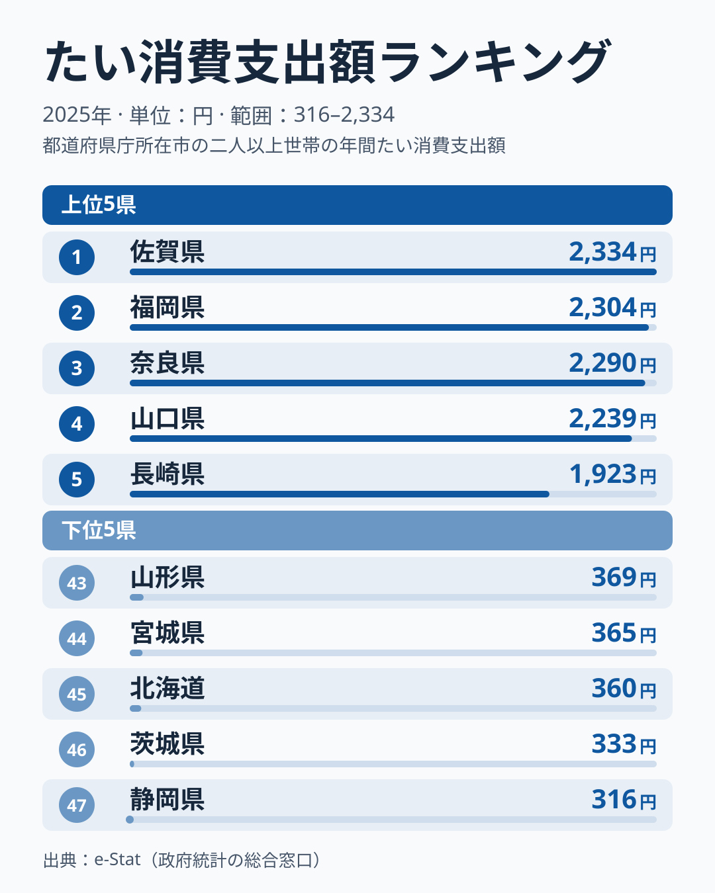
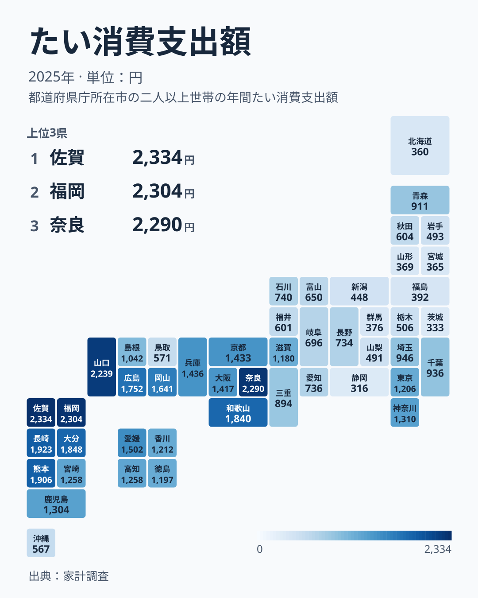

「腐っても鯛」という言葉があるほど、たいは日本人にとって特別な魚です。しかし家計調査のデータを見ると、その特別さを実感できるかどうかは住む県によって大きく違うことがわかります。

総務省家計調査（品目別）によると、2025年の都道府県庁所在市におけるたい消費支出額は、1位の佐賀県が2334円、最下位の静岡県が316円で、その差はおよそ7倍に達します。同じ日本の食卓でも、たいがどれだけ身近かはまったく違うのです。

上位10県は九州・中国・近畿の県で占められ、確かに西日本に偏っています。ただし西日本の中でも、鹿児島県や島根県、鳥取県、沖縄県は上位に入りません。この記事では、データから言えるのは偏りの存在とその形までで、理由は仮説にとどまることをはっきりさせた上で、上位県と下位県の地理的パターンを読み解きます。あわせて、2024年に1位だった兵庫県が2025年には12位に下がった事実から、市別の家計調査を単年で読むときの注意点も整理します。

> [!NOTE]
> 本データは総務省「家計調査（品目別）」の都道府県庁所在市・二人以上世帯を対象にした年間支出額です。県全体ではなく県庁所在市（例: 佐賀県なら佐賀市）のみの調査である点に注意してください。

## 上位県と下位県

<source-link href="/ranking/sea-bream-consumption-expenditure">たい消費支出額ランキングをもっと見る</source-link>

1位は[佐賀県](/areas/41000)の2334円、2位は福岡県の2304円、3位は奈良県の2290円です。上位10県を並べると、佐賀・福岡・奈良・山口・長崎・熊本・大分・和歌山・広島・岡山で、九州が5県、中国が3県（山口・広島・岡山）、近畿が2県（奈良・和歌山）を占めます。四国の最上位は11位の愛媛県で、関東や東北の県は上位10県に一つも入っていません。

> [!TIP]
> 1位の佐賀県から3位の奈良県までは44円しか離れていません。上位3県の順位そのものより、「2200円台を超える4県」という上位グループとして読むほうが、市別の標本の揺れに左右されません。

地図に置き直すと、色の濃い県が九州北部から山口、瀬戸内の西側にかたまり、紀伊半島の奈良・和歌山に飛び地のように続く形が見えます。一方で関東から東北、北海道にかけては全体に淡く、新潟・福島・群馬・山形も40位台に並びます。西日本は一様に濃いわけではなく、濃淡の差がかなり大きい地図です。

この偏りは、たいが古くから「祝いの魚」として西日本の食文化に組み込まれてきたことと整合します。関西では出産後の「お食い初め」や結婚式の引き出物にたいの尾頭付きを用いる習慣が根強く残っており、日常の献立というより「ハレの日」の食材として消費されてきたとされます。奈良県が3位に入っているのも、海に面していない内陸県でありながら祝い事の食文化が消費を押し上げているためと考えられます（[仮説]。この点は家計調査だけでは検証できず、祝い事向けの購入比率が分かる調査が必要です）。

もう一つ考えられる要因が産地の近さです。九州から瀬戸内海にかけては天然真鯛の漁場や養殖マダイの産地が広がっており、地元で獲れる・育てられるたいがそのまま地元の食卓に上りやすい地産地消的な構造があると考えられます（[仮説]。県庁所在市ごとの購入先や流通量との突き合わせは行っていません）。

## 「西日本」では括れない例外

題にある「西日本の偏り」を、そのまま一般化することはできません。西日本の中にも上位に入らない地域がはっきり残っています。

- 南九州と沖縄では、鹿児島県が1304円で16位、宮崎県が1258円で高知県と並ぶ17位、沖縄県は567円で36位です。同じ九州でも、北部の佐賀・福岡との差は大きく開いています
- 山陰では、島根県が1042円で23位、鳥取県は571円で35位にとどまります。同じ中国地方でも、山口・広島・岡山の上位3県とは水準が違います
- 四国では、愛媛県の11位1502円に対し、高知県が17位1258円、香川県が19位1212円、徳島県が21位1197円で、いずれも1200円前後に集まっています
- 京阪神では、兵庫県が12位1436円、京都府が13位1433円、大阪府が14位1417円で、1400円台の中位に並びます

関西ではたいを祝い事に使う習慣が根強いとされますが、京都・大阪・兵庫がそろって上位10県の外にあることは、「祝いの魚の文化があるから多い」という説明だけでは足りないことを示しています。南九州や山陰、四国、京阪神がなぜ中位以下なのかは、データだけでは分かりません。県庁所在市の家計の購入先や、祝い事向けの購入比率が分かる調査と突き合わせて検証する必要があります（いずれも[仮説]の段階です）。

産地の近さについても同じです。愛媛県は養殖マダイの代表的な産地として知られながら、支出額は1502円で11位にとどまり、同じく養殖マダイの産地として知られる三重県は894円で27位と中位です。「産地だから多い」とは単純に言えず、産地の近さは偏りの一部しか説明しません。

## 下位グループの特徴

下位を見ると、最下位の静岡県316円に、茨城県333円、北海道360円、宮城県365円、山形県369円が続きます。静岡県は中部、茨城県は関東、宮城県・山形県は東北にあたり、北海道を含めて東側の地域が目立ちます。さらに42位の群馬県376円、41位の福島県392円、40位の新潟県448円も下位に並びます。

最下位の[静岡県](/areas/22000)は、駿河湾に面した海の県であり、内陸だから低いという説明は当てはまりません。ここでは、たい以外のまぐろ・かつお・しらすなど身近な魚介が食卓の中心にあり、たいを選ぶ機会が相対的に少ないのではないかと考えられます（[仮説]。魚種別の支出構成を静岡市の家計調査で並べれば検証できます）。

北海道はサケ・ホタテ・カニなど独自の海産物文化が強く根付いており、たいを積極的に選ぶ必然性が薄いと考えられます。宮城県・山形県・茨城県も、地元で水揚げされる別の魚種や、日常的に手に入りやすい魚が食卓の主役になりやすい地域です（いずれも[仮説]）。「祝いの魚」という位置づけが薄い地域では、そもそも購入する機会自体が少ない、という見方もできます。

## 魚種が変わると強い県も入れ替わる

たいの順位を別の魚介と並べると、下位に沈む県が別の魚では上位に来ることが分かります。同じ2025年の家計調査で見ると、かつおでは茨城県が3226円で2位、静岡県が1989円で8位です。たいでは茨城県が46位、静岡県が47位でした。逆に、たいで1位の佐賀県は、かつおでは676円で47位です。

瀬戸内も同じです。広島県はたいで9位、かきでは1485円で1位、岡山県はたいで10位、かきでは1247円で2位と、瀬戸内の県はたいでもかきでも上位に入ります。一方で奈良県はたいで3位、かきでは898円で8位と、たいほどの突出はありません。

家計が魚に使う金額が、西から東へなだらかに変わるのではなく、魚種ごとに強い県が入れ替わっていることが分かります。かつおは太平洋側、かきは瀬戸内と三陸というように、面する海との結びつきで分かれることは、[かつお・かき消費の地域差](/blog/bonito-vs-oyster-fish-map)で詳しく見ています。あわせて見る: [かつお消費支出額ランキング](/ranking/bonito-consumption-expenditure) / [かき消費支出額ランキング](/ranking/oyster-consumption-expenditure)

## 兵庫県は2024年の首位から12位へ動いた

市別の家計調査は、単年のぶれが大きいという性質があります。同じ指標（ranking_key は sea-bream-consumption-expenditure）の2024年分では、兵庫県（神戸市）が2524円で全国首位でしたが、2025年は1436円で12位に下がりました。1年で1088円、金額にして4割以上の落ち込みです。

この変動の理由は、今回のデータからは特定できません。ただ、市別の家計調査は二人以上世帯の限られた標本から作られるため、標本の入れ替わりだけでも大きく動きうるという一般的な性質があります（兵庫県の変動がそれで説明できるかは[仮説]で、年ごとの標本の内訳が分かる資料で検証が必要です）。単年の順位だけで「この県が日本一」と断定するのは危険です。

> [!WARNING]
> 本データは支出「額」であり、消費「量」とは異なります。価格が高い地域ほど支出額が押し上げられる可能性があるため、量ベースの地域差とは一致しない場合がある点に注意してください。また、調査対象は県庁所在市の標本で、1位の入れ替わりが起きやすい点も前提にしてください。

## まとめ

- 1位は佐賀県で2334円、最下位は静岡県で316円と、約7倍の差
- 上位10県は九州5県・中国3県・近畿2県（奈良・和歌山）で、関東・東北は一つも入らない
- ただし西日本でも、鹿児島・宮崎・島根・鳥取・沖縄と京阪神は上位10県の外で、偏りは北部九州から山口、瀬戸内西部、紀伊半島に絞られる
- 背景には「祝いの魚」としての食文化と産地の近さがあると考えられるが、いずれも[仮説]で、データだけでは検証できない
- 下位県は静岡・茨城・北海道・宮城・山形で、かつおなど別の魚介が強い県が目立つ
- 2024年に1位だった兵庫県は2025年に12位となり、市別の単年の順位はぶれが大きい

家計消費の地域差は他の品目にも見られます。合わせて[経済カテゴリの他ランキング](/category/economy)も確認してみてください。

## データについて

総務省統計局「家計調査（品目別）」（都道府県庁所在市・二人以上世帯、2025年）を基に作成。e-Stat（政府統計の総合窓口）経由で取得したデータを集計しています。2024年の兵庫県の2524円と全国首位という順位は同じ指標の2024年分、かつお・かきの2025年の順位と金額は各ランキングの2025年分を参照しました。
