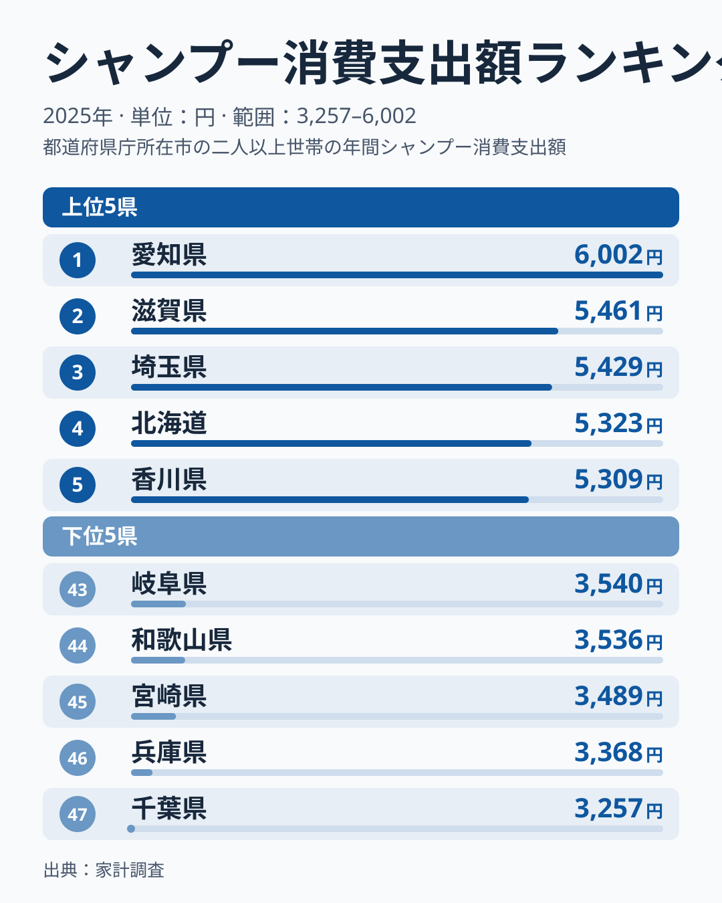
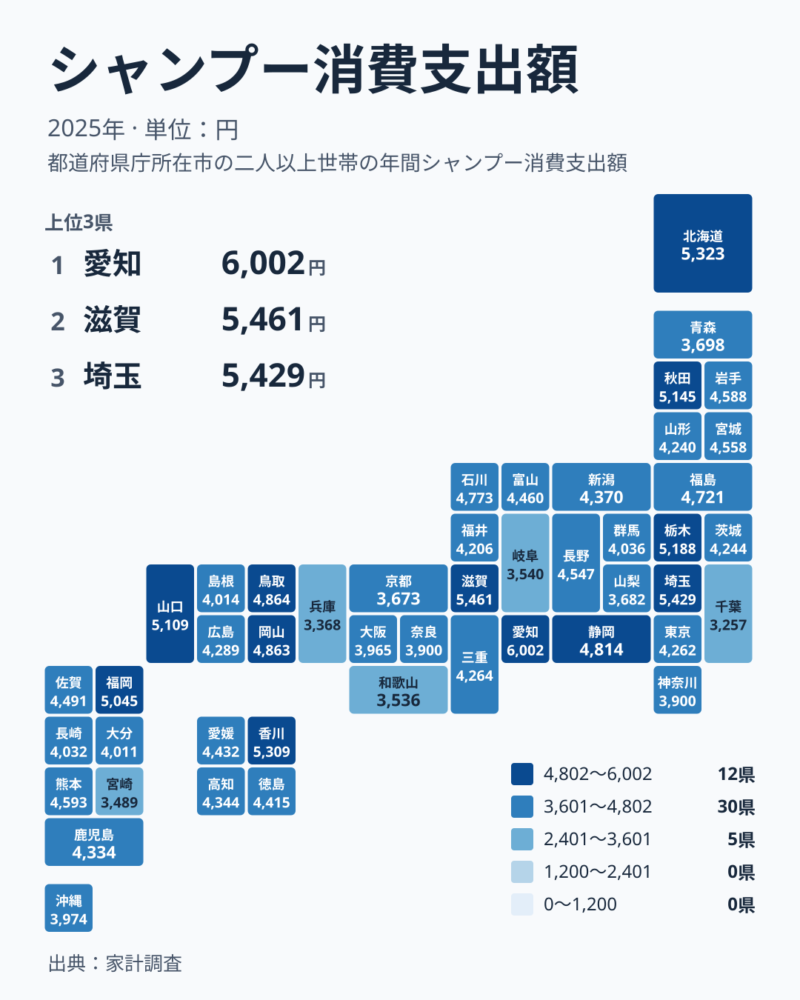

毎日の入浴で使うシャンプーは、どの家庭にもある身近な日用品です。ところが家計調査の2025年の結果を見ると、1世帯あたりのシャンプーへの支出は、都道府県によって大きく違います。1位は愛知県の6,002円で、47位は千葉県の3,257円です。この記事では、数字の並びから見えてくる地域の傾向を、大都市圏や地方内のばらつきという別の切り口で分けて確かめ、数字を自分の暮らしに引き寄せて読むための手がかりをまとめます。

## 先頭は愛知県、続くのは滋賀県と埼玉県

まず上位と下位の顔ぶれを確認します。次の図は、支出の多い5県と少ない5県を並べたものです。

<source-link href="/ranking/shampoo-consumption-expenditure">シャンプーへの支出ランキングをもっと見る</source-link>

1位は[愛知県](/areas/23000)で6,002円です。2位は[滋賀県](/areas/25000)の5,461円、3位は埼玉県の5,429円、4位は北海道の5,323円、5位は香川県の5,309円と続きます。1位と2位の間には開きがありますが、2位から5位までは5,461円から5,309円の範囲に収まっていて、ほぼ横並びです。愛知県が頭ひとつ抜けた首位であることが、図からも読み取れます。

下位には千葉県の3,257円が47位として入ります。46位は兵庫県の3,368円、45位は宮崎県の3,489円、44位は和歌山県の3,536円、43位は岐阜県の3,540円です。実データにある最大と最小を比べると、1位の愛知県は47位の千葉県の約1.8倍にあたります。同じ日本で、同じようにシャンプーを使っていても、家計簿に記録される金額にはこれだけの開きがあります。

上位5県を地方別に見ると、中部の愛知県、近畿の滋賀県、関東の埼玉県、北海道・東北の北海道、四国の香川県と、5県がすべて別の地方から入っています。下位5県は、関東の千葉県、近畿の兵庫県と和歌山県、九州・沖縄の宮崎県、中部の岐阜県です。こちらも地方はばらばらで、「この地方は高い」「この地方は低い」と単純には言い切れません。

> [!NOTE]
> ここでの支出額は、1世帯が1年間にシャンプーの購入に支払った金額です。使用量そのものではなく、購入量と価格の両方を反映した結果です。家計調査は都道府県庁所在市などを単位に集計されるため、県全体の平均というより、県の中心となる都市の家計を映した数字として読むのが安全です。

## 地図で見ると、高い県は特定の地方に固まらない

次に、全国での分布を地図で確かめます。

色の濃淡を眺めても、東日本と西日本のように、はっきり二分されるわけではありません。6位の栃木県は5,188円、7位の秋田県は5,145円、8位の山口県は5,109円、9位の福岡県は5,045円です。関東、北海道・東北、中国、九州・沖縄の県が、上位の中に入り混じっています。

一方で、下位側にも近畿、九州・沖縄、中部、関東の県が混ざっています。寒冷な地域も温暖な地域も、上位と下位の両方に顔を出しているため、気候や地方といった大きな枠組みだけでは、この差は説明しにくいといえます。背景には、世帯の構成や購入先、買い方の違いなどが重なっている可能性がありますが、今回のデータだけでは原因を特定できません。

> [!WARNING]
> 家計調査は標本調査であり、1県あたりの調査世帯数は限られています。順位が近い県どうしの差は、調査のぶれの範囲に収まる可能性があります。たとえば27位の三重県は4,264円、28位の東京都は4,262円で、ほとんど変わりません。1つの順位の違いに大きな意味を持たせすぎないでください。

## 大都市圏は意外と中位から下位に並ぶ

ここで、内訳を別の切り口で分けてみます。人口の多い大都市圏の県に注目します。人口が多く、美容院やドラッグストアも多い地域ほど、シャンプーへの支出も大きいと思われがちです。

実際はどうでしょうか。東京都は4,262円で28位、大阪府は3,965円で37位、神奈川県は3,900円で38位です。京都府は3,673円で42位、兵庫県は3,368円で46位、千葉県は3,257円で47位でした。大都市圏の県の多くは、上位ではなく中位から下位に集まっています。例外は、1位の愛知県と3位の埼玉県です。

この結果から、人口の集中や店舗の多さが、そのままシャンプーへの支出を押し上げるわけではないことがわかります。理由としては、都市部では美容院でシャンプーを使う機会が多く、家庭で買う分が少なくなる、あるいは安く買える店が多く、同じ量でも支出が小さくなるといった仮説が考えられます。ただし、いずれも今回のデータから確かめられる話ではありません。

家計調査の支出額は購入量と価格の結果なので、どちらの要因が効いているのかは、この数字だけでは切り分けられません。ここでは、都市の規模と支出の多さが単純には比例しない、という事実だけを押さえておきます。

> [!TIP]
> 支出額が高い県を見るときは、「高価な商品を選ぶ」のか「たくさん買う」のか、「買い置きが多い」のかを分けて考えると、読み違えにくくなります。同じ金額でも、中身がまったく違う場合があります。金額の差を、そのまま「ケアへの熱心さ」の差と読まないことが大切です。

## 同じ地方でも順位は大きく開く

地方単位の印象がどこまで当てはまるのかも確かめます。中国地方では、山口県が8位の5,109円、鳥取県が10位の4,864円、岡山県が11位の4,863円と上位に並びます。ところが広島県は26位の4,289円、島根県は34位の4,014円です。同じ地方の中で、8位から34位まで広がっています。

四国も同じです。香川県は5位の5,309円ですが、愛媛県は21位の4,432円、徳島県は22位の4,415円、高知県は24位の4,344円です。香川県だけが上位に入り、残る3県は中位に位置しています。近畿でも、2位の滋賀県と46位の兵庫県、44位の和歌山県が同じ地方に含まれます。

こうした並びを見ると、「◯◯地方だから多い」「◯◯地方だから少ない」という見方は、あまり当てになりません。県ごと、さらに言えば世帯ごとの事情が、数字の差を生んでいると考えるのが妥当です。

## 暮らしへの含意:自分の県の位置を知る

ここからは、読者の暮らしに引き寄せて考えます。まず、お住まいの県の金額と順位を確かめてみてください。たとえば宮城県は4,558円で17位、長野県は4,547円で18位、静岡県は4,814円で12位です。全体の47県を並べると、4,000円台の県が中心になります。

このとき注意したいのは、順位が高いか低いかを、良し悪しの判断に直結させないことです。支出の多さは、髪や頭皮の状態に合わせた製品選びや、家族の人数、購入頻度など、さまざまな事情の表れかもしれません。逆に少ない県でも、まとめて買う習慣や価格の安い店の利用などが背景にある可能性があります。いずれもデータから確かめられるわけではないので、あくまで読み解くときの視点として持っておいてください。

自分の家計の金額を、全国の並びの中に置いてみることには意味があります。上位の愛知県の6,002円も、下位の千葉県の3,257円も、同じ調査の中の数字です。自分の世帯の支出が、どのあたりに位置するのかを知ることが、家計の特徴を理解する第一歩になります。

家計全体を見渡すには、ほかの費目との比較も有効です。[同じカテゴリの統計一覧](/category/economy)では、さまざまな支出項目を確認できます。シャンプーだけでなく、他の日用品や食料品との並びで見ると、自分の県の家計の特徴がより立体的に見えてきます。たとえば[愛知県のデータ](/areas/23000)や[滋賀県のデータ](/areas/25000)からは、ほかの統計も確認できます。

## 数字を読むときの注意点

最後に、この指標の読み方を整理します。

- 1年分のデータだけでは、傾向が続くものなのか、偶然の揺れなのかを判断できません。
- 県名で単純に括るのではなく、世帯の構成や購入先といった背景を想像しながら読むことが重要です。
- 順位が近い県どうしは、実質的に同水準とみなすほうが安全です。

それでも、全国の47県を並べたときに、1位の愛知県と47位の千葉県で約1.8倍の開きがあるという事実は変わりません。身近な日用品の支出でさえ、地域によって違いが表れます。自分の県の位置を確かめたうえで、気になる県の詳細を見てみてください。

## データについて

この記事で扱った指標は、家計調査の「シャンプー消費支出額」です。2025年の結果を使っており、単位は円です。1世帯が1年間にシャンプーへ支出した金額にあたり、都道府県ごとの順位は、この金額の大きい順に並べています。記事中の数値と順位は、すべてこの調査結果にもとづいています。
