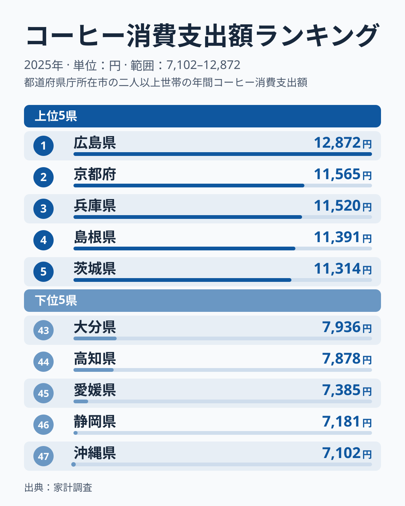
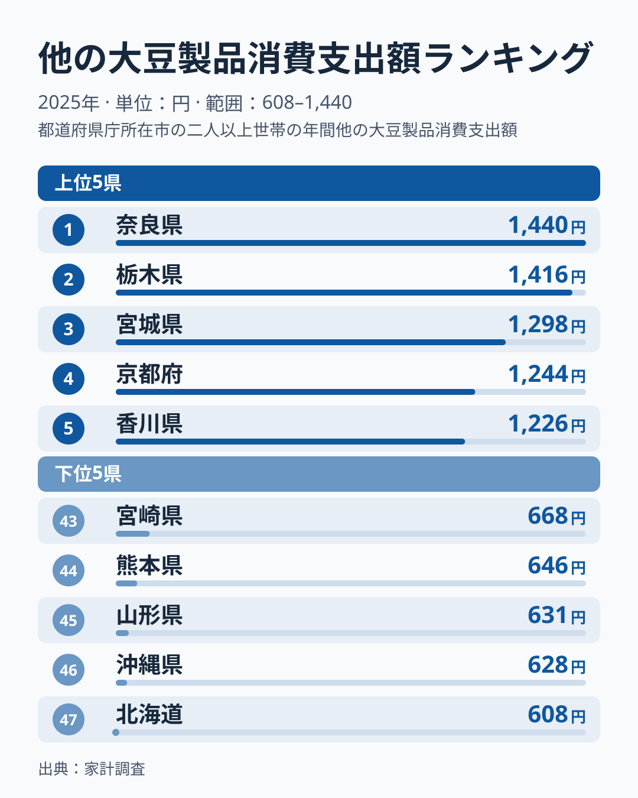
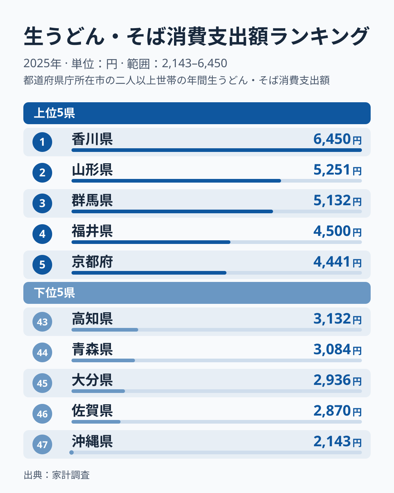
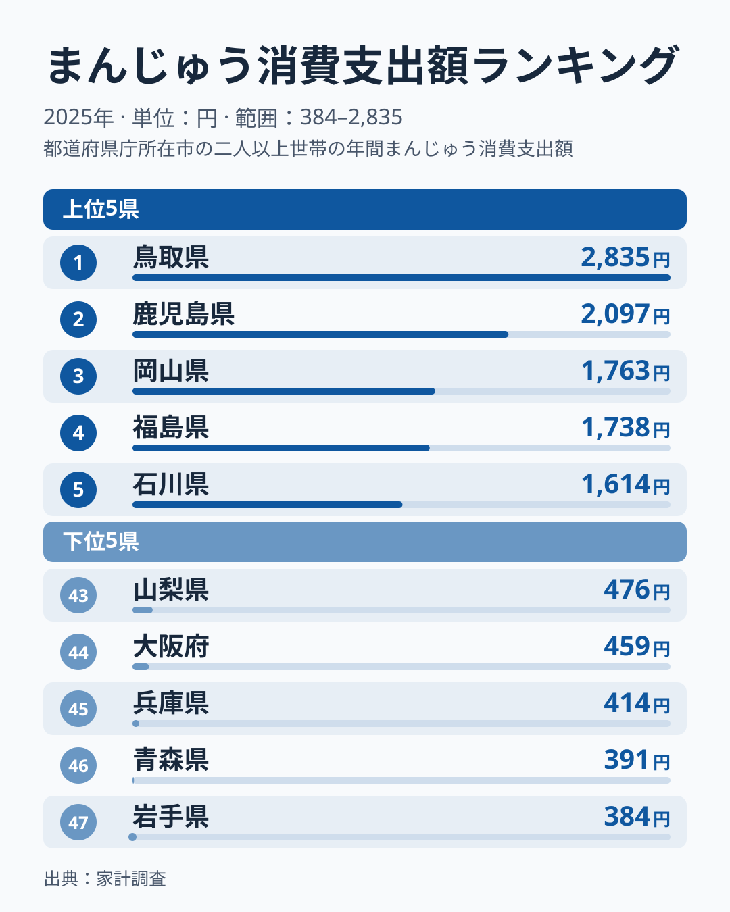
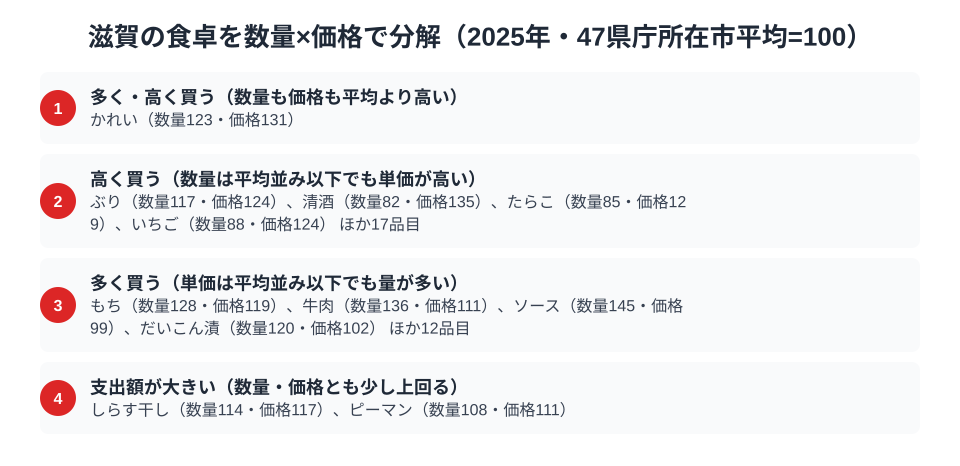

滋賀県というと近江牛や琵琶湖の魚介を思い浮かべる人が多いかもしれません。ところが総務省の家計調査（品目別）2025年で滋賀県（県庁所在市・大津市）の支出額を都道府県庁所在市ごとに比べると、上位に入ったのは肉でも魚でもなく、コーヒーでした。

コーヒー消費支出額は全国7位の11,069円です。他の大豆製品（豆腐・油揚げ・厚揚げなど）は21位の1,007円、生うどん・そばは15位の4,001円とほぼ中位で、まんじゅうは41位の618円まで下がります。この記事では家計調査の実データから、滋賀の食卓のどこが上位で、どこが中位や下位なのかを探ります。さらに数量と価格に分解できる品目では、支出額のランキングに出てこない品目も見ていきます。

> [!NOTE]
> ここでいう「滋賀」の数値は、総務省統計局「家計調査（品目別）」における都道府県庁所在市（大津市）の二人以上世帯の年間支出額です。県全体の平均ではなく大津市の世帯を対象にした調査である点に注意してください。

## コーヒー消費支出額 — 全国7位11,069円、上位は僅差

<source-link href="/ranking/coffee-consumption-expenditure">コーヒー消費支出額ランキングをもっと見る</source-link>

コーヒー消費支出額は広島県が全国1位の12,872円で、2位は京都府の11,565円、3位は兵庫県の11,520円です。滋賀県は全国7位の11,069円で、5位の茨城県11,314円との差は245円しかありません。1位から8位の長野県11,024円までが11,000円前後に並んでおり、この水準では順位が1つ動くだけの差は小さく、7位という位置は「上位の集団に入っている」と読むのが妥当です。最下位は沖縄県で47位の7,102円で、コーヒー消費には明確な地域差があることがわかります。

支出額の上位には京都府と兵庫県も入っており、滋賀県と同じ近畿の府県が3つ並んでいます（図を参照）。[仮説] 近畿の中で生活圏が近いことが似た消費の傾向につながっている可能性がありますが、家庭内のコーヒー消費の理由を示す資料は今回確認しておらず、単年の市別の値はぶれが大きいため、構造の断定はできません。

## 他の大豆製品消費支出額 — 全国21位1,007円、近畿の中では目立たない

<source-link href="/ranking/other-soy-products-consumption-expenditure">他の大豆製品消費支出額ランキングをもっと見る</source-link>

滋賀県は他の大豆製品（豆腐・油揚げ・厚揚げなど、豆腐そのものを除く大豆加工品）で全国21位の1,007円でした。1位は奈良県の1,440円、2位は栃木県の1,416円、3位は宮城県の1,298円で、4位に京都府の1,244円が入ります。滋賀県は1位の奈良県より433円低くなっています。最下位は北海道で47位の608円です。

近畿の隣県を見ると、奈良県が1位、京都府が4位、兵庫県が6位の1,204円、大阪府が9位の1,173円と上位に並び、滋賀県の21位はそれらから離れています。[仮説] 精進料理や寺院の食文化が根付いた近畿の大豆製品の習慣は、大津市の世帯では2025年の家計調査に強く表れなかった可能性があります。ただしこの品目は単年の値のぶれが大きいため、滋賀の大豆製品が弱いとも強いとも、1年分の数字だけでは言い切れません。

## 生うどん・そば消費支出額 — 全国15位4,001円、中位に位置

<source-link href="/ranking/fresh-udon-soba-consumption-expenditure">生うどん・そば消費支出額ランキングをもっと見る</source-link>

生うどん・そばの消費支出額で滋賀県は全国15位の4,001円でした。首位は香川県の6,450円で、2位の山形県5,251円、3位の群馬県5,132円を大きく引き離しています。4位は福井県の4,500円、5位は京都府の4,441円で、4位から14位の東京都4,022円までは4,000円台前後に密集しており、滋賀県はその少し下の中位です。最下位の沖縄県は47位の2,143円です。

近畿では京都府が5位に入る一方、滋賀県は中位にとどまっており、麺どころが近い立地が直接の押し上げ要因になっているとまでは言えません。この品目は数量の統計を使った分解の対象に入っていないため、量が多いのか単価が高いのかは、この記事のデータでは判断できません。

## まんじゅう消費支出額 — 全国41位618円、下位にとどまる

<source-link href="/ranking/manju-consumption-expenditure">まんじゅう消費支出額ランキングをもっと見る</source-link>

一方でまんじゅうの消費支出額を見ると、滋賀県は全国41位の618円にとどまります。首位は鳥取県で全国1位の2,835円です。2位は鹿児島県の2,097円、3位は岡山県の1,763円と続きます。最下位は岩手県で47位の384円です。近江地方には「うばがもち」「姥ヶ餅」のような伝統和菓子もありますが、家計調査の「まんじゅう」という品目区分そのものへの支出は全国的に見て低調でした。

これは滋賀に和菓子文化がないことを意味するわけではなく、「まんじゅう」という特定の品目区分に支出が集まっていないだけの可能性もあります。ただし、ほかの和菓子に支出が分散しているかどうかを裏づけるデータは、この記事にはありません。[仮説] 京都の和菓子文化の影響が強い近畿圏では、まんじゅう以外の和菓子に支出が向いている可能性がありますが、検証には品目の中身を細かく分けた統計が必要です。

> [!WARNING]
> まんじゅうと他の大豆製品は、数量の統計が家計調査にないため、数量と価格への分解ができません。つまり、まんじゅう41位や大豆製品21位が「買う量が少ない」ことによるのか「単価が低い」ことによるのか、このページのデータでは判断できません。生うどん・そばも同様に分解の対象外で、支出額の順位から食文化の強弱を読み取るには限界があります。

## 滋賀の食卓で目立ったのはコーヒーだけではない

2025年の大津市で支出額の順位が高かったのはコーヒーで、7位でした。他の大豆製品は21位、生うどん・そばは15位と中位にとどまり、まんじゅうは41位と下位でした。支出額の4品目だけを見れば、上位に入ったのはコーヒーのみです。

ただし、数量と価格に分解できる品目まで広げると、次の節で見るとおり、かれい、ぶり、牛肉、もち、ソースなど、平均を大きく上回る品目が他にも多くあります。支出額の4品目では見えなかった偏りが、品目を広げると現れるということです。

麺類の比較では、[福井県民の食卓](/blog/fukui-food-culture)も参考になります。福井県は中部、滋賀県は近畿に区分される別の地方ですが、2025年の生うどん・そば消費支出額で福井県は4位、滋賀県は15位と開きがあり、並べて読むと品目ごとの地域差が見えてきます。

> [!TIP]
> 家計調査の市別の値は標本が小さく、単年で順位が大きく動きます。1年分の順位から食文化を断定せず、数年にわたって上位が続く品目を探すのが安全な読み方です。

## 数量×価格で分解する大津市の食卓

<source-link href="/ranking/coffee-consumption-quantity">コーヒー消費量ランキングをもっと見る</source-link>

ここまで見てきた支出額のランキングだけでは、滋賀県が「たくさん食べている」のか「単価の高いものを買っている」のかまでは分かりません。家計調査には支出額だけでなく数量を集計している品目もあり、両方をそろえると支出額を数量と価格の掛け算に分解できます。47都道府県庁所在市の平均をそれぞれ100として品目ごとに数量指数と価格指数を出すと、滋賀の食卓がどちらの理由で膨らんでいるのかが見えてきます。上の図は、指数が平均を上回る品目を4区分にまとめたものです。

図の区分は、数量指数と価格指数のどちらが平均を大きく上回るかで分かれています。ここでは、図の区分に従って各品目を次のように置きます。

- 数量も価格も平均を上回る区分：かれい（数量指数123・価格指数131）
- 価格の高さが目立つ区分：ぶり（数量指数117・価格指数124）、清酒（数量指数82・価格指数135）、たらこ（数量指数85・価格指数129）、いちご（数量指数88・価格指数124）など
- 数量の多さが目立つ区分：もち（数量指数128・価格指数119）、牛肉（数量指数136・価格指数111）、ソース（数量指数145・価格指数99）、だいこん漬（数量指数120・価格指数102）など

ぶり、もち、牛肉は、数量指数・価格指数のどちらも100を超えています。そのため、どちらか一方だけで支出額が決まるわけではなく、図の区分は「どちらの指数がより目立つか」で分けたものと読む必要があります。かれいは数量指数も価格指数も他の品目より際立って高く、この区分に置かれています。

清酒、たらこ、いちごのように、量は少なくても単価が高い品目は、支出額の背景が量ではなく価格にあります。一方、ソースやだいこん漬のように、価格がほぼ平均並みで数量が多い品目は、購入量が支出額を支えています。このほか、しらす干し（数量指数114・価格指数117）とピーマン（数量指数108・価格指数111）は、数量・価格とも平均を少し上回る形で支出額が大きくなっています。[仮説] 琵琶湖周辺の食習慣が量の多さに表れている品目もあると考えられますが、各品目の背景を示す一次資料は今回確認していません。

支出額の順位だけを見ると「その品目が好きな県」のように見えますが、数量指数と価格指数に分けると理由が変わります。同じ「支出額が大きい」でも、量が支えているのか単価が支えているのかで背景は違います。

> [!NOTE]
> ここでの数量指数・価格指数は「47都道府県庁所在市の単純平均＝100」を基準にした相対値で、家計調査の全国値とは一致しません。また価格指数は支出額を数量で割って逆算した値なので、同じ品目でも高いブランドや品種を選んでいる場合も指数を押し上げます。純粋な店頭価格の違いだけを表すわけではない点に注意してください。他の大豆製品やまんじゅうは支出額の統計はあっても数量の統計が家計調査に無いため、この分解の対象外です。二人以上世帯・大津市の年間集計という前提は、記事全体の他の数値と共通です。

## まとめ

- コーヒーは消費支出額が全国7位11,069円（1位広島県12,872円）で、上位は僅差
- 他の大豆製品（豆腐・油揚げ等）は全国21位1,007円（1位奈良県1,440円）
- 生うどん・そばは全国15位4,001円（1位香川県6,450円）
- まんじゅうは全国41位618円と下位。量が少ないのか単価が低いのかは、数量の統計がなく判断できない
- 数量×価格に分解すると、かれい、ぶり、牛肉、もち、ソースなど、支出額の4品目以外にも平均を上回る品目が多い

滋賀県の地域プロフィールは[滋賀県のページ](/areas/25000)、家計・所得に関する他の指標は[経済カテゴリ一覧](/category/economy)で確認できます。
