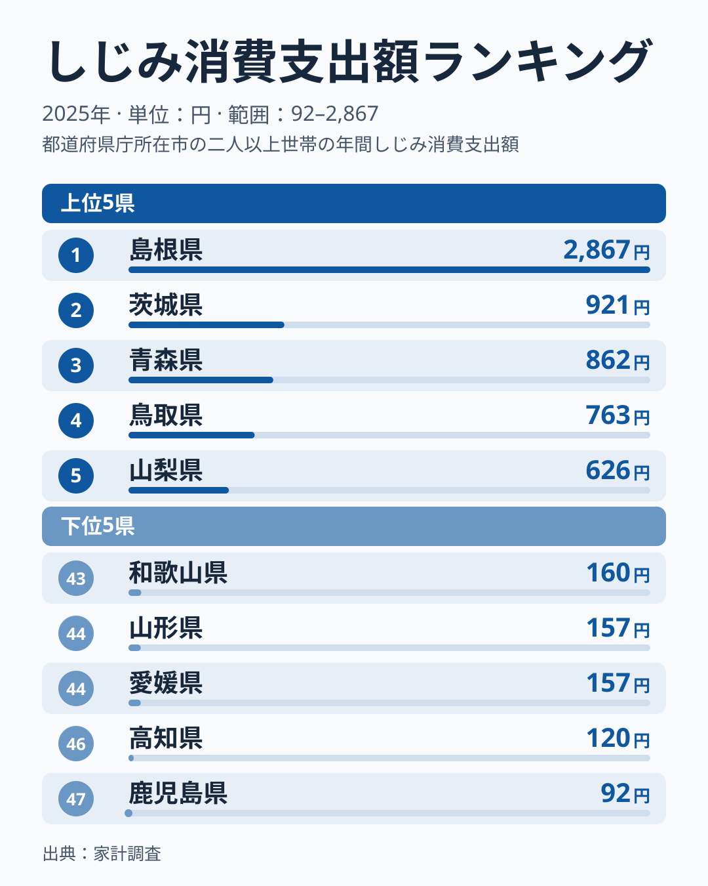
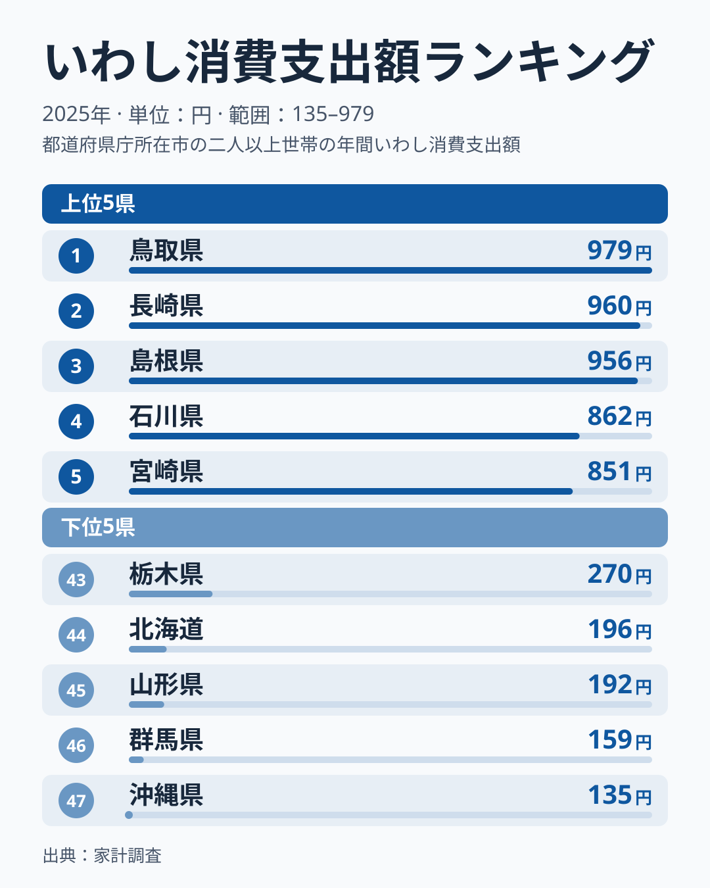
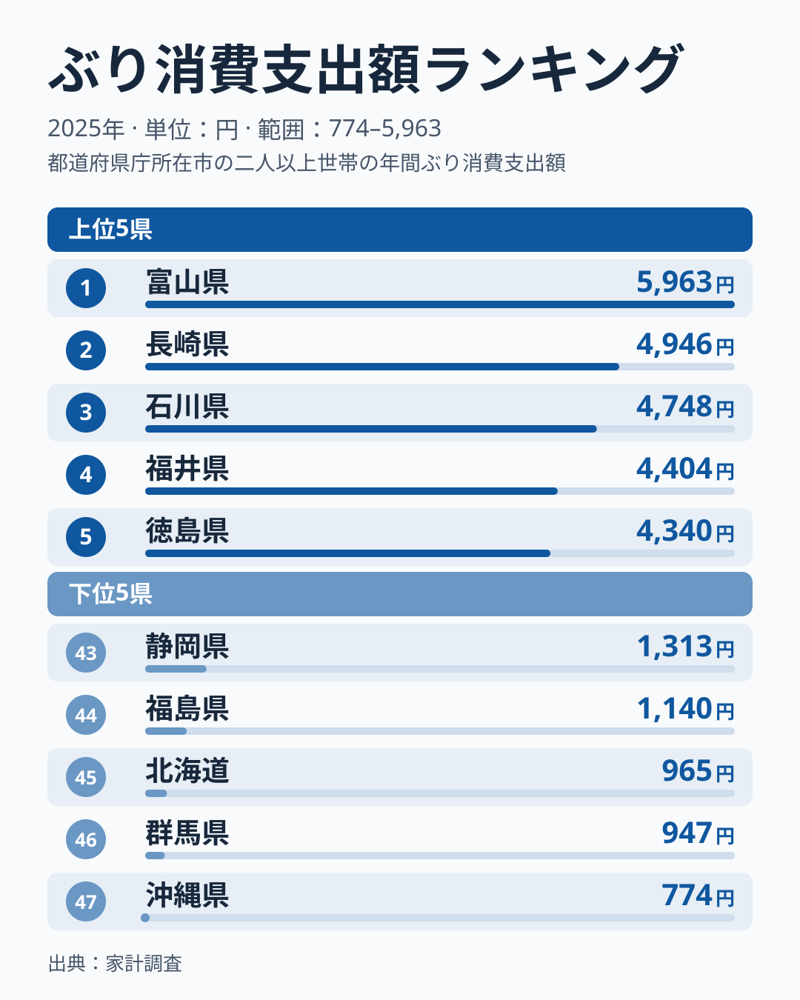
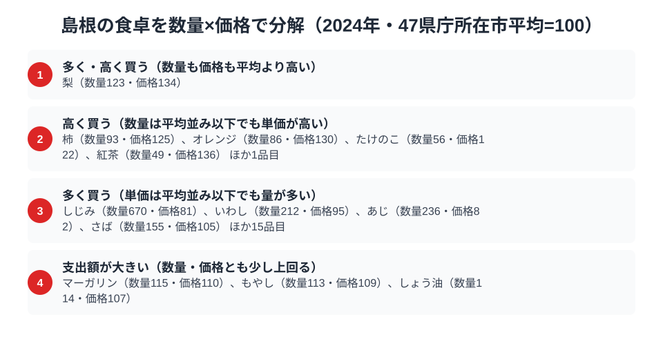

島根県の食卓を家計調査の数字でのぞくと、水産物の存在感が見えてきます。宍道湖のしじみ、日本海のいわし、そしてぶり。しじみは全国1位、いわしは3位、ぶりは11位で、島根の家庭の食卓に水産物が並んでいる様子が数字から浮かび上がります。

しじみの消費支出額は2867円で、2位の茨城県921円の約3.1倍です。なぜここまで差がつくのでしょうか。数量と価格に分けると、答えの輪郭が見えます。しじみは買う量が47県庁所在市の平均の約10倍で、単価は平均より安く、松江市の食卓は「安い貝を大量に買う」形になっています。総務省「家計調査」の品目別データから、しじみ・いわし・ぶりの順位を確かめたうえで、貝類やあじ、梨、いかとの対比まで読み進めます。

> [!NOTE]
> 本記事の数値は総務省統計局「家計調査（品目別支出額）」2025年、都道府県庁所在市（島根県は松江市）の二人以上世帯における年間値です。県全体の値ではありません。

## しじみ — 全国1位2867円、宍道湖の恵みが圧倒的

<source-link href="/ranking/freshwater-clam-consumption-expenditure">しじみ消費支出額ランキングをもっと見る</source-link>

島根県のしじみ消費支出額は年間2867円で全国1位です。茨城県は921円で、島根はその約3.1倍です。3位の青森県は862円で、島根は頭ひとつ抜けています。最下位の鹿児島県は92円で、1位との間には約31倍という開きがあり、しじみが島根の食卓に定着していることが数字にはっきり表れています。

この差を生んでいるのは、単価の高さではなく買う量の多さです。数量指数は974、価格指数は73で、松江市の家庭は平均より安い単価のしじみを、平均の約10倍の量で買っています(指数の意味は最後の節で説明します)。島根には汽水湖の宍道湖があり、地元で採れるしじみが身近だから量が増える、というのは [仮説] ですが、数量と価格の分解は「高級品として買っている」のではなく「日常の食材として大量に買っている」ことを示しています。

## いわし — 全国3位956円、1位と3位は中国地方の2県

<source-link href="/ranking/sardine-consumption-expenditure">いわし消費支出額ランキングをもっと見る</source-link>

いわし消費支出額では、島根県は956円で全国3位につけています。首位は鳥取県で979円、間に2位の長崎県が960円で入る接戦です。1位と3位が中国地方の2県で、その間に長崎県が入る形です。最下位の沖縄県は135円です。

上位3つの差は979円・960円・956円とわずか23円で、順位だけでは差が読み取れない僅差です。ここでも決め手は量で、島根のいわしは数量指数220、価格指数91と、単価は平均並みよりやや安く、買う量が平均の2.2倍あります。家計調査の市別の値は年ごとのぶれも大きいため、順位の入れ替わりより、「量で支出額を押し上げている」という内訳に注目してください。

## ぶり — 全国11位3641円、上位の一歩手前

<source-link href="/ranking/yellowtail-consumption-expenditure">ぶり消費支出額ランキングをもっと見る</source-link>

ぶり消費支出額は3641円で全国11位です。首位は富山県で5963円、2位の長崎県は4946円、3位の石川県は4748円、4位の福井県は4404円で、いずれにも届きません。最下位の沖縄県は774円です。

首位の富山ほど突出してはいませんが、島根の3641円は10位の山口県3762円に近い水準で、ぶりが食卓へ上る県であることは確かです。順位は11位で、上位の一歩手前にとどまります。しじみ・いわしが「量で稼ぐ」のに対し、ぶりは数量指数114、価格指数115と、量も単価も平均を少し上回って積み上がる品目です。同じ水産物でも、支出額の積み上がり方は品目によって違います。

## しじみだけではない、貝類・あじも「量」で突出

数量×価格の分解を対象の138品目に広げると、しじみだけが特別ではないことがわかります。「多く買う(単価は平均並み以下でも量が多い)」に分類された品目のうち、しじみの数量指数974に次いで高いのは貝類全体の338で、価格指数は64と全体の中でも安い側です。しじみ単独の突出に加えて、貝類というくくりでも平均の3倍以上の量を買っていることになります。あじも数量指数236、価格指数91で、いわし(数量指数220・価格指数91)とほぼ同じ形です。

つまり島根の食卓は、「しじみが特別に好まれている」という単独の話ではなく、安価な貝類や小型の青魚を日常的に大量に買う傾向として読めます。これは数量指数と価格指数という実データから言える範囲の結論です。一方で、なぜそうなるのかという理由、たとえば宍道湖や日本海との距離は、この調査からは確かめられません。

## 梨・いかは「量も単価も高い」少数派

水産物以外では、梨(数量指数159・価格指数153)といか(数量指数154・価格指数120)が、数量も価格も平均を大きく上回る品目として挙がります。しじみ・貝類・あじ・いわしが「安いものを大量に」なのに対し、梨といかは「たくさん買い、しかも単価の高いものを選ぶ」形です。いかは日本海側の水産物ですが、梨は水産物ではなく、島根の食卓を水産物だけで語ると見落とす品目があることもわかります。

## 数量×価格で分解する松江市の食卓

<source-link href="/ranking/freshwater-clam-consumption-quantity">しじみ消費量ランキングをもっと見る</source-link>

支出額の高さだけを見ると、それが「たくさん食べているから」なのか「単価の高いものを選んでいるから」なのかは区別がつきません。家計調査の品目別データを「数量指数」と「価格指数」に分解すると、その内訳が見えてきます。指数はいずれも47都道府県庁所在市の単純平均を100とした相対値で、家計調査が公表する全国平均そのものではありません。また価格指数は購入している品種やブランドの違いも反映するため、店頭価格そのものの高低を示すものではない点に注意してください。

> [!WARNING]
> しじみは数量指数974・価格指数73で、2867円という支出額は単価の高さではなく買う量の多さで積み上がった値です。支出額の順位だけを見て「高級なしじみを買っている」と読むと実態を取り違えます。いわし(数量指数220・価格指数91)にも同じ読み違いが当てはまります。

しじみ消費量の数量指数は974で、平均の100を大きく上回っています。一方で価格指数は73にとどまり、平均より安い単価で買われています。松江の食卓では「高い品を少し」ではなく「安いものをたくさん」食べる形でしじみが消費されていることがわかります。いわしも同じ傾向で、こちらも量で支出額を押し上げている品目です。

ぶりだけは様子が異なります。数量指数は114、価格指数は115と、どちらも平均をわずかに上回るだけで突出はしていません。それでも支出額が11位に入るのは、数量と価格の両方が少しずつ平均を超え、掛け合わさった結果と考えられます。しじみ・いわしのように「量で稼ぐ」品目と、ぶりのように「量と価格の両方で少しずつ稼ぐ」品目が、松江の食卓には同居しているのです。

## まとめ

- しじみ消費支出額は年間2867円で全国1位（2位は茨城921円）
- いわし消費支出額は956円で全国3位（1位は鳥取979円、2位は長崎960円）
- ぶり消費支出額は3641円で全国11位（1位は富山5963円）
- しじみ(数量指数974・価格指数73)、貝類(同338・64)、あじ(同236・91)は、安い単価で大量に買う「量で稼ぐ」品目
- 宍道湖や日本海との結びつきが理由かどうかは [仮説] の段階で、単年・1市の値からは確かめられない

島根の地域プロフィールは[島根県のページ](/areas/32000)で他の指標も確認できます。家計消費や物価に関する他の統計は[経済カテゴリ一覧](/category/economy)からたどれます。
