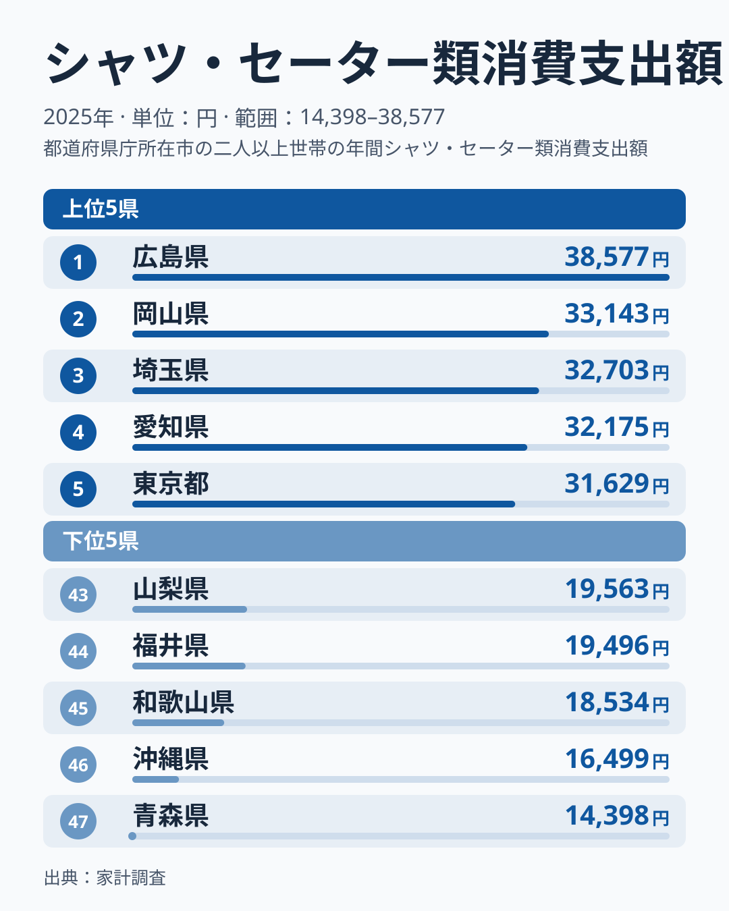
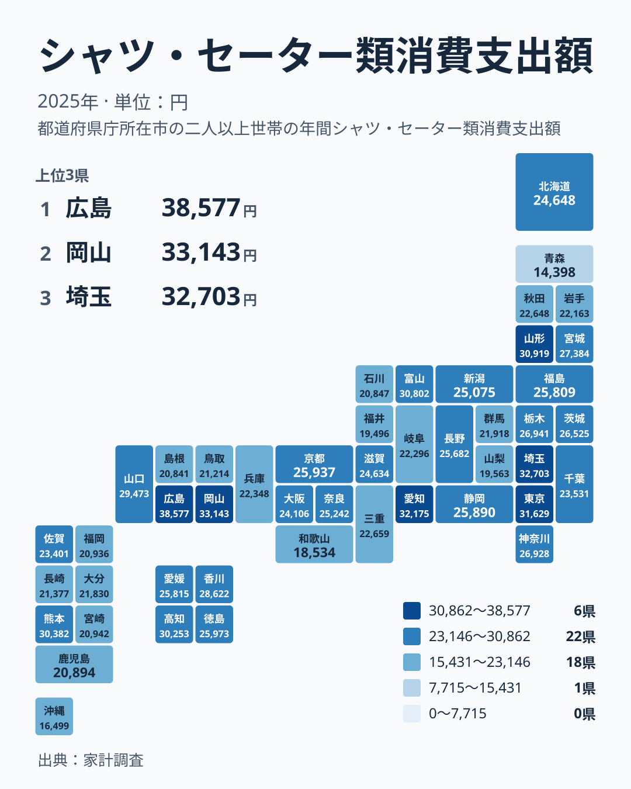

## 広島県と青森県で何倍の差があるのか

毎日の服装にかける費用は、住んでいる県によってどれほど違うのでしょうか。2025年の家計調査で、シャツ・セーター類への年間支出を都道府県別に見ると、1位は広島県の38,577円でした。一方、最下位の47位は青森県で14,398円です。

実データにある最大と最小の比を取ると、広島県は青森県の約2.7倍にあたります。同じ「シャツ」や「セーター」を買う家計でも、1年間に使う金額が県によってここまで違うということです。

この記事では、まず上位と下位のどこに注目すべきかを確認します。そのうえで、地理分布を見て、広島県と岡山県の突出や、青森県の低さをどう読むかを考えます。最後に、数字を自分の暮らしに引き寄せて読むための視点を整理します。

> [!NOTE]
> ここでの数字は、家計調査で把握された1世帯あたりの年間支出額です。シャツ・セーター類は被服及び履物の中の一品目群で、コートやスーツ、靴、下着などは含まれません。「服にいくら使うか」の全体像ではなく、トップスの一部分を見た数字だと理解してください。

## 上位と下位の顔ぶれから読み取れること

<source-link href="/ranking/shirts-sweaters-group-consumption-expenditure">シャツ・セーター類への支出ランキングをもっと見る</source-link>

上位には、広島県、岡山県、埼玉県、愛知県、東京都が並びます。中国地方の2県と、関東・中部の大都市圏の県が混在している点が、まず目を引きます。下位は山梨県、福井県、和歌山県、沖縄県、青森県です。

注目したいのは、1位の広島県と2位の岡山県の開きです。広島県は38,577円、岡山県は33,143円で、5,000円を超える差があります。これに対して3位の埼玉県は32,703円、5位の東京都は31,629円で、3位から5位は約1,000円差の僅差です。2位以下がひと固まりになる中で、広島県だけが抜けています。

下位では、46位の沖縄県が16,499円、47位の青森県が14,398円です。暖かい南の県と寒い北の県が、そろって最下位付近にいます。暑さだけでも寒さだけでも説明できないということは、気温以外の要素が関わっている手がかりになります。

## 地理分布から見える地方ごとの傾向

タイルマップで全体を眺めると、支出の多い県が一つの地方にまとまっているわけではないことが分かります。中国地方では広島県が1位、岡山県が2位、山口県が10位と上位に並びます。一方で、同じ中国地方の鳥取県は37位の21,214円、島根県は42位の20,841円です。同じ地方の中でも大きく割れています。

関東では、埼玉県が3位、東京都が5位、栃木県が13位、神奈川県が14位、茨城県が15位です。千葉県は27位の23,531円、群馬県は34位の21,918円にとどまります。首都圏といっても、均一に高いわけではありません。

東北は、山形県が6位の30,919円、宮城県が12位の27,384円と健闘する一方で、青森県は47位、岩手県は33位の22,163円、秋田県は30位の22,648円です。北海道・東北の中でも、青森県の低さは際立っています。

九州・沖縄でも、熊本県が8位の30,382円と高い反面、福岡県は39位の20,936円、鹿児島県は40位の20,894円、沖縄県は46位です。大都市を抱える県が必ず上位に来るわけではない点は、注意すべきところです。

> [!WARNING]
> 家計調査は標本調査で、都道府県単位では調査された世帯数が限られます。そのため、特に被服のように購入頻度が低く単価にばらつきのある品目では、1年の値が偶然に左右されやすくなります。順位の1つや2つの違いは、実力差というより誤差の範囲かもしれません。単年の順位を、その県の恒久的な特徴と決めつけないでください。

## 気候や都市規模だけでは説明しきれない

被服支出の地域差は、一般に気候や都市規模などから説明されることがあります。ただし、今回のデータだけでこれらの要因を確かめることはできません。ここでは、データで見える事実と、そこから立てられる仮説を分けて考えます。

事実として確認できるのは、次の点です。

- 最下位の青森県は寒冷地ですが、同じく暑い地域の沖縄県も46位で、気候の両極が下位に並んでいます
- 埼玉県が3位、愛知県が4位、東京都が5位と、大都市圏の県は上位に入っています
- 一方で、福岡県は39位、千葉県は27位と、都市を抱えていても中位から下位の県があります

これらから言えるのは、気候や都市の大きさのどちらか一方だけで順位が決まるわけではない、ということです。仮説としては、買い物ができる店舗の多さや、通勤で着る服の必要度などが関わっているかもしれません。ただし、今回の数字はそれを裏づけるものではありません。年齢構成についても、このデータには手がかりがないため、ここでは触れません。

> [!TIP]
> ランキングを読むときは、「高い県は服にお金をかけている」「低い県は節約している」と単純化しないのがコツです。支出が少ない背景には、通勤服の必要度、買い物のしやすさ、他の被服項目への配分など、生活様式の違いがあります。気になる県は、シャツ・セーター類以外の被服費もあわせて見ると、全体像がつかめます。

## 中国地方の突出をどう読むか

今回の最大の特徴は、広島県と岡山県が1位と2位を占めたことです。広島県は38,577円、岡山県は33,143円で、東京都の31,629円も上回っています。山口県も10位の29,473円と、中国地方の3県が上位10位以内に入っています。広島県のデータは[広島県のページ](/areas/34000)、岡山県のデータは[岡山県のページ](/areas/33000)で確認できます。

ここで注意したいのは、鳥取県と島根県が下位に沈んでいることです。中国地方は5県で、そのうち3県が上位、2県が37位と42位です。「中国地方は服にお金をかける地域」と一括りにはできません。広島市や岡山市のような中核都市を持つ県と、そうでない県とで、買い物環境や外出機会の違いが現れている可能性があります。

このことは、読者の生活にも示唆を与えます。たとえば、近隣に商業施設が少ない県では、服を買う機会そのものが限られ、支出が伸びにくいことがあるかもしれません。逆に、店舗が身近にある県では、気軽に買い足す習慣が支出を押し上げているのかもしれません。数字の違いには、買い物環境の違いが関わっている可能性もあります。

## 数字を自分の暮らしに引き寄せるには

では、この結果を家計管理にどう生かせばよいでしょうか。

自分の県の順位を知ったうえで、次の3点を確認してみてください。

- 自分の世帯の年間のシャツ・セーター類への支出が、住んでいる県の数字と比べて多いか少ないか
- 買う場所が通勤圏にあるか、遠出が必要か
- 防寒や仕事用など、必要に迫られた買い物がどれだけ含まれているか

たとえば、上位の埼玉県は32,703円、東京都は31,629円です。一方で、北海道は24,648円で24位、大阪府は24,106円で26位と、中位に位置します。これらの数字は、他の県の家計と自分を単純に比べるためではなく、生活環境の違いを知るための目安として役立ちます。

また、支出が低い県の世帯が、必ずしも服に困っているわけではありません。青森県の14,398円や沖縄県の16,499円は、買い方の違いや他の品目への配分の結果とも考えられます。数字の大小に一喜一憂するよりも、自分の暮らしに合った支出の水準を考える材料にしてください。

ほかの家計項目の地域差は、[同じカテゴリの統計一覧](/category/economy)から見比べられます。食費や住居費などと並べて見ると、被服費の地域差が、家計全体の中でどういう位置にあるかが分かります。

## データについて

この記事で使った数字は、家計調査のシャツ・セーター類消費支出額(2025年、単位は円)です。47都道府県の値を、そのまま実データとして使っています。

- 各県の値は、調査された世帯の1年間の支出額を示しています
- 順位は、金額の大きい順に付けています
- 倍率は、1位の広島県と47位の青森県の値の比だけを示しています

地方ごとの傾向を述べる際は、北海道・東北、関東、中部、近畿、中国、四国、九州・沖縄の7区分で県を整理しました。なお、本文で触れた気候や都市規模などの説明は、仮説として紹介したものです。今回の数字そのものが、それぞれの要因を証明するわけではありません。
