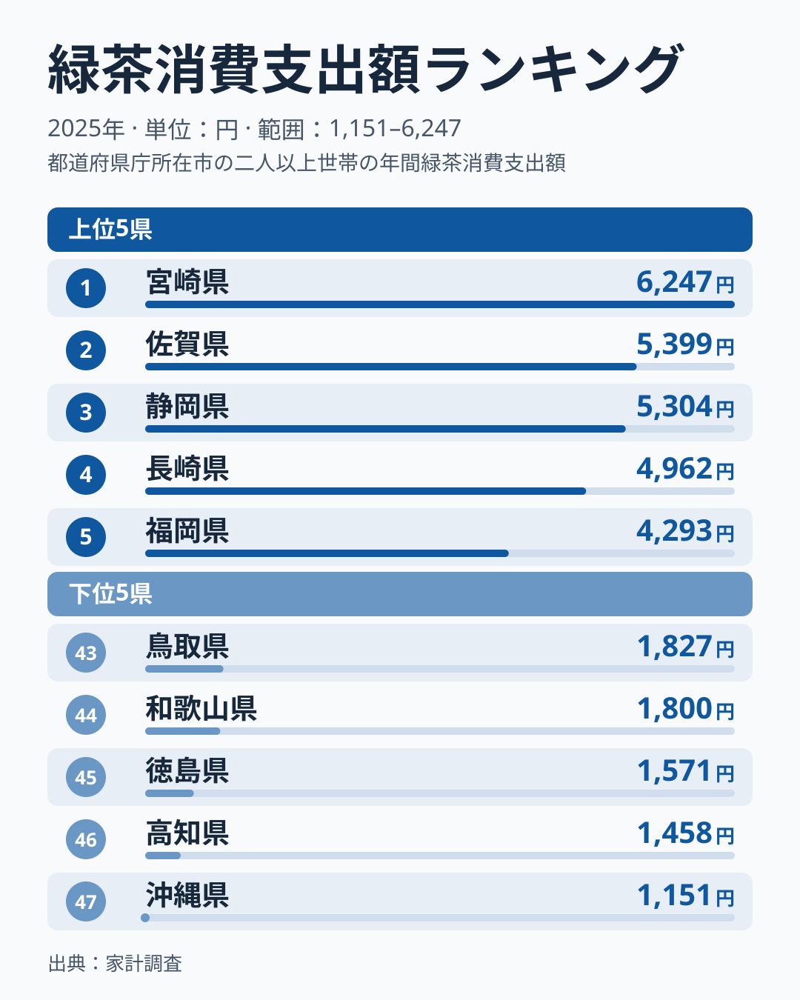
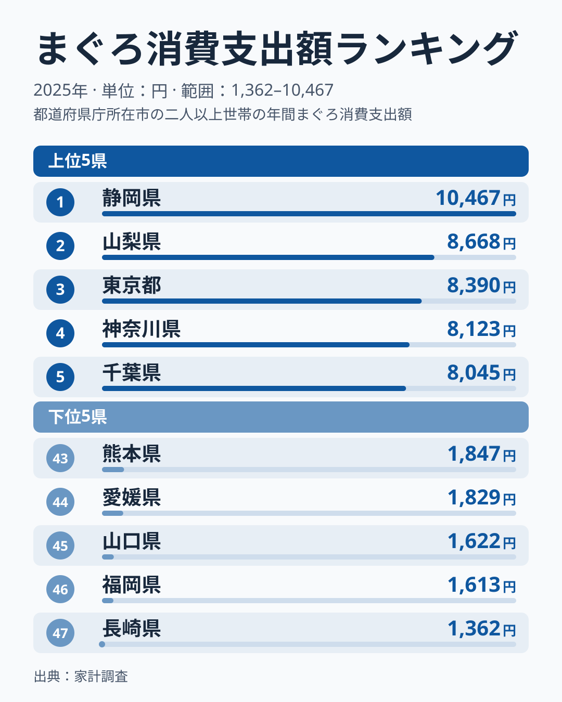
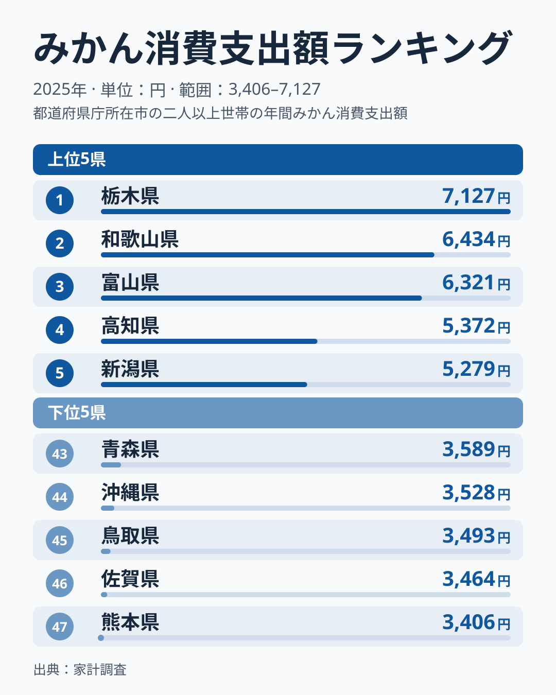
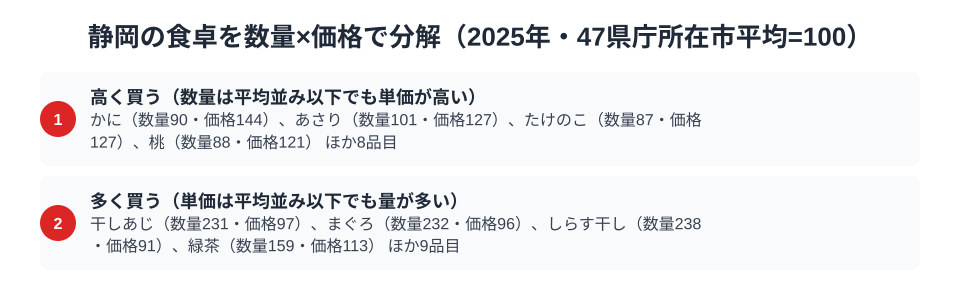

静岡県といえば、まず思い浮かぶのはお茶でしょう。ところが総務省の家計調査（品目別）の2025年で静岡市の二人以上世帯を見ると、緑茶の消費支出額は5,304円で全国3位です。1位は宮崎県の6,247円、2位は佐賀県の5,399円で、お茶の国は首位を譲りました。

その一方で、まぐろの消費支出額は10,467円で全国1位でした。みかんは5,187円で7位です。この記事では、緑茶・まぐろ・みかんという3つの品目を横断しながら、「お茶の国」というイメージの外側にある静岡県民の食卓を読み解きます。家計調査の市別の値は単年のぶれが大きいため、順位は2025年の姿として読んでください。

> [!NOTE]
> 家計調査の都道府県データは、県庁所在市（静岡県は静岡市）の二人以上世帯を対象にした年間支出額です。県全体ではなく静岡市在住世帯の家計簿から見た傾向であり、支出「金額」であって消費「量」そのものではない点にご注意ください。

## 緑茶 — 全国3位5,304円、宮崎・佐賀に次ぐ

<source-link href="/ranking/green-tea-consumption-expenditure">緑茶消費支出額ランキングをもっと見る</source-link>

2025年の緑茶消費支出額は、1位が宮崎県の6,247円、2位が佐賀県の5,399円で、静岡県は5,304円の3位でした。2位の佐賀県との差は95円、4位の長崎県4,962円との差は342円です。最下位の沖縄県は1,151円で、1位の宮崎県とは5.4倍の開きがあります。静岡は牧之原台地をはじめとする広大な茶園を抱える日本最大の茶産地ですが、家計の支出額では九州の茶産地に並ばれている形です。

それでも茶葉への支出が全国の上位にあることは変わりません。食事のたびに急須で緑茶を淹れる習慣は、静岡の暮らしに深く根づいていると考えられます。順位が入れ替わった理由は、このデータだけでは断定できません。[仮説] 市別の家計調査は単年のぶれが大きく、静岡市の2025年の値がたまたま低く、宮崎市が高く出た可能性があります。検証するには、複数年の推移を並べて見る必要があります。

## まぐろ — 全国1位10,467円、清水港の水揚げ

<source-link href="/ranking/tuna-consumption-expenditure">まぐろ消費支出額ランキングをもっと見る</source-link>

お茶のイメージが強い静岡ですが、2025年にいちばん高い順位だったのはまぐろで、消費支出額は10,467円の全国1位です。2位の山梨県8,668円を1,799円上回り、最下位の長崎県1,362円とは7.7倍の差があります。静岡市の清水港は、冷凍まぐろの水揚げ量で全国トップクラスを誇る「まぐろの街」です。

遠洋まぐろ漁業の基地である清水港には、世界の海で獲れたまぐろが大量に水揚げされます。地元にはまぐろ料理の専門店が集まる市場もあり、家庭でも刺身や漬け、づけ丼などでまぐろを日常的に食べる文化が根づいています。内陸県の山梨が2位に入るのも、静岡・清水港からまぐろが運ばれる流通ルートの影響と考えられます。[仮説] 3位の東京都、4位の神奈川県、5位の千葉県まで含めて、産地や大きな消費地に近い地域ほどまぐろ消費が高いという構図ですが、流通経路まで確かめたデータはなく、検証が必要です。

## みかん — 全国7位5,187円、温暖な斜面の恵み

<source-link href="/ranking/mandarin-consumption-expenditure">みかん消費支出額ランキングをもっと見る</source-link>

果物では、静岡は上位の一角にとどまります。みかんの消費支出額は5,187円で全国7位でした。首位は栃木県で7,127円、2位は和歌山県の6,434円、3位は富山県の6,321円で、静岡との差は首位と1,940円です。最下位の熊本県は3,406円で、首位とは2.1倍の差です。静岡は三ヶ日みかんに代表される温州みかんの一大産地で、駿河湾に面した温暖な斜面がみかん栽培に適しています。

産地であっても、消費額が全国で最も高いとは限りません。1位は静岡ではなく栃木県でした（[みかん消費支出の記事](/blog/mandarin-expenditure-ranking)で産地と消費地の関係を詳述）。地元でとれた新鮮なみかんが手頃に手に入ることは、冬の食卓に欠かせない果物として定着する理由の一つと考えられます。ただし、7位という順位は、産地というだけでは支出額の上位に入れないことも示しています。

> [!WARNING]
> 家計調査は支出金額の調査であり、消費量そのものではありません。物価や単価の違いも金額に影響します。特にまぐろや緑茶は品質による価格差が大きいため、「支出額が高い＝量を多く消費している」とは限らない点にご注意ください。

## 静岡の食卓を貫くもの

静岡県民の食卓を貫くのは、「山と海、両方の恵みに囲まれた豊かさ」です。牧之原台地の茶、清水港のまぐろ、駿河湾に面した斜面のみかん。温暖な気候と変化に富んだ地形が、緑茶・まぐろ・みかんという性格の異なる3つの品目を、いずれも上位に押し上げています。2025年の順位は、まぐろが1位、緑茶が3位、みかんが7位です。

高知の「黒潮のかつお特化」、北海道の「海と大地の豊穣型」と並べると、静岡は「山の茶と海のまぐろ、両極の恵みを併せ持つ県」。ひとつの県のなかで、全国1位と3位が並ぶ例は多くありません。

> [!TIP]
> 「お茶の県」というイメージだけで静岡を捉えると、まぐろ全国1位という一面を見逃します。県の食文化を数字で見るときは、代表的なイメージの品目だけでなく、意外な品目の順位もあわせて確認すると、その土地の地理と産業の全体像が見えてきます。

## 数量×価格で分解する静岡市の食卓

<source-link href="/ranking/whitebait-consumption-quantity">しらす干し消費量ランキングをもっと見る</source-link>

支出額は「量」と「単価」のかけ算で決まります。まぐろの支出額が全国1位だと分かっても、それが量をたくさん消費しているからなのか、単価の高いものを選んで買っているからなのかは、支出額の順位だけでは判別できません。この違いを見るために、家計調査の品目のうち静岡市で消費量と支出額の両方が確認できる138品目について、消費量と支出額をそれぞれ47都道府県庁所在市の単純平均を100とした指数に直し、支出額を数量で割った単価に相当する価格指数もあわせて算出しました。数量指数・価格指数がともに120以上の品目、どちらか一方だけが120以上の品目、両方とも80から120の範囲に収まる品目に分けます。「他の〜」という残余の区分16品目を除くと、静岡市は両方とも高い品目が0、単価だけが突出して高い品目が12、購入量だけが突出して多い品目が13、どちらも際立たないが支出額はやや大きい品目が0という構成になりました。

まぐろ・しらす干し・干しあじは、いずれも数量指数が231.8・237.9・231.4と平均の2倍を超える一方、価格指数は96.2・91.0・97.2とほぼ平均並みです。数量の全国順位は、しらす干しとまぐろが1位、干しあじが2位です。単価の高いものを選んで買っているのではなく、単純に量をたくさん買っている品目群であり、清水港のまぐろ・しらす干しに象徴される「海の恵みを日常的に量で食べる文化」がここに数字として表れています。

一方、かには数量指数90.2と平均を下回るのに、価格指数は143.5と高く、支出額は全国5位に入ります。あさり、たけのこ、桃も同様に、量より単価が際立つ品目です。ほたて貝は数量指数36.5と平均の3分の1程度しか買っておらず、価格指数は124.8です。これに対して緑茶は数量指数159.4・価格指数113.2で、量が多い品目に入ります。数量の全国順位は2位、支出額の順位は3位で、量を多く飲むことが支出額の上位を支えています。まぐろが「量の文化」、かにが「価格の文化」、緑茶が「量で支える文化」というように、同じ「支出額が高い」品目でも中身は異なる構造をしています。

> [!TIP]
> 支出額のランキングだけでは、その1位が「量」によるものか「単価」によるものかは判別できません。静岡のまぐろは支出額・数量ともに全国1位ですが、価格指数は96.2とほぼ平均並みで、支出額が高いのは高級品を選んでいるからではなく単純に多く食べているからだと分かります。品目のランキングを見るときは、支出額だけでなく数量・価格に分解して読むと、その土地の食文化がより具体的に見えてきます。

この区分は静岡市の実額そのものではなく、47都道府県庁所在市の単純平均を100とした相対指数（120以上を「多い・高い」、80以下を「少ない・安い」）です。家計調査の全国値ではない点にご注意ください。価格指数は支出額を数量で割った単価の相対値であり、購入する品種やブランドの違いも反映するため、純粋な物価水準の差ではありません。対象は静岡市の二人以上世帯の年間値（2025年）です。

## まとめ

- まぐろ消費支出額は静岡県が全国1位（10,467円）、清水港の水揚げを背景にした「まぐろの街」
- 緑茶は5,304円で全国3位、1位は宮崎県の6,247円、2位は佐賀県の5,399円
- みかんは全国7位で5,187円、首位の栃木県は7,127円
- 山の茶・海のまぐろ・斜面のみかんと、性格の異なる3品目がいずれも上位に並ぶ食卓。まぐろ・しらす干しは量で食べる文化

静岡県の他の統計は[静岡県の地域プロフィール](/areas/22000)、食品・家計消費の地域差は[経済カテゴリ一覧](/category/economy)からご覧いただけます。
