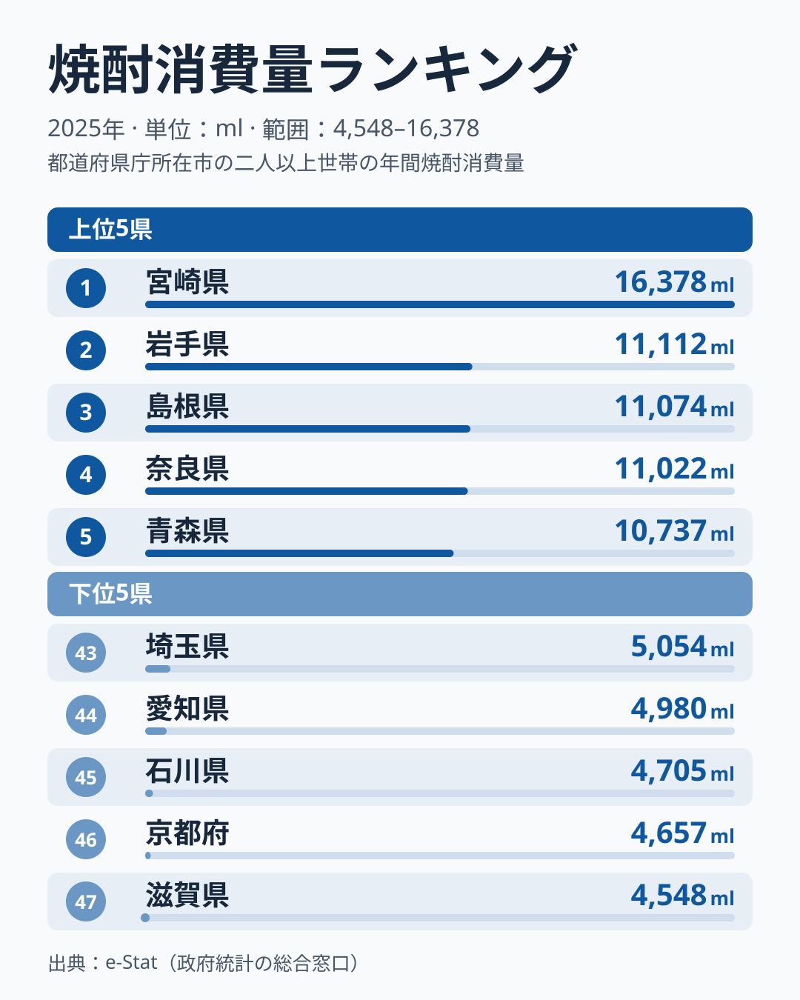

総務省「家計調査」の焼酎購入量データ(2025年・2人以上世帯1世帯あたり年間ml)を都道府県別に比較しました。1位の**[宮崎県](/areas/45000)は16,378ml**で、岩手県は11,112mlにとどまります。最下位の滋賀県は4,548mlで、宮崎との**格差は3.60倍**です。上位は宮崎に続いて岩手・青森(東北)、島根(中国)、奈良(近畿)が並び、鹿児島は7位でした。下位は滋賀・[京都府](/areas/26000)・石川・愛知・埼玉です。本記事は2025年1年分のデータだけを使うため、順位が年ごとに入れ替わるかどうかは確かめられません。焼酎消費の地域差を「気候・原料・酒造文化」の視点で仮説として整理しつつ、単年の順位をどこまで信じてよいかも考えます。

> [!NOTE]
> 本データは総務省「家計調査」の品目別年間支出・購入数量から得たもので、対象は各都道府県庁所在市の二人以上世帯です。家計調査の「焼酎」項目には沖縄の泡盛も含まれるため、沖縄の数値は泡盛消費を反映しています。また、県全体の平均ではなく「県庁所在市の世帯」の購入量であり、外食・飲食店での消費は含まれません。

## 宮崎が突出し、2位から5位は1万1千ml前後に並ぶ

図から読み取れる構造は二つあります。一つは、1位の宮崎県が16,378mlと、2位の岩手11,112mlを大きく引き離している点です。もう一つは、2位の岩手から5位の青森10,737mlまでが、島根11,074ml、奈良11,022mlを含めて1万1千ml前後にほぼ並んでいる点です。この4県の間では、わずかな差で順位が入れ替わりうる水準です。下位は滋賀、京都、石川、愛知、埼玉の5府県が4,500ml台から5,000ml台前半に集まっています。

<source-link href="/ranking/shochu-consumption-quantity">焼酎消費量ランキングをもっと見る</source-link>

九州の県が上位を独占するわけではなく、2位の岩手から5位の青森までは、東北、中国、近畿の県が入っています。九州では宮崎が1位、鹿児島が7位で10,443ml、熊本が10位で9,121ml、大分が14位で8,530mlでした。沖縄は18位で7,641mlですが、これは家計調査の「焼酎」項目に泡盛が含まれるための値です。

宮崎が首位に立つ理由は、本記事のデータでは確かめられません。[仮説] 地元に蔵元があり、芋・麦などの地場原料から造る焼酎が日常の晩酌に根づいていることが、購入量を押し上げている可能性があります。ただし、これは今回のデータから検証した結論ではありません。

> [!TIP]
> 上位に岩手・青森や奈良が入る点は意外に見えますが、特定の原料の産地だからと断定するのは早計です。[仮説] 家計調査の市別の値は単年のぶれが大きく、サンプルの偏りが順位を押し上げている可能性があります。同じ `/ranking/shochu-consumption-quantity` の値を複数年並べ、上位の常連かどうかを確かめる必要があります。

同じ九州の中でも消費量にはばらつきがあります。宮崎は1位、鹿児島は7位、熊本は10位、大分は14位、佐賀は16位で7,931ml、長崎は17位で7,720ml、福岡は28位で6,712mlと、九州7県の順位は1位から28位まで広がります。長崎は壱岐の麦焼酎が知られる産地ですが、順位は17位です。「地元に蔵元と地場原料があれば上位に来る」という単純な図式では説明しきれない例で、他の酒類との競合など別の要因も候補になります。

## 最下位グループ:滋賀・京都・石川は4,500ml台

最下位は滋賀県で4,548mlです。続く46位は京都府で4,657ml、45位は石川県で4,705mlでした。いずれも1位宮崎の16,378mlと比べて大きく低い水準です。

この低さの理由も、本記事のデータでは特定できません。[仮説] 京都の伏見のように日本酒の産地を抱える地域では、家庭の晩酌で日本酒が選ばれやすく、焼酎が「もう一つの選択肢」になりにくい可能性があります。ただし、これは京都についての見立てにとどまり、滋賀や石川まで同じ説明が当てはまるかは分かりません。なお、宮城は5,550mlで40位でした。

下位グループの数字は、「焼酎を飲まない」ことの直接の証拠ではありません。家計調査が捉えるのは家庭での購入量なので、飲食店で飲む焼酎は数字に乗りません。低い値は、あくまで「家庭での購入量が少ない」ことを示すものとして読むのが正確です。

> [!WARNING]
> 家計調査は各都道府県庁所在市の世帯を対象としており、県全体の消費傾向を完全に代表するわけではありません。また家庭での購入量データのため、居酒屋・飲食店での消費は含まれません。単年の順位は、年によって変動しうる点にも注意してください。

## 焼酎消費は「気候・原料・酒造伝統」の三層で決まるのか

**[仮説] 焼酎消費量の地域偏在は、(1)蒸留酒に適した温暖湿潤な気候、(2)芋・麦・米・黒糖など原料の自給、(3)地元酒造の流通圏という三つの要因が重なる地域で高くなる**という見立てが立てられます。宮崎・鹿児島の芋焼酎、大分・熊本の麦・米焼酎、沖縄の泡盛は、地場原料と蔵元を持つことで知られる代表例です。一方、岩手・青森・島根・奈良が2025年に上位へ入る理由は本記事のデータだけでは特定できません。地元蔵元の流通圏の厚さや、家庭での甲類焼酎購入の多さ、単年のぶれなど、複数の仮説が考えられます。

この仮説は、清酒との「住み分け」を予測します。日本酒文化が強い地域ほど焼酎の家庭消費が低いという負の相関が成り立つなら、酒類の地域差は「総量の多寡」ではなく「どの酒を主役に据えるか」という選好の地図として読めるはずです。検証は次の手順で行います。

- 清酒消費量との相関を確認: `/ranking/sake-consumption-quantity` と本データのスピアマン順位相関を算出
- 負の相関がはっきり見られれば仮説支持、相関がほぼ見られなければ棄却して次仮説(可処分所得・年齢構成)を検証

地域ごとの所得や世帯人員、高齢化率も飲酒量に影響しうるため、単一の原因に帰着させず、複数の要因を踏まえて読むことが大切です。単年の順位だけから構造変化を読むのは避け、複数年で見て初めて地域の特色と呼べると考えるのが妥当です。

あわせて見る: [焼酎消費支出額ランキング](/ranking/shochu-consumption-expenditure) / [ビール消費量ランキング](/ranking/beer-consumption-quantity) / [ビール消費支出額ランキング](/ranking/beer-consumption-expenditure)

## まとめ

- 1位の宮崎県は16,378mlで、2位の岩手は11,112ml、3位の島根は11,074mlです
- 最下位は滋賀県の4,548mlで、宮崎との格差は3.60倍です
- 2位から5位は岩手・島根・奈良・青森が1万1千ml前後に並び、鹿児島は7位、熊本は10位、大分は14位でした
- 下位は滋賀・京都・石川・愛知・埼玉で、宮城は40位でした
- 本記事は2025年のみのデータで、2位以下の順位は単年のぶれを含むため、構造とは読みにくいです
- 焼酎消費は気候・原料・酒造伝統の三層が重なる地域で高いという[仮説]を、清酒消費との負の相関で検証する予定です
