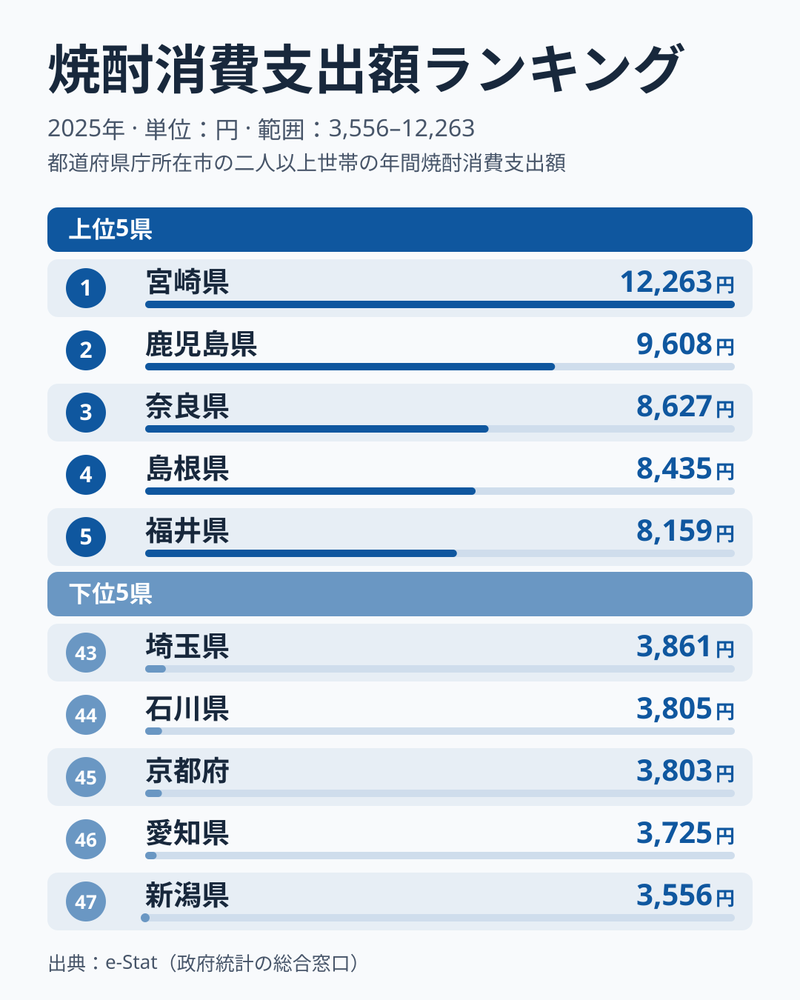
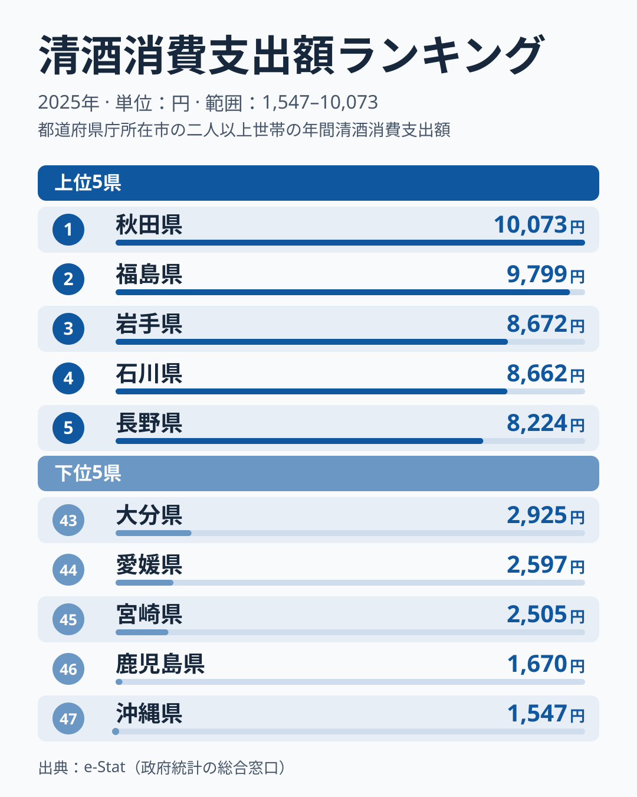

焼酎の年間消費支出額で全国1位なのは宮崎県の12,263円です。ところが同じ宮崎県を清酒の消費支出額ランキングで見ると、45位の2,505円まで沈みます。清酒1位の秋田県10,073円と比べると4倍の差です。1つの県が「片方は日本一、もう片方はほぼ最下位」という逆転構造を見せるのは、単なる好みの違い以上の理由がありそうです。

総務省の家計調査（二人以上世帯、2025年）から、焼酎と清酒それぞれの年間消費支出額を都道府県別に並べ、どこで逆転が起きているかを見ていきます。

> [!NOTE]
> ここでの「消費支出額」は家計調査における二人以上の世帯が1年間に購入した金額（円）です。飲食店での消費や贈答用は含まれず、家庭での購入行動を反映した数値です。焼酎消費「量」（ml）とは別の指標なので、量のランキングとは順位が一致しない場合があります。

## 焼酎の消費支出額ランキング

<source-link href="/ranking/shochu-consumption-expenditure">焼酎消費支出額ランキングをもっと見る</source-link>

1位の[宮崎県](/areas/45000)12,263円を筆頭に、2位[鹿児島県](/areas/46000)9,608円と、南九州の2県が上位を占めています。その後ろは3位奈良県8,627円、4位島根県8,435円、5位福井県8,159円と、九州以外の県が続きます。6位岡山県8,083円、7位青森県7,994円を挟んで、8位に熊本県7,627円が入り、大分県は12位の6,713円でした。芋焼酎の産地として知られる宮崎・鹿児島が突出する構図は変わりませんが、「焼酎は九州の酒」という見方だけでは上位5県の顔ぶれを説明しきれません。焼酎の消費量（ml）で見た地域差は「[焼酎は宮崎が宮城の5倍、なぜ南九州だけ突出するのか](/blog/shochu-consumption-prefecture-gap)」でも詳しく扱っています。

一方で最下位は新潟県3,556円、46位愛知県3,725円、45位京都府3,803円、44位石川県3,805円、43位埼玉県3,861円と、日本海側の北陸から東海・近畿・関東の都市部にかけて下位が並びます。最大の宮崎県と最小の新潟県では3.4倍の開きがあり、支出額でも「焼酎をよく買う県」とそうでない県がはっきり分かれています。

3位以下の奈良・島根・福井や、南九州以外で熊本が8位にとどまる点は、家計調査の県別の値が単年のぶれを含むことも踏まえて読む必要があります。[仮説] 九州以外の県が上位に入る背景には、地元の銘柄や飲み方の習慣があるかもしれませんが、2025年1年分の値だけでは確かめられず、複数年の推移を見る必要があります。

## 清酒の消費支出額ランキング

<source-link href="/ranking/sake-consumption-expenditure">清酒消費支出額ランキングをもっと見る</source-link>

清酒では焼酎とまったく異なる顔ぶれが上位に来ます。1位[秋田県](/areas/05000)10,073円、2位[福島県](/areas/07000)9,799円、3位岩手県8,672円、4位石川県8,662円、5位長野県8,224円。東北の3県に北陸の石川、信州の長野が続き、日本酒の名だたる酒処が並ぶ、いわば「教科書通り」の結果です。6位青森県7,986円、7位宮城県7,064円、8位東京都7,001円までが7,000円台を超えています。

そして最下位に沖縄県1,547円、46位鹿児島県1,670円、45位宮崎県2,505円と、焼酎ランキングの上位県がそのまま清酒ランキングの下位に沈んでいます。44位は愛媛県2,597円、43位は大分県2,925円で、九州の県が清酒の下位に目立ちます。清酒の最大・最小倍率は6.5倍で、焼酎の3.4倍よりも地域差が大きい点も特徴です。

## 焼酎と清酒が入れ替わる構造

2つのランキングを重ねると、宮崎・鹿児島は「焼酎は1位と2位、清酒は45位と46位」という完全な逆転関係にあることがわかります。沖縄県も焼酎は13位の6,691円と上位に入る一方、清酒は最下位です。反対に、清酒1位の秋田県は焼酎だと28位の5,092円、清酒2位の福島県は焼酎23位の5,405円と、どちらも焼酎では中位にとどまります。新潟県は焼酎が最下位の47位なのに、清酒は10位の6,602円まで上がります。

一方で、両方をよく買う県もあります。青森県は焼酎7位の7,994円、清酒6位の7,986円でほぼ同額です。岩手県も焼酎は10位の7,016円、清酒は3位の8,672円で、2県とも両方が上位10県に入っています。北東北の2県は、焼酎と清酒の両方が日常的に買われている数少ない地域といえます。

この逆転の背景には気候と原料があると考えられます。[仮説] 南九州はサツマイモの栽培に適した温暖な気候と、稲作よりも畑作が中心の土地条件を持ち、江戸期から芋焼酎づくりが根付いてきたことが、焼酎への支出の多さにつながっている可能性があります。対して東北・北陸は良質な米と雪解け水に恵まれ、清酒の産地として発展した歴史があります。「どちらの酒が地元の産業として定着したか」が、そのまま消費支出額の逆転として表れている形ですが、ここでは産地と支出額の対応を見ているだけで、因果までは確かめていません。

> [!TIP]
> 焼酎の支出額上位5県のうち、宮崎・島根・奈良は消費数量も上位4位以内で、量の多さが支出額を押し上げています。一方、鹿児島県は数量が7位にとどまる代わりに単価が高く、同じ上位でも「量型」と「単価型」が混ざります。支出額の順位だけでなく、数量と単価に分けて読むと違いが見えてきます。

産地がなくても支出額が高い県もあります。清酒消費支出額8位の東京都や14位の埼玉県は、地元に酒どころの歴史が薄くても支出額が高く出ています。この背景に数量ではなく単価の高さがあることは、次の数量と単価の分解で詳しく見ていきます。

> [!WARNING]
> 家計調査は都道府県庁所在地及び政令指定都市が調査対象の中心であり、都道府県全域の消費動向を完全に代表するものではありません。また年による変動があるため、単年（2025年）の数値であることに留意してください。本記事は消費側のデータのみを扱っており、産地の分布と消費額の対応は相関の指摘であって因果の検証ではありません。

## 支出額を数量と単価に分解すると

家計調査の消費支出額は「消費数量×単価」に分解できます。焼酎と清酒それぞれの消費数量（ml）を重ね合わせると、支出額ランキングだけでは見えなかった「量で稼ぐ県」と「単価で稼ぐ県」の違いが浮かび上がります。

> [!NOTE]
> ここでいう「単価」は、消費支出額（円）を消費数量（ml）で割って算出した参考値であり、家計調査が公表している指標そのものではありません。世帯によって購入する銘柄や容量はさまざまなので、実際の店頭価格を表す数値ではなく、都道府県間の相対的な傾向をつかむための目安として扱ってください。また、本章で示す全国値は47都道府県の値を単純合計・単純平均したものであり、家計調査が公表する全国平均（世帯数で重み付けされた値）とは一致しません。

47都道府県の値を単純合計すると、焼酎は消費数量35万4,328ml・消費支出額27万4,819円で、単価はおよそ0.78円/mlです。清酒は消費数量26万1,011ml・消費支出額24万8,331円で、単価はおよそ0.95円/mlと焼酎よりおよそ1.2倍高くなります。1世帯あたりの消費量でみても焼酎は清酒よりおよそ1.4倍多く、単価は逆に2割弱安いというのが47都道府県平均でみた構図です。清酒は少ない量をやや高い単価で買う酒、焼酎はより多い量を手頃な単価で買う酒という違いが、支出額の内訳に表れています。

宮崎県の焼酎消費支出額が全国1位なのは、単価が特別高いからではありません。宮崎県は焼酎の消費数量でも全国1位の16,378mlで、47都道府県平均の1世帯あたりおよそ7,539mlの2.2倍にのぼります。単価は47都道府県平均をやや下回る水準にとどまり、「量で稼ぐ」1位県だといえます。清酒1位の秋田県は事情が異なります。秋田県の清酒消費数量は6位の7,738mlで、47都道府県平均の1.4倍ほどです。そのうえ単価が47都道府県で4位と高く、量と単価の両方が支出額を押し上げています。清酒の消費数量が全国1位なのは岩手県ですが、単価は47都道府県平均を下回るため、支出額は3位にとどまります。

一方で、焼酎の消費支出額で13位の沖縄県は、消費数量でみると18位まで順位を落とします。数量の順位より支出額の順位が上がっているのは、沖縄県の焼酎の単価が47都道府県平均より高いためです。[仮説] 沖縄県で流通する焼酎には泡盛など単価の高い銘柄が含まれている可能性がありますが、家計調査のデータだけでは購入銘柄までは分からず、検証には別データが必要です。

埼玉県の清酒についても、数量ではなく単価が支出額を押し上げているパターンに当てはまります。埼玉県の清酒消費数量は28位で決して多くありませんが、単価は47都道府県中でも9位と高く、宮崎県のような「量で稼ぐ」パターンとは対照的です。[仮説] 東京圏のベッドタウンとして高価格帯の清酒を選んで購入する層が一定数いる可能性がありますが、これも家計調査のデータだけでは検証できません。

さらに極端な例が清酒の鹿児島県です。清酒の消費数量は1,022mlで47都道府県の最下位ですが、単価だけは47都道府県で最も高く、1.63円/mlと全体平均のおよそ1.7倍になります。焼酎を日常的に飲む鹿児島県では、清酒はごく一部の人が少量だけ買う酒で、その分、高めの銘柄が選ばれているようにも見えます。[仮説] ただし購入量が少ない県は、数件の高額な購入が単価を大きく動かすため、単年の単価の高さを構造と断定することはできず、複数年での確認が必要です。

あわせて見る: [焼酎消費量ランキング](/ranking/shochu-consumption-quantity) / [清酒消費量ランキング](/ranking/sake-consumption-quantity)

## まとめ

- 焼酎消費支出額1位は宮崎県12,263円、最下位は新潟県3,556円で3.4倍差
- 清酒消費支出額1位は秋田県10,073円、最下位は沖縄県1,547円で6.5倍差
- 宮崎・鹿児島は焼酎で1位と2位、清酒で45位と46位の完全な逆転構造
- 焼酎上位は南九州の2県に奈良・島根・福井が続き、九州以外の県も目立つ（2025年単年の値）
- 清酒上位は東北（秋田・福島・岩手）に石川・長野が加わる伝統的な酒処が中心
- 青森・岩手は焼酎も清酒も上位10県に入る両取りの県
- 焼酎は清酒より1世帯あたりの消費量が約1.4倍多く単価は2割弱安い酒で、宮崎県は消費数量でも1位の「量で稼ぐ」構図、清酒1位の秋田県は量と単価の両方が効いている
- 清酒の鹿児島県は消費数量が最下位でも単価が最も高く、埼玉県は数量ではなく単価の高さが支出額を左右している

お酒に関する他の指標は[家計調査（品目別）の調査ハブ](/survey/kakei-chousa)からもたどれます。
