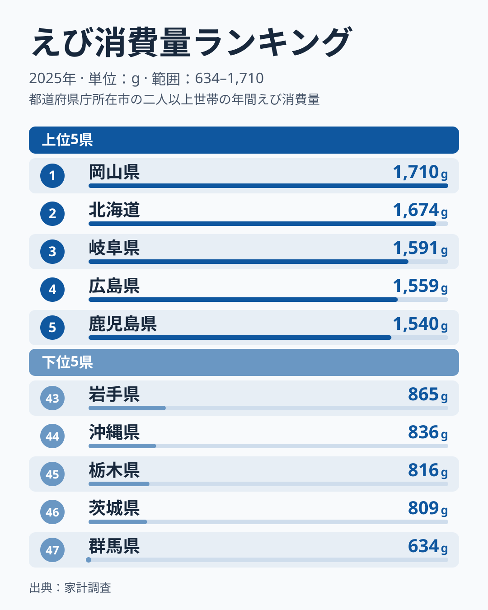
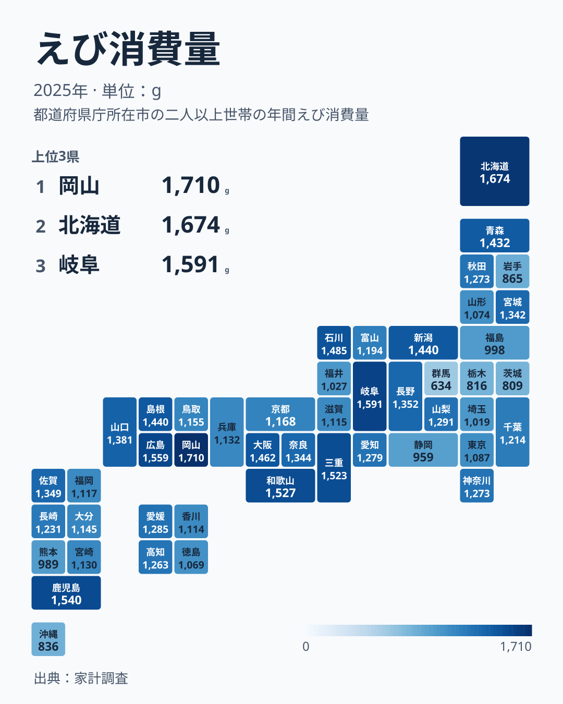

家庭でどれだけえびを買っているかは、都道府県によって大きく異なります。総務省の家計調査が示す2025年のえび消費量を見ると、上位の県と下位の県のあいだには、ひと目でわかるほどの開きがあります。

全国1位は岡山県で、年間の購入量は1,710グラムです。一方、最下位の群馬県は634グラムにとどまり、その差は約2.7倍になります。ただし、この順位は前年から大きく入れ替わっています。2024年に全国一だった熊本県は2025年に989グラムで41位まで下がり、2024年に28位だった岡山県が1位に上がりました。この記事では、2025年の上位と下位の顔ぶれを確認しながら、「全国一の座がなぜ1年で入れ替わるのか」と、「入れ替わらずに下位に残る県があるのはなぜか」を読み解きます。

> [!NOTE]
> ここでの「えび消費量」は、家計調査で2人以上の世帯が1年間に購入したえびの量をグラムで示したものです。むきえびや冷凍のむき身も含めて集計されているため、殻付きで購入する家庭が多い地域と、むき身を中心に買う地域とでは、同じグラム数でも食卓に上る回数の感覚が異なる場合があります。

## 上位と下位に見えるえび消費量の格差

<source-link href="/ranking/shrimp-consumption-quantity">えび消費量ランキングをもっと見る</source-link>

上位5県は、1位の岡山県が1,710グラム、2位の北海道が1,674グラム、3位の岐阜県が1,591グラム、4位の広島県が1,559グラム、5位の鹿児島県が1,540グラムです。6位以下も和歌山県が1,527グラム、三重県が1,523グラム、石川県が1,485グラム、大阪府が1,462グラムと続き、10位の新潟県は1,440グラムで、同じ値の島根県と並んでいます。顔ぶれは中国、近畿、北陸、九州、北海道に散らばっていて、「西日本の瀬戸内海沿岸が多い」といった一つの地域でまとめにくいことがわかります。海に面していない岐阜県が3位に入っている点も、産地に近い県ほど多いという単純な見立てを崩しています。

下位は、47位の群馬県634グラムに続いて、46位の茨城県が809グラム、45位の栃木県が816グラム、44位の沖縄県が836グラム、43位の岩手県が865グラムです。ここで目を引くのは、群馬県、茨城県、栃木県の北関東3県が、最下位から連続して並んでいることです。1位の岡山県と47位の群馬県の差は1,076グラムで、倍率にすると約2.7倍です。前年の2024年は熊本県の1,994グラムが最多、沖縄県の615グラムが最少で、約3.2倍でしたから、格差の幅そのものも年によって変わります。

> [!WARNING]
> 家計調査の都道府県別の値は、県庁所在市および政令指定都市に住む2人以上の世帯の購入量です。県全体の平均ではなく、調査される世帯の数も限られるため、1年分の順位だけで「その県はえび好き」と決めることはできません。

## 地理でみるえび消費の分布

タイルマップで全国の分布を見ると、濃い色の上位県は一か所に固まっておらず、北海道、北陸の石川県と新潟県、東海の岐阜県と三重県、近畿の和歌山県と大阪府、中国の岡山県と広島県と島根県、九州の鹿児島県と、日本列島のあちこちに点在しています。地図の上で最も薄い色が集まっているのは、関東の北側です。群馬県634グラム、茨城県809グラム、栃木県816グラムの3県は下位から数えて1位から3位を占め、埼玉県も39位の1,019グラム、東京都も35位の1,087グラムと下位寄りです。同じ関東でも、千葉県は25位の1,214グラムで中位にあり、関東の中でも差があります。

東北に目を移すと、青森県は12位の1,432グラム、宮城県は17位の1,342グラムと中位より上にいる一方で、岩手県は43位の865グラムと下位に沈んでいます。隣り合う県でも順位が大きく離れているため、地域ブロックごとの食文化だけでは説明しきれません。九州では、鹿児島県が5位の1,540グラム、佐賀県が15位の1,349グラム、長崎県が24位の1,231グラム、熊本県が41位の989グラムと、県ごとに大きく散らばります。こうした「隣の県と全然違う」という並びは、各県の恒常的な違いに加えて、市ごとの単年のぶれが大きく混ざっていることを示唆しています。

> [!TIP]
> 地図で県どうしを比べるときは、隣の県との差だけでなく、複数年の順位も見ると読み違えを減らせます。単年の順位を並べた地図は、その年の偶然のぶれも一緒に写し取っています。

## 全国一の座はなぜ1年で入れ替わるのか

2025年の1位である岡山県は、前年の2024年には1,172グラムで28位、2023年には1,378グラムで13位でした。反対に、2025年に41位の熊本県は、2023年に1,769グラムで2位、2024年に1,994グラムで首位でした。わずか1年で、首位の県が下から数えたほうが早い位置まで下がり、中位だった県が1位に上がっています。熊本県の購入量は1,994グラムから989グラムへ、ほぼ半分になった計算です。

この動きは、「岡山県の家庭が急にえび好きになり、熊本県の家庭が急に買わなくなった」と読むよりも、調査の性質から読むほうが自然です。[仮説] 家計調査の市別の値は、1市あたりの調査世帯数が限られているため、少数の世帯の買い方や、年末年始のような特別な買い物の有無によって、年ごとに大きく振れやすい可能性があります。検証には、同じ県の複数年の順位を並べ、順位の変動幅が大きい県と小さい県を分けて見る必要があります。期日を設けて追うなら、翌年の2026年分が公表された時点で、2025年の上位県が上位に残るかを確かめるのが最も直接的です。

岡山県や熊本県の個別の背景について、本データだけから言えることは多くありません。[仮説] 岡山県は瀬戸内海に面し、えびを含む水産物が流通しやすい環境にあるため、購入量が高めに出やすい土地柄である可能性がありますが、これは本データでは確認できない推測です。[岡山県のデータ](/areas/33000)では、食料に関する他の指標もあわせて確認できます。同じく、2位の[北海道のデータ](/areas/01000)も、水産物の消費に関する指標とあわせて見ると、えびの購入量が上位に来る背景を考える手がかりになります。

> [!NOTE]
> 熊本県の順位の動き（2023年は2位、2024年は首位、2025年は41位）は、同じ県の値でも年によってこれだけ変わることを示しています。1年の順位を「県の特徴」として読むときは、前後の年の動きとあわせて確認してください。[同じカテゴリの統計一覧](/category/economy)から、関連する消費支出の指標もたどれます。

## 年が変わっても下位に残る県

一方で、年が変わっても下位に残り続ける県もあります。群馬県は2025年に47位の634グラムでしたが、2023年も47位の707グラム、2024年も42位の961グラムと、3年とも下位でした。沖縄県も2023年に45位の822グラム、2024年に47位の615グラム、2025年に44位の836グラムと、3年連続で下位に位置しています。上位がめまぐるしく入れ替わるのに対して、下位は顔ぶれが比較的固定されている点は、この指標のもう一つの特徴です。

下位の理由について、本データから確認できるのは購入量の少なさだけで、原因までは特定できません。[仮説] 沖縄県では豚肉や島野菜を中心とした家庭料理が多く、えびを使う料理が本土ほど日常的ではないために購入量が少ない可能性があります。[仮説] 北関東の3県は、海から離れていて鮮魚店で買う機会が少なく、他の魚介類や惣菜で代替されている可能性があります。いずれも本データでは検証できないため、外食や加工品を含む消費の指標とあわせた分析が必要です。

## まとめ

- 全国1位は岡山県で、年間のえび消費量は1,710グラムです
- 最下位は群馬県で、634グラムにとどまり、1位との差は約2.7倍です
- 上位5県は岡山県、北海道、岐阜県、広島県、鹿児島県で、特定の地域にまとまっていません
- 下位は群馬県、茨城県、栃木県の北関東3県が連続し、44位に沖縄県、43位に岩手県が続きます
- 前年に首位だった熊本県は2025年に41位となり、1年で順位が大きく入れ替わるため、単年の順位だけで県の特徴を決めないことが大切です

## データについて

出典は総務省の家計調査です。対象年は2025年で、都道府県庁所在市および政令指定都市を対象とした2人以上の世帯における、えびの年間購入量（グラム）を集計したものです。本文で触れた2023年と2024年の値は、同じ指標の過去年の値です。
