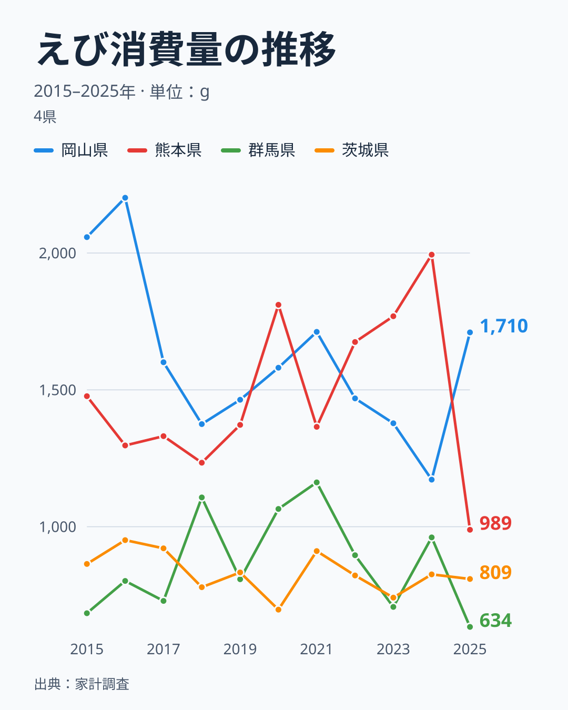

家庭でどれだけえびを買っているかは、都道府県によって大きく異なります。総務省の家計調査が示す2025年のえび消費量を見ると、全国1位は岡山県の1,710グラム、最下位は群馬県の634グラムで、その差は約2.7倍です。

そして、この順位は前年から大きく入れ替わっています。前年に全国一だった熊本県は、2025年に989グラムで41位まで下がり、前年は28位だった岡山県が1位に上がりました。この記事では、2015年から2025年までの11年分の値を並べて、首位がどれだけ入れ替わってきたのか、そして下位の関東の県はなぜ動かないように見えるのかを確かめます。先に結論を書くと、上位は毎年のように顔ぶれが変わり、下位は同じ県が残りやすいという非対称が見えます。ただし、その理由までは本データだけでは断定できません。

## 上位と下位に見えるえび消費量の格差

<source-link href="/ranking/shrimp-consumption-quantity">えび消費量ランキングをもっと見る</source-link>

2025年の上位5県は、1位の岡山県が1,710グラム、2位の北海道が1,674グラム、3位の岐阜県が1,591グラム、4位の広島県が1,559グラム、5位の鹿児島県が1,540グラムです。注目したいのは、上位の値が密集していることです。10位の新潟県と同じ値の島根県は1,440グラムで、1位から10位までの幅は270グラムに収まっています。顔ぶれは中国、近畿、中部、九州の鹿児島県、北海道に分かれていて、海に面していない岐阜県が3位に入っている点も、産地に近い県ほど多いという単純な見立てを当てはめにくくしています。

下位は、47位の群馬県が634グラム、46位の茨城県が809グラム、45位の栃木県が816グラム、44位の沖縄県が836グラム、43位の岩手県が865グラムです。ここで目立つのは、最下位の群馬県だけが次点の茨城県から175グラムも離れていることです。茨城県から岩手県までの4県は56グラムの幅に詰まっているので、2025年の最下位は、下位グループの中でもさらに一段低い位置にあります。関東の3県が最下位から連続している点は、次の節の地図でも確かめられます。

> [!WARNING]
> 家計調査の都道府県別の値は、県庁所在市および政令指定都市に住む2人以上の世帯の購入量です。県全体の平均ではなく、調査される世帯の数も限られるため、1年分の順位だけで「その県はえび好き」と決めることはできません。

## 地理でみるえび消費の分布

タイルマップで全国の分布を見ると、濃い色の上位県は一か所に固まっておらず、北海道、中部の石川県・新潟県・岐阜県、近畿の和歌山県・三重県・大阪府、中国の岡山県・広島県・島根県、九州の鹿児島県と、日本列島のあちこちに点在しています。地図の上で最も薄い色が集まっているのは関東の北側で、同じ関東でも千葉県は25位の1,214グラムと中位にあります。埼玉県は39位、東京都は35位で、関東は下位寄りの県が多いものの、一様ではありません。

隣り合う県で順位が大きく離れる例もあります。東北では、青森県が12位の1,432グラムである一方、岩手県は43位の865グラムです。九州では、鹿児島県が5位の1,540グラムなのに対し、熊本県は41位の989グラムまで下がっています。この「隣の県と全然違う」という並びは、各県の恒常的な違いだけで生まれたものなのか、その年の偶然が重なったものなのかを、1年分の地図からは区別できません。区別するには、同じ県の年ごとの値を並べる必要があります。次の節で、それを見ます。

## 全国一の座は11年で7県が入れ替わった

2015年から2025年までの11年間に、首位に立った県は和歌山県、岡山県、北海道、富山県、佐賀県、愛媛県、熊本県の7県です。前年と同じ県が首位を続けたのは、2022年から2023年の和歌山県の1回だけで、残る9回の更新ではすべて首位が変わりました。首位の値そのものも下がっていて、2015年の和歌山県は2,412グラムでしたが、2025年の岡山県の1,710グラムは、この11年の首位の値でいちばん小さい数字です。

前年の首位が翌年にどこまで下がったかを見ると、2016年から2024年までの9回は、最も下がった場合でも15位でした。2025年の熊本県の41位は、これを大きく上回る動きです。熊本県の購入量は、2024年の1,994グラムから2025年の989グラムへと1,005グラム減りました。全47都道府県の前年からの変化の中央値は141グラムなので、熊本県の減少幅は中央値の約7倍にあたります。一方、2025年に1位の岡山県は、2024年は1,172グラムで28位でしたが、2021年には1,712グラムを記録していて、2025年の1,710グラムはその水準にほぼ戻った値です。つまり、岡山県が突然えび好きになったというより、2022年から2024年に下がっていた値が元の水準に戻ったと読むほうが、データに合います。

この入れ替わりが大きく見える理由の一つは、順位の並びにあります。2025年の10位が1,440グラム、35位の東京都が1,087グラムで、25の順位が353グラムの幅に収まっています。中位は1つの順位あたり十数グラムしか違わないので、141グラム前後の変化が起きるだけで、順位は簡単に10前後動きます。実際に、2024年から2025年にかけて順位が10以上動いた県は、47都道府県のうち20県でした。値の動きがそれほど大きくなくても、順位は大きく入れ替わって見えるわけです。

> [!TIP]
> 順位が動いたことと、買う量が大きく変わったことは別の話です。2025年の上位5県は、2024年にはいずれも9位から28位の間にいました。前年の5位以内から1県も残っていない一方で、値の動きは数百グラムの範囲に収まっています。順位だけを追うと変化を大きく見誤るので、値の幅とあわせて読んでください。

[仮説] 家計調査の市ごとの標本は小さく、少数の世帯の買い方や年末年始のような特別な買い物の有無で、年ごとの値が動きやすい可能性があります。検証するには、調査世帯数が少ない県ほど順位の動きが大きいかを、公表されている標本の大きさと照らす必要があり、本データだけではまだ確かめていません。個別の県のデータは、[岡山県のデータ](/areas/33000)や[熊本県のデータ](/areas/43000)で確認でき、同じ[経済カテゴリの統計](/category/economy)から消費に関する他の指標もたどれます。

## 下位は動きにくく、関東の3県が残りやすい

上位が入れ替わるのに対して、下位は同じ県が残りやすい傾向があります。2024年と2025年の下位10県を比べると、10県のうち6県が共通しています。栃木県、沖縄県、福井県、福島県、群馬県、茨城県です。上位10県では、2024年と2025年で共通したのは3県だけでした。

関東の下位の並びは、より長く続いています。茨城県は2021年から2025年まで5年連続で46位です。値は911グラム、822グラム、741グラム、826グラム、809グラムで、毎年700グラムから900グラムの幅に収まっています。群馬県は2023年に707グラムで47位、2024年に961グラムで42位、2025年に634グラムで47位と、順位は動きますが、いずれの年も下位にとどまっています。栃木県も2024年と2025年は45位です。熊本県のように1,000グラム前後の幅で動く県がある一方、下位の県は、値の幅が小さい分、順位も動きにくくなっています。

下位の理由について、本データから確認できるのは購入量が低い水準で続いていることだけで、原因までは特定できません。関東の3県が低い理由や、沖縄県が下位に入る理由を説明するには、外食や加工品を含む消費の指標とあわせた分析が必要で、ここでは仮説を置かずに事実の提示にとどめます。

## まとめ

- 全国1位は岡山県で、年間のえび消費量は1,710グラムです
- 最下位は群馬県で、634グラムにとどまり、1位との差は約2.7倍です
- 2015年から2025年の11年間で、首位は7県が入れ替わり、前年と同じ県が続いたのは1回だけです
- 前年首位の熊本県は2025年に41位まで下がり、減少幅は1,005グラムと、前年からの変化の中央値の約7倍でした
- 下位10県の6県は2024年と共通で、関東では茨城県が5年連続46位です。上位は動きやすく、下位は動きにくいという非対称が見えます

## データについて

出典は総務省の家計調査です。対象年は2025年で、都道府県庁所在市および政令指定都市を対象とした2人以上の世帯における、えびの年間購入量（グラム）を集計したものです。年ごとの推移と順位の比較には、同じ指標の2015年から2025年の値を使っています。
