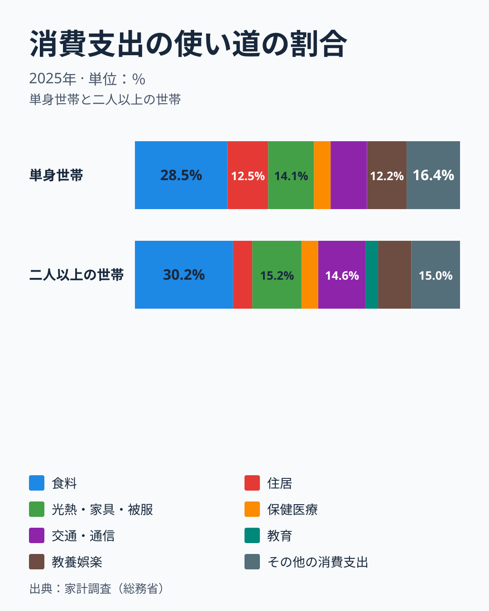
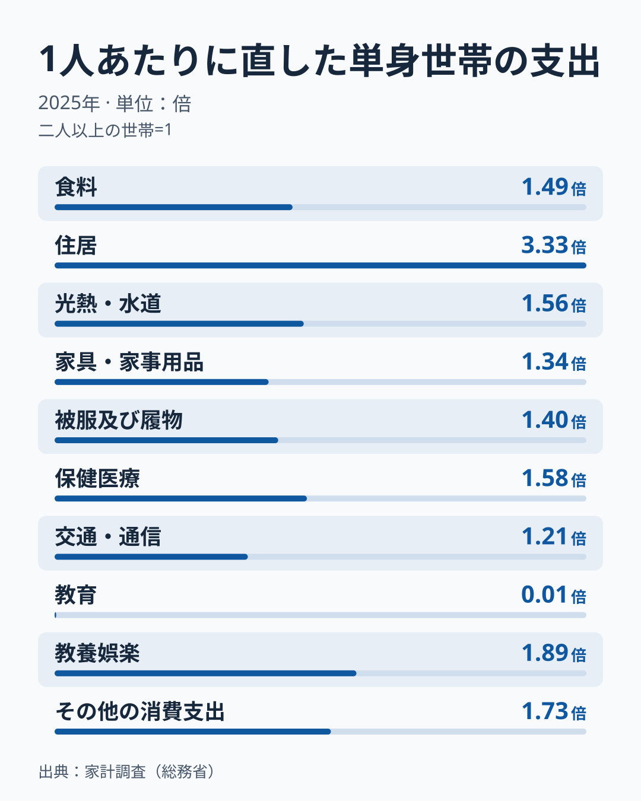
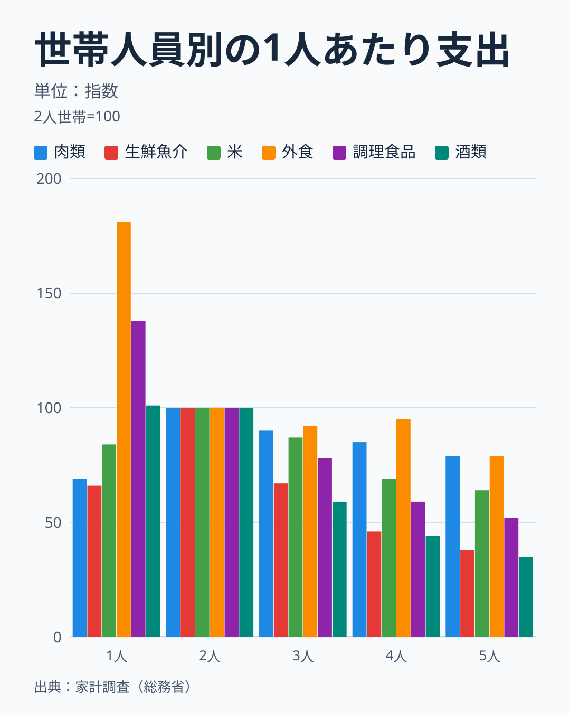
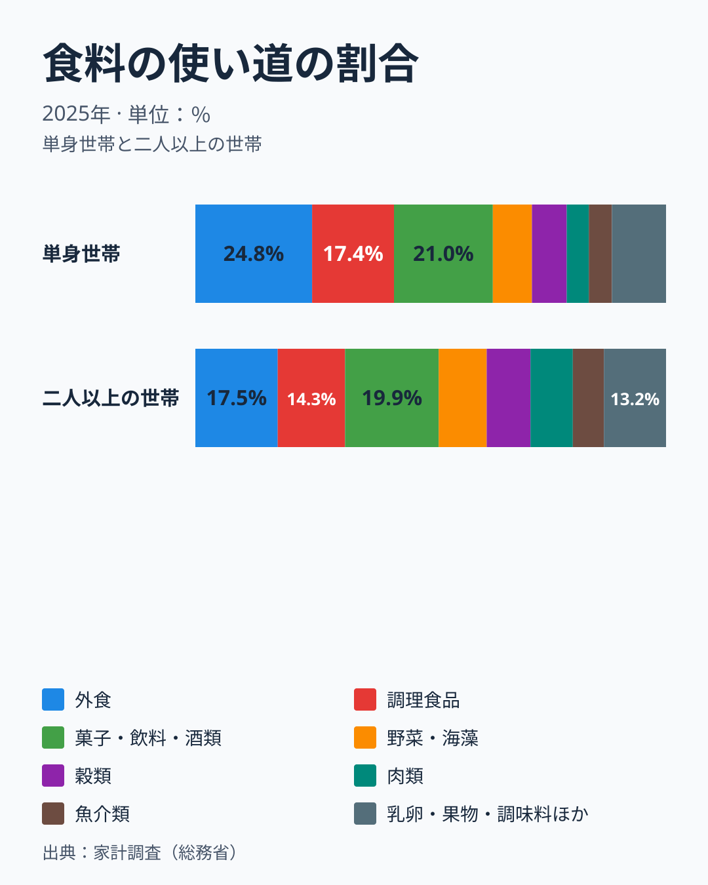
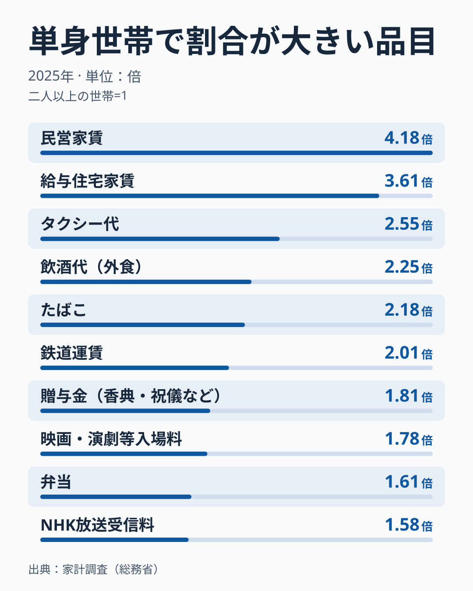
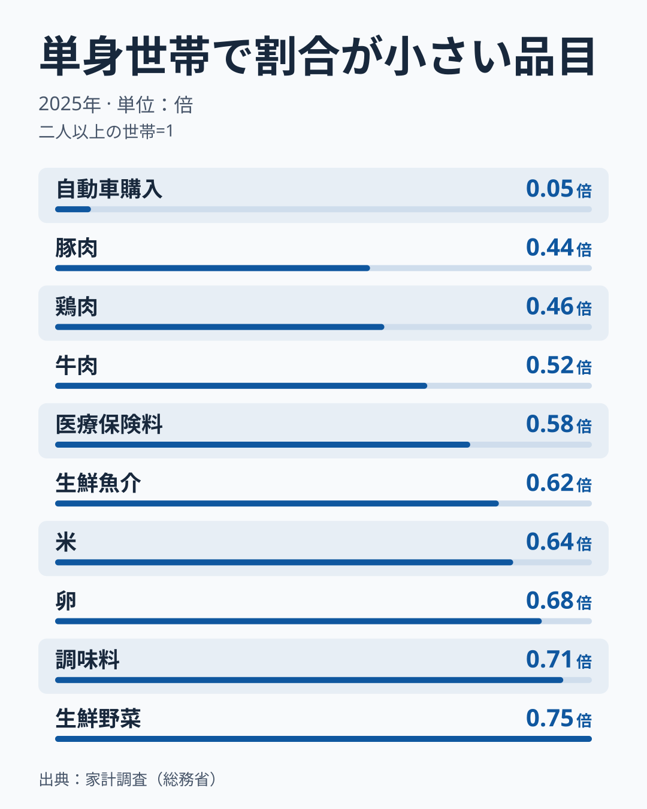
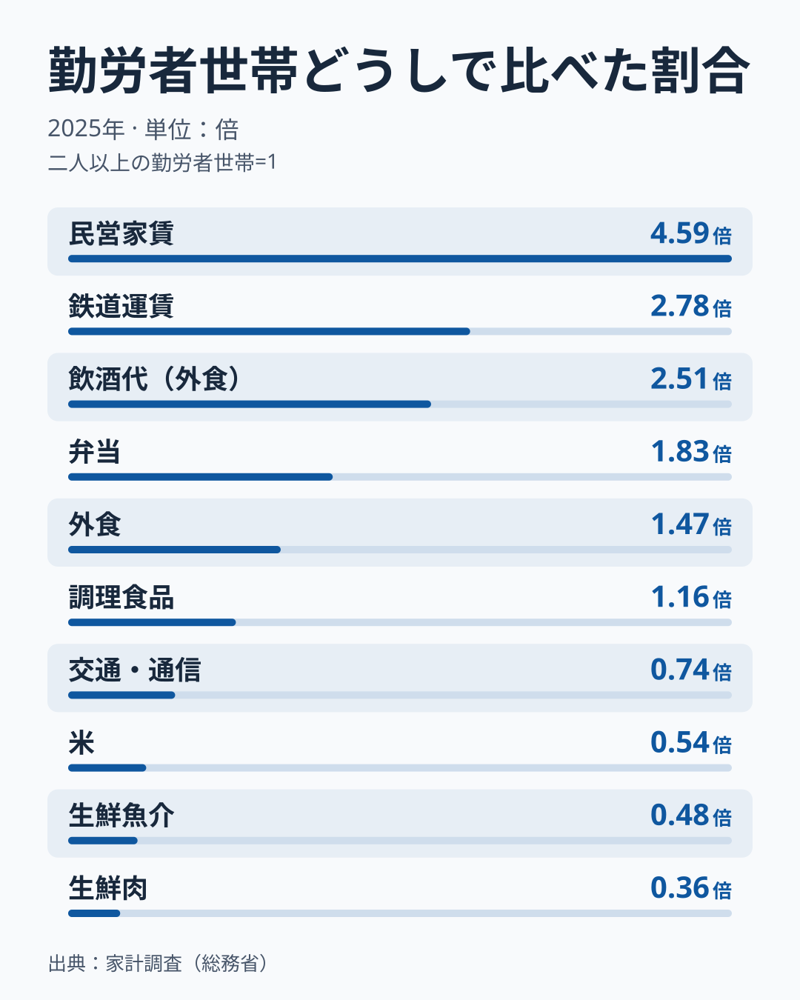
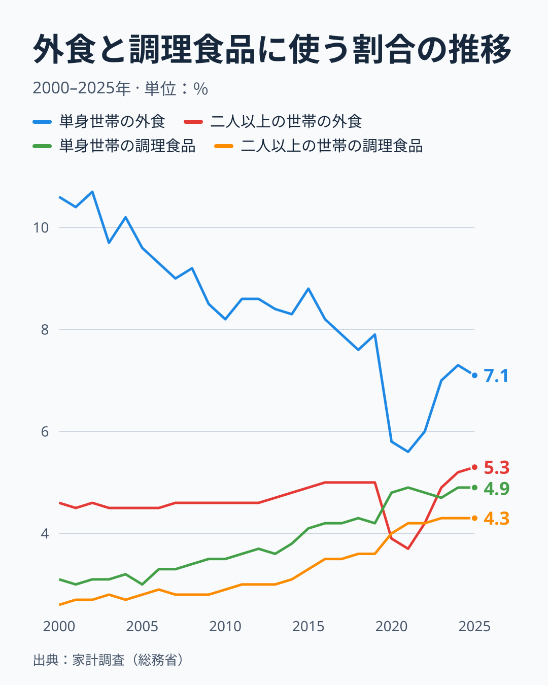
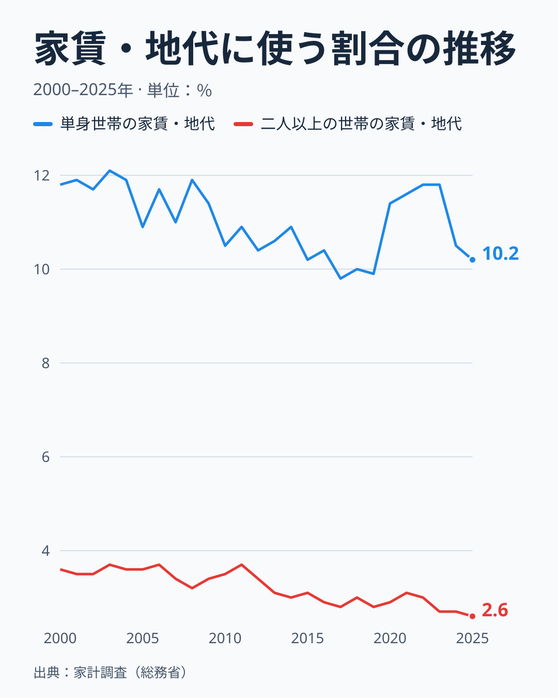
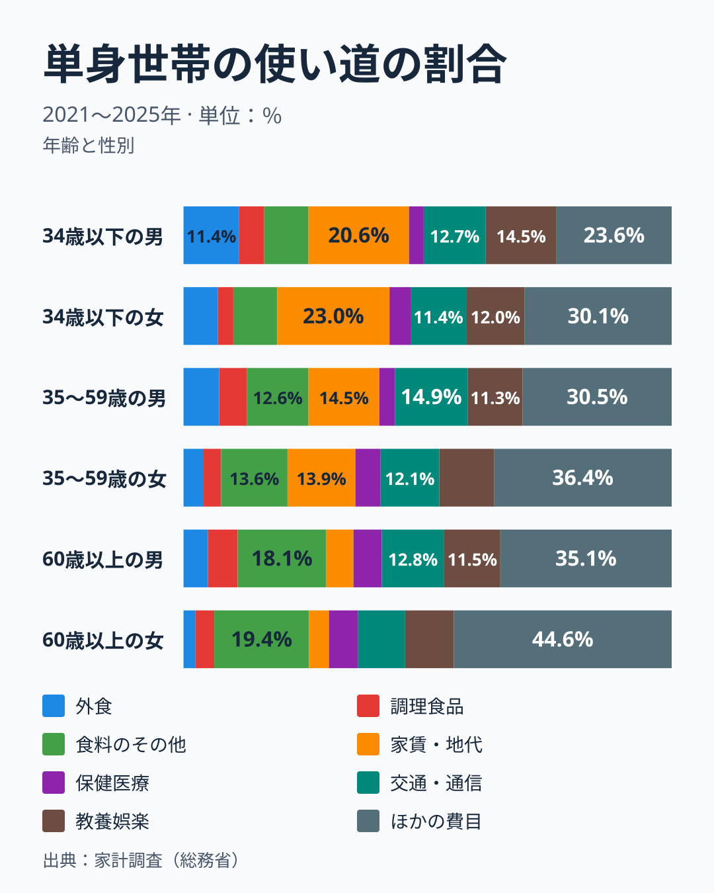

一人暮らしの世帯は、二人以上の世帯と何の買い方が違うのでしょうか。家計調査の2025年の年間支出で比べると、いちばん大きな違いが出たのは家賃と自動車でした。消費支出に占める民営家賃の割合は、単身世帯が9.2%、二人以上の世帯が2.2%で、単身世帯は4.2倍です。反対に自動車の購入は、単身世帯が0.2%、二人以上の世帯が2.9%で、単身世帯は0.05倍にとどまります。教育も単身世帯はほぼゼロですが、これは子どもと暮らさない世帯の構造の違いです。

食料に使う割合は、単身世帯の28.5%と二人以上の世帯の30.2%でほとんど変わりません。違うのは食料の中身で、単身世帯は外食と調理食品が食料の42.2%を占め、二人以上の世帯の31.8%を10.4ポイント上回ります。生鮮肉は消費支出に占める割合が二人以上の世帯の0.46倍です。人数の違いをならすために二人以上の世帯の支出を平均世帯人員の2.87人で割っても、生鮮肉は1人あたり0.73倍、自動車購入は0.09倍と、一人暮らしのほうが少ない側に残ります。

ただし、単身世帯の標本は646世帯と小さく、年齢と性別でさらに分けると数十世帯の区分も出てきます。この記事は、どこまでが確かな違いで、どこからが読みすぎになるのかを、別の年、勤労者世帯どうし、世帯人員別という3つの角度から確かめながら進めます。

## 三つの比べ方と、比べる相手

世帯の人数が違うので、「何が違うのか」への答えは比べ方で変わります。この記事では次の三つを使います。

- 世帯あたり: 1世帯の年間支出をそのまま比べます。財布の大きさの違いを見る方法です。
- 1人あたり: 二人以上の世帯の支出を平均世帯人員の2.87人で割り、単身世帯の1人と比べます。人数の違いをならした見方です。
- 割合: 消費支出に占める割合を比べます。お金を何に回しているかの違いを見る方法です。

消費支出は、単身世帯が年間2,076,507円(月平均173,042円)、二人以上の世帯が年間3,768,007円(月平均314,001円)です。世帯あたりでは単身世帯が二人以上の世帯の0.55倍で、1人あたりでは1.58倍に逆転します。さらに、世帯人員の平方根で割る換算を使うと0.93倍になり、換算の仕方しだいで「一人暮らしのほうが多い」とも「少ない」とも言えてしまいます。

この三つは別の情報ではなく、同じ値を別の基準線で読み替えたものです。ある品目の割合の倍率は世帯あたりの倍率を0.55で割った値、1人あたりの倍率は世帯あたりの倍率に2.87をかけた値なので、どの見方でも品目を並べたときの順序は変わりません。変わるのは「多い」「少ない」を分ける基準線だけで、割合なら1倍、1人あたりなら消費支出全体の1.58倍、世帯あたりなら0.55倍です。この記事は、全体の水準そのものではなく、全体よりも多いか少ないかの品目の順序を中心に読みます。

比べる相手は、総世帯ではなく二人以上の世帯にします。総世帯の消費支出は年間3,118,554円で、これを単身世帯と二人以上の世帯の加重平均とみなすと、単身世帯の重みは38.4%と計算できます。食料、住居、光熱・水道、交通・通信、教養娯楽、外食、生鮮肉で同じ計算をしたところ、重みは38.3%から38.4%にそろいました。総世帯は単身世帯と二人以上の世帯を混ぜた値であり、混ぜた値と比べると一人暮らしの特徴が4割ほど薄まって見えます。

比べる二つの世帯は、中身も違います。単身世帯は、総務省統計局の家計調査では学生の単身世帯などを除いて集計されており、学生ではない一人暮らしの世帯の姿です。世帯主の平均年齢は単身世帯が58.6歳、二人以上の世帯が60.7歳で近い一方、持ち家率は59.0%と87.3%、家賃・地代を支払っている世帯の割合は35.1%と11.7%です。二人以上の世帯には、1世帯あたり平均0.52人の18歳未満と0.86人の65歳以上がいます。人数だけでなく、住まいと家族の構成が違う世帯どうしを比べていることを、先に押さえておきます。

> [!NOTE]
> この記事の2025年の値は、品目分類の年次表(単身世帯と総世帯と二人以上の世帯)と、用途分類の年次表(単身世帯の年齢別・性別と、二人以上の世帯の世帯人員別)の2種類を使います。同じ単身世帯の2025年でも、食料は品目分類で年間591,850円、用途分類の月平均を12倍した値で535,908円と一致しません。外食が消費支出に占める割合も、品目分類は7.1%、用途分類は5.6%です。食料の範囲が表で違う理由はこの記事では確かめていないので、二つの表の数字は同じ図や同じ文の中で混ぜません。

## 割合で見ると、住居の12.5%と教育のゼロが目立つ

まず、世帯の大きさを消して、消費支出の使い道の割合を比べます。

差が3ポイント以上あるのは、住居、交通・通信、教育の3つです。食料は1.7ポイント、教養娯楽は2.0ポイントの差で、保健医療は5.1%で同じです。光熱・水道、家具・家事用品、被服及び履物をまとめた区分も14.1%と15.2%で近く、日々の生活に要る費目の配分は、世帯の人数が違っても大きくは変わりません。

住居は単身世帯が12.5%、二人以上の世帯が5.9%で、単身世帯は2.1倍です。住居の81%は家賃・地代で、単身世帯の家賃・地代は年間211,268円です。単身世帯は家賃・地代を支払っている世帯が35.1%いて、二人以上の世帯の11.7%より多く、持ち家率も59.0%と87.3%で差があります。年間平均の家賃・地代を、支払っている世帯の割合35.1%で割ると、支払っている世帯の1世帯あたりは年間およそ60.2万円、月にして約5.0万円と概算できます。平均を単純に割った概算なので、実際の家賃の分布は表からは分かりません。

交通・通信は単身世帯が11.2%、二人以上の世帯が14.6%です。差の大半は自動車等関係費で、年間101,095円と340,255円です。一方、交通は年間53,927円と68,431円と差が小さく、鉄道運賃だけを見ると単身世帯が28,538円、二人以上の世帯が25,821円と、1世帯あたりでも単身世帯のほうが多くなっています。一人暮らしの移動は車より電車やタクシーに寄っていると読めますが、居住地の違いは表から分からないので、都市部に住んでいるせいなのかまでは言えません。

教育は、単身世帯が年間443円、二人以上の世帯が年間143,269円で、割合は0.0%と3.8%です。単身世帯は子どもと暮らしていない世帯なので、子どもの授業料や補習教育の費用は構造的に入りません。二人以上の世帯の授業料等は年間109,781円、補習教育は31,338円ですが、単身世帯は表に値がありません。この区分は買い方の違いというより、世帯の構成の違いがそのまま出ています。

<source-link href="/ranking/private-rent-consumption-expenditure">民営家賃の支出額を県庁所在市の二人以上の世帯で見る</source-link>

## 1人あたりに直しても、少ないのは教育と自動車と肉

次に、二人以上の世帯の支出を平均世帯人員の2.87人で割り、単身世帯の1人と比べます。基準線は2つあります。二人以上の世帯の1人と同じ額を表す1倍と、消費支出の全体で単身世帯が上回る1.58倍です。

10の費目のうち、1人あたりでも二人以上の世帯の人を下回るのは教育の0.01倍だけです。交通・通信は1.21倍で、1倍は超えますが、全体の1.58倍には届きません。家具・家事用品の1.34倍、被服及び履物の1.40倍、食料の1.49倍も全体の水準を下回ります。反対に住居は3.33倍、教養娯楽は1.89倍、その他の消費支出は1.73倍で、全体の水準を上回ります。

費目の中を品目に降ろすと、1倍を下回る品目が見えます。自動車購入は0.09倍、肉類は0.78倍で、牛肉が0.83倍、豚肉が0.69倍、鶏肉が0.73倍、生鮮肉は0.73倍です。医療保険料は0.92倍で、生鮮魚介は0.98倍と1倍すれすれ、米は1.01倍でほぼ同じです。食料の中で肉だけが1倍をはっきり下回り、魚と米は二人以上の世帯の人とほぼ同じ額に収まります。反対に、外食は2.12倍、調理食品は1.81倍、飲酒代は3.56倍、民営家賃は6.62倍です。

1人あたりの見方には限界もあります。二人以上の世帯の2.87人は子どもと高齢者を含む平均で、大人1人あたりではありません。家賃や光熱・水道、家電のように世帯で共有する費目は、人数で割るほど単身世帯が多く見えます。そのため、この図の倍率を「一人暮らしの人は何倍使っている」と読むのは避けるべきです。個人が食べる量に近いのは、世帯で共有しにくい生鮮肉や米のような食材の値のほうです。また、ここで見ているのは金額で、単身世帯の品目表には購入数量がないため、「肉を買う量が少ない」とは言えず、「肉に使う金額が少ない」までが確かな範囲です。

## 世帯の人数別に並べると、肉と魚は2人世帯がもっとも多い

肉の支出が少ないのは、一人暮らしだからなのでしょうか。それとも、世帯の人数が増えるほど1人あたりの肉は減るという、一般的な傾向の一部にすぎないのでしょうか。二人以上の世帯を2人、3人、4人、5人に分けた用途分類の表と、単身世帯の用途分類を並べて確かめます。値は1人あたりに直した月平均の支出額で、2人世帯を100にそろえています。標本は2人世帯が3,739世帯、3人世帯が1,679世帯、4人世帯が1,333世帯、5人世帯が406世帯です。

肉類は、1人あたりで2人世帯が月3,225円でもっとも多く、3人世帯が2,909円、4人世帯が2,746円、5人世帯が2,535円と、人数が増えるほど減ります。ところが単身世帯は2,238円と2人世帯より少なく、2人世帯を100にした指数で69です。生鮮魚介も、2人世帯の1,690円に対して単身世帯は1,107円で66と、同じ向きです。人数が増えて1人あたりが減る傾向だけなら、単身世帯がもっとも多くなるはずですが、肉と魚は逆に2人世帯が頂点になっています。

米は単身世帯が84で、2人世帯より少なく、3人世帯の87とほぼ同じ水準です。野菜は単身世帯の指数が85です。反対に、外食は単身世帯が月9,761円で2人世帯の5,403円の1.81倍、調理食品は8,289円で6,022円の1.38倍です。2人世帯から5人世帯までは調理食品が1人あたりで減り続け、外食もおおむね減る向きで、単身世帯だけが突出して高く、一人暮らしの外食と調理食品の厚さは、世帯の人数のスケールメリットでは説明できない水準です。

その他の費目を2人世帯と比べると、一人暮らしの特徴がさらに絞られます。消費支出の全体は単身世帯が月173,042円、2人世帯が月140,507円で1.23倍です。家賃・地代は17,606円と3,710円で4.75倍、光熱・水道は1.18倍、教養娯楽は1.43倍で、保健医療が1.07倍、食料が1.13倍と続きます。一方、交通・通信は19,190円と19,758円で0.97倍、酒類は1,947円と1,923円で1.01倍と、2人世帯の人とほぼ同じです。2人世帯と比べても、一人暮らしの特徴は家賃と外食、調理食品の厚さと、肉と魚の薄さです。

肉と魚が2人世帯より少ない理由は、この表だけでは分かりません。[仮説] 2人以上で食卓を囲むと一度に調理する量が増え、食材を買う頻度が上がる可能性があり、一人分では肉や魚を買う機会が減るのかもしれません。検証には、食材ごとの購入頻度や1回あたりの購入量が分かる統計が要ります。なお、この表には世帯主の年齢別の内訳がないので、2人世帯と単身世帯の年齢構成の違いを取り除いた比較にはなっていません。

## 食料の中身は、外食と調理食品が10ポイントほど多い

食料の割合は同じでも、使い道の配分は違います。品目分類で、食料の中の割合を比べます。

単身世帯の食料は、外食が24.8%、調理食品が17.4%で、2つで42.2%を占めます。二人以上の世帯は外食が17.5%、調理食品が14.3%で、2つで31.8%です。外食と調理食品の合計は、単身世帯が10.4ポイント多くなります。反対に、肉類は単身世帯が4.7%、二人以上の世帯が9.0%で、ほぼ半分です。穀類は7.4%と9.3%、野菜・海藻は8.3%と10.2%、魚介類は4.9%と6.6%で、いずれも単身世帯のほうが小さくなっています。

外食全体は、単身世帯が年間146,908円で、二人以上の世帯の198,759円の74%です。世帯の人数は2.87倍違うのに、世帯あたりの外食はこの程度しか違わないことが、1人あたり2.12倍という値を作っています。調理食品は、弁当、おにぎり、そう菜、冷凍食品などを含みます。弁当は、総務省統計局の収支項目分類の内容例示で、飲食店以外の持ち帰りのもの(冷凍は除く)とされています。弁当は単身世帯が年間16,811円、二人以上の世帯が18,968円で、1世帯あたりでもほぼ同じ金額です。二人以上の世帯の弁当を1人あたりにすると年間約6,600円で、単身世帯の約4割です。

飲酒代は、単身世帯が年間24,153円で、二人以上の世帯の19,498円を上回ります。世帯あたりでも単身世帯のほうが多い数少ない品目の一つです。ここまでの配分から、一人暮らしの食事は「外で食べる」「できあがったものを買う」に寄っていると読むのは自然ですが、料理をしているかどうかは家計調査から分かりません。材料を一度にまとめて買えば、割合は変わります。表が示すのは、家計簿の上でそう見える配分だけです。

## 品目まで降りると、多いのは家賃と飲酒代、少ないのは自動車と肉

費目の中の違いを品目まで降ろして、単身世帯の割合が二人以上の世帯の何倍かを並べます。割合が大きい品目から見ます。

いちばん大きいのは民営家賃の4.18倍で、給与住宅家賃(社宅などの家賃)が3.61倍で続きます。民営家賃は、2019年から2025年の7年間でこの倍率が3.99倍から4.81倍の範囲に収まり、毎年4倍前後です。次に、タクシー代が2.55倍、鉄道運賃が2.01倍と、交通の足にかかわる品目が並びます。飲酒代が2.25倍、映画・演劇等入場料が1.78倍、たばこが2.18倍は、外での過ごし方や嗜好品です。贈与金(香典、祝儀、見舞金など)は1.81倍、弁当は1.61倍、NHK放送受信料は1.58倍です。放送受信料は世帯ごとに契約する性格の支出なので、世帯の人数が少ないほど割合が大きく出ます。一人暮らしの人が特別に払っているのではなく、世帯あたりの固定費が人数で割られない効果です。

品目の倍率は、年による振れが大きいものもあります。飲酒代は2019年から2025年の範囲が2.25倍から6.31倍で、2025年はその中で最小です。単身世帯が二人以上の世帯の2倍以上を毎年飲酒代に使っていることは言えても、2.25倍という数字を安定した値とは読めません。映画・演劇等入場料も1.65倍から2.55倍、タクシー代も2.23倍から3.98倍の範囲があります。

続いて、割合が小さい品目を並べます。

いちばん小さいのは自動車購入の0.05倍です。2019年から2025年の範囲は0.03倍から0.15倍ですが、毎年0.2倍を超えることはありませんでした。自動車購入は、年によって買う世帯としない世帯が分かれるため、値が不安定になる品目の代表です。単身世帯の標本は646世帯なので、数世帯が車を買うかどうかで大きく動きます。それでも「単身世帯の自動車購入の割合は二人以上の世帯の数分の1以下」という方向は、7年のどの年でも変わりませんでした。

食料の品目は、肉がもっとも小さくなります。豚肉が0.44倍、鶏肉が0.46倍、牛肉が0.52倍で、この3つは2019年から2025年の7年間で0.44倍から0.58倍の範囲に収まっています。続いて医療保険料が0.58倍、生鮮魚介が0.62倍、米が0.64倍、卵が0.68倍、調味料が0.71倍、生鮮野菜が0.75倍です。調理をしないと食べられない食材が、0.44倍から0.75倍の範囲に並び、調理済みの食品と外食が大きい結果と同じ方向です。

## 勤め人どうしで比べても、差は縮まらずに広がる

ここまでの比較は、年金で暮らす高齢の単身世帯が混ざっていて、働いていない世帯の影響が差を作っているのではないか、という疑問が残ります。そこで、世帯主が勤め先に雇われている世帯だけに絞り、単身の勤労者世帯と、二人以上のうち勤労者世帯で同じ比較をやり直しました。

2025年の標本は、単身の勤労者世帯が226世帯、二人以上の勤労者世帯が3,913世帯です。世帯主の平均年齢は43.3歳と51.0歳で、全体の比較(58.6歳と60.7歳)より年齢の差は2.1歳から7.7歳に広がりました。働いていない高齢世帯を除くと、単身世帯のほうがはっきり若くなるためです。持ち家率は34.1%と82.2%、家賃・地代を支払っている世帯の割合は56.3%と16.5%で、二人以上の勤労者世帯の平均世帯人員は3.2人です。

結果は、全体の比較と同じ方向で、差はむしろ広がりました。民営家賃は全体の4.18倍から勤労者世帯では4.59倍になり、飲酒代は2.51倍、弁当は1.83倍、外食は1.47倍です。反対に、生鮮肉は全体の0.46倍から0.36倍、生鮮魚介は0.62倍から0.48倍、米は0.64倍から0.54倍に小さくなりました。食料の割合は単身の勤労者世帯が26.4%、二人以上の勤労者世帯が28.3%で、ここでも大差はなく、住居の割合は15.8%と5.8%で、単身の勤労者世帯が2.7倍です。1人あたりに直すと、二人以上の勤労者世帯の世帯人員3.2人で割った場合に、生鮮肉は0.63倍、米は0.96倍、外食は2.61倍で、全体の消費支出は1.77倍です。

したがって、一人暮らしの家計の特徴は、働いていない高齢世帯が混ざっているだけでは説明できません。働く世帯どうしに絞るほど、家賃と外食に厚く、肉と米と魚に薄い向きが強く出ます。ただし、勤労者世帯に絞ると単身世帯のほうが若くなり、二人以上の世帯の勤労者は子育て期の世帯が中心になるため、世代の違いを取り除いた比較にはなりません。単身の勤労者世帯の標本は226世帯と小さく、年ごとの振れも大きくなります。飲酒代の倍率は2019年から2025年に2.51倍から8.38倍の範囲で、2025年は7年の中で最小でした。民営家賃は4.37倍から5.14倍、弁当は1.76倍から2.64倍、米は0.37倍から0.54倍で、いずれも7年を通じて1を挟まず同じ側にありますが、小数第2位の倍率に意味を持たせるのは避けるべきです。

## 外食は減り続けたのか、年齢のせいなのか

外食の違いは、時間の中でどう動いてきたのでしょうか。品目分類で、2000年から2025年の推移を見ます。

単身世帯の外食の割合は、2000年に10.6%でした。その後は2019年の7.9%まで下がり、2021年に5.6%まで落ち込んだあと、2025年は7.1%です。二人以上の世帯の外食は、2000年の4.6%から2019年の5.0%までほぼ横ばいで、2021年に3.7%まで落ち、2025年は5.3%と、2019年を上回りました。単身世帯の外食は、二人以上の世帯の2.3倍(2000年)から、1.3倍(2025年)に縮まっています。

調理食品は両方の世帯で伸びています。単身世帯は2000年の3.1%から2025年の4.9%、二人以上の世帯は2.6%から4.3%です。単身世帯は外食の割合が下がり調理食品の割合が上がったため、2021年には外食5.6%に対して調理食品4.9%まで差が縮まりました。2025年は外食が7.1%、調理食品が4.9%で、2つの合計は12.0%、二人以上の世帯の合計は9.6%です。

> [!WARNING]
> 2020年と2021年の外食は、新型コロナウイルス感染症の流行による外出の自粛や営業の制限で大きく落ちています。単身世帯の5.6%と二人以上の世帯の3.7%は2021年の値です。「外食の習慣が変わった」と読む場合は、2021年の底から2025年への戻り(単身世帯も二人以上の世帯も約1.5ポイント)も合わせて見る必要があります。

単身世帯の外食の割合が下がったのは、一人暮らしの人の年齢が上がったからではないか、という見方も成り立ちます。そこで用途分類の表で、2007年から2025年の単身世帯の外食(用途分類の外食)の割合を、世帯主の年齢別(34歳以下、35〜59歳、60歳以上)に分けて確かめました。この分解は用途分類の2007〜2025年の結果で、品目分類の2000〜2025年の低下に年齢構成がどれだけ効いたかは確かめていません。重みには世帯数分布(抽出率調整)を使い、全体の割合は「世帯数×外食の月平均額」の合計を「世帯数×消費支出の月平均額」の合計で割って組み立てています。反事実は、年齢別の世帯数の重みだけを別の年に差し替え、年齢別の消費支出と外食の額は固定した年のものを使います。重みや消費支出の組み方を変えると年齢構成の寄与は0.3〜0.7ポイントほど動きますが、低下の大半が年齢構成ではないという結論は変わりません。

外食の割合は、2007年の7.7%から2025年の5.6%へ、2.1ポイント下がりました。60歳以上の世帯の重みは、2007年の47.3%から2025年の52.6%に増えています。年齢別の外食の割合を2007年に固定し、世帯の構成だけを2025年にそろえて計算すると7.4%で、年齢の構成の変化だけで説明できる低下は0.3ポイントにとどまります。反対に、世帯の構成を2007年に固定して年齢別の外食の割合を2025年の値にすると5.8%です。低下の大半は年齢の構成ではなく同じ年齢の中での変化で、とくに35〜59歳の世帯で9.5%から5.6%に下がっています。34歳以下は11.6%から9.8%、60歳以上は4.0%から3.8%でした。

外食の割合が同じ年齢の中で下がった理由は、この表だけでは分かりません。[仮説] 在宅勤務の定着や宅配、調理食品の増加が影響している可能性がありますが、期間中の変化を原因に結びつける材料は表にありません。検証には、勤務形態や調理食品の購入先を調べた別の統計が要ります。

<source-link href="/ranking/dining-out-consumption-expenditure">外食の支出額を県庁所在市の二人以上の世帯で見る</source-link>

家賃・地代の割合は、外食と対照的に動きません。

単身世帯は2000年の11.8%から2025年の10.2%へ、二人以上の世帯は3.6%から2.6%へ、単身世帯は1.6ポイント、二人以上の世帯は1.0ポイント下がりました。単身世帯の割合は2021年から2023年に11.6%、11.8%、11.8%と11%台で推移し、2024年に10.5%、2025年に10.2%と下がっています。二人以上の世帯との倍率は2000年が3.2倍、2025年が3.95倍です。年ごとの倍率は2011年の2.9倍から2023年の4.4倍の範囲で動き、2020年代は3.7倍から4.4倍と高めです。外食のように倍率が2.3倍から1.3倍へ縮まった品目とは違い、家賃の差は25年間消えず、むしろ広がっています。

## 一人暮らしといっても、買い方は一つではない

ここまでは単身世帯を一つに束ねて見てきましたが、中身は若い人と高齢の人、男性と女性で大きく違います。用途分類の表で、世帯主の年齢と性別に分けて、使い道の割合を見ます。値は2021年から2025年の5年分を、各年の集計世帯数で重みづけしてまとめています。この5年には外食が落ち込んだ2021年と2022年が含まれ、値はコロナ禍の影響を受けています。

もっとも違うのは家賃・地代です。34歳以下の男は20.6%、34歳以下の女は23.0%を家賃・地代に使い、35〜59歳は男14.5%、女13.9%、60歳以上は男5.6%、女4.1%です。年齢が上がるほど小さくなるのは、持ち家の世帯が増えるためと考えられます。2025年の持ち家率は34歳以下の男が7.4%、女が8.4%に対し、60歳以上の男は80.2%、女は85.6%です。なお、この34歳以下は学生の単身世帯を除いた集計です。

外食の割合は、34歳以下の男が11.4%でもっとも高く、34歳以下の女は7.0%、35〜59歳は男7.3%、女4.0%、60歳以上は男5.0%、女2.4%です。同じ年齢でも男性のほうが女性より外食の割合が高く、いちばん高い区分(34歳以下の男)といちばん低い区分(60歳以上の女)で、外食の割合に4.8倍の開きがあります。区分ごとの外食の割合を5年のそれぞれで見ても、34歳以下の男は10.3%から13.0%、60歳以上の女は1.9%から2.8%の範囲に収まり、いちばん高い区分といちばん低い区分の序列は、どの年でも入れ替わりませんでした。

調理食品の割合は、60歳以上の男が6.1%でもっとも高く、女は34歳以下が3.2%、35〜59歳が3.7%、60歳以上が3.9%と、男より小さくなります。60歳以上の男は外食が5.0%、調理食品が6.1%と、外食よりも調理食品に多く使っています。一方、60歳以上の女は食料のその他(調理食品と外食を除く食料)が19.4%と6区分で最も高く、食材を買う比率が高い区分です。保健医療は、34歳以下の男が3.0%、60歳以上の女が5.9%で、年齢が上がるほど大きくなります。家賃・地代と保健医療に限れば、年齢による差(家賃・地代は男で20.6%と5.6%、保健医療は女で4.3%と5.9%)が、同じ年齢の中の男女差より大きく出ています。外食と調理食品は、年齢の差と性別の差が同じ程度か、性別の差のほうが大きい項目です。

> [!WARNING]
> 区分ごとの標本は小さく、34歳以下の女は5年を合わせても集計世帯数が110世帯、1年あたり20世帯前後です。34歳以下の男は5年で231世帯、35〜59歳の男は297世帯、女は294世帯、60歳以上の男は615世帯、女は1,718世帯でした。外食の年ごとの値が区分によって0.9〜2.9ポイントの幅で動くので、34歳以下の区分どうしの差(男11.4%と女7.0%など)は、方向は読めても大きさは確定できません。

## この比較から言えること、言えないこと

ここまでの結果を、確かさの順に整理します。

確かに言えるのは、一人暮らしの世帯で割合が大きい品目が、7年のどの年でも家賃、電車とタクシー、飲酒代、たばこ、放送受信料などに偏ることです。民営家賃は2019年から2025年の7年間、倍率が3.99倍から4.81倍に収まりました。反対に、自動車購入と肉の割合が小さいことは、7年のどの年でも同じ方向でした。肉は勤労者世帯どうしでも、世帯人員別の2人世帯と比べても少ない側です。

ある程度言えるのは、食料の配分が外食と調理食品に偏ることです。割合の差は10ポイント程度あり、年を変えても、勤労者世帯どうしに絞っても方向は変わりません。ただし、時間の中では単身世帯の外食の割合が2000年の10.6%から2025年の7.1%へと下がっており、「単身世帯の外食の多さ」は25年前より縮まっています。

言えないのは、価格の違いと購入量の違いの区別です。ここで使った品目は支出額で、同じ割合の差が「たくさん買う」のか「高いものを買う」のか、この表では分けられません。単身世帯の全国の品目表は金額だけで、購入数量はありません。また、世帯の中身のすべても分けられません。勤労者世帯どうしの比較で働いていない高齢世帯の影響は確かめましたが、居住地(都市部に住む割合)や収入の違いは分けていません。二人以上の世帯は農林漁家世帯を含み、自家消費やもらい物の食料は支出に入りません。

最後に、世帯あたり、1人あたり、割合の三つは同じ値の定数倍で、独立した確認にはなりません。三つの見方で同じ向きになるのは当然なので、確かさを高めるのは、別の年、勤労者世帯どうし、世帯人員別のように、比べる集団や期間を変えた確認のほうです。この記事で確かめた範囲では、民営家賃の割合の大きさと生鮮肉の小ささは、別の年、勤労者世帯どうし、世帯人員別のどれでも変わりませんでした。自動車購入と飲酒代は、別の年での確認までで、勤労者世帯と世帯人員別では値を出していません。弁当は世帯あたりでほぼ同じ(年間16,811円と18,968円)で、1人あたりでは2.54倍、割合では1.61倍と、基準線によって「多い」「同じ」と言い方が変わる品目です。

## まとめ

- 消費支出に占める割合は、民営家賃が単身世帯9.2%、二人以上の世帯2.2%で4.2倍、自動車購入は0.05倍、生鮮肉は0.46倍でした。
- 食料の割合は28.5%と30.2%でほぼ同じで、食料の中身は単身世帯が外食24.8%、調理食品17.4%、肉類4.7%、二人以上の世帯が外食17.5%、調理食品14.3%、肉類9.0%です。
- 1人あたりに直すと、消費支出全体は単身世帯が1.58倍で、その中で生鮮肉は0.73倍、自動車購入は0.09倍、教育は0.01倍と少ない側に残ります。
- 世帯人員別(用途分類)に見ると、1人あたりの肉類と生鮮魚介は2人世帯がもっとも多く、単身世帯は2人世帯の69%と66%でした。外食は2人世帯の1.81倍です。
- 単身の勤労者世帯と二人以上の勤労者世帯に絞っても方向は同じで、民営家賃は4.59倍、生鮮肉は0.36倍、外食は1.47倍と、差はむしろ広がりました。
- 単身世帯の外食の割合は、品目分類で2000年の10.6%から2025年の7.1%へ下がりました。用途分類の2007〜2025年の分解では、低下の大半が年齢構成ではなく同じ年齢の中での変化です。
- 一人暮らしの買い方は一つではなく、用途分類の2021〜2025年の合算で、34歳以下の男は家賃・地代20.6%と外食11.4%、60歳以上の女は家賃・地代4.1%と食料のその他19.4%と、年齢で大きく分かれます。

家計の地域差も気になる方は、食料に使うお金の指標をまとめた[家計・食費のテーマ](/themes/household-food-spending)や、調査そのものの解説の[家計調査](/survey/kakei-chousa)をどうぞ。物価高で買い方が変わった品目は[アイスは+32%、ぎょうざは-8%の記事](/blog/household-spending-before-after-inflation)に、世帯の構造の地域差は[都市は独居、地方は共働きの記事](/blog/household-solo-vs-dualincome)にまとめています。
