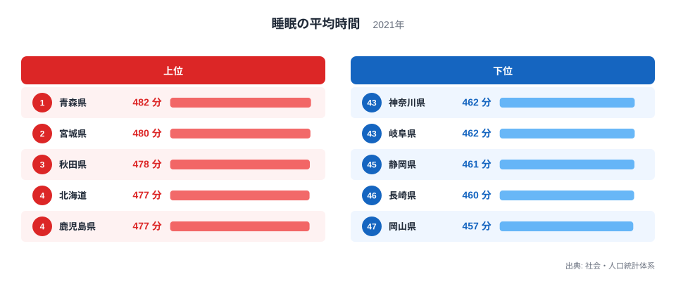
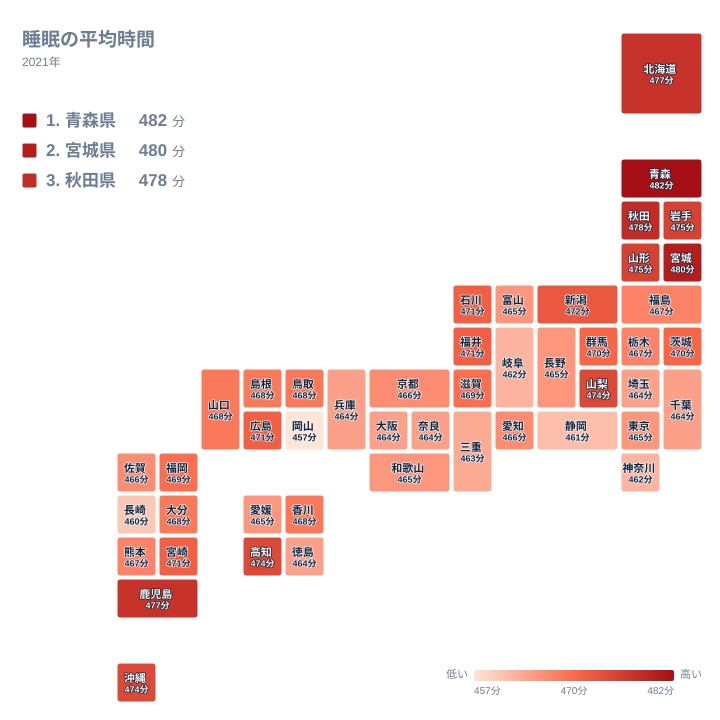

毎日の睡眠にどれだけの時間を充てているかは、地域の暮らし方がそのまま表れる指標です。2021年の調査で、睡眠の平均時間が最も長かったのは青森県の482分でした。一方、最も短かったのは岡山県の457分です。この記事では、都道府県ごとの並びを確かめながら、なぜそのような順になるのかを地理や産業、暮らしの面から考えます。

## 睡眠の平均時間が長い県と短い県

まず、上位と下位の顔ぶれを図で確かめます。

<source-link href="/ranking/sleep-avg-time-female">睡眠の平均時間ランキングをもっと見る</source-link>

1位は青森県で482分です。2位は宮城県の480分、3位は秋田県の478分と続きます。4位は北海道の477分、5位は鹿児島県の477分で、この二つは分単位では同じ値です。上位には北海道・東北の道県が目立ち、九州・沖縄から鹿児島県が割って入る形になっています。

下位に目を向けると、47位は岡山県の457分です。46位は長崎県の460分、45位は静岡県の461分、44位は岐阜県の462分、43位は神奈川県の462分でした。最下位の岡山県と、最上位の青森県を並べると、睡眠の平均時間には小さくない開きがあることがわかります。

ただし、真ん中あたりの県は値がごく近く、ほとんど横一線です。東京都は31位で465分、愛知県は28位で466分、大阪府は38位で464分です。順位の差が数分に収まる帯の中に、多くの県がひしめいています。極端な位置にいる県と、その他の県とでは、順位の意味合いが異なる点に注意が必要です。

> [!NOTE]
> この指標は、睡眠にあてた時間を平均した値で、単位は分です。2021年の調査にもとづく「睡眠の平均時間」で、地域ごとの暮らし方を比べる目的に向いています。一方で、眠りの質や寝つきの良さ、夜中に目覚める回数までは反映していません。

## 上位に北海道・東北が並ぶ背景

上位を眺めると、青森県、宮城県、秋田県、北海道、岩手県、山形県が7位までに入っています。北海道・東北の道県が上位に固まる傾向は、はっきりしています。同じ地方の福島県は25位で467分と中位にとどまるため、すべてが一様ではありませんが、全体としては長く眠る地域といえます。

理由を一つに絞ることはできませんが、いくつか候補が考えられます。一つは、冬の長さと日照の条件です。寒さが厳しく、日が短い季節が長いと、屋外での夜の活動が減り、早めに床に就く暮らしになりやすいと考えられます。もう一つは、通勤や通学の事情です。大都市圏のように、長い通勤時間のために朝早く起きて夜遅く帰る生活が主流ではない地域では、睡眠に回せる時間が残りやすくなります。

産業の面でも、農林水産業や地場産業の比重が高い地域では、勤務地と住まいが近い人が多い傾向があります。移動に取られる時間が少ない分、睡眠が長くなるという見方です。ただし、これはあくまで背景として考えられる要因であり、今回のデータだけで因果関係を示せるわけではありません。

最上位の青森県のデータは[青森県のデータ](/areas/02000)から、2位の宮城県は[宮城県のデータ](/areas/04000)から、他の指標とあわせて確かめられます。睡眠の長さが、ほかの暮らしの指標とどう結びつくかを見るきっかけになります。

> [!WARNING]
> 平均値は、地域内のばらつきを隠します。同じ県の中にも、夜勤のある仕事に就く人や、早朝から働く人、高齢で長く休む人など、さまざまな生活があります。県の値が長いからといって、その県の全員がたっぷり眠れているとは限りません。また、調査の回答は本人の記録や申告にもとづくため、実際の睡眠とはずれる可能性があります。

## 下位に並ぶ県は何が違うのか

下位の顔ぶれは、岡山県、長崎県、静岡県、岐阜県、神奈川県です。地方でみると、中国の岡山県、九州・沖縄の長崎県、中部の静岡県と岐阜県、関東の神奈川県と、特定の地方に偏っていません。このため、上位のように地方の特徴だけで説明するのは難しい点が、下位の特徴です。

神奈川県は、東京都への通勤圏を抱える県です。通勤に時間がかかる人が多い環境では、朝の起床が早まり、帰宅も遅くなりがちで、睡眠が削られやすくなると考えられます。静岡県や岐阜県は、製造業の比重が大きい県として知られています。交代制の勤務など、働き方の形が睡眠時間に影響している可能性があります。

最下位の岡山県については、今回のデータだけでは理由を断定できません。特筆すべきなのは、岡山県の457分が46位の長崎県の460分と比べても離れている点です。中位の県が数分の中にまとまるなか、最下位だけが一段低く出ています。この点は、岡山県の暮らしや働き方を、別の指標とあわせて丁寧に見る価値があります。

## 地図で見る睡眠時間の地理分布

次に、地図で分布を確かめます。

地図にすると、北海道・東北の濃い色が一つのまとまりとして見えてきます。青森県、岩手県、宮城県、秋田県、山形県が連なり、北海道もここに加わります。これらはいずれも上位7位までの道県です。北日本に睡眠の長い地域が広がっていることが、視覚的に確かめられます。

一方、関東から中部、近畿にかけての太平洋側の都市部は、色が薄い領域になっています。埼玉県は36位で464分、千葉県は37位で464分、兵庫県は39位で464分、奈良県は40位で464分です。人口の集まる地域ほど、睡眠時間が短い傾向が読み取れます。ただし、東京都は31位で465分と、神奈川県や大阪府よりも上に位置しており、単純な都市部の短さだけでは説明できません。

西日本に目を向けると、まとまりは弱くなります。鹿児島県は5位で477分、高知県は9位で474分、沖縄県は10位で474分と、離れた地域から上位に顔を出します。これに対して長崎県は46位、岡山県は47位です。同じ西日本でも、長い県と短い県が入り混じっています。このため、東西や南北の単純な対比では語れない分布です。

地図を読むときは、色の濃淡の差がそれほど大きくない点にも注意してください。全体の値は457分から482分の範囲に収まっています。色の違いが目立っても、実際の値の開きは限られています。

> [!TIP]
> 順位表を読むときは、順位そのものより、その県の値が周囲とどれだけ離れているかを見るのがコツです。中位の県は値が数分の中に並ぶため、順位が一つ違っても実質的な差は小さいことがあります。逆に、最上位の青森県や最下位の岡山県のように端にある県は、値が周囲から離れており、意味のある違いといえます。

## 数字から読み取れること

ここまでをまとめます。睡眠の平均時間が長い県は、青森県、宮城県、秋田県、北海道、鹿児島県の順で並びました。短い県は、岡山県、長崎県、静岡県、岐阜県、神奈川県です。上位は北海道・東北に集まり、下位は地方がばらばらという非対称な構図になっています。

北日本が長い理由としては、冬の暮らし方、通勤や通学の負担の軽さ、産業構造などが考えられます。都市圏の県が短い側に寄りやすいことも、通勤時間や働き方の違いで説明できそうです。ただし、いずれも推測の域を出ません。今回のデータは、結果としての睡眠時間を示すものであり、原因を直接測ったものではないからです。

睡眠は、健康や仕事の成果、日々の気分にまで関わる基本的な生活の要素です。自分の住む県がどの位置にあるのかを知ることは、生活を見直すきっかけになります。賃金や労働時間など、働き方に関わる指標とあわせて見たい方は、[同じカテゴリの統計一覧](/category/laborwage)も参考にしてください。

## データについて

この記事で使った指標は、社会・人口統計体系にある「睡眠の平均時間」の2021年の値です。単位は分で、都道府県別に47件の値が公表されています。

値は分単位に丸められて公表されているため、同じ値の県が複数あります。たとえば465分には東京都、富山県、長野県、和歌山県、愛媛県が並びます。同じ値でも順位が分かれているのは、公表値の細かい違いによるものと考えられるため、同じ値の県の順位の前後を過度に重視しないようにしてください。

また、2021年は新型コロナウイルスの影響が続いていた時期で、在宅勤務や外出の自粛により、生活の時間配分が通常の年とは異なっていた可能性があります。この年の並びが、その後も変わらず続くとは限りません。年ごとの変化を追うことで、より確かな傾向が見えてきます。
