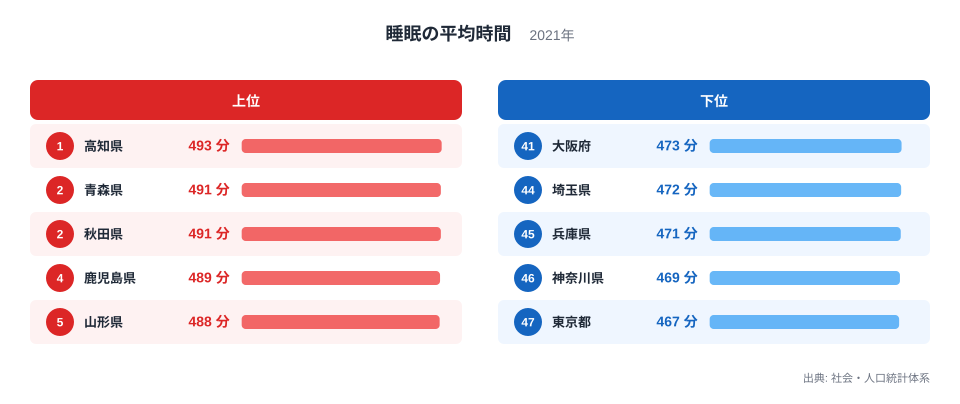
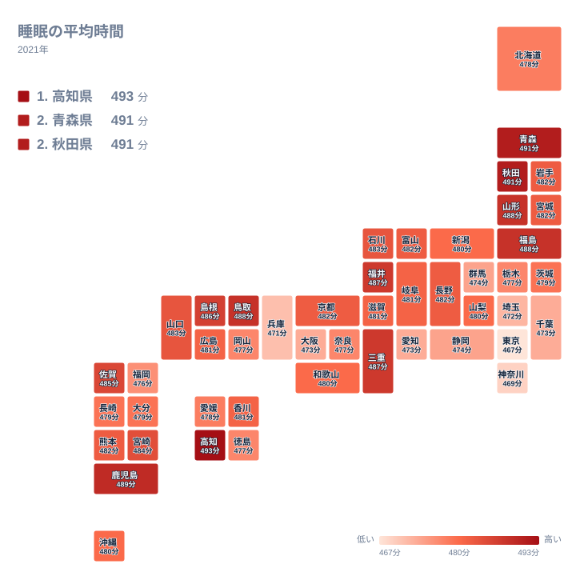

毎日の睡眠は、健康にも仕事の効率にも関わる時間です。2021年の男性の睡眠の平均時間を都道府県で並べると、最も長い高知県は493分で1位、最も短い東京都は467分で47位でした。同じ日本で暮らしていても、眠る時間には県ごとの違いがあります。

この記事では、まず並びの形を図から読み取り、次にそれが地理的にどう分布しているかを確かめます。そのうえで、なぜそうなるのかを仮説として整理します。仮説は、この統計だけでは検証できないものとして扱います。

> [!NOTE]
> この記事の値は男性の睡眠の平均時間で、単位は分です。調査では本人の申告をもとに集計されるため、実際に眠っていた時間を機器で測ったものではありません。布団に入っていた時間と眠っていた時間の区別も、回答する人によって異なる可能性があります。

## 高知県が最長、東京都が最短という両端

まず上位5県と下位5都府県の並びを図で確認します。

<source-link href="/ranking/sleep-avg-time-male">睡眠の平均時間ランキングをもっと見る</source-link>

図で目を引くのは、顔ぶれの偏りです。上位5県は、北海道・東北の青森県、秋田県、山形県の3県に、四国の高知県と九州・沖縄の鹿児島県が加わります。下位5都府県は、関東の東京都、神奈川県、埼玉県と、近畿の兵庫県、大阪府です。上位に地方圏の県が、下位に大都市圏の都府県が集まる構図になっています。

もうひとつ注目したいのは、端の間隔と中位の間隔の違いです。1位の高知県は493分、2位の青森県と3位の秋田県は491分で、先頭は次の県より一段上にいます。最下位の東京都は467分で、46位の神奈川県は469分です。この間隔は、後で見る中位の1分刻みの並びと比べると相対的に大きなものです。ただし、これを大きな断絶と言えるほどではありません。端のほうが隣との間が少し空きやすい、という程度の違いです。

つまり、このデータは両端がややばらけ、真ん中が詰まった形をしています。数字の大小そのものよりも、この形を頭に入れて読むのが大切です。

## 地図で見る：長い県は東北と西日本に点在する

次に、地理的な広がりを地図で見ます。

上位10位まで広げると、高知県、青森県、秋田県、鹿児島県、山形県、福島県、鳥取県、福井県、三重県、島根県が並びます。地方別では、北海道・東北が青森県、秋田県、山形県、福島県の4県で最多です。中国の鳥取県と島根県が続き、四国の高知県、九州・沖縄の鹿児島県、中部の福井県、近畿の三重県が1県ずつ入っています。特定の地方に固まるというより、東北を中心に、西日本の地方圏にも点在する形です。

同じ北海道・東北でも、県による違いは小さくありません。岩手県と宮城県はともに482分で15位と16位、北海道は478分で32位です。地方全体が一様に長いわけではないことが、地図からも読み取れます。

下位側は、首都圏と近畿の大都市圏が目立ちます。東京都が47位、神奈川県が46位、埼玉県が44位、千葉県が41位です。ただし関東の中でも、茨城県は479分で29位、栃木県は477分で34位と中位に位置しており、関東がまとめて短いわけではありません。

> [!TIP]
> この指標は全県が467分から493分の幅に収まっており、中位の県どうしは1分から2分の差しかありません。地図の濃淡で隣り合う県の色が違って見えても、実際の差は誤差に近い場合があります。色の違いよりも、東北や西日本の濃い側と、首都圏や近畿の薄い側という大きなまとまりを見るのが、この指標の読み方です。

## 中位は密集している：順位の細かな上下は気にしすぎない

ランキングを読むうえで見落としやすいのが、中位の込み具合です。12位の宮崎県は484分、37位の徳島県は477分で、この範囲に47県の半分を超える県が収まっています。

とくに13位の石川県から28位の沖縄県までは、483分から480分のあいだにひしめいています。483分は石川県と山口県、482分は岩手県、宮城県、富山県、長野県、京都府、熊本県、481分は岐阜県、滋賀県、広島県、香川県、480分は新潟県、山梨県、和歌山県、沖縄県です。1分違えば順位が数位動くため、この帯の中で順位が上か下かに大きな意味はありません。

分布は「両端がやや離れ、真ん中が詰まっている」形です。意味のある違いとして読めるのは、上位の高知県、青森県、秋田県と、下位の東京都、神奈川県、兵庫県といった端の部分です。中位の県を並べて優劣を論じるのは避けたほうがよいでしょう。たとえば北海道は478分で32位ですが、29位の茨城県とは1分の差です。順位だけを見ると遠く感じますが、値で見ればほぼ同じ水準です。

> [!WARNING]
> 値は県ごとの平均で、睡眠の質や十分さを示すものではありません。また、自己申告にもとづくため、1分から2分の差は暮らしの違いではなく、調査のばらつきの範囲かもしれません。回答者の年齢の偏りや調査時期の事情が値に影響した可能性もありますが、この統計からは確かめられません。

## なぜ分かれるのか：考えられる仮説

ここからは、データだけでは検証できない仮説です。

ひとつは通勤や通学の時間です。大都市圏では移動に時間がかかる人が多く、起床が早く帰宅が遅くなれば、睡眠に回せる時間が減るかもしれません。逆に、職場が近い地域では余裕が生まれる可能性があります。ただし、この統計に通勤時間は含まれていません。そのため、これが睡眠時間の差の原因だと言うことはできません。

もうひとつは産業や勤務の形です。商業やサービス業が集まる地域では、勤務時間帯が多様で、就寝が遅くなる人が多いのかもしれません。農林水産業の比重が高い地域では、生活の時間が日の出や日没に沿いやすいという見方もあります。しかしこれらは一般的な見方にとどまり、県別の産業構成と睡眠時間を結びつけて検証したわけではありません。実際、静岡県は474分で40位、群馬県は474分で39位、福岡県は476分で38位と、大都市圏ではない県も下位寄りに入っています。仮説だけでは説明しきれない例です。

歴史的な背景として、都市部に人が集まり、長時間の通勤や夜型の働き方が広がったことを挙げる見方もあります。ただ、これも本統計から裏づけられる話ではありません。世帯の形や年齢構成なども関わる可能性がありますが、どの要因がどの程度効いているのかは、別の統計を組み合わせないと分かりません。この記事で言えるのは、大都市圏の都府県が下位に、地方圏の県が上位に多いという傾向までです。

各県の詳しい数値は、[高知県のデータ](/areas/39000)や[青森県のデータ](/areas/02000)で確認できます。働き方や賃金など関連する指標は、[同じカテゴリの統計一覧](/category/laborwage)からたどれます。就業や通勤の統計と見比べると、仮説を考える手がかりになります。

## データについて

使用したのは、社会・人口統計体系の「睡眠の平均時間」の2021年の値で、男性を対象にした単位は分の数値です。47都道府県すべてを使い、順位はデータ上の並びに従っています。同じ値の県が複数ある場合も、データの並び順をそのまま示しました。

睡眠時間は調査の方法や回答者の自己申告に左右されます。細かな順位の上下より、両端の傾向と中位の密集という全体の形に注目して読んでください。

## まとめ：両端の違いと中位の密集をあわせて読む

2021年の男性の睡眠の平均時間は、高知県が493分で1位、青森県と秋田県が491分で並び、東京都が467分で最下位でした。上位には東北と西日本の地方圏の県が多く、下位には首都圏と近畿の大都市圏が並びます。一方で、半数を超える県が12位の484分から37位の477分のあいだに収まっており、中位の順位の違いにはあまり意味がありません。

通勤時間、産業、世帯の形といった要因が関わる可能性はありますが、この統計だけでは確かめられません。自分の住む県の位置を確かめながら、睡眠の取り方を考える材料にしてください。
