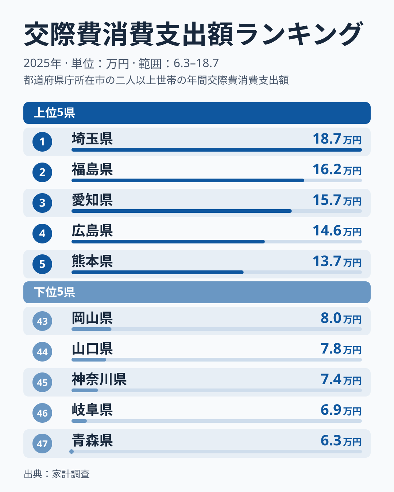
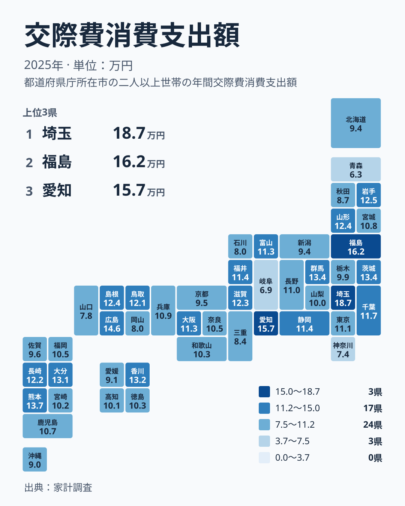

## 交際費は県によってここまで違います

冠婚葬祭のご祝儀、職場や親戚への贈り物、友人との付き合い。こうした「人付き合いのお金」は、住む地域によってどれほど違うのでしょうか。2025年の家計調査で交際費への支出を見ると、埼玉県は187,170円で1位です。青森県は62,833円で47位です。最も多い県と最も少ない県の間には、100,000円を超える開きがあります。

1位と2位の間にも段差があります。2位の福島県は162,430円、3位の愛知県は157,126円です。埼玉県はこの2県から大きく離れて先頭に立っています。

同じ関東でも、順位は大きく割れています。神奈川県は74,130円で45位です。埼玉県が1位であるのに対し、神奈川県は下から3番目に位置しています。

この記事では、まず上位と下位の顔ぶれを確認し、次に地方ごとの分布を整理します。そのうえで、差を別の切り口から分けて考え、わかることとわからないことを切り分けます。最後に、暮らしの中でこの数字をどう扱えばよいかを短く書きます。同じ分野の数字は[同じカテゴリの統計一覧](/category/economy)でも確認できます。

> [!NOTE]
> 家計調査の交際費は、贈答品の購入、冠婚葬祭の費用、お付き合いでの飲食など、人との関係に使ったお金を指します。単位は円で、世帯が1年間に使った金額の平均です。個人が自由に使えるお金ではなく、世帯全体の数字である点に注意してください。

## 上位5県と下位5県の顔ぶれ

まず、上位5県と下位5県を並べた図を見てみましょう。

<source-link href="/ranking/social-expenses-group-consumption-expenditure">交際費への支出ランキングをもっと見る</source-link>

上位5県は、埼玉県、福島県、愛知県、広島県、熊本県です。地方で見ると、関東、北海道・東北、中部、中国、九州・沖縄に1県ずつ分かれています。東京都や大阪府といった大都市の都府県は、この5県に入っていません。

下位5県は、青森県、岐阜県、神奈川県、山口県、岡山県です。北海道・東北が青森県の1県、中部が岐阜県の1県、関東が神奈川県の1県、中国が山口県と岡山県の2県という内訳です。中国地方は、上位に広島県が入り、下位に山口県と岡山県が入っています。同じ地方の中で、上位と下位の両方が出ている形です。

上位でも下位でも、顔ぶれは特定の地方に固まっていません。この図からわかるのは、地方という大きなくくりだけでは、交際費の多い少ないを説明しにくいということです。[埼玉県のデータ](/areas/11000)や[福島県のデータ](/areas/07000)で、他の指標とあわせて見るのも一つの方法です。

## 地方ごとに見る分布の広がり

次に、47都道府県を地図の上に並べた図です。

この図を、上位10県と下位10県に区切って地方別に数えてみます。上位10位までは、埼玉県、福島県、愛知県、広島県、熊本県、群馬県、茨城県、香川県、大分県、岩手県です。内訳は関東が3県、北海道・東北が2県、九州・沖縄が2県、中国が1県、中部が1県、四国が1県です。

下位10県は、青森県、岐阜県、神奈川県、山口県、岡山県、石川県、三重県、秋田県、沖縄県、愛媛県です。内訳は北海道・東北が2県、中部が2県、中国が2県、関東が1県、近畿が1県、四国が1県、九州・沖縄が1県です。

どの地方も、上位と下位の両方に顔を出しています。関東では、埼玉県、群馬県、茨城県が上位10県に入る一方で、神奈川県は下位10県に入っています。北海道・東北では、福島県と岩手県が上位10県に入り、青森県と秋田県が下位10県に入っています。山形県は12位です。

近畿は少し様子が違います。近畿は上位10県に1県も入らず、下位10県には三重県のみが入ります。三重県は41位です。三重県を除く6県は、滋賀県が13位、大阪府が20位、兵庫県が23位、奈良県が26位、和歌山県が29位、京都府が35位で、13位から35位の間に収まっています。近畿の中でも、三重県と他の県の位置はかなり離れています。

> [!TIP]
> 交際費は、結婚式や葬儀、お祝い事が重なった年に増え、何もない年には減りやすい支出です。1年分の順位だけで「この県は付き合いが濃い」と決めつけず、単年の偶然が混じっている可能性を頭に置いて読んでください。

## 差を別の切り口で分けて考える

では、なぜここまで差が開くのでしょうか。手元にあるのは各県の値と順位だけなので、原因を確かめることはできません。ここでは、背景として語られることが多い切り口を挙げ、データから言えることと言えないことを分けます。

- 贈答や冠婚葬祭の習慣が、地域によって違うのかもしれません。親族や近所との付き合いが深い地域では、人間関係を保つための支出が日常的になりやすいと言われます。
- 家賃などの固定費が低い地域では、手元に残るお金を付き合いに回しやすいという見方があります。
- 単身世帯が多い地域と、複数人で暮らす世帯が多い地域では、同じ交際費でも使い方が変わる可能性があります。
- 調査に含まれた世帯の顔ぶれが、その年の値を動かしている可能性もあります。

どの切り口も、このデータだけでは裏づけられません。地方ごとの分布を見ても、上位10県と下位10県のどちらにも複数の地方が入っています。東北と関東の県が上位に多少目立つとはいえ、青森県、秋田県、神奈川県は下位10県にも入っています。地方単位の気質で説明するのは難しいと言えます。

大都市の値も確認しておきます。東京都は111,362円で21位、大阪府は112,806円で20位です。千葉県は116,720円で16位です。大都市圏だからといって突出して高いわけでも、極端に低いわけでもありません。むしろ、都市の規模よりも、県ごとの個別の事情のほうが効いていそうだと読めます。

> [!WARNING]
> 家計調査は全国の限られた世帯を対象とした標本調査です。県ごとの標本は多くないため、結婚式や葬儀の有無といった個々の世帯の事情が、県の平均に大きく響くことがあります。順位が近い県どうしの差は、実質的な違いとは言えない場合があります。

## 暮らしへの含意

この数字から読み取れることは、多くありません。確かなのは、世帯あたりの交際費が県によって大きく違う年があるということです。1位の埼玉県と47位の青森県の差は、人付き合いの形の違いを映している可能性がありますが、断定はできません。

使い道としては、自分の世帯の交際費を、住んでいる県の値と見比べてみることが考えられます。ただし、平均より多いか少ないかで良し悪しを決める必要はありません。同じ金額でも、物を贈るのか、会って食事をするのかで中身は変わります。順位は付き合いの強さそのものではなく、それがお金として現れた結果にすぎません。

## データについて

このデータは、家計調査の「交際費消費支出額」を、2025年の都道府県別に比べたものです。単位は円で、世帯が1年間に使った金額の平均を示します。順位は全47件で付けています。値が近い県どうしでは差がわずかなので、順位の上下だけで優劣を判断しないでください。

地方の区分は、次の7区分だけを使っています。

- 北海道・東北: 北海道、青森県、岩手県、宮城県、秋田県、山形県、福島県
- 関東: 茨城県、栃木県、群馬県、埼玉県、千葉県、東京都、神奈川県
- 中部: 新潟県、富山県、石川県、福井県、山梨県、長野県、岐阜県、静岡県、愛知県
- 近畿: 三重県、滋賀県、京都府、大阪府、兵庫県、奈良県、和歌山県
- 中国: 鳥取県、島根県、岡山県、広島県、山口県
- 四国: 徳島県、香川県、愛媛県、高知県
- 九州・沖縄: 福岡県、佐賀県、長崎県、熊本県、大分県、宮崎県、鹿児島県、沖縄県

> [!NOTE]
> 交際費には、冠婚葬祭費、贈答品、お付き合いの飲食などが含まれます。どこまでを交際費に含めるかは調査上の分類に従っているため、家庭で「交際費」と感じる支出とは範囲が異なることがあります。
