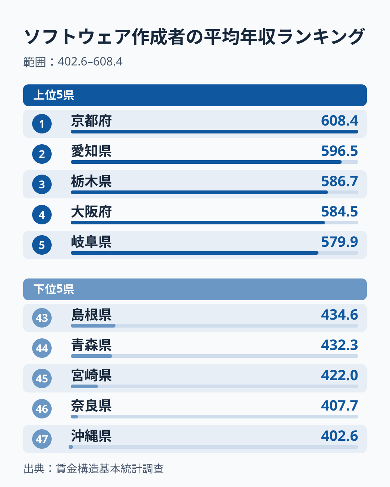
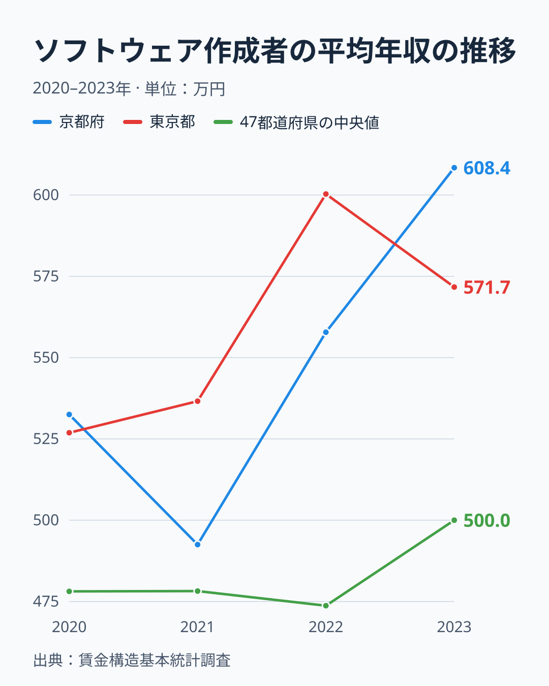

「IT エンジニアとして一番稼げるのは、やっぱり東京だろう」──そう考える人は多いはずです。実際、情報通信業の事業所 (2014年の経済センサス) は全国の約3割にあたる34.1%が[東京都](/areas/13000)にあり、IT 産業の中心が首都圏であることは確かです。

ところが、ソフトウェア作成者 (プログラマ・システムエンジニア等) の平均年収を都道府県別に並べると、2023年の1位は[京都府](/areas/26000)で608.4万円でした。東京都は571.7万円で6位です。最下位の[沖縄県](/areas/47000)は402.6万円で、京都府との差は205.8万円、比にして約1.51倍あります。

ただし、この順位は毎年大きく動きます。同じ統計を2020年から2023年の4年分並べると、首位は毎年違う府県で、2023年に1位の京都府は2021年には20位でした。この記事では、2023年の順位を見たうえで、単年の順位をどこまで信じてよいかを4年分の推移で確かめます。

> [!NOTE]
> ここでの「ソフトウェア作成者」は厚生労働省「賃金構造基本統計調査」の職種区分で、プログラマやシステムエンジニアを含みます。システムコンサルタント・設計者は別の職種です。年収は、一般労働者 (男女計) の6月のきまって支給する現金給与額を12倍し、前年1年間の賞与等を足した推計値です。調査対象の事業所で働く人の標本平均で、事業所の所在地で集計されています。個人の実際の年収ではありません。

## 2023年のランキング──首位は京都、東京は6位

上位は、1位の京都府が608.4万円、2位の愛知県が596.5万円、3位の栃木県が586.7万円、4位の大阪府が584.5万円、5位の岐阜県が579.9万円です。東京都は571.7万円で6位、埼玉県が568.9万円で7位、千葉県が567.7万円で8位と続きます。9位には愛媛県が562.7万円で入り、IT 集積地とは言いがたい県も上位にいます。

47都道府県の中央値は500.0万円です。三大都市圏の8都府県 (東京・神奈川・埼玉・千葉・愛知・大阪・京都・兵庫) は、1位・2位・4位・6位・7位・8位・10位と上位に集まりますが、神奈川県だけは522.4万円で18位にとどまります。

下位は、47位の沖縄県が402.6万円、46位の奈良県が407.7万円、45位の宮崎県が422.0万円、44位の青森県が432.3万円、43位の島根県が434.6万円です。地方の県に混じって、大阪・京都に隣り合う奈良県が下位にいる点が目を引きます。

<source-link href="/ranking/software-engineer-annual-income">ソフトウェア作成者の平均年収 全47都道府県を比較する</source-link>

## 4年の推移──首位は滋賀・栃木・兵庫・京都と毎年入れ替わる

同じ統計を2020年から2023年まで並べると、2023年の順位の見え方が変わります。

首位は、2020年が滋賀県で593.2万円、2021年が栃木県で567.8万円、2022年が兵庫県で606.2万円、2023年が京都府で608.4万円と、4年で4府県が入れ替わりました。京都府は2020年の6番目から、2021年に20番目、2022年に7番目と動き、2023年にこの4年で初めて首位に立ちました。2021年の京都府は492.5万円で、2023年までの2年で115.9万円上がった計算です。

東京都も一定ではありません。2020年は526.9万円で9番目、2021年は5番目、2022年は600.3万円で2番目、2023年は6位です。「東京は6位」という2023年の結果は、2022年なら「東京は2番目」になっていました。最下位も、2020年が宮崎県、2021年と2022年が鳥取県、2023年が沖縄県と入れ替わっています。

これほど順位が動く理由として、この統計が標本調査で、県によってはソフトウェア作成者として集計される人数が多くないことが考えられます。[仮説] 少数の事業所の入れ替わりで県の平均が大きく動いている可能性があり、確かめるには県別の標本数 (集計に使われた労働者数) を見る必要があります。いずれにしても、1年分の順位から「京都が最も稼げる県」と結論づけるのは早計です。

47都道府県の中央値は、2020年の478.1万円、2021年の478.2万円、2022年の473.7万円とほぼ横ばいで、2023年は500.0万円へ上がりました。上がったのは2023年の1年分なので、水準が上がり続けるかどうかは次の年の値で確かめる必要があります。

> [!WARNING]
> この統計の「ソフトウェア作成者」の都道府県別の値は、このサイトでは2020年から2023年の4年分だけを収録しています。それより前の年と比べるときは、職種の区分が同じかどうかを出典で確かめてください。

## なぜ東京が最高給ではないのか──事業所の数と給与のねじれ

年はずれますが、情報通信業の事業所数 (2014年) は、東京都が22,591所で全国の34.1%を占め、2位の大阪府の6,152所を大きく引き離しています。それでも東京都の平均年収は、4年間で一度も首位になっていません。

あわせて見る: [情報通信業の事業所数ランキング](/ranking/number-of-establishments-information-communication)

[仮説] 平均年収は、若手や受託開発の下流工程まで含めた全従事者の平均です。東京都に受託開発やエンジニアの派遣を行う企業が多く集まっていれば、経験年数の浅い層が平均を下げている可能性があります。反対に、京都・愛知・栃木のように特定の大手企業や研究開発拠点が高給の専門職を抱える県では、平均が押し上げられやすいという見方もあります。ただし、前の節で見たように上位の顔ぶれは毎年入れ替わっており、この記事のデータ (職種別・都道府県別の平均値) だけでは、どの説明が当たっているかを確かめられません。検証には事業所規模別・企業別の賃金データが必要です。

言えるのは、東京は「IT の仕事が最も多い県」ではあっても、平均年収が毎年最も高い県ではない、ということまでです。

## 下位に並ぶ県──地方の県と、順位が大きく動いた奈良・神奈川

下位5県のうち、沖縄・宮崎・青森・島根は地方の県です。[仮説] これらの県では、高給を支払う大規模な IT 企業や研究開発拠点が少なく、地元の自治体や中小企業向けの受託開発・サポート業務が中心になりやすいことが、平均を押し下げている可能性があります。ただし沖縄県も2022年は46番目、2021年は43番目と、毎年下位にいるものの最下位とは限りません。

奈良県と神奈川県は、大阪・京都や東京で働く人が多い府県です。そのため「高給のエンジニアは勤め先の府県で集計され、住んでいる県の値が低く出る」という説明が浮かびますが、4年分の順位はこの説明と合いません。神奈川県は2020年に2番目、2021年に3番目、2022年に9番目で、2023年に18位へ下がりました。奈良県も2020年の18番目、2021年の21番目から、2022年に42番目、2023年に46位へ下がっています。通勤の形は4年でそれほど変わらないのに、順位だけが大きく動いています。

さらに、他県で働く・通学する人の割合 (流出人口比率、2020年) が最も高いのは埼玉県の13.89%で、奈良県の12.98%、千葉県の12.70%が続きます。同じように他県へ通う人の多い埼玉県と千葉県は、2023年に7位と8位の上位にいます。通勤の多さだけで奈良県の低さを説明することはできず、[仮説] 前の節で見た標本の揺れが、奈良県と神奈川県の2023年の順位にも出ている可能性のほうが高いと考えられます。

## まとめ──1年の順位より、4年の動きで読む

- 2023年のソフトウェア作成者の平均年収は、1位が京都府の608.4万円、東京都は571.7万円で6位、最下位は沖縄県の402.6万円で、比は約1.51倍です。
- 2020〜2023年の4年で、首位は滋賀・栃木・兵庫・京都と毎年入れ替わりました。京都府は2021年に20番目、東京都は2022年に2番目でした。
- 情報通信業の事業所は東京都に34.1%が集まりますが、東京都は4年間で一度も首位になっていません。
- 47都道府県の中央値は2022年の473.7万円から2023年の500.0万円へ上がりました。
- 上位と下位の理由 (大手企業・受託開発・通勤) はどれも仮説です。奈良県と神奈川県の2023年の低さは、通勤の多い埼玉県・千葉県が上位にいることと合わず、標本の揺れの可能性があります。
