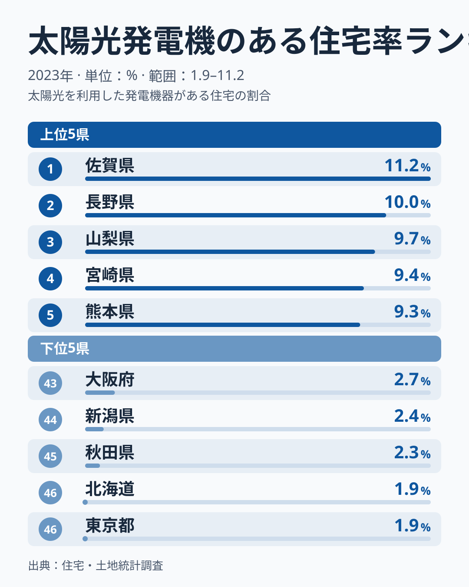
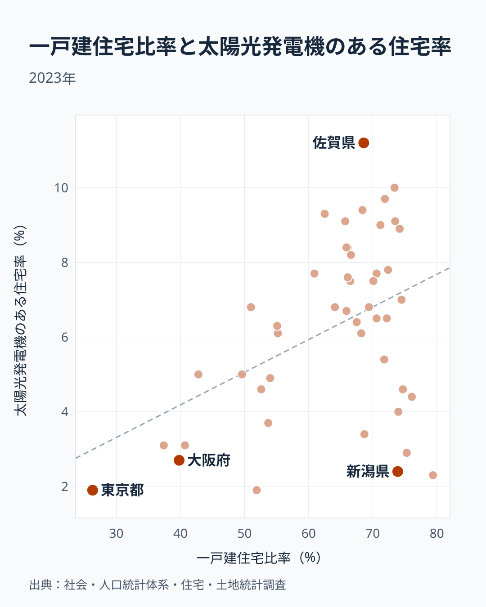
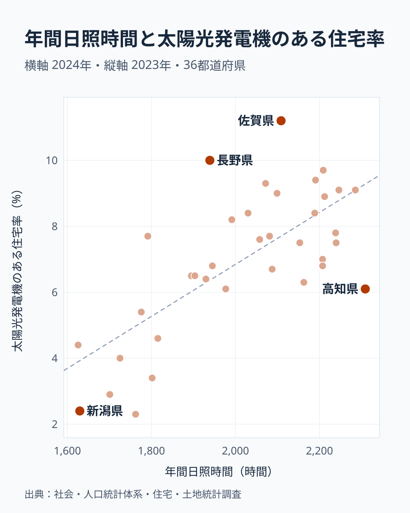
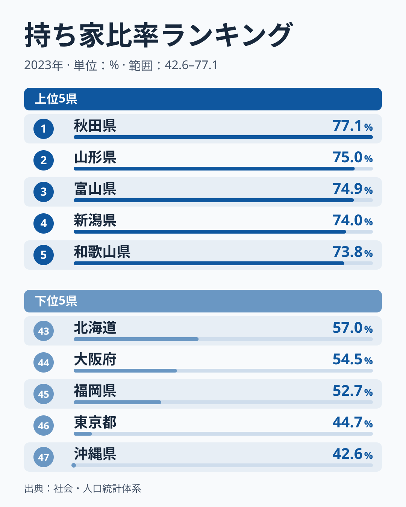

太陽光パネルは、屋根がなければ載せられません。では、一戸建が多い県ほど太陽光も多いのでしょうか。2023年の住宅・土地統計調査で「太陽光発電機のある住宅率」を47都道府県で比べると、この見立ては半分だけ当たっていました。

1位は[佐賀県](/areas/41000)の11.2%で、最下位は[東京都](/areas/13000)と北海道の1.9%です。差は**5.9倍**あります。下位を見ると、東京都や大阪府のような一戸建の少ない都市と並んで、一戸建が全国で最も多い秋田県が入っています。屋根の数だけでは説明できません。

先に結論を書くと、一戸建が少ない県は普及率が低い傾向があります。一方で、一戸建が多い県どうしを比べると、普及率の差は一戸建の多さではなく日照時間と連動し、特に東北や日本海側の日照が短い県の低さが目立ちました。

> [!NOTE]
> 住宅率は設備容量（kW）ではなく、**住宅のうち太陽光発電機のある住宅の割合**です。分母には載せにくい集合住宅も含まれるので、一戸建が少ない県は住民の意欲に関係なく低く出ます。総務省「住宅・土地統計調査」（2023年）によります。

## 太陽光住宅率の上位と下位

1位は佐賀県の11.2%で、2位の長野県は10.0%、3位の山梨県は9.7%、4位の宮崎県は9.4%、5位の熊本県は9.3%です。九州と中部内陸の県が目立ちます。

下位は東京都と北海道が1.9%で同率46位、秋田県が2.3%で45位、新潟県が2.4%で44位、大阪府が2.7%で43位です。東京都と大阪府は大都市で、秋田県と新潟県は東北と日本海側の県です。性格の違う県が同じ下位に並んでいる点が、この指標を読むときの鍵になります。

47都道府県の単純平均は6.3%です。東京都は平均の3割ほどにとどまり、佐賀県は平均のおよそ1.8倍です。

<source-link href="/ranking/solar-panel-housing-rate">太陽光発電機のある住宅率ランキングをもっと見る</source-link>

## 一戸建が少ない県は低い、多くても高いとは限らない

[一戸建住宅比率](/ranking/detached-house-ratio)と太陽光住宅率の相関係数は0.43で、順位どうしでは0.21です。全体の関係は強くありません。ただ、散布図を左右に分けると形がはっきりします。

一戸建住宅比率が55%未満の11都道府県は、東京都、沖縄県、大阪府、神奈川県、福岡県、兵庫県、愛知県、北海道、千葉県、京都府、埼玉県です。この11都道府県の太陽光住宅率の平均は3.9%で、最も高い愛知県でも6.8%です。55%以上の36県の平均は7.0%です。太陽光住宅率の上位11県は、すべて55%以上の県でした。

東京都の一戸建住宅比率は26.3%で47位です。大阪府は39.8%で45位、神奈川県は40.7%で44位です。集合住宅に住む世帯は屋根を自由に使えないので、一戸建の少なさが普及率の上限を抑えていると考えられます。

ところが55%以上の36県の中では、関係が消えます。この36県で計算した相関係数はマイナス0.29で、一戸建が多い県ほど太陽光が多いとは言えません。一戸建住宅比率が全国1位の秋田県は79.4%なのに、太陽光住宅率は2.3%で45位です。新潟県は73.9%で8位ながら太陽光は44位、青森県は75.3%で3位ながら42位です。一戸建の多さは普及の土台にはなっても、普及の高さそのものは決めていません。

> [!WARNING]
> 北海道は一戸建住宅比率が51.9%で40位なので55%未満の側に入りますが、太陽光住宅率の1.9%は同じ側の県の中でも特に低い値です。東京都のような住宅の事情だけでは説明しにくく、本記事のデータでは理由を確かめられていません。

## 戸建が多い36県では、日照時間と連動する

では、36県の差は何と連動しているのでしょうか。[年間日照時間](/ranking/annual-sunshine-duration)と比べると、相関係数は0.71でした。一戸建の多さではマイナス0.29だった県どうしで、日照時間の長い県ほど太陽光住宅率が高い傾向がはっきり出ます。47都道府県全体で計算すると0.47なので、一戸建が少ない11都道府県を除くと関係が見えやすくなった形です。ただし、この0.71は東北や日本海側の日照が短い県が相関を押し上げているためで、山形県、新潟県、青森県、秋田県、富山県の5県を除くと0.48まで下がります。

年間日照時間が1,900時間未満の10県の平均は4.4%で、1,900時間以上の26県の平均は8.0%です。短い側には山形県の1,625.6時間、新潟県の1,629.6時間、青森県の1,701時間、富山県の1,725.2時間、秋田県の1,762.4時間が並びます。いずれも太陽光住宅率が下位から中位の県です。日照時間が短いと発電量は減るので、設置の採算に響いている可能性があります。

ただし、きれいに揃うわけではありません。高知県の日照時間は2,309時間で1位ですが、太陽光住宅率は6.1%で28位です。長野県は1,939.1時間で33位なのに、太陽光住宅率は2位です。福島県は1,791.4時間と短い側にありながら、7.7%あります。日照の他にも、補助制度や電気料金、住宅の新しさなど、本記事で調べていない要因が関わると考えられます。

日照時間の短い県には、雪の多い県も重なります。積雪が設置をためらわせる面はありえますが、日照と雪を切り分けた計算はしていないので、本記事ではどちらが効いているかは断定しません。日照時間は2024年の1年分の値で、県全体の平均ではなく特定の地点の観測値である可能性もある点に注意してください。高知県の例を掘り下げた分析は[姉妹記事](/blog/sunshine-solar-housing-correlation)にあります。

## 持ち家比率は都市の低さを補足する

賃貸住宅では、住んでいる人が設置を決められません。そこで持ち家比率も見ておきます。

東京都は44.7%で46位、沖縄県は42.6%で47位、大阪府は54.5%で44位、北海道は57.0%で43位です。太陽光住宅率の低い都市は、持ち家比率も低い傾向があります。ただし47都道府県の相関係数は0.32と弱く、一戸建の0.43を上回りません。持ち家比率1位の秋田県は77.1%で、太陽光住宅率は45位です。36県に絞ると相関係数はマイナス0.37で、むしろ弱い負の関係です。秋田県や山形県のように、持ち家も一戸建も多く太陽光が少ない県が含まれるためとみられます。持ち家比率は、都市の低さを一戸建とともに補足する指標と読むのが適切です。

<source-link href="/ranking/owner-occupied-housing-ratio">持ち家比率ランキングをもっと見る</source-link>

## まとめ

- 太陽光住宅率は佐賀県が11.2%で1位、東京都と北海道が1.9%で同率46位で、差は**5.9倍**です
- 一戸建住宅比率が55%未満の11都道府県は平均3.9%で、55%以上の36県の平均7.0%を大きく下回ります
- 55%以上の36県では、一戸建の多さと普及率の相関はマイナス0.29で、秋田県のように戸建が多くても普及しない県があります
- 同じ36県で年間日照時間との相関係数は0.71でした。日照の短い5県を除くと0.48まで下がり、高知県や長野県のように日照だけでは読めない県もあります

一戸建が少ない県では普及率が抑えられ、一戸建が多い県どうしでは日照が特に短い県の低さが目立つ、という2段階で見ると、5.9倍の差が読みやすくなります。どちらも相関であり、原因を確定した数字ではありません。住宅まわりの指標は[住宅カテゴリ](/category/construction)からも比較できます。
