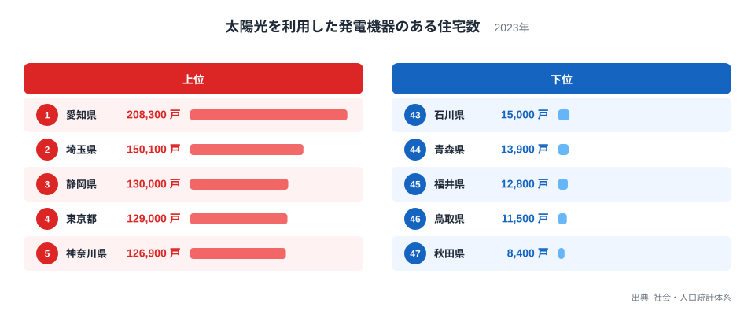
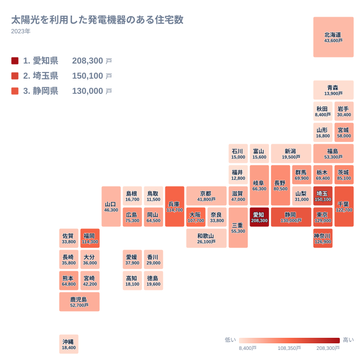

太陽光発電を備えた住宅は、全国でどこに集まっているのでしょうか。2023年のデータでは、1位の愛知県が208,300戸、47位の秋田県が8,400戸でした。最大と最小の比は約24.8倍です。この記事では、上位と下位がなぜその順になるのかを、地理・産業構造・歴史の面から整理します。ただし、手元のデータは県別の戸数だけですので、原因に触れる部分は仮説として書きます。

## 上位と下位の顔ぶれ

まず、上位5県と下位5県を図で確認します。

<source-link href="/ranking/solar-power-housing">太陽光を利用した発電機器のある住宅数ランキングをもっと見る</source-link>

図から読み取れるのは、上位5県の厚みです。愛知県の208,300戸は、2位の埼玉県の150,100戸を大きく上回っています。1位と5位の神奈川県126,900戸の間には81,400戸の開きがあります。一方で、2位から5位までは150,100戸から126,900戸の間に収まり、混戦です。

下位側は、47位の秋田県8,400戸から43位の石川県15,000戸まで、5県が狭い範囲に固まっています。上位が1位だけ突出しているのに対し、下位は横並びに近い形です。

上位9県は10万戸を超えています。10位の茨城県は85,100戸で、ここから急に数字が下がります。下位5県はすべて2万戸を下回っており、上位と下位が二層に分かれる構図です。

> [!NOTE]
> この指標は、正式には「太陽光を利用した発電機器のある住宅数」で、単位は戸です。人口や世帯数で割った普及率ではなく、住宅の実数を数えたものです。住宅の総数が多い県ほど数字が大きくなりやすい点が、この指標に固有の読み方の注意です。

## 愛知県と埼玉県が上位に来る理由

上位2県を、産業と暮らしの面から見てみます。以下は仮説であり、データだけで裏付けられるものではありません。

愛知県は、[愛知県のデータ](/areas/23000)も参照できます。製造業の集積が厚く、郊外に戸建ての住宅地が広がっているのではないか、というのが一つの見方です。戸建てが多い地域では、屋根に設置できる余地が大きいと考えられます。

埼玉県は、[埼玉県のデータ](/areas/11000)にあるとおり、150,100戸で2位です。東京都への通勤圏として戸建ての住宅地が育ってきたことが、戸数を押し上げている可能性があります。

東京都は129,000戸で4位で、愛知県と埼玉県の下です。東京都は集合住宅の割合が高く、屋根を自由に使える戸建てが相対的に少ないのかもしれません。静岡県は130,000戸で3位です。日照条件が影響している可能性もありますが、今回は日照のデータを使っていないため、確かなことは言えません。

> [!TIP]
> 順位を読むときは、まず「その県に住宅がどれだけあるか」を頭に置いてください。上位に並ぶ県が大きな県ばかりのときは、設備の普及が進んでいるというより、母数が大きいだけの場合もあります。

## 地理分布で見る地方ごとの傾向

次に、地理分布をタイルマップで確認します。

関東では、埼玉県が2位、東京都が4位、神奈川県が5位、千葉県が6位と、上位6位までに4都県が入っています。茨城県も85,100戸で10位、群馬県は69,900戸で13位、栃木県は69,400戸で14位です。関東の7都県が、すべて14位以内に入っています。

近畿では、兵庫県が114,700戸で7位、大阪府が107,700戸で9位です。一方、京都府は41,800戸で26位、奈良県は33,800戸で30位、和歌山県は26,100戸で35位にとどまります。同じ近畿でも順位が大きく割れています。地形や住宅の形が関係している可能性はありますが、これは仮説であり、本データでは確かめられません。

九州・沖縄では、福岡県が114,300戸で8位、熊本県が64,800戸で16位、鹿児島県が52,700戸で21位です。沖縄県は18,400戸で38位です。日照の豊かな地域というイメージとは違い、順位は県ごとにばらつきます。

> [!WARNING]
> このデータは2023年の1時点の値です。設置が進んだ経過や、いつ設置されたかは分かりません。また、県内の市町村ごとの差も見えません。

## 下位の県に共通する条件

下位には、秋田県、鳥取県、福井県、青森県、石川県が並びます。地方で分けると、東北からは秋田県と青森県、中国からは鳥取県、中部からは福井県と石川県です。

これらの県に共通する条件があるとすれば、住宅の総数が限られることかもしれません。また、冬に雪や曇りの日が多い地域では、設置をためらう家庭が多いという見方もあります。ただし、これらも仮説です。北海道は43,600戸で24位と中位に入っており、雪の多い地域だから低いとは言い切れません。

中部でも差があります。愛知県が1位、静岡県が3位である一方、新潟県は19,500戸で37位、富山県は15,600戸で42位です。長野県は80,500戸で11位に入っています。同じ中部でも順位は大きく分かれます。

歴史の面では、太陽光発電は固定価格買取制度の開始以降に広がったとされます。新築が多かった地域で設置も進んだ可能性がありますが、人口や新築のデータを今回は使っていないため、仮説にとどまります。

## 中位の県と、順位の見方

中位を見ると、東北の宮城県が58,000戸で18位、福島県が53,300戸で20位です。中国では、広島県が75,300戸で12位、岡山県が64,500戸で17位、山口県が46,300戸で23位です。四国は、愛媛県が37,900戸で27位、香川県が29,000戸で34位、徳島県が19,600戸で36位、高知県が18,100戸で39位です。

四国は27位から39位に収まります。理由は本データからは分かりません。人口規模などの影響が考えられますが、確かめるには別の指標が必要です。

順位が近い県は、わずかな差で入れ替わります。奈良県と佐賀県はどちらも33,800戸で同じ値です。順位が1つ違うだけの差は、実質的には小さいことがあります。

同じカテゴリの数字も合わせて見ると、住宅の特徴がより立体的に見えます。[同じカテゴリの統計一覧](/category/construction)から、住宅に関する別の指標も確認できます。

## データについて

この記事の数値は、社会・人口統計体系による「太陽光を利用した発電機器のある住宅数」の2023年の値です。単位は戸で、47都道府県すべてを対象としています。最も多いのは愛知県の208,300戸、最も少ないのは秋田県の8,400戸で、その比は約24.8倍です。

県ごとの普及の度合いを見たいときは、世帯数などの別の指標と並べて確認する必要があります。

## まとめ

太陽光を備えた住宅は、愛知県の208,300戸を筆頭に、埼玉県、静岡県、東京都、神奈川県といった大きな県に集まっています。下位は、秋田県の8,400戸をはじめ、鳥取県、福井県、青森県、石川県が占めます。

差を生む要因として、住宅の総数、戸建ての多さ、日照、積雪、新築の進み方などが考えられますが、いずれも本データだけでは裏付けられない仮説です。数字を読むときは、実数であることを意識し、背景を断定しすぎないことが大切です。
