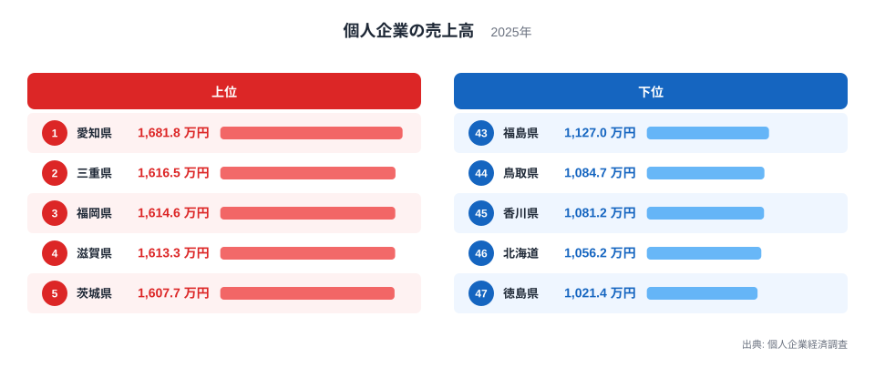
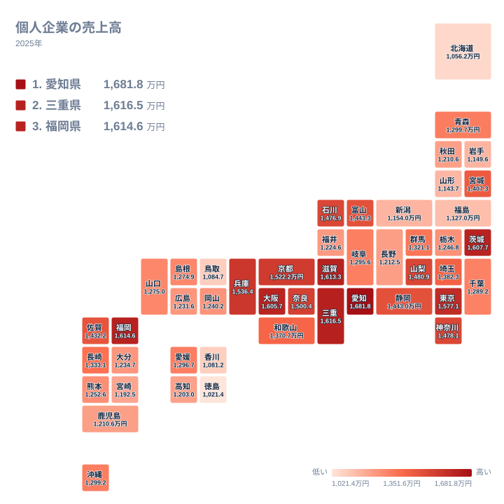

## 個人企業の売上高は県でどれだけ違うのか

個人で事業を営む商店や工房、サービス業の売上高は、都道府県によって大きな差があります。2025年のデータでは、1位の愛知県が1,681.8万円、47位の徳島県が1,021.4万円でした。差は660.4万円にのぼり、愛知県は徳島県の約1.6倍です。

この差は、個人企業が置かれた環境の違いを映していると考えられます。近くに大きな工業地帯があるか、人が集まる商圏があるか、業種がどう偏っているか。こうした条件が売上の水準に関わっている可能性があります。ただし、手元のデータは県ごとの平均的な水準だけです。理由を断定することはできないため、この記事では地理・産業構造・歴史の観点から、あくまで仮説として考えます。

> [!NOTE]
> この指標は「個人企業経済調査」にもとづく「個人企業の売上高」で、2025年の単位は万円です。法人ではなく、個人が経営する事業所が対象です。1事業所あたりの水準を比べるもので、県全体の売上総額ではありません。

## 上位5県と下位5県のちがい

<source-link href="/ranking/sole-proprietor-sales">個人企業の売上高ランキングをもっと見る</source-link>

図でまず目を引くのは、1位の愛知県が1,681.8万円で、2位の三重県との間に65.3万円の差をつけている点です。一方で、2位の三重県1,616.5万円から5位の茨城県1,607.7万円までは、約9万円の幅に収まっています。上位は愛知県が抜け、その後ろを4県が僅差で追う形です。

上位5県の顔ぶれは、東海の愛知県と三重県、九州の福岡県、近畿の滋賀県、北関東の茨城県です。特定の1地方に集中しているわけではなく、複数の地方に散らばっています。大都市圏やその周辺に位置する県が多い、という程度の傾向は読み取れますが、それ以上の共通点は数字からは分かりません。

下位5県は、47位の徳島県、46位の北海道、45位の香川県、44位の鳥取県、43位の福島県です。四国が2県、北海道、中国、東北が1県ずつと、こちらも地方はばらけています。上位5位の下限である1,607.7万円と、下位5位の上限である1,127万円を比べると、480万円以上の開きがあります。1位の愛知県は、46位の北海道の1,056.2万円と比べても約1.6倍です。

注目したいのは、東京都が7位で1,577.1万円だった点です。大都市だから突出するという単純な構図にはなっていません。

## 愛知県・三重県の位置から考える

愛知県が1位になる背景として、製造業の集積が影響している可能性があります。部品加工や運輸、修理、飲食といった周辺の個人事業が、安定した需要を得やすい環境が想像できます。詳しくは[愛知県のデータ](/areas/23000)も参照してください。

2位の三重県は、愛知県と隣り合う東海圏です。名古屋圏や大阪圏と結びつきやすい立地が、売上に関わっているのかもしれません。こちらは[三重県のデータ](/areas/24000)で確認できます。

ただし、これらは立地から想像した仮説にとどまります。個人企業の業種別の売上は今回のデータにないため、製造業との関係を数字で示すことはできません。同じ東海でも、岐阜県は25位で1,295.6万円、静岡県は15位で1,443万円と位置はさまざまです。隣接していることだけで、順位が決まるわけではないことが分かります。

> [!TIP]
> 順位の上下を、そのまま「景気の良し悪し」と読まないでください。売上高が大きくても、仕入れや人件費が重ければ手元の利益は小さくなります。この指標は規模を見るもので、収益性は別の統計で確かめる必要があります。

## 地理分布で見る東西と南北の差

タイルマップで全国を見渡すと、近畿に売上高の高い県がまとまっています。滋賀県が4位、大阪府が6位で1,605.7万円、兵庫県が8位で1,536.4万円、京都府が9位で1,522.2万円、奈良県が10位で1,500.4万円です。上位10位のうち、近畿の県が5つを占めています。

一方で、北海道は46位で1,056.2万円、福島県は43位で1,127万円、山形県は42位で1,143.7万円、岩手県は41位で1,149.6万円と、北海道と東北に低い県が続きます。四国でも、香川県が45位、徳島県が47位です。

この分布は、人口密度や市場の近さと重なっている可能性があります。広い県土に事業所が散らばる地域では、1事業所が相手にできる顧客が限られるかもしれません。ただし、人口や面積のデータは今回扱っていないため、確かめられているわけではありません。

## 中位の県にみる、くくりでは説明しにくい違い

中位には、事情の異なる県が混ざります。首都圏では、東京都が7位、神奈川県が12位で1,478.1万円、埼玉県が18位で1,382.3万円、千葉県が26位で1,289.2万円です。同じ首都圏でも、東京都と千葉県では287.9万円の差があります。人口が多いことと、1事業所あたりの売上が大きいことは、同じ意味ではないようです。

中部では、山梨県が11位で1,480.9万円、石川県が13位で1,476.9万円、富山県が14位で1,443.3万円です。静岡県も15位で1,443万円と、近い水準に並びます。この帯には製造業や伝統産業、観光などが個人事業を支えている可能性がありますが、業種別のデータがないため、その構図が実際にあるかは読み取れません。

東北では、宮城県が17位で1,407.3万円です。今回の東北6県のうち、宮城県の値は福島県や山形県、岩手県より高くなっています。青森県は22位で1,299.7万円でした。同じ東北でも、順位には大きな幅があることが分かります。

> [!WARNING]
> 個人企業経済調査は標本調査であり、県ごとの回答数には限りがあります。順位が近い県同士の差は、調査のばらつきの範囲に収まる可能性があります。たとえば秋田県と鹿児島県は、ともに1,210.6万円で並んでいます。小さな差を過大に解釈しないでください。

## 歴史と商業の積み重ねという仮説

ここから先は、実データでは裏付けられない仮説です。数字が示すのは結果だけで、歴史との関係は、別の資料で確かめる必要があります。

近畿には、古くから商業の中心として栄えた歴史があります。商店や職人の仕事が長く続いてきたことが、現在の水準に関わっているのかもしれません。東海については、製造業の発展の中で、地域の事業者が取引に組み込まれてきた可能性が考えられます。

下位の北海道や四国の県は、市場が分散しやすいことや人口減少の影響が、背景にあるのかもしれません。徳島県と香川県は近畿に近い位置にありますが、売上の水準は低く、近さだけで説明できない点は押さえておきたいところです。

## 数字を読むときの注意点

ここまでの説明は、産業構造や地理から考えた仮説です。統計は結果の数字だけを示しており、原因までは直接示しません。個別の県の事情は、業種の構成比や事業所数の推移など、別の統計とあわせて確かめることが大切です。

また、この記事の数字は2025年の1時点の比較です。年によって順位が入れ替わる可能性もあります。1年の結果だけで、地域の優劣を決めつけるのは避けてください。

ほかの経済関連の統計も見たい場合は、[同じカテゴリの統計一覧](/category/economy)から探せます。所得や事業所数などとあわせて見ると、売上高の背景がより立体的に見えてきます。

## データについて

使用した統計は、個人企業経済調査の「個人企業の売上高」で、対象年は2025年、単位は万円です。数値は1事業所あたりの水準を示すもので、都道府県ごとの合計額ではありません。順位は大きい値から並べた全47件の結果です。

## まとめ

2025年の個人企業の売上高は、愛知県の1,681.8万円が最も高く、徳島県の1,021.4万円が最も低い結果でした。上位には東海の愛知県と三重県、九州の福岡県、近畿の滋賀県、北関東の茨城県が並び、下位には徳島県、北海道、香川県、鳥取県、福島県が並びます。

背景には、製造業の集積、市場への近さ、商業の歴史といった要因があるかもしれません。ただし、これは仮説であり、順位も1年の標本調査にもとづくものです。数字の差を地域の優劣として読むのではなく、環境の違いを考える入口として活用してください。
