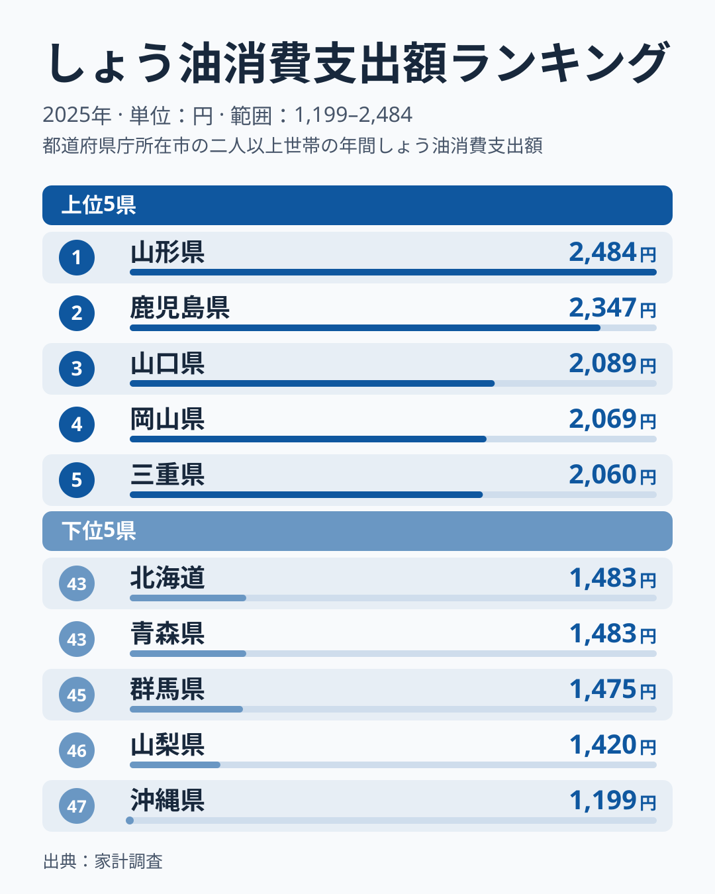
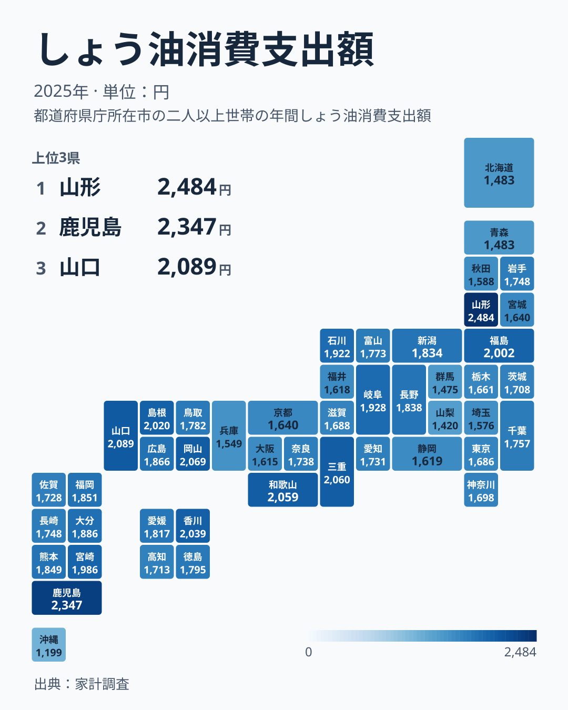

しょう油への年間支出が全国で最も高いのは山形県です。ただ、支出額は「どれだけ買ったか」と「いくらのものを買ったか」の掛け算なので、1位という順位だけでは、量が多いのか、単価が高いのかが分かりません。この記事は、同じ家計調査にあるしょう油の購入量を並べ、その切り分けを試みます。

先に結論を書くと、山形県は購入量が9位、割り出した単価が10位で、どちらも上位に入っています。支出額の上位10県のうち、量と単価の両方で10位以内に入るのは山形県だけです。

ここで使う指標は、都道府県庁所在市の二人以上世帯が1年間にしょう油へ支払った金額で、1世帯当たりの値です。県全体の値ではありません。

## しょう油消費支出額、上位と下位の県

<source-link href="/ranking/soy-sauce-consumption-expenditure">しょう油消費支出額ランキングをもっと見る</source-link>

1位は山形県で2,484円、2位は鹿児島県で2,347円です。3位の山口県は2,089円で、1位と2位が3位以下から200円以上離れています。3位の山口県から6位の和歌山県までは、2,089円、2,069円、2,060円、2,059円と、4県がごく近い値で並ぶ接戦です。7位は香川県、8位は島根県、9位は福島県、10位は宮崎県が続きます。

最下位は沖縄県で1,199円です。46位の山梨県は1,420円で、沖縄県はそこからさらに200円以上低くなります。北海道は43位、青森県は44位で、どちらも1,483円と同額です。1位と最下位の比は2,484円÷1,199円で約2.07倍です。

> [!WARNING]
> 家計調査の対象は、都道府県庁所在市に住む二人以上の世帯の年間合計です。標本が小さいため、3位から6位のようにほぼ同額で並ぶ範囲の順位は、単年の誤差として読むのが安全です。

上位10県は東北の山形県と福島県、中国の山口県・岡山県・島根県、九州の鹿児島県と宮崎県、四国の香川県、近畿の三重県と和歌山県で、特定の地方には偏りません。産地の有無でも説明できません。しょう油の産地としてよく知られる千葉県は23位で1,757円、兵庫県は42位で1,549円にとどまります。ここで言えるのは、地方でも産地でも順位は揃わない、ということまでです。

## 金額の差は量か、単価か

支出額と同じ家計調査には、しょう油の購入量があります。単位はミリリットルで、これも二人以上世帯の1世帯当たり年間値です。支出額を購入量で割ると、1リットル当たりの平均単価が出ます。この単価は本記事で割り出した値で、店頭価格そのものではありません。濃口・淡口などの種類、容量、買う店の違いがすべて混ざった平均です。

> [!NOTE]
> 単価は、年間支出額を年間購入量で割って1000倍した値です。例えば山形県は2,484円÷4,365mlで、1リットル当たり約569円です。標本の平均同士を割っているため、実際の販売価格として読まず、県同士の相対比較にだけ使います。

購入量は和歌山県が6,165mlで1位、大分県が4,777mlで2位、岐阜県が4,728mlで3位です。単価は山口県が1リットル当たり約712円で1位、大阪府が約621円、広島県が約607円と続きます。同じ支出額上位でも、中身は三つに分かれます。

- 量で押し上げている県: 和歌山県は購入量1位ですが単価は約334円で47位、支出額は6位です。三重県は量が4位、単価が33位、支出額は5位です。鹿児島県は量が5位で4,595ml、単価は20位で約511円、支出額は2位です。
- 単価で押し上げている県: 山口県は購入量が41位の2,932mlと少ないものの、単価が約712円で1位となり、支出額は3位です。福島県は量が33位で単価が5位、香川県は量が31位で単価が6位で、支出額はそれぞれ9位と7位です。
- 量も単価も上位の県: 山形県は購入量が9位の4,365ml、単価が10位の約569円で、両方が10位以内です。

支出額の上位10県のうち、購入量が10位以内なのは山形県、鹿児島県、三重県、和歌山県の4県です。単価が10位以内なのは山口県、福島県、香川県、山形県の4県です。残る岡山県、島根県、宮崎県は、どちらの10位以内にも入りません。つまり、山形県が1位になった理由として、データから言えるのは「量と単価が両方とも高めに重なったから」までです。なぜ両方が高いのかは、この指標だけでは分かりません。

47都道府県全体で見ても、支出額と購入量の相関係数は約0.45、支出額と単価の相関係数は約0.26で、どちらか一方だけで説明できる関係ではありません。買う量が多い県が高く、単価が高い県も高く、そのどちらにも入らない県も上位にいる、というのが全体の姿です。

## 地理的に見るしょう油消費の広がり

タイルマップで順位を見ると、上位の県は北から南まで広く散らばっています。中国地方では山口県が3位、岡山県が4位、島根県が8位と上位に入る一方、広島県は14位、鳥取県は21位で、同じ地方でも順位は揃いません。

南北の端の県が下位になる、という見方も当てはまりません。沖縄県は最下位、北海道は43位ですが、列島の南端に近い鹿児島県は2位、宮崎県は10位です。本州の内陸でも、山梨県は46位、群馬県は45位と低い一方で、岐阜県は11位、長野県は17位です。位置の端か中央かでは、順位は決まりません。

> [!TIP]
> 地図の濃淡は支出額の大小だけを示します。購入量と単価のどちらが効いているかは、上で見たように県ごとに違うので、色が濃い県が同じ理由で濃いとは限りません。

## 東北でも違う、しょう油とみその支出

東北4県の順位は、山形県が1位、福島県が9位、秋田県が40位、青森県が44位と大きくばらつきます。同じ家計調査にあるみそへの支出と並べると、別の構図が見えます。

みその支出額は、秋田県が3位で2,938円、山形県が8位で2,730円、福島県が15位で2,473円、青森県が34位で2,057円です。秋田県はしょう油が40位なのに、みそは3位です。山形県は両方とも上位で、青森県は両方とも下位に寄ります。みそへの支出が最も高いのは長野県で、次いで熊本県ですが、しょう油の順位は長野県が17位、熊本県が16位です。

47都道府県でしょう油の支出額とみその支出額の相関係数を求めると約0.30で、弱い関係にとどまります。しょう油の支出が高い県が、みその支出も高いとは限りません。秋田県のように、発酵調味料のうちみその側に支出が寄る県もあります。なぜそうなるかはこのデータからは分からず、食文化との関係は別の資料で確かめる必要があります。

あわせて見る: [みそ消費支出額ランキング](/ranking/miso-consumption-expenditure) / [しょう油消費量ランキング](/ranking/soy-sauce-consumption-quantity) / [油脂・調味料への支出を比べた記事](/blog/oils-seasonings-group-consumption-expenditure-prefecture-gap)

## まとめ

- 1位は山形県で2,484円、最下位は沖縄県で1,199円で、約2.07倍の差があります
- 山形県は購入量が9位、割り出した単価が10位で、支出額上位10県のうち両方で10位以内なのは山形県だけです
- 山口県は購入量が41位でも単価が1位で3位、和歌山県は購入量が1位でも単価が47位で6位と、金額の高さの中身は県ごとに違います
- しょう油の産地としてよく知られる千葉県は23位、兵庫県は42位で、産地の有無では順位を説明できません
- 同じ東北でも、秋田県はしょう油が40位でみそが3位です。しょう油とみその支出の相関係数は約0.30で、弱い関係です
