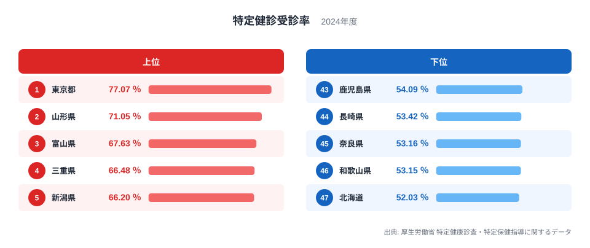
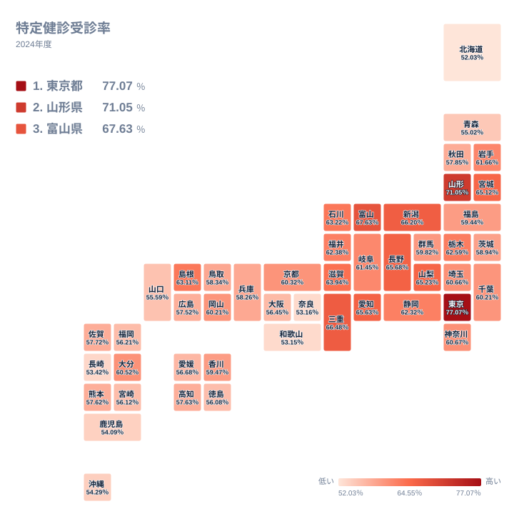

メタボリックシンドロームの予防を目的に、40歳から74歳の公的医療保険加入者へ実施される特定健診は、全国で同じ制度のもとに運営されています。それにもかかわらず、実際に受けた人の割合は都道府県によって大きく異なります。2024年のデータでは、最も高い東京都が77.074％、最も低い北海道が52.025％でした。東京都の値は北海道の約1.5倍にあたり、差は25ポイント以上です。この記事では、その差がどのような背景から生まれるのかを、確かめられる事実と仮説を分けて考えます。

## 受診率の上位と下位の分布を見る

まずは上位5都県と下位5道府県を図で確認します。

<source-link href="/ranking/specific-health-checkup-participation-rate">特定健診受診率ランキングをもっと見る</source-link>

この図で目を引くのは、分布の形です。東京都だけが77％台で飛び抜けており、2位の山形県との間には6ポイント近い開きがあります。2位以下は70％台前半から60％台半ばまでの狭い範囲に並び、上位の中でも東京都は別格の位置にあります。

下位側は逆に、北海道から5番目の鹿児島県までが52％台から54％台に収まっています。北海道と和歌山県、奈良県の間にも1ポイント余りしかなく、下位は団子状に固まっています。つまり全国の構図は、突出した東京都、なだらかに連なる上位県、密集した下位という三つの層で捉えられます。

上位5県には東京都のほか、東北、北陸、東海、甲信越の県が入っています。大都市の東京都が1位でありながら、2位以下は地方の県が占めており、単純な「都会は高く地方は低い」という図式では説明できません。下位にも、広い道県と大都市圏に近い府県が混在しています。

> [!NOTE]
> 特定健診は40歳から74歳が対象で、受診率は「対象者のうち実際に受診した人の割合」です。人口全体に対する割合ではありません。実施は加入する医療保険者ごとに行われ、都道府県の値はそれらを合算したものです。

## 東京都が突出する理由についての仮説

東京都が高い理由として、まず考えられるのは、働く人が加入する被用者保険の割合の高さです。被用者保険では、職場の定期健康診断と特定健診が一体で行われることが多く、受診が仕事の流れに組み込まれやすいと言われます。一方、自営業者や退職者が中心の国民健康保険では、本人が自治体の案内を受けて自発的に受診する必要があります。

ただし、今回使えるデータは都道府県別の受診率と順位だけで、保険の種類別の内訳は含まれていません。したがって、被用者保険の比率が東京都の高さを説明するという見方は、あくまで仮説です。詳しい数字は[東京都のデータ](/areas/13000)でも確認できます。

> [!WARNING]
> 都道府県別の受診率は、保険者の種類が混在した合計値です。高い県が「住民の健康意識が高い」とは限らず、保険構成や事業所の立地といった構造の違いが混ざっている可能性があります。この数字だけから、順位を努力の差と解釈することはできません。

## 地理分布で見る地域の偏り

続いて、全国の分布を地図で確認します。

地図では、東北の山形県、宮城県、北陸の富山県、石川県、新潟県、甲信越の長野県、山梨県、東海の三重県、愛知県など、東北から中部にかけて上位の県が多く見られます。宮城県は東北の太平洋側にあたり、日本海側だけのまとまりではありません。近畿では滋賀県が63.939％で10位に入っており、近畿全体が低いわけでもありません。

一方で、近畿の和歌山県、奈良県、大阪府、そして九州の長崎県、鹿児島県、福岡県、宮崎県、沖縄県、さらに北海道は下位に位置します。ただし九州でも大分県は60.521％で20位と中位の上位にあり、地方ごとに一括りにはできません。地域単位の傾向は見えるものの、例外も多いことに注意が必要です。

2位の山形県は71.052％で、東京都に次ぐ高さです。地域の保健師や健康推進員による声かけ、集団健診の定着などが背景にあるという見方もありますが、これもデータからは検証できない仮説にとどまります。山形県の様子は[山形県のデータ](/areas/06000)から確認できます。

> [!TIP]
> 同じ順位帯でも、値の間隔は一様ではありません。上位は東京都が頭ひとつ抜け、下位は密集しています。順位の数字だけでなく、図で値の間隔を見ると、差の大きさを読み違えにくくなります。

## 下位の道府県に見られる共通点の仮説

最下位の北海道は52.025％です。面積の広さや冬の移動の難しさが影響している可能性がありますが、これは推測であり、データで確かめたものではありません。長崎県や鹿児島県も下位にあり、離島や山間部の多さが関係するという仮説が考えられます。

和歌山県の53.146％と奈良県の53.156％は、ほぼ同じ水準です。奈良県が大阪府への通勤者が多い県であることから、居住地と勤務地の違いが受診の案内に影響するという仮説も立てられますが、今回のデータでは裏付けられません。沖縄県は42位、青森県は41位で、自営業や小規模事業所の多さが関係するのではないかという見方もありますが、同様に仮説の域を出ません。

大阪府は56.451％で36位、福岡県は56.213％で37位と、大都市を抱えながら中位より下に位置します。人口が多い都市部でも、東京都のように高くなるとは限らないことがわかります。同じ分野の他の統計は[同じカテゴリの統計一覧](/category/socialsecurity)から見比べられます。

## まとめ：倍率で見ると何が言えるか

東京都の77.074％と北海道の52.025％を比べると、約1.5倍の差があります。ただし「倍率」が示すのは開きの大きさだけで、その理由は示しません。また、この差は東京都が突出していることの影響が大きく、2位の山形県71.052％と北海道との差は、東京都との差より小さくなります。

確かなのは、同じ制度でも受診率に大きな地域差があること、そして上位は東京都が突出し、下位は密集しているという分布の形です。保険の構成、地理的な条件、地域の保健活動といった要因は、いずれも有力な仮説ですが、保険者別の内訳などの追加データがなければ検証できません。自分の住む県の位置を確認する際は、順位だけでなく値の間隔にも目を向けてみてください。

## データについて

この記事で扱う受診率は、厚生労働省が公表する特定健康診査・特定保健指導に関するデータを用いた、2024年の都道府県別の値です。単位は％で、小数第3位まで示されています。数値は全47都道府県を対象としています。
