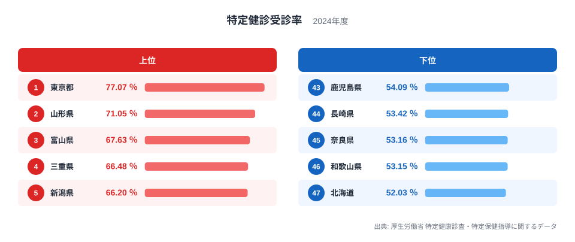
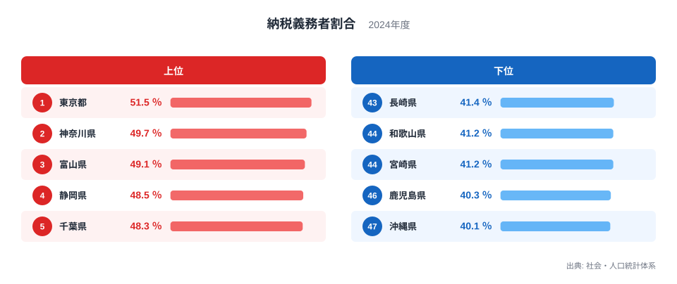
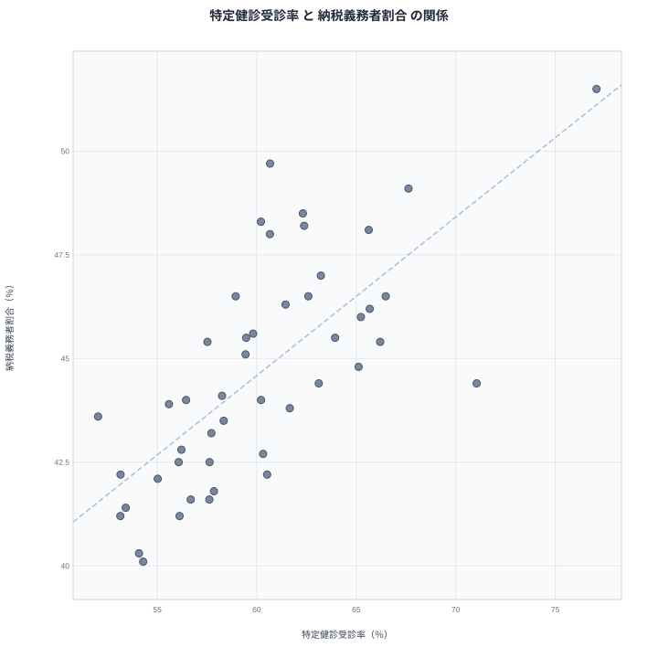

## 健診の受診率と納税者の多さは並んで動くのか

健診をよく受ける県には、働いて税を納める人も多い。そんな直感は、一見もっともらしく聞こえます。会社勤めの人が多い県では職場の健診が行き届き、同時に納税者も多くなりそうだからです。

この記事では、特定健診受診率と納税義務者割合を、2024年の47都道府県で並べて見ます。先に結果を書くと、両者の間には相関係数0.72という比較的はっきりした正の関係があります。ただし、相関は因果ではありません。健診を受けたから納税者が増えるのでも、納税者が多いから健診を受けるのでもなく、第三の要因が両方を動かしている可能性があります。ここでは、データから言えることと言えないことを分けて整理します。

> [!NOTE]
> 特定健診受診率は、特定健診の対象者のうち実際に受診した人の割合です。納税義務者割合は、住民に占める納税義務者の割合です。どちらも県単位の集計値で、分母になる集団が異なります。受診率は健診の対象者が分母で、納税義務者割合は住民全体が分母です。

問いは二つです。特定健診受診率が最も高い県はどこで、納税義務者割合が最も高い県はどこか。そして、両者が重なるのはなぜか。順に見ていきます。

## 特定健診受診率の上位と下位

まず特定健診受診率のランキングです。

<source-link href="/ranking/specific-health-checkup-participation-rate">特定健診受診率ランキングをもっと見る</source-link>

1位は東京都で77.074％です。2位は山形県で71.052％、3位は富山県で67.627％、4位は三重県で66.481％、5位は新潟県で66.201％と続きます。1位の東京都は、2位以下を大きく引き離しています。上位には大都市圏だけでなく、東北、北陸、東海の県が混じっている点が目を引きます。

一方、下位は47位の北海道が52.025％、46位の和歌山県が53.146％、45位の奈良県が53.156％です。44位は長崎県で53.418％、43位は鹿児島県で54.086％となっています。上位と下位の間には、20ポイントを超える開きがあります。受診率は、県によってかなり大きく異なる指標です。

注目したいのは、2位に山形県が入っていることです。山形県は後で見る納税義務者割合では23位で、順位は中位にとどまります。納税者の多さと受診率の高さが、単純には連動していないことを示す例です。山形県で受診率が高い理由は、このデータからは確かめられません。自治体の受診勧奨や地域での健診の定着といった仮説は考えられますが、本稿のデータに裏づけはありません。県の様子は[山形県のデータ](/areas/06000)から確認できます。

> [!WARNING]
> 特定健診の受診率は、加入している医療保険の種類によって対象者の把握の仕方が異なります。県ごとの保険者構成の違いが数字に含まれるため、県民の健康意識をそのまま測った値ではありません。今回のデータには保険者構成の指標がなく、その影響の大きさは見積もれません。

## 納税義務者割合の上位と下位

次に、納税義務者割合のランキングです。

1位は東京都で51.5％です。2位は神奈川県で49.7％、3位は富山県で49.1％、4位は静岡県で48.5％、5位は千葉県で48.3％です。首都圏と、富山県や静岡県といった製造業の集積する県が上位に並びます。

下位では、47位の沖縄県が40.1％、46位の鹿児島県が40.3％です。宮崎県と和歌山県はともに41.2％で、並んでいます。その次に長崎県が41.4％で続きます。九州や沖縄の県が下位に目立ちます。詳しい順位は[納税義務者割合ランキング](/ranking/taxpayer-ratio-per-pref-resident)で見られます。

東京都は両方の指標で1位です。富山県も、受診率で3位、納税義務者割合でも3位に入っています。反対に、沖縄県は受診率で42位、納税義務者割合で47位と、どちらも下位に位置します。鹿児島県も受診率は43位、納税義務者割合は46位です。こうした県が、全体の相関をつくる一因になっていると考えられます。ただし、東京都は他県と事情が大きく異なる可能性もあります。数字は[東京都のデータ](/areas/13000)にまとまっています。

## 2つの指標を重ねるとどう見えるか

2つの指標を、1県を1点として散布図に置くと次のようになります。

ピアソンの相関係数は0.72で、47都道府県のデータから計算しています。右上がりの傾向が見え、納税義務者割合の高い県ほど、特定健診受診率も高い傾向にあります。両指標で1位の東京都は右上側に位置し、両方で下位に近い沖縄県や鹿児島県は左下側に位置します。

ただし、0.72は関係の向きとそろい方を示す数字です。因果の大きさや、一方で他方を説明できる割合を示すものではありません。点は直線のまわりに広くばらついており、傾向から外れる県も確かにあります。山形県は受診率が2位と高い一方で、納税義務者割合は44.4％の23位です。逆に千葉県は、納税義務者割合が48.3％で5位なのに、受診率は60.211％の23位にとどまります。北海道も、納税義務者割合は43.6％の30位と中位ですが、受診率は47位です。納税者の多さだけでは、受診率の高低は決まっていないことが分かります。

> [!TIP]
> この2指標を読むときは、両方が同じ背景に左右される可能性を頭に置いてください。受診率は保険者構成に、納税義務者割合は年齢構成や働き方に左右されると考えられます。これらは「現役世代が多い県かどうか」で重なりやすいものです。そのため、2つが連動して見えても、健診と所得が直接つながっているとは限りません。

## 見かけの相関の背景にあるもの

では、なぜ2つは同じ方向に動くのでしょうか。提供されたデータには、就業者の構成や年齢構成、保険者の構成を示す指標がありません。そのため、背景を検証することはできません。ここでは、考えられる仮説を挙げるにとどめます。

- 就業構造の違いという仮説です。会社員の多い県では、職場を通じた健診の機会が整っていて、受診率が高くなるのかもしれません。同じ県では給与所得者が多く、納税義務者割合も高くなる可能性があります。
- 年齢構成の違いという仮説です。現役世代が厚い県では、課税対象となる所得のある人が多くなります。同時に、健診の対象者に占める職域の保険の加入者も多くなるのかもしれません。
- 都市と地方の違いという仮説です。企業が集まる都市では、事業所単位で健診を行いやすいのかもしれません。反対に、移動の不便な地域では、受診の機会そのものが少ない可能性もあります。

どれも、健診と納税の間に直接の原因と結果があるのではなく、働き方や年齢構成といった共通の背景が両方の数字に関わっている、という考え方です。統計の言葉では、これを交絡と呼びます。ただし、上の3つはいずれも仮説です。データだけでは確かめられません。

東京都の77.074％という突出した受診率も、同じ見方で考えられます。東京都を「健康意識が高い県」と読む前に、保険者構成など数字の成り立ちを確かめる必要があります。

## 結果を使うときの注意点

最後に、この結果の使い方です。県単位の傾向は、個人には当てはまりません。納税義務者割合が高い県に住む人が、必ず健診を受けているわけではありません。県の平均と個人の行動は別物です。

受診率を上げれば納税者が増える、あるいはその逆、といった政策的な結論も、このデータからは導けません。山形県のように、納税義務者割合は中位でも受診率が高い県は、原因を探る手がかりにはなります。ただし、手がかりであって答えではありません。

同じ分野の他の指標も、[同じカテゴリの統計一覧](/category/socialsecurity)から見比べられます。複数の指標を重ねて見ると、1つの順位表だけでは見えない地域の姿が浮かんできます。

## データについて

特定健診受診率は、厚生労働省の特定健康診査・特定保健指導に関するデータにもとづく2024年の値で、単位は％です。納税義務者割合は、社会・人口統計体系にもとづく2024年の値で、単位は％です。

相関係数は、47都道府県の2つの値からピアソンの方法で求めた0.72です。県を1点として扱った計算なので、県内の地域差や個人の違いは反映されていません。
