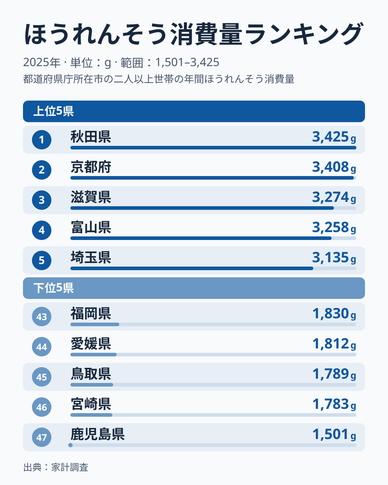
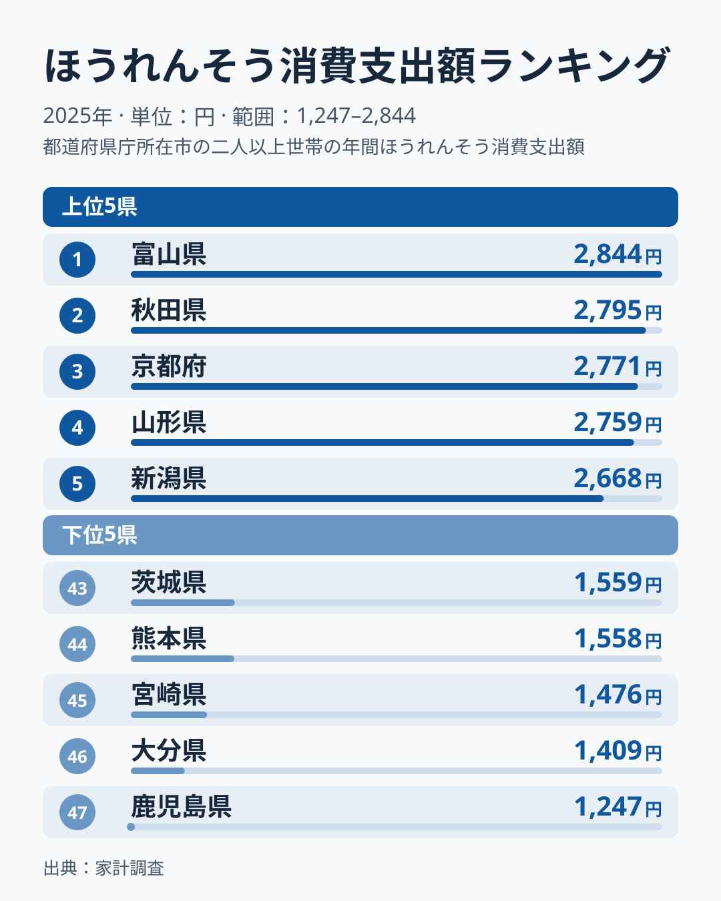

「野菜をよく食べる県」と聞いて、真っ先に思い浮かぶのはどこでしょうか。2025年の家計調査（二人以上世帯・都道府県庁所在市）でほうれんそう消費量が最も多かったのは[秋田県](/areas/05000)でした。1世帯あたり年間3,425gと、最下位の鹿児島県1,501gの2.3倍にのぼります。ただし2位の京都府とは17gしか違わず、上位4県（秋田・京都・滋賀・富山）は3,258〜3,425gにひしめく横並びです。

このランキングが面白いのは、上位の顔ぶれです。秋田・京都・滋賀・富山・埼玉の順に並びます。この記事では、上位と下位の顔ぶれがどう構成されているのかを、消費量と支出額という2つの指標から読み解きます。

> [!NOTE]
> このランキングは総務省「家計調査」の品目別購入数量データが元になっています。調査対象は**都道府県庁所在市の二人以上世帯**で、県内全域の消費実態そのものではありません。ほうれんそうの産地が県内にあっても、集計されるのは県庁所在市の家庭が買った量だけです。

## 上位と下位の対比

<source-link href="/ranking/spinach-consumption-quantity">ほうれんそう消費量ランキングをもっと見る</source-link>

2025年の1位は秋田県で3,425g、2位は[京都府](/areas/26000)で3,408g、3位は滋賀県で3,274gでした。4位は富山県で3,258g、5位は埼玉県で3,135g、6位は[山形県](/areas/06000)で3,077gと続き、7位に静岡県で3,033g、8位に[岩手県](/areas/03000)で3,029g、9位に神奈川県で2,893g、10位に新潟県で2,870gが入ります。上位10県を地方別に見ると、北海道・東北が3県（秋田・山形・岩手）、中部が3県（富山・静岡・新潟）、近畿が2県（京都・滋賀）、関東が2県（埼玉・神奈川）です。東北が上位を独占する形ではなく、寒冷地に限らず幅広い地方の県が並んでいます。

一方で下位は、鹿児島県が1,501gで最下位、次いで宮崎県1,783g、鳥取県1,789g、愛媛県1,812g、福岡県1,830gです。下位10県（38〜47位）まで広げると、九州・沖縄の県が6県（鹿児島・宮崎・福岡・沖縄・長崎・熊本）を占めます。ただし鳥取（中国）や愛媛（四国）も下位5県に入っており、地方だけでは説明できません。

一般にほうれんそうは寒冷地でも育てやすく、霜に当たると甘みが増す野菜とされます。東北や新潟・富山では、地元で採れる新鮮なほうれんそうが食卓に上りやすく、それが購入量を押し上げているのかもしれません。ただし京都・滋賀・埼玉のような地域も上位に入っており、気候だけでは説明できません。九州・沖縄の県が下位に多い背景としては、小松菜や春菊、白菜など別の葉物野菜に購入が分散していることや、温暖な地域では地場の旬が短いことが考えられますが、他の葉物野菜のランキングと突き合わせないと裏づけは取れません。このランキングが示すのは、あくまで県庁所在市の世帯が買った量の差です。

> [!WARNING]
> 家計調査は毎年の抽出調査であり、サンプル世帯の入れ替わりや天候不順による野菜価格の変動によって順位が動くことがあります。実際、同じ消費量ランキングの2024年値（ランキングページの2024年データ）では山形県が1位、岩手県が3位、大分県が最下位の47位でしたが、2025年は山形県が6位、岩手県が8位、大分県が37位でした。1年だけの順位を「その県の食文化」と断定するのは早計で、複数年の傾向を見ることをおすすめします。

## 消費量と支出額は同じ順位になるのか

支出額ランキングでは、上位5県のうち富山・秋田・京都の3県が消費量の上位5県と共通し、残りの2枠は入れ替わります。外れたのは消費量3位の滋賀県と5位の埼玉県で、支出額では滋賀県が9位、埼玉県が7位です。代わりに山形県が4位、新潟県が5位で入ります。

<source-link href="/ranking/spinach-consumption-expenditure">ほうれんそう消費支出額ランキングをもっと見る</source-link>

支出額の最大と最小の倍率も2.3倍で、消費量の倍率と一致します。1位の富山県は2,844円、最下位の鹿児島県は1,247円です。2位は秋田県の2,795円、3位は京都府の2,771円、4位は山形県の2,759円、5位は新潟県の2,668円と続きます。消費量でも支出額でも最下位は鹿児島県ですが、1位は消費量が秋田県、支出額が富山県と異なります。

順位の食い違いは、支出額を購入量で割った平均単価（世帯の平均支出額÷平均購入量の概算で、1グラムあたりの円）で説明できます。滋賀県は2,437円÷3,274gで約0.74円/gと安く、購入量が多くても支出額では9位に下がりました。反対に新潟県は2,668円÷2,870gで約0.93円/g、山形県は2,759円÷3,077gで約0.90円/gと高く、消費量では10位・6位でも支出額では5位・4位に上がります。埼玉県は約0.82円/gで、秋田県は約0.82円/g、京都府は約0.81円/gですから、3県の単価はほぼ同水準です。埼玉県は購入量が秋田・京都より少ない分、支出額で7位に下がりました。

全県で見ると、単価が最も高いのは鳥取県の約1.03円/g、次いで北海道の約1.01円/gで、最も安いのは大分県の約0.69円/g、次いで茨城県の約0.71円/gです。最高と最低の開きは約1.5倍あり、同じ量を買っても県によって払う額がかなり違うことが分かります。最下位の鹿児島県は約0.83円/gで、購入量が少ないことがそのまま支出額の少なさにつながっています。なお、この単価は県庁所在市の世帯平均から割り戻した概算で、品質や買い方（産地・袋詰め・量り売りなど）の違いまでは区別できません。

> [!TIP]
> 支出額を購入量で割ると、順位のずれの正体が見えます。消費量3位の滋賀県は約0.74円/gと安く支出額では9位、消費量10位の新潟県は約0.93円/gと高く5位でした。「どれだけ食べるか」と「いくら払うか」は別の話なので、家計の支出額だけで食べる量を比べないようにしましょう。

## まとめ

- 2025年のほうれんそう消費量（1世帯あたり年間）は秋田県が3,425gで最多、鹿児島県が1,501gで最少となり2.3倍の差。ただし京都府とは17g差で、上位4県は横並び
- 上位10県は北海道・東北3県・中部3県・近畿2県・関東2県で、特定の地方に偏らない
- 下位10県には九州・沖縄の6県が入る一方、下位5県には鳥取（中国）・愛媛（四国）も含まれ、地方だけでは説明できない
- 支出額の上位5県は消費量と3県が共通し、滋賀・埼玉が外れて山形・新潟が入る。支出額÷購入量の概算単価は鳥取約1.03円/gから大分約0.69円/gまで約1.5倍の幅があり、順位のずれは単価の差で説明できる
- 単年の県庁所在市の調査だけでは、地域の食文化を断定できない

主食の側で食習慣の地域差がどう表れるかは、[米消費量ランキング](/blog/rice-consumption-quantity-ranking)でも確認できます。ほうれんそうで上位に並んだ秋田・京都・富山などが米でも上位に入るかどうか、見比べてみてください。

## データについて

総務省「家計調査」の品目別データを、e-Stat（政府統計の総合窓口）経由で取得・集計しています。集計年は2025年、対象は都道府県庁所在市の二人以上世帯です。
