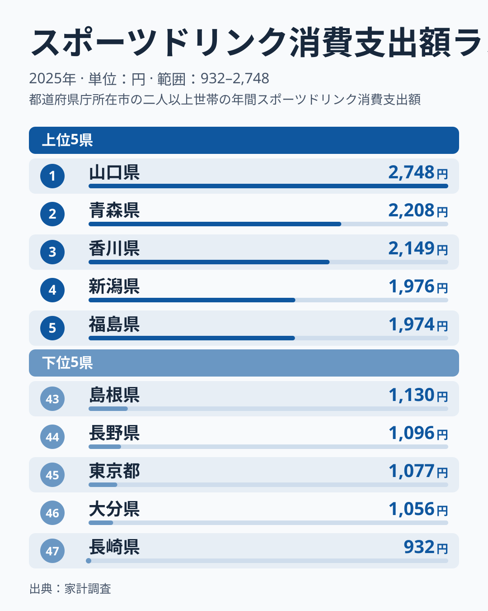
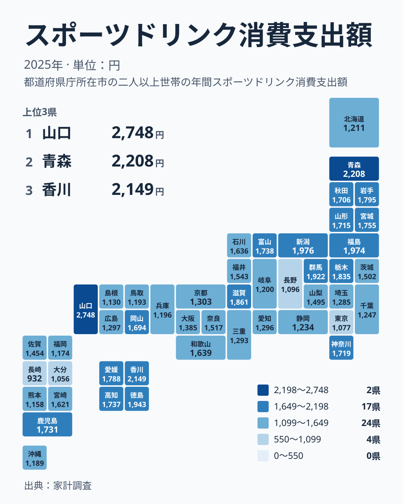

運動後や暑い日の水分補給として定着したスポーツドリンクですが、家計からの支出額は都道府県でかなり違います。2025年の家計調査では、最も多い山口県が2,748円で1位でした。最も少ない長崎県は932円で47位です。同じ商品を買っているはずなのに、なぜここまで差が出るのでしょうか。

この記事では、実際の支出額と順位を並べながら、気候、生活スタイル、買い物の場といった切り口で地域差の背景を考えます。数字から確実に言えることと、あくまで推測にとどまることを分けて書きます。

## 上位と下位の顔ぶれを見る

まず、上位5県と下位5県を図で確認します。

<source-link href="/ranking/sports-drink-consumption-expenditure">スポーツドリンクへの支出ランキングをもっと見る</source-link>

上位は、1位の山口県が2,748円、2位の青森県が2,208円、3位の香川県が2,149円、4位の新潟県が1,976円、5位の福島県が1,974円です。下位は、47位の長崎県が932円、46位の大分県が1,056円、45位の東京都が1,077円、44位の長野県が1,096円、43位の島根県が1,130円でした。

目を引くのは、1位と2位の間にも大きな開きがあることです。山口県は2,748円、青森県は2,208円で、トップが頭一つ抜けています。2位から5位までは2,208円から1,974円の範囲に収まっていて、山口県だけが別格の水準にあります。[山口県のデータ](/areas/35000)や[青森県のデータ](/areas/02000)のページで、ほかの指標と見比べてみるのも面白いでしょう。

下位に目を向けると、東京都が45位に入っているのが意外です。人口が多く、コンビニや自動販売機も多い大都市なのに、支出額は1,077円にとどまります。スポーツドリンクの購入量が多い県ほど上位に来る、という単純な図式ではなさそうです。

> [!NOTE]
> ここでの「支出額」は、家計調査におけるスポーツドリンクの年間支出額で、正式な統計名はスポーツドリンク消費支出額です。調べているのは世帯が家計から支払った金額であり、飲んだ量や本数ではありません。容量が大きい商品や粉末タイプ、特売品を選ぶ世帯は、同じ量を飲んでも支出額が小さくなります。

## 地図で見ると西と北に山がある

次に、47都道府県の分布を地図で見ます。

地図からは、支出が高い県が一か所にかたまっているわけではないことが分かります。北は青森県、日本海側から関東に近い位置には新潟県や群馬県、西は山口県や四国の各県と、離れた場所に高い県が散らばっています。気温や緯度だけで説明できる分布ではありません。

地方別に見ると、四国は4県すべてが上位にあります。香川県が3位、徳島県が6位、愛媛県が11位、高知県が14位です。四国の4県は、順位がいずれも14位以内に収まっています。一方で九州・沖縄は二極化しています。鹿児島県が15位、宮崎県が22位と中位から上位にいる反面、長崎県が47位、大分県が46位、熊本県が42位、福岡県が41位、沖縄県が40位と、下位に並ぶ県が目立ちます。

同じ地方でも順位が大きく割れる点は、地域の気候や文化だけで説明しにくい、という重要な手がかりです。鹿児島県と長崎県は同じ九州・沖縄の区分ですが、順位の差は大きく開いています。県ごとの事情を丁寧に見る必要があります。

## 北海道・東北、関東、中部、近畿の傾向

北海道・東北の区分では、北海道を除く6県が上位に集まっています。青森県が2位、福島県が5位、岩手県が10位、宮城県が12位、山形県が17位、秋田県が18位です。これに対して北海道は1,211円で36位と、同じ区分の中で例外的に低い位置にいます。

冷涼な地域でスポーツドリンクがよく買われるのは、一見すると不思議です。考えられる理由のひとつは、水分補給の場面が暑さだけではないことです。屋内の暖房、部活動や地域のスポーツ活動、農作業や除雪といった体を使う仕事など、季節を問わず飲む機会があるのかもしれません。ただし、これは推測であり、今回のデータから裏づけられるわけではありません。

関東では群馬県が7位で1,922円、栃木県が9位で1,835円、神奈川県が16位で1,719円と上位から中位に入ります。一方、茨城県は25位、埼玉県は33位、千葉県は34位、東京都は45位です。同じ関東でも、北関東の2県と首都圏の都市部とで差があります。

中部では新潟県が4位で1,976円、富山県が13位で1,738円と高く、石川県が21位、福井県が23位、山梨県が26位と続き、愛知県が31位、静岡県が35位、岐阜県が37位、長野県が44位と下位に並びます。長野県の1,096円は中部で最も低い水準です。

近畿では滋賀県が8位で1,861円と最も高く、和歌山県が20位、奈良県が24位、大阪府が28位、京都府が29位、三重県が32位、兵庫県が38位と続きます。近畿の7府県のうち上位10位に入るのは滋賀県だけです。

> [!TIP]
> 順位だけで見ると差が大きく感じられますが、中位の県どうしは金額の差がわずかです。たとえば大阪府は1,385円で28位、京都府は1,303円で29位、広島県は1,297円で30位と、順位がひとつ違っても金額はそれほど変わりません。上位と下位の両端に注目し、中位の細かな順位の入れ替わりは気にしすぎないのが読み解くコツです。

## 関連する飲料との対比で考える

スポーツドリンクの支出が多い県は、水分補給に使う飲料の予算が大きいだけかもしれません。お茶、炭酸飲料、果汁飲料、水などのほかの飲み物にお金をかける県では、スポーツドリンクの比重は小さくなる可能性があります。今回は、ほかの飲料の支出額を扱わないため、置き換えが起きているかどうかは確かめられません。ただ、スポーツドリンクだけが突出している県と、飲料全般への支出が多い県とでは、背景が違うはずです。

たとえば東京都は、コンビニや自動販売機、駅ナカの店舗で飲み物を一本ずつ買う機会が多いと考えられます。それでもスポーツドリンクへの支出は1,077円と低く、家計調査が捉えるのは主に家庭での購入だという点を考えると、外出先で買う分が結果に十分反映されていない可能性があります。反対に山口県のように家庭で箱買いする習慣が根づいている県では、数字が高く出やすいのかもしれません。

こうした買い方の違いは、同じ飲料でも、まとめ買いか、一本ずつの購入かで統計への現れ方が変わることを示しています。地域差を読むときは、飲む量の違いと買い方の違いを混ぜないようにしたいところです。

> [!WARNING]
> 家計調査は、一定数の世帯を対象とした標本調査です。県庁所在地や政令指定都市を中心とした調査結果が、県全体の消費を代表しているとは限りません。また、スポーツドリンクのような単価の小さい品目は、少数の世帯の購入が平均を押し上げることがあります。1年分の結果だけで、その県に固有の習慣があると断定するのは避けてください。

## 山口県の突出をどう受け止めるか

山口県の2,748円は、2位の青森県と比べても大きな差があります。最下位の長崎県が932円なので、1位との開きは実データの上でもはっきり確認できます。理由として、夏場の暑さ、製造業や屋外での仕事に従事する人の多さ、学校や地域のスポーツ活動の盛んさなどを思い浮かべることはできますが、今回の数字だけではどれが効いているのか判断できません。

一方、香川県が3位の2,149円、徳島県が6位の1,943円、愛媛県が11位の1,788円と、山口県に近い瀬戸内海周辺や四国の県が上位に並ぶのは注目に値します。中国では、山口県が1位なのに対し、岡山県は19位で1,694円、広島県は30位で1,297円、鳥取県は39位で1,193円、島根県は43位で1,130円と、順位が大きくばらけます。瀬戸内海に面しているかどうかだけで、きれいに説明できるわけでもありません。

このように、地域の共通点を探しても例外が必ず出てきます。だからこそ、県ごとの個別の事情、たとえば世帯構成、年齢構成、仕事、学校の部活動、店舗の価格設定などを個別に確かめることが大切です。ほかの経済統計と並べて読みたい方は、[同じカテゴリの統計一覧](/category/economy)から関連する指標を探してみてください。

## データについて

この記事の数値は、2025年の家計調査によるスポーツドリンク消費支出額で、単位は円です。47都道府県の値が公表されており、記事中の金額と順位はすべてその値をそのまま使っています。

支出額は、世帯が実際に支払った金額を集計したものなので、物価や商品の容量、割引の影響を受けます。地域差は、飲む量の差だけでなく、価格や買い方の差も含んだ結果だと理解してください。

スポーツドリンクの支出が最も多い県は山口県で、最も少ない県は長崎県です。この両端の間に、地域の暮らし方や買い物の習慣が反映された大きな幅があります。順位の背景を決めつけず、数字の差を手がかりに、それぞれの地域の事情へ目を向けるきっかけにしていただければ幸いです。
