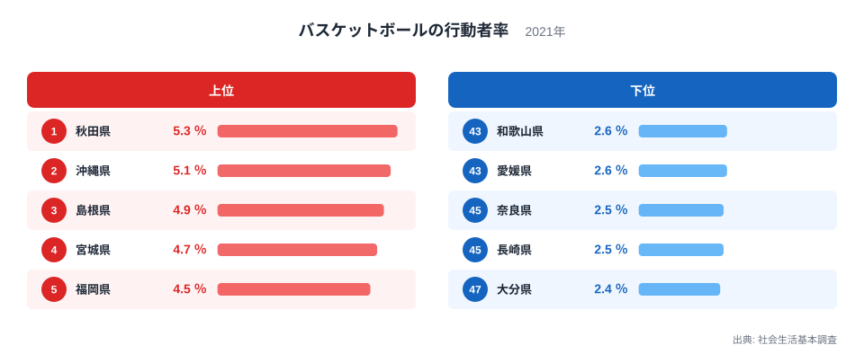
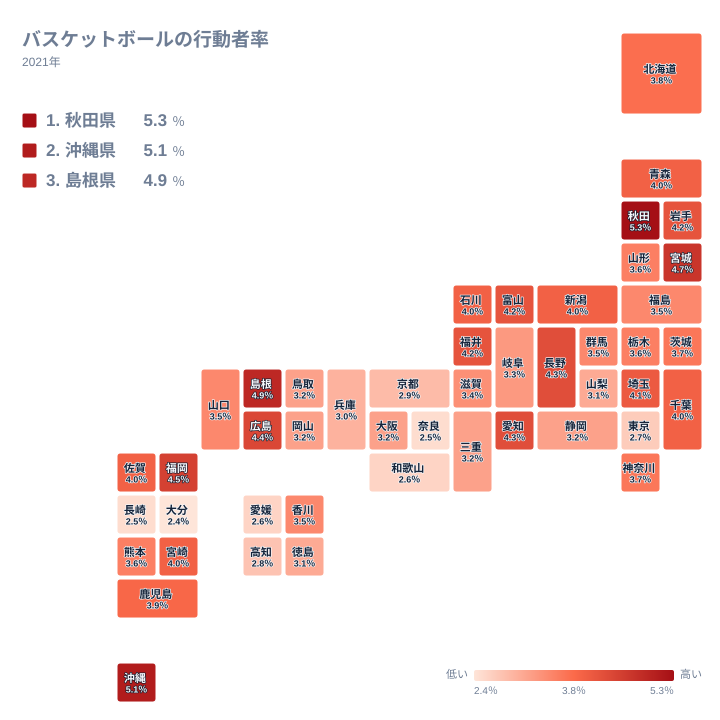

## 首位は秋田県、東京都は下位にとどまる

バスケットボールは、体育館さえあれば楽しめる身近な競技です。それでも、バスケットボールをした人の割合は都道府県によってかなり違います。2021年の調査で首位だったのは秋田県で、5.3％でした。沖縄県が5.1％で2位、島根県が4.9％で3位です。

一方、人口が多く施設も多そうな東京都は2.7％で42位にとどまりました。最下位は大分県の2.4％です。「大都市ほど競技をする人の割合が高い」という直感は、この指標ではあてはまりません。

この記事では、上位と下位がなぜその順になるのかを、地理・産業構造・歴史の面から考えます。ただし、手元にあるのは割合のデータだけです。背景の説明はすべて仮説として読んでください。

> [!NOTE]
> ここでの割合は、調査の対象期間中に一度でもバスケットボールをした人が、その県の対象者のうちどれだけいたかを示します。回数や時間の長さは反映されません。たまに遊ぶ人も、毎週練習する人も、同じ「した人」として数えられます。

## 上位と下位の顔ぶれ

<source-link href="/ranking/sports-participation-rate-basketball">バスケットボールをした人の割合ランキングをもっと見る</source-link>

図で目を引くのは、上位の県が一つの地方にまとまっていないことです。東北の秋田県と宮城県、中国の島根県、九州・沖縄の沖縄県と福岡県が並びます。下位には近畿の和歌山県と奈良県、四国の愛媛県、九州の長崎県と大分県が入りました。九州・沖縄は上位にも下位にも顔を出しており、地方という大きな単位では順位を説明しきれません。

秋田県については、県北の能代市が高校バスケットボールの名門で知られています。強い学校があると、地域に競技の経験者が増え、指導者や練習の場も残りやすくなります。そうした土壌が、卒業後も競技を続けやすい空気をつくっているのかもしれません。ただし、今回のデータから確かめられることではなく、あくまで仮説です。

沖縄県は、プロチームの試合が身近にあることや、競技が早くから親しまれてきたことが語られます。こうした事情が背景にある可能性はありますが、この指標だけでは裏付けられません。詳しい数字は[秋田県のデータ](/areas/05000)や[沖縄県のデータ](/areas/47000)で確認できます。

下位については、さらに根拠が乏しくなります。人が分散して暮らす地域で仲間を集めにくい、ほかの余暇や運動が選ばれやすいといった想像は成り立ちますが、検証できる数字がありません。ここでは、下位の理由を断定しないことが誠実だと考えます。

> [!TIP]
> この指標は小数第1位までの表示のため、同じ値の県が多くあります。たとえば4％の県は、13位の青森県から18位の宮崎県まで6県が並んでいます。順位が違っても実質的な差は小さいと考えられます。同じ値が並ぶ範囲を確かめてから順位を読むと、読み違いを防げます。

## 地理分布に見る地方内のばらつき

タイルマップで眺めると、色の濃い県が地方ごとにきれいに固まってはいません。同じ地方の中でも県ごとの差が目立ちます。

北海道・東北では、秋田県と宮城県が上位に入り、岩手県も4.2％で9位と上位に近い位置です。一方、山形県は3.6％で23位、福島県は3.5％で26位と、同じ地方でも中位に下がります。気候や地域区分だけでは、順位は説明できないと見るのが自然です。

中国も似た構図です。島根県が3位、広島県が6位と高い一方、鳥取県と岡山県は3.2％で並び、35位と36位です。隣り合う県でも、競技の根づき方は同じではありません。

中部は上位に近い県と中位以下の県が混在しています。長野県と愛知県はともに4.3％で7位と8位、富山県と福井県は4.2％で10位と11位です。これに対して山梨県は3.1％で37位でした。中部の中でも、高い県と低い県の間に開きがあります。

九州・沖縄では、福岡県の4.5％から大分県の2.4％まで幅が広く開いています。福岡県のように人が集まる都市を抱える県では、学校、クラブ、民間施設など競技に触れる場が多いのかもしれません。長崎県や大分県の低さについては、地形が集まりにくさにつながる可能性も考えられますが、データでは確認できません。

> [!WARNING]
> この調査は標本調査です。県ごとの回答者数には限りがあり、小数第1位の違いは誤差の範囲かもしれません。1位と2位のような小さな差を、そのまま実力差や熱意の差と読み取るのは避けてください。

## 大都市圏の低さをどう読むか

関東では、埼玉県が4.1％で12位と高めで、千葉県は4％で14位です。茨城県と神奈川県は3.7％で21位と22位でした。その中で東京都だけが2.7％で42位と大きく離れています。同じ首都圏でも、隣接する県と東京都では傾向が違います。

東京都が低い理由としては、施設の予約が取りにくいこと、余暇の選択肢が多くて運動が分散することなどが考えられます。ただし、これらは施設数や利用状況の数字を見ない限り確かな説明にはなりません。

近畿では、滋賀県が3.4％で30位と最も高く、大阪府は3.2％で34位です。兵庫県が39位、京都府が40位、和歌山県が43位、奈良県が45位と続き、上位に入る県はありません。近畿は全体として中位から下位に集まっています。

愛知県の4.3％や埼玉県の4.1％のように、大都市圏でも高い県はあります。「大都市だから低い」というより、県ごとの環境や競技の根づき方の違いと見るほうが無理のない読み方でしょう。

> [!NOTE]
> 行動者率は、対象者に占める割合です。人数そのものではありません。人口の多い県ほど競技者の人数は多くなりますが、この指標では人口規模の影響が除かれています。順位が高いことは、競技者の数が多いことを意味しません。

## 四国の位置づけと、数字の使い方

四国では、香川県が3.5％で29位と最も高く、徳島県が38位、高知県が41位、愛媛県が44位です。四国の県は中位から下位にあり、上位に入る県はありません。

人が散らばって暮らす地域では、チーム競技の仲間を集めにくいという見方もできます。別の楽しみが盛んだという説明もありえます。いずれも、データからは裏付けられないため、断定は避けます。

数字を読むうえで確かなのは、順位の差が必ずしも大きな差を意味しない点です。3.5％には群馬県、山口県、香川県、福島県が並んでいます。小さな値の違いで、順位が何位も動くことは珍しくありません。順位だけでなく、値そのものを見る習慣が大切です。

> [!TIP]
> 学校の部活動や地域のクラブの影響も頭に置いておくとよいでしょう。若い世代が競技を続けやすい県では、値が高くなる可能性があります。ただし、この記事のデータには年齢別の内訳がないため、確かめることはできません。順位の高さを「大人が楽しんでいる」ことの証拠と読むのは控えてください。

## 数字から読み取れること

バスケットボールをした人の割合は、都市の大きさとは単純には結びつきません。最も高い秋田県は5.3％、最も低い大分県は2.4％で、同じ競技でも県によって日常への入り込み方が違います。

高い水準の背景には、世代を超えて競技に親しむ土壌があるのかもしれません。反対に、低い県は競技に触れる機会をどうつくるかという課題を映している可能性もあります。いずれも、別の統計と照らして確かめる必要があります。

[同じカテゴリの統計一覧](/category/educationsports)では、ほかの競技の行動者率も比べられます。競技ごとに上位の県が入れ替わる様子を見ると、地域のスポーツ文化の違いがより立体的に見えてきます。

## データについて

使用した統計は、社会生活基本調査の「バスケットボールの行動者率」です。調査の対象期間中にバスケットボールを一度でも行った人が、その県の対象者に占める割合を示しています。単位は％で、2021年の結果を使っています。

同じ値の県が多いため、本文では順位に加えて値も併記しました。順位は実データの表示に従っています。年齢構成の違いが順位に影響する可能性もありますが、このデータだけでは確かめられません。
