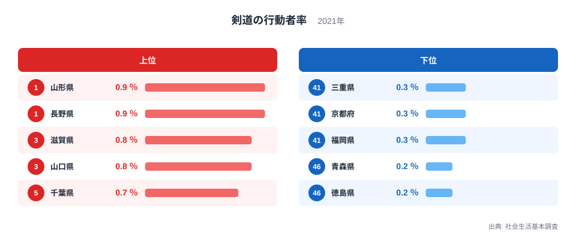
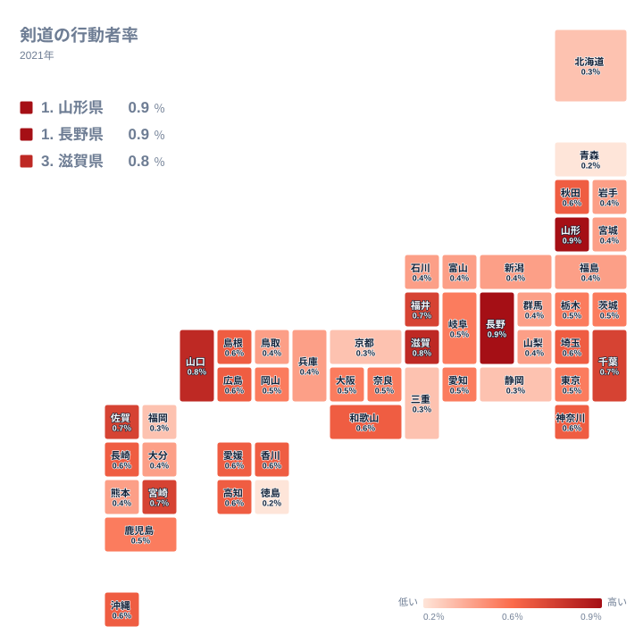

## 剣道をした人が多い県はどこか

竹刀の音が響く道場は、どの県にもあるように見えます。しかし過去1年間に剣道をした人の割合を県ごとに並べると、はっきりとした差が現れます。2021年の社会生活基本調査では、1位は山形県で0.9％、同じ0.9％で2位が長野県でした。最下位は青森県と徳島県で、どちらも0.2％です。

全体が0.2％から0.9％の間に収まる指標では、0.1％の違いも順位に大きく響きます。1位と最下位の比は、実データの上では0.9％対0.2％です。小さな数字の中に、意外に大きな開きがあることがわかります。

この記事では、上位と下位がどのような顔ぶれになっているかを、地理の広がりを中心に見ていきます。先に断っておくと、この統計は「なぜその順になるのか」という理由までは教えてくれません。そのため、数字から言えることと、仮説として考えられることを分けて書きます。

> [!NOTE]
> 「行動者率」は、調査前の1年間にその種目を1回以上行った人の割合です。剣道の場合、数字に含まれるのは、竹刀を握った人です。観戦したり、子どもの送迎をしたりしただけの人は入りません。道場の数や有段者の数とは別の物差しです。

## 上位5県と下位5県の顔ぶれ

まず、上位と下位を図で確かめます。

<source-link href="/ranking/sports-participation-rate-kendo">剣道をした人の割合ランキングをもっと見る</source-link>

上位5県は、北海道・東北の山形県、中部の長野県、近畿の滋賀県、中国の山口県、関東の千葉県と、五つの地方にまたがっています。剣道が盛んな県は、特定の地方に固まっているわけではありません。

下位5県も同様に散らばっています。この記事では地方を、冒頭に示した7区分で数えます。三重県は近畿に含めます。この基準で見ると、下位5県は近畿の三重県と京都府、九州・沖縄の福岡県、北海道・東北の青森県、四国の徳島県です。五つのうち近畿が二つで、残りは別々の地方です。

京都府は古くから武道の伝統が語られる土地ですが、行動者率では44位にとどまっています。歴史的なイメージと、いま実際に竹刀を握っている人の割合は、必ずしも一致しません。山形県の様子は[山形県のデータ](/areas/06000)、長野県の様子は[長野県のデータ](/areas/20000)でも確認できます。

> [!WARNING]
> 公表値は小数第1位までで、多くの県が同じ値に並びます。0.6％には9位の秋田県から19位の沖縄県までが入っており、順位が1つ違うだけでは実質的な差とは言えません。また、行動者率は標本調査からの推計値です。人口の少ない県は回答数が限られるため、0.2％と0.3％の差が調査上の揺れの範囲に収まっている可能性もあります。

## 地理分布を見る

次に、47都道府県の分布をタイルマップで見ます。

分布を眺めて目につくのは、高い値が一か所に固まっていないことです。九州・沖縄では、佐賀県と宮崎県が0.7％で7位と8位に入る一方、福岡県は0.3％で45位です。四国でも、香川県、愛媛県、高知県が0.6％で並ぶ中、徳島県だけが0.2％で最下位です。同じ地方の中でも、県による開きが大きいことがわかります。

北海道・東北も同じです。山形県は1位ですが、北海道は41位の0.3％、青森県は46位の0.2％です。剣道は屋内で行う種目なので、雪の多い少ないといった気候だけでは、この差は説明しにくいと考えられます。気候や地方という大きなくくりよりも、県ごとの事情が効いている可能性があります。

都市部はどうでしょうか。東京都は22位、大阪府は25位で、どちらも0.5％と中位です。埼玉県と神奈川県は0.6％で、それぞれ10位と11位です。大都市圏だから高い、あるいは低いと一括りにはできません。

> [!TIP]
> 順位表の順番だけでなく、値が同じ帯に何県入っているかを見ると、読み違いを避けられます。0.5％と0.4％の帯は、それぞれ多くの県が入る中間層です。1位や47位の県だけに目が行きがちですが、「大半の県は似た水準にある」という全体像を先に押さえてください。

## 上位・下位をどう読むか

ここからは、データに直接は表れない部分を、仮説として整理します。いずれも、この統計だけでは確かめられません。

仮説の一つ目は、地域の指導の場の厚みです。剣道は学校の部活動だけでなく、地域の道場やスポーツ少年団が受け皿になりうる種目です。こうした場が長く続いている県では、行動者率が高くなるかもしれません。ただし、道場の数や運営の状況はこのデータにはありません。山形県と長野県がなぜ1位と2位に並ぶのかも、この統計からは断定できません。

二つ目は、他の種目との競合です。選択肢の多い県では、剣道に向かう人の割合が相対的に薄まるのではないか、という見方です。福岡県が45位であることとは整合的に見えますが、東京都や大阪府は中位で、きれいには当てはまりません。他の種目の行動者率と並べて初めて検証できる話です。

三つ目は、歴史の影響です。藩校や武家の文化が、いまの行動者率に影響しているのではないかという見方がありますが、京都府の44位のような例もあり、単純には結びつきません。歴史が現在の数字にどこまで効いているのかは、この記事では結論を出せません。

下位についても、同じ慎重さが必要です。青森県と徳島県の0.2％は、剣道が衰えている証拠とは限りません。小数第1位の公表値と標本調査という性質上、0.3％の三重県、京都府、福岡県との差も、誤差の範囲かもしれません。

## 全体の中での位置づけ

分布の中ほどに目を向けると、20位の茨城県から28位の鹿児島県までが0.5％、29位の岩手県から40位の大分県までが0.4％です。この中間層が厚いことが、全体のイメージを形づくっています。

0.9％と0.2％という両端を除くと、多くの県は0.4％から0.6％の間に収まります。極端に盛んな県と極端に少ない県は少数で、大半の県は似た水準にあります。山形県と長野県は、その中でも際立つ存在です。

読者の地元がどの帯にあるかを確かめて、隣の県と見比べてみてください。他の種目や学習に関する指標と並べたいときは、[同じカテゴリの統計一覧](/category/educationsports)から進めます。剣道の位置づけは、他の指標と並べたときにいっそうはっきりします。

## データについて

この記事で使ったのは、社会生活基本調査の「剣道の行動者率」で、年は2021年、単位は％です。調査は10歳以上の人を対象に、過去1年間の活動を尋ねています。

比較にあたっては、次の点を意識してください。

- 値は小数第1位までの公表値で、細かな差は表れません。
- 標本調査の推計値のため、人口の少ない県では揺れが大きくなります。
- 稽古の頻度や段位は反映されず、年に一度だけ体験した人も日常的に稽古する人も、同じ一人として数えられます。
- 地方の区分は、この記事では北海道・東北、関東、中部、近畿、中国、四国、九州・沖縄の7区分で統一しています。

したがって、この数字は剣道の強さや伝統の深さを測るものではありません。2021年時点で、どれだけの人が竹刀を握ったかを示す目安です。
