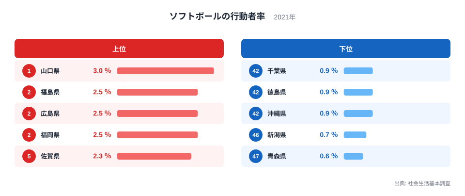
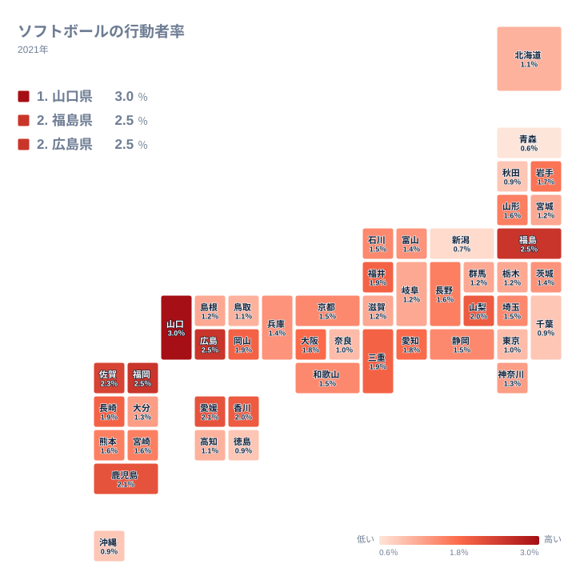

## ソフトボールをした人の割合で見える都道府県の差

ソフトボールは、野球に似ていながら、少ない人数や広くない場所でも楽しめる競技です。職場や地域のチーム、学校の部活動、ママさんソフトなど、参加の入り口が多いことが特徴です。では、実際にどの県でソフトボールをした人が多いのでしょうか。

2021年の社会生活基本調査では、過去1年間にソフトボールをした人の割合が都道府県別に示されています。最も高いのは山口県の3％で、最も低いのは青森県の0.6％です。最大と最小の比は5倍にのぼります。数字だけを見ると小さな差に思えますが、多くの県が1％台前半までに集まっていることを考えると、山口県の3％はかなり抜けた水準です。

この記事では、上位と下位に並ぶ県の顔ぶれを確かめたうえで、地理や産業構造、歴史といった観点から、なぜその順になるのかを考えます。ただし、使えるのはこの指標の値と順位だけです。背景の説明は、確かめられた事実ではなく仮説として読んでください。

> [!NOTE]
> ここでいう「ソフトボールをした人の割合」は、社会生活基本調査における「ソフトボールの行動者率」です。10歳以上の人のうち、過去1年間に一度でもソフトボールをした人が占める割合を指します。年に数回の草試合でも、毎週の練習でも、同じ1人として数えられます。競技への熱心さの度合いではなく、触れた人の広がりを示す指標です。

## 上位と下位の顔ぶれ

<source-link href="/ranking/sports-participation-rate-softball">ソフトボールをした人の割合ランキングをもっと見る</source-link>

図で目を引くのは、上位と下位でばらつき方が違うことです。上位は1位の山口県が3％、5位の佐賀県が2.3％と、5県の間に0.7ポイントの開きがあります。これに対して下位は、43位の千葉県から45位の沖縄県までが0.9％で並び、46位の新潟県が0.7％、47位の青森県が0.6％です。5県の間の開きは0.3ポイントにとどまります。上位は値が散らばり、下位は低い値に密集しているのです。

上位には、中国の山口県と広島県、九州・沖縄の福岡県と佐賀県、北海道・東北の福島県が入っています。下位は、関東の千葉県、四国の徳島県、九州・沖縄の沖縄県、中部の新潟県、北海道・東北の青森県で、5つの地方にばらけています。上位は西日本に寄り、下位は特定の地方に固まっていません。下位には県ごとに別々の事情があると考えたほうが自然です。

2位から4位は、福島県、広島県、福岡県がいずれも2.5％で並んでいます。1位の山口県との差は0.5ポイントです。[山口県のデータ](/areas/35000)や[福島県のデータ](/areas/07000)とあわせて見ると、同じ上位でも、ほかの指標でどんな姿をしているのかを比べられます。

> [!TIP]
> この指標は小数第1位までの表示で、2位から4位のように同じ値が並ぶ県があります。見るべきは順位の細かな前後よりも、3％、2％台、1％台、1％未満という大きな段差です。段差の位置を押さえると、全体の姿が読み取りやすくなります。

## 上位はなぜ高いのか

山口県が1位に立つ理由を、この指標だけで断定することはできません。仮説としては、学校や職場、地域のチームなど、ソフトボールに触れる場が多いことが考えられます。ただし、それを裏づける数値は手元にありません。山口県の3％という値が、全国で最も高いという事実だけを確かな点として押さえておきます。

広島県は3位で2.5％、福岡県は4位で2.5％、佐賀県は5位で2.3％です。愛媛県は6位で2.1％、鹿児島県は7位で2.1％と、西日本の県が上位に続きます。西日本に球技を地域や職場で楽しむ習慣が根づいている可能性はありますが、この指標だけでは確かめられません。傾向として受け止めるのが妥当です。

福島県は2位で2.5％と、北海道・東北の中で突出しています。同じ地方の青森県は47位で0.6％、岩手県は16位で1.7％、山形県は17位で1.6％、北海道は37位で1.1％、秋田県は42位で0.9％です。同じ北海道・東北でも、県ごとの差が大きいことがわかります。福島県で競技が広がった要因は、地域のクラブや大会の様子などかもしれませんが、この指標からは判断できません。

## 地理分布で見る西高東低の傾向

タイルマップで全体を眺めると、濃い色が集まるのは中国から九州にかけての西日本です。愛媛県の6位で2.1％、鹿児島県の7位で2.1％、香川県の9位で2％、岡山県の12位で1.9％など、瀬戸内海周辺から九州にかけて上位の県が連なっています。山梨県が8位で2％、福井県が10位で1.9％と、中部にも上位の県はありますが、数は多くありません。

関東に目を移すと、様子は変わります。埼玉県は21位で1.5％、茨城県は26位で1.4％、神奈川県は29位で1.3％、東京都は40位で1％、千葉県は43位で0.9％です。首都圏の県は中位から下位にかけて広がっています。人口が多く都市化が進んだ地域で低めに出る傾向は見えますが、栃木県は32位で1.2％、群馬県は33位で1.2％と、都市化の度合いだけでは並びを説明できません。

背景として、グラウンドの確保しやすさや、ほかのスポーツとの競合が考えられます。ただし、これも仮説にとどまります。大阪府は15位で1.8％、愛知県は14位で1.8％と、大都市圏でも比較的高い県があります。大都市圏の県がすべて低いわけではなく、地域差の理由はひとつではないと考えたほうがよさそうです。

> [!WARNING]
> この指標は小数第1位までの表示で、しかも1％前後に多くの県が密集しています。たとえば1.2％には宮城県から島根県まで6県が並び、1.5％にも5県が並びます。0.1ポイントの違いで順位が数位動く中位帯では、順位の上下を県の優劣として読むと誤ります。

## 下位はなぜ低いのか

下位の青森県は0.6％、新潟県は0.7％です。ともに雪の多い地域として知られており、屋外競技であるソフトボールがしにくい可能性は考えられます。青森県は北海道・東北、新潟県は中部で、地方は異なります。ただし、積雪との関係を示す数値は使えないため、あくまで仮説です。

雪の多さだけでは説明しきれない点もあります。岩手県は16位で1.7％、山形県は17位で1.6％と、中位より上にいます。逆に、雪とは縁の薄い沖縄県は45位で0.9％と、下位に入っています。気候の要因だけでなく、競技の人気の向きや、クラブ文化の広がり方など、別の事情が重なっているのでしょう。

四国を見ると、徳島県は44位で0.9％です。愛媛県が6位で2.1％、香川県が9位で2％、高知県が39位で1.1％と、県ごとに大きく割れています。同じ地方でも順位が大きく動くことは、地方という大きな単位だけでは傾向をとらえきれないことを示しています。

## 数字をどう受け止めるか

ここまで見てきたように、ソフトボールをした人の割合は、山口県の3％から青森県の0.6％まで開きがありました。西日本に高い県が多いという傾向も見えます。一方で、その背景は気候、土地の広さ、地域のクラブ文化、他のスポーツとの競合などが重なっていると考えられ、ひとつの理由では説明できません。

順位の高さがそのまま「スポーツが盛んな県」を意味するわけではない点にも注意してください。ソフトボールの割合が低くても、他の競技が盛んな県は数多くあります。この指標は、ソフトボールという一つの競技に触れた人の広がりを映したものです。ほかの競技や運動全般の統計と見比べると、その県のスポーツ環境がより立体的に見えてきます。

[同じカテゴリの統計一覧](/category/educationsports)では、ほかのスポーツ種目の行動者率も確かめられます。競技ごとに上位の県が入れ替わる様子を見ると、地域ごとのスポーツ文化の個性がよくわかるでしょう。ソフトボールで上位の山口県や福島県が、ほかの競技でどのような位置にいるのかを調べてみるのもおすすめです。

## データについて

この記事で使った数値は、2021年の社会生活基本調査によるソフトボールの行動者率です。単位は％で、全47都道府県の値を比べています。行動者率は、調査の対象となる10歳以上の人口に対する、過去1年間にその活動をした人の割合です。

小数第1位までの表示のため、同じ値に見える県でも、実際の順位は細かい違いで決まっています。この記事では、記載された値と順位だけを使って比較しました。
