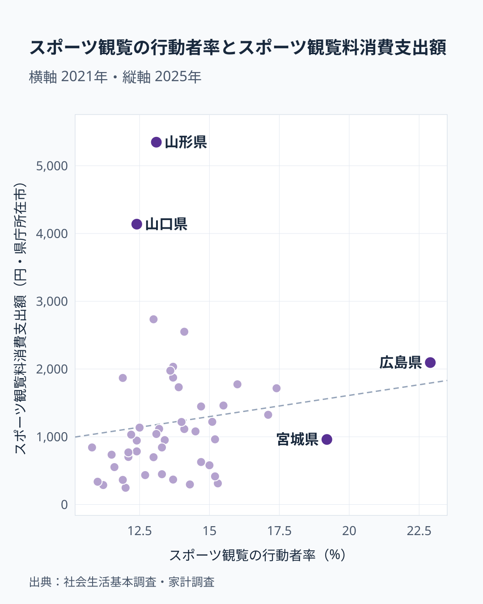

家計調査のスポーツ観覧料消費支出額は、1世帯が1年間にスタジアムや競技場でスポーツを観戦するために支払った金額を示す指標です。2025年のデータでは、1位の山形県が5,348円、47位の鳥取県が247円で、両者の間には約22倍の開きがあります。ところが、社会生活基本調査でスポーツ観覧をした人の割合を見ると、山形県は13.1%で28位にとどまります。観戦する人が多い県で支出が多いわけではないとすれば、山形県の1位は何を表しているのでしょうか。この記事では、支出額の順位と観戦した人の割合を重ねて、データから読み取れることと仮説にとどまることを分けて整理します。

> [!NOTE]
> スポーツ観覧料消費支出額は、家計調査の「教養娯楽サービス」に分類される支出項目の一つで、県庁所在市の二人以上の世帯を対象にした値です。観戦チケットを購入した世帯だけの平均ではなく、購入のなかった世帯(支出ゼロの世帯)も含めた全世帯の平均なので、金額が小さくても「観戦する人が少ない」とは限らず、少数の高額支出で平均が押し上げられることもあります。

## 上位5県と下位5県の開き

<source-link href="/ranking/sports-spectating-consumption-expenditure">スポーツ観覧料消費支出額ランキングをもっと見る</source-link>

上位5県を見ると、山形県が5,348円で1位、山口県が4,138円で2位、長崎県が2,734円で3位、沖縄県が2,550円で4位、広島県が2,095円で5位となっています。注目したいのは上位内の落差です。1位の山形県と2位の山口県の差は1,210円、2位の山口県と3位の長崎県の差は1,404円で、2位と3位の間のほうが大きく開いています。つまり山形県と山口県は、長崎県以下から一段抜けた水準にあります。長崎県から広島県までの3県は2,000円台でまとまっています。

中位に目を向けると、6位の宮崎県が2,033円、10位の愛知県が1,774円、16位の東京都が1,220円、22位の静岡県が1,041円、30位の岡山県が784円と、値はなだらかに下がっていきます。1,000円前後の県が多く、5,000円を超えるのは山形県だけです。平均的な県は突出した上位県よりも下位に近い水準にあるといえます。

一方の下位5県は、岐阜県が336円で43位、熊本県が312円で44位、長野県が296円で45位、福島県が287円で46位、鳥取県が247円で47位です。下位はいずれも200円台から300円台に密集しており、1位の山形県との差は5,000円を超えます。ただし、この指標だけでは、下位の県で観戦そのものが少ないのか、観戦しても購入が家計調査の対象世帯に当たらなかっただけなのかを区別できません。[山形県のデータ](/areas/06000)や[山口県のデータ](/areas/35000)を見ると、それぞれの県が持つ他の指標でも独自の傾向が確認できます。

## 地理的分布から見える偏り

地図で見ると、上位の県は北海道・東北、中国、九州・沖縄に見られます。ただし同じ地方の中でもばらつきが大きく、地方単位で高低を言い切ることはできません。

中国地方では、山口県が4,138円で2位、広島県が2,095円で5位、島根県が1,135円で18位、岡山県が784円で30位、鳥取県が247円で47位と、上位から最下位までが同じ地方に収まっています。北海道・東北でも、山形県は5,348円で1位ですが、北海道は1,461円で13位、岩手県は1,116円で19位、福島県は287円で46位です。九州・沖縄では、長崎県が2,734円で3位、沖縄県が2,550円で4位、宮崎県が2,033円で6位と上位に並ぶ一方、熊本県は312円で44位です。関東では千葉県が1,873円で8位、埼玉県が1,447円で14位、東京都が1,220円で16位、神奈川県が962円で24位、栃木県が951円で26位と、中位に並んでいます。

四国地方は、高知県が842円で28位、徳島県が769円で31位、香川県が735円で32位、愛媛県が698円で34位と、4県とも中位から下位の近い範囲に収まっており、中国地方とは対照的に県同士の差が小さい地方です。[仮説] 地方ごとの傾向よりも、県や市ごとの個別の事情が支出額に影響している可能性があります。

## 観戦する人の割合と支出額は重なるのか

<source-link href="/ranking/hobby-participation-rate-sports-spectating">スポーツ観覧の行動者率ランキングをもっと見る</source-link>

「観戦する人が多い県ほど支出も多い」という素直な仮説を、社会生活基本調査の行動者率(スポーツ観覧をした人の割合、2021年)で確かめます。行動者率の1位は広島県の22.9%、2位は宮城県の19.2%、3位は福岡県の17.4%、4位は大分県の17.1%、5位は愛知県の16.0%です。支出額の順位は、広島県が5位、福岡県が12位、愛知県が10位、大分県が15位と上位から中位に収まる一方、宮城県は960円で25位にとどまり、47県の中央付近にあります。観戦する人の割合が2位でも、家計の支出額では目立たない県があるということです。

反対に、支出額の上位5県のうち行動者率で10位以内に入るのは広島県だけです。山形県は13.1%で28位、山口県は12.4%で34位、長崎県は13.0%で30位、沖縄県は14.1%で16位です。行動者率が下位の県を見ると、高知県が10.8%で47位、岐阜県が11.0%で46位、福島県が11.2%で45位、香川県が11.5%で44位、群馬県が11.6%で43位です。このうち福島県と岐阜県は支出額も下位に入っていますが、高知県は支出額で28位と中位に位置します。

47都道府県の値から計算した相関係数は0.14で、散布図の点は右上がりにそろっていません。順位同士で計算しても0.31にとどまり、観戦する人の割合だけで支出額の差を説明できないことは読み取れます。山形県と山口県の突出は「観戦する人が多いから」ではなさそうです。[仮説] 観戦に出かける世帯が限られていても、その世帯が遠征を含めて何度も購入すれば、全世帯の平均は大きく押し上げられます。ただし、世帯ごとの購入回数や金額の分布はこのデータにないため、検証には家計調査の個票や観戦行動の別の調査が必要です。

> [!WARNING]
> 行動者率は社会生活基本調査の2021年の値で、支出額は家計調査の2025年の値です。調査も調査年も対象も違うため、同じ年の関係として読むことはできません。また相関係数が小さいことは、観戦行動と支出に関係がないことの証明ではなく、このデータの組み合わせでは関係が見えないという意味です。家計調査は標本調査で、観戦チケットの購入は毎月発生する支出でもないため、年ごとの数値が動きやすい点にも注意してください。

## 山形県や山口県の突出をどう読むか

山形県と山口県が上位に並ぶ理由は、このデータだけでは確かめられません。上の散布図が示したのは、観戦した人の割合では説明できないという消去の結果までです。地元クラブへの愛着や遠征観戦の習慣といった説明は、裏づける数値がないため[仮説]の域を出ません。

広島県は支出額5位で行動者率が1位と、両方が上位に重なる珍しい県です。ただし、この2つの指標だけでは、球団や競技場の存在がその理由なのか、スタジアムの開業前後でどう変わったのかは判断できません。球団や競技場の有無、開業時期を重ねるには、年ごとの時系列や設備の情報が別に必要です。

大都市を抱える県でも、支出額は一様ではありません。愛知県は1,774円で10位に入っていますが、大阪府は627円で35位、京都府は415円で40位にとどまっています。人口の多い県が高いとも低いとも言えず、こうした差が生まれる理由は、このデータからは分かりません。

あわせて見る: [スポーツ観覧の行動者率ランキング](/ranking/hobby-participation-rate-sports-spectating) / [スポーツ観覧料消費支出額ランキング](/ranking/sports-spectating-consumption-expenditure)

## まとめ

- 1位は山形県で5,348円、最下位は鳥取県で247円で、差はおよそ22倍です。
- 山形県と山口県は長崎県以下から一段抜けており、5,000円を超えるのは山形県だけです。
- 観戦した人の割合が28位の山形県が、支出額では1位です。
- 支出額の上位5県のうち、観戦した人の割合が10位以内なのは広島県だけです。
- 観戦率と支出額の相関係数は0.14で、観戦する人の割合では支出額の差を説明できません。
- 中国地方では山口県が2位、鳥取県が47位と、同じ地方の中でも大きな差があります。
