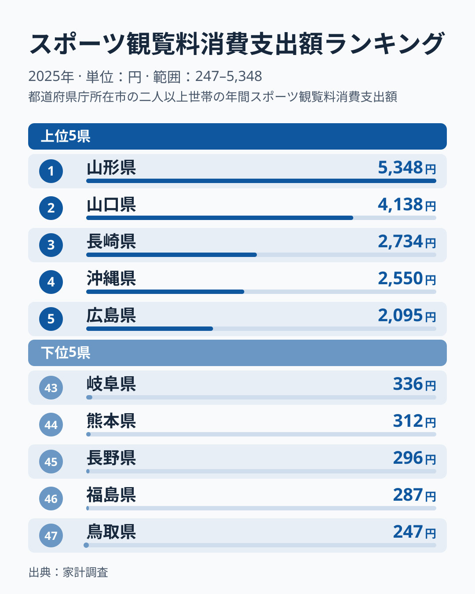
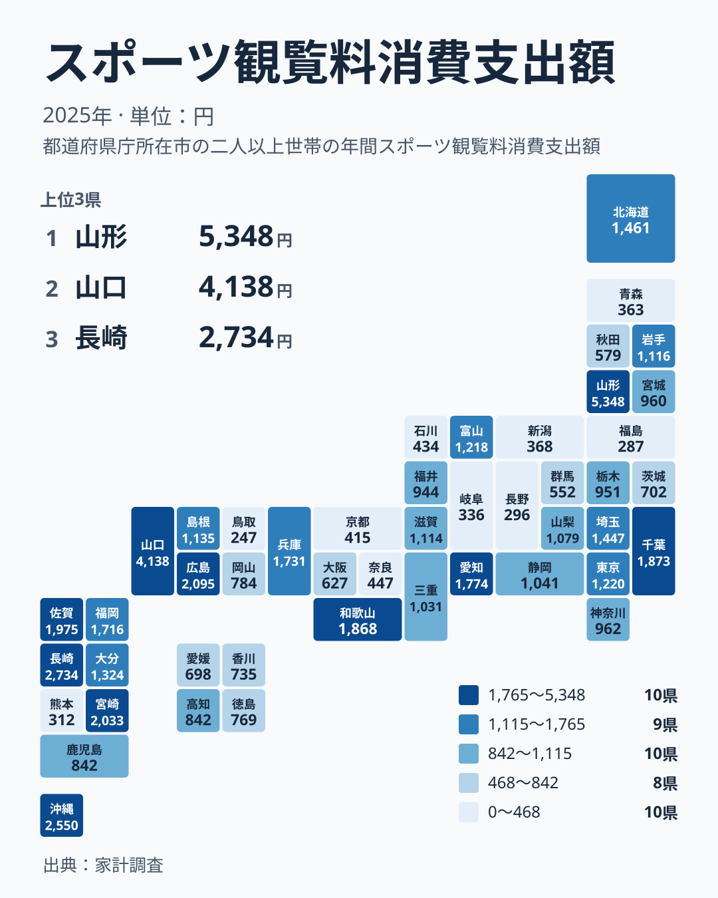

家計調査のスポーツ観覧料消費支出額は、1世帯が1年間にスタジアムや競技場でスポーツを観戦するために支払った金額を示す指標です。2025年のデータを見ると、1位の山形県は5,348円で、47位の鳥取県は247円にとどまり、両者の間には約22倍の開きがあります。同じ国内で暮らしていても、これほど支出額に差が生まれるのはなぜでしょうか。この記事では、上位県と下位県の顔ぶれや地方内のばらつきを手がかりに、データから読み取れることと、仮説にとどまることを分けて整理します。なお家計調査は県庁所在市の二人以上の世帯の値で、県全体の姿をそのまま表すものではありません。

> [!NOTE]
> スポーツ観覧料消費支出額は、家計調査の「教養娯楽サービス」に分類される支出項目の一つで、県庁所在市の二人以上の世帯を対象にした値です。観戦チケットを購入した世帯だけの平均ではなく、購入のなかった世帯(支出ゼロの世帯)も含めた全世帯の平均なので、金額が小さくても「観戦する人が少ない」とは限らず、少数の高額支出で平均が押し上げられることもあります。

## 上位5県と下位5県の開き

<source-link href="/ranking/sports-spectating-consumption-expenditure">スポーツ観覧料消費支出額ランキングをもっと見る</source-link>

上位5県を見ると、山形県が5,348円で1位、山口県が4,138円で2位、長崎県が2,734円で3位、沖縄県が2,550円で4位、広島県が2,095円で5位となっています。注目したいのは上位内の落差です。1位の山形県と2位の山口県の差は1,210円、2位の山口県と3位の長崎県の差は1,404円で、2位と3位の間のほうが大きく開いています。つまり山形県と山口県は、3位以下から一段抜けた水準にあります。3位の長崎県から5位の広島県までは2,000円台でまとまっています。

中位に目を向けると、6位の宮崎県が2,033円、10位の愛知県が1,774円、16位の東京都が1,220円、22位の静岡県が1,041円、30位の岡山県が784円と、値はなだらかに下がっていきます。1,000円前後の県が多く、5,000円を超えるのは山形県だけです。平均的な県は突出した上位県よりも下位に近い水準にあるといえます。

一方の下位5県は、岐阜県が336円で43位、熊本県が312円で44位、長野県が296円で45位、福島県が287円で46位、鳥取県が247円で47位です。下位はいずれも200円台から300円台に密集しています。[仮説] 球団や競技場があっても、観戦が家計の支出として計上されにくい事情や、調査対象世帯の偏りが影響している可能性があります。[山形県のデータ](/areas/06000)や[山口県のデータ](/areas/35000)を見ると、それぞれの県が持つ他の指標でも独自の傾向が確認できます。

## 地理的分布から見える偏り

地図で見ると、上位の県は北海道・東北、中国、九州・沖縄に見られます。ただし同じ地方の中でもばらつきが大きく、地方単位で高低を言い切ることはできません。

中国地方では、山口県が4,138円で2位、広島県が2,095円で5位、島根県が1,135円で18位、岡山県が784円で30位、鳥取県が247円で47位と、上位から最下位までが同じ地方に収まっています。北海道・東北でも、山形県は5,348円で1位ですが、北海道は1,461円で13位、岩手県は1,116円で19位、福島県は287円で46位です。九州・沖縄では、長崎県が2,734円で3位、沖縄県が2,550円で4位、宮崎県が2,033円で6位と上位に並ぶ一方、熊本県は312円で44位です。関東では千葉県が1,873円で8位、埼玉県が1,447円で14位、東京都が1,220円で16位、神奈川県が962円で24位、栃木県が951円で26位と、中位に並んでいます。

四国地方は、高知県が842円で28位、徳島県が769円で31位、香川県が735円で32位、愛媛県が698円で34位と、4県とも中位から下位の近い範囲に収まっており、中国地方とは対照的に県同士の差が小さい地方です。[仮説] 地方ごとの傾向よりも、県や市ごとの個別の事情が支出額に影響している可能性がありますが、球団や競技場の有無との関係は、このデータだけでは確かめられません。

## 山形県や山口県の突出をどう読むか

山形県と山口県が上位に並ぶ理由は、データだけでは確かめられません。[仮説] 地元クラブへの愛着や観戦習慣が家計に定着している可能性はありますが、それを裏づける数値はここにはありません。広島県については、広島東洋カープの人気の高さと、2009年に開業したMAZDA Zoom-Zoom スタジアム広島の存在が挙げられます。[仮説] 新しいスタジアムの開業をきっかけに観客動員数が伸び、チケット購入が家計支出として定着した可能性があります。

大都市を抱える県でも、支出額は一様ではありません。愛知県は1,774円で10位に入っていますが、大阪府は627円で35位、京都府は415円で40位にとどまっています。人口の多い県が高いとも低いとも言えず、こうした差が生まれる理由は、このデータからは分かりません。

> [!WARNING]
> スポーツ観覧料消費支出額は家計調査という標本調査にもとづく平均値です。観戦チケットの購入は毎月発生する支出ではないため、調査対象となった世帯にたまたま大きな支出があったかどうかで年ごとの数値が変動しやすい項目です。1年分の数値だけで、その県の恒常的なスポーツ観戦熱を断定しないよう注意してください。

## 他の娯楽支出と比べて見える特徴

スポーツ観覧料は、家計調査の中では「教養娯楽サービス」という大きな分類に含まれる支出項目の一つです。月謝やレッスン代のように毎月継続的に発生する支出とは異なり、観戦チケットの購入は特定の試合や季節に集中しやすく、都道府県ごとの差が大きく出やすい性質を持っています。[仮説] このため、他の教養娯楽サービスの支出と比べても、スポーツ観覧料は本拠地球団や競技場の有無といった地域固有の条件に、より強く左右される可能性があります。[同じカテゴリの統計一覧](/category/economy)を確認すると、教養娯楽サービスに分類される他の支出項目との比較ができ、スポーツ観覧料が持つ変動の大きさを相対的に把握する手がかりになります。

> [!TIP]
> この指標を読み解くときは、単に金額の大小だけでなく、その県にプロ野球・Jリーグ・Bリーグなどの本拠地球団があるかどうかを重ねて見ると理解が深まります。球団があっても支出額が低い県や、球団が無くても健闘している県を探すと、支出額を左右する要因が球団の有無だけではないことが見えてきます。

## まとめ

- 1位は山形県で5,348円です。
- 最下位は鳥取県で247円です。
- 1位と最下位の差はおよそ22倍にのぼります。
- 山形県と山口県は3位以下から一段抜けており、5,000円を超えるのは山形県だけです。
- 中国地方では山口県が2位、鳥取県が47位と、同じ地方の中でも大きな差があります。
- 本拠地球団の存在や新しい競技場の開業が支出額の差に関わっている可能性はありますが、このデータだけでは確かめられません。
