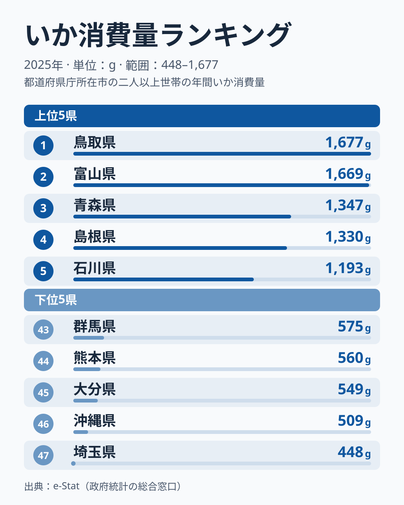

「いかといえば函館、北海道」というイメージを持っている方は多いのではないでしょうか。しかし、家計調査のデータを見ると、この「常識」はそのまま当てはまりません。

2025年の都道府県庁所在市別いか消費量ランキングで1位になったのは、鳥取県で1,677gです。2位には富山県が1,669gで僅差で続き、3位は青森県で1,347gです。漁業のイメージが強い北海道は10位で1,005gにとどまり、1位や2位とは開きがあります。

この「見えている産地と食べている地域がズレる」という現象には、日本の食文化と流通構造を読み解くヒントが詰まっています。

## いか消費量の全国ランキング (2025年)

2025年の家計調査によると、47都道府県のいか消費量には最大3.7倍の開きがあります。1位の鳥取県が年間一世帯あたり1,677gであるのに対し、最下位の埼玉県は448gです。

上位には中国・中部・東北の県が顔を揃えます。1位から6位までは、順に鳥取、富山、青森、島根、石川、山形です。一方で下位は、埼玉が47位、沖縄が46位、大分が45位、熊本が44位などと続きます。この記事では、ここに挙げた順位の背景を、データで確かめられる範囲と仮説に分けて整理します。

<source-link href="/ranking/squid-consumption-quantity">いか消費量ランキングの詳細を見る</source-link>

> [!NOTE]
> このデータは総務省「家計調査」に基づく「都道府県庁所在市の二人以上世帯の年間いか消費量」です。調査対象は各県の県庁所在市のみであり、県全体の平均ではありません。例えば鳥取県であれば鳥取市の家庭の消費量を代表しています。また、「いか」には生鮮・冷凍・加工品が含まれます。

## なぜ鳥取と富山が上位なのか

1位の鳥取は1,677g、2位の富山は1,669gで、この2市はほぼ同水準です。3位の青森は1,347gで、鳥取市と富山市の2市が頭一つ抜けた集団を作っています。

家計調査の市別の値は、年ごとのぶれが大きいことが知られています。実際に、2024年のランキングでは富山が首位で、秋田が2番手、鳥取が4番手でした。2025年は鳥取が首位に立ち、秋田は9位で1,018gです。単年の順位だけで「この県がいか王国だ」と断定するのは避け、複数年で上位に入るかを見る必要があります。

そのうえで、理由は次のような仮説で考えられます。

[仮説] 富山は、富山湾でとれるホタルイカをはじめ、春にいかが食卓に上る機会が多いことが考えられます。寿司文化が発達した地域で、ネタとしてのいかの需要も高いことが、消費量を押し上げている可能性があります。検証には、富山市の月別のいか購入量が必要です。

[仮説] 鳥取は、境港をはじめとする日本海の漁港が近く、生鮮のいかが家庭に届きやすいと考えられます。鳥取の食文化の中で、いかが日常的な食材になっている可能性があります。隣の島根が4位で1,330gと上位に入っていることは、この見方と整合します。検証には、鳥取と島根の複数年の順位と、生鮮・加工品別の購入量が必要です。

3位の青森は、スルメイカの主要な漁場である八戸近海を抱える県です。ただし、今回のデータは県庁所在地である青森市の家庭の消費量であり、漁港のある八戸市のものではない点に注意が必要です。

## 北海道は10位、「産地」ほどは突出しない

北海道は10位で1,005gと、全国の上位10には入っています。それでも1位の鳥取の1,677gや、2位の富山の1,669gと並べると、大きな差があります。函館のイカは全国的に有名で、北海道はスルメイカの主要な産地ですが、消費量では鳥取や富山に及びません。

[仮説] 産地と消費地は必ずしも一致しないという流通の仕組みが、背景にあるかもしれません。北海道のいかは、その多くが道外へ出荷されると考えられます。特に、いかを日常的に食べる地域へ流れる構図が想定できます。検証には、道内出荷量と道外出荷量の統計が必要です。

[仮説] 北海道の食文化では、いか以外にサケ・カニ・ウニなど優先される魚介が多く、肉食の傾向も比較的強いため、いかの購入量が相対的に抑えられている可能性があります。検証には、札幌市の魚介類品目別の購入量の比較が必要です。

> [!WARNING]
> 家計調査は都道府県庁所在市のみを対象とした標本調査です。函館市や旭川市などのデータは直接含まれず、北海道を代表する都市として「札幌市」の家庭の消費が反映されます。また、年によって順位は大きく変動します。札幌市は2024年には下位にとどまっていましたが、2025年は上位10に入る1,005gです。単年のデータだけで長期的なトレンドを判断するのは避けてください。

## 下位に並ぶ九州・関東の県

最下位は埼玉県で448gで、1位の鳥取県の約27%にとどまります。ただし、この記事で使っているデータは県庁所在市のいか購入量だけなので、さいたま市がなぜここまで低いのかを説明できる材料は含まれていません。46位の沖縄県は509gです。沖縄については、豚肉を中心とした食文化が背景にあると言われることがあります。ただし、これは一般的なイメージであり、家計調査の購入量から確かめた結論ではありません。

下位には、ほかに大分が45位で549g、熊本が44位で560g、群馬が43位で575g、滋賀が42位で580g、佐賀が41位で598g、宮崎が40位で610g、愛媛が39位で625g、福岡が38位で667gと続きます。

九州勢が下位に集まっているのも目を引きます。大分、熊本、佐賀、宮崎、福岡が38位から45位に並びます。一方で鹿児島は26位で772gと中位です。

[仮説] 九州の食文化では、さば・あじなどの青魚や、ブリ・マグロなどの大型魚の消費が多く、いかは主役になりにくいのかもしれません。検証には、九州各県の魚介類全体の購入内訳が必要です。

関東は一括りにはできません。埼玉が47位、群馬が43位と下位に並ぶ一方で、茨城は14位で970g、神奈川は21位で889g、東京は29位で738g、栃木は30位で730g、千葉は37位で674gと、順位が大きく割れています。内陸の県が下位に集まる点は注目できますが、単年の値のため、構造として断定はできません。

> [!TIP]
> いか消費量と合わせて[まぐろ消費量ランキング](/ranking/tuna-consumption-quantity)や[こんぶ消費量ランキング](/ranking/konbu-consumption-quantity)を参照すると、地域の「海産物文化」の全体像が見えてきます。なお、この記事ではいかの順位だけを扱っており、まぐろやこんぶとの比較は行っていません。

## 上位に入る京都と長崎

上位10県の中には、中国・中部・北海道・東北のいずれにも入らない県が2つあります。近畿の京都府が7位で1,072g、九州の長崎県が8位で1,029gです。

京都は日本海に面する地域を抱えますが、ここで対象になるのは県庁所在市の京都市です。[仮説] 日本海の魚介が流通で運ばれ、煮物や加工品としてのいかが家庭の食卓にも定着していることが、消費量を押し上げている可能性があります。検証には、京都市の生鮮・加工品別のいか購入量が必要です。

長崎は、いか漁が盛んな玄界灘・東シナ海に面する県です。[仮説] 地元でとれるいかが身近なことが、九州で唯一上位10に入った背景にあるかもしれません。検証には、長崎市の複数年の順位が必要です。

大阪府は15位で969gと、上位10位の外にあります。都市部の大阪が上位圏に入る姿は、2025年の値では見られません。

[農林水産業を俯瞰するカテゴリ](/category/agriculture)でも、地域ごとの産業と食文化の関係を確認できます。

## まとめ

2025年のいか消費量ランキングで明らかになった主なポイントをまとめます。

- **1位は鳥取県の1,677g**で、2位の富山の1,669gとは僅差。3位の青森は1,347gで、鳥取と富山が先行する
- **最下位は埼玉県の448g**で、1位鳥取との差は3.7倍。46位の沖縄は509gで、これも下位
- **北海道は10位で1,005g**。産地のイメージほど突出せず、産地と消費地のズレがあることは確かですが、その理由は仮説の段階にとどまります
- **上位には中国・中部・東北の県が並ぶ**。鳥取、富山、青森、島根、石川、山形が上位6位を占める
- **単年の順位はぶれが大きい**。富山は前年の首位から2位へ、札幌市は前年の下位から10位へ動いた

いか消費量のデータは、日本の「海産物文化マップ」の一断面を見せてくれます。産地のイメージと実際の消費地が大きく異なることは確かですが、その理由を断定するには、品目別・月別の購入量など、追加のデータが必要です。

鳥取の[地域プロフィール](/areas/31000)や富山の[地域プロフィール](/areas/16000)では、食文化以外の経済・社会指標も確認できます。ほかにも[青森の地域データ](/areas/02000)などを参照することで、上位県の特徴をより深く理解できます。
