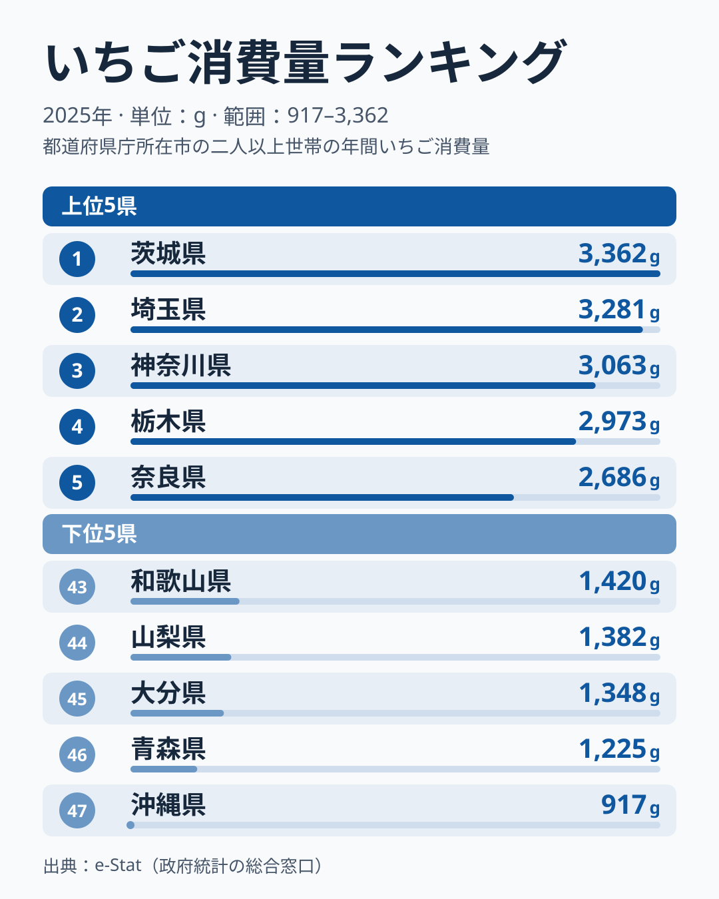
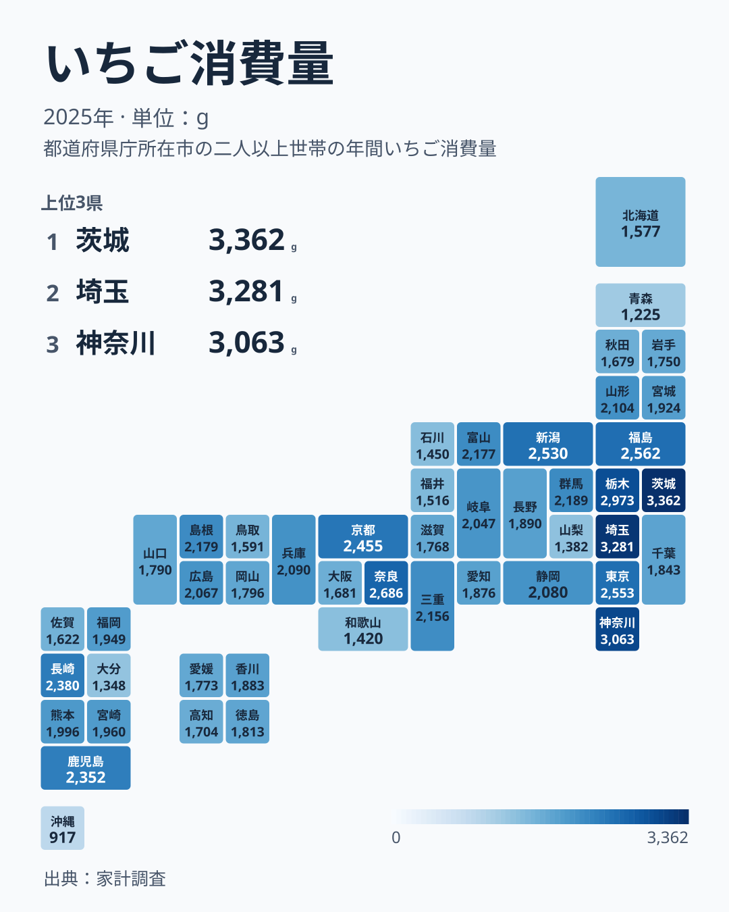

「いちごの名産地ほど、たくさん食べているはず」——直感的にはそう思えます。ですがデータを開くと、その直感は茨城・栃木では当たり、九州では県ごとに割れています。

総務省の家計調査（2025年）でいちご消費量（二人以上世帯・1世帯あたり年間、都道府県庁所在市）を見ると、1位は[茨城](/areas/08000)の**3,362g**です。産地として知られる**[栃木](/areas/09000)は4位の2,973g**に入りました。一方、九州では**長崎が10位**、**佐賀が38位**、**大分が45位**と、同じ地方でも県によって位置が大きく違います。最下位は**沖縄の917g**で、1位との差は**3.67倍**にのぼります。

この記事では、いちごの「作る県」と「食べる県」がどこまで一致し、どこからズレるのかを、47都道府県のデータで読み解いていきます。

> [!NOTE]
> いちごは旬の冬〜春に購入が偏りやすい品目です。調査世帯が限られるため単年でぶれやすく、順位の細かな差を、その県の恒久的な特徴と読むのは避けてください。

## いちご消費量 上位5県と下位5県

図の上位5県は、1位の茨城3,362gから5位の奈良2,686gまでで、差は676gです。1位から4位までは3,362g、3,281g、3,063g、2,973gと2,900g台から3,300g台に集まっていて、5位の奈良との間で一段下がります。上位5県のうち4県は関東の1都6県に含まれる茨城・埼玉・神奈川・栃木で、残る1県は近畿の奈良です。

ここで注目したいのは、上位の顔ぶれがすべて産地とは限らないことです。茨城と栃木は産地として知られますが、2位の埼玉、3位の神奈川、5位の奈良は、いちごの産地としてよく名前が挙がる県ではありません。[仮説] 産地でなくても、大消費地に近い県は購入の機会が多いなど、買いやすさが消費量を押し上げているのかもしれません。ただし、購入先や価格の違いまでは本記事のデータで確かめていないため、断定はできません。

6位以降は、東北の福島が2,562g、関東の東京が2,553g、中部の新潟が2,530g、近畿の京都が2,455gと続き、地方をまたいで2,400g台後半から2,500g台に並びます。

<source-link href="/ranking/strawberry-consumption-quantity">いちごの消費量ランキングをもっと見る</source-link>

ほかの品目の地域差は[経済・家計カテゴリ](/category/economy)から探せます。

## 下位グループはなぜ薄いのか

上のチャート右側に並ぶ下位5県は、43位の和歌山が1,420g、44位の山梨が1,382g、45位の大分が1,348g、46位の青森が1,225g、そして最下位の沖縄が917gです。最下位の沖縄は、下から2番目の青森の1,225gとの間にも開きがあり、下位の中でも突出して少ない県です。

下位5県を見ると、青森（りんご）、山梨（ぶどう・もも）、和歌山（みかん）の3県は、地元に全国的な特産果物をもつ県です。ただし、これだけで「特産果物がある県はいちごを食べない」とは言えません。果物産地として知られる福島は6位の2,562g、山形は16位の2,104g、静岡は18位の2,080g、長野は25位の1,890gと、中位以上に入っている県もあります。残る大分と沖縄は、特産果物では説明しにくい県です。

[仮説] 地元産の旬の果物が豊富な県の一部では、いちごへの支出が相対的に小さくなり、果物の中での置き換えが起きているのかもしれません。検証するには、同じ家計調査の果物の品目別の購入量を県ごとに突き合わせる必要があり、本記事のデータだけでは確定できません。沖縄については、気候が違い、いちごの旬である冬〜春に別の果物や食べ方が選ばれている可能性もありますが、同様に確かめていません。果物全体の地域差は、[生鮮果物の消費量の記事](/blog/fresh-fruit-consumption-quantity-prefecture-gap)で見られます。

> [!TIP]
> 「いちごをあまり食べない県」は、果物を食べない県とイコールではありません。ほかの果物との競合が起きている可能性はありますが、本記事では確かめていません。

## 発見1：産地でも、茨城・栃木は上位・九州は県ごとに割れる

いちごの産地として知られる県の消費順位を並べると、一致とズレの両方がはっきり見えてきます。茨城が1位、栃木が4位のように「作る県＝食べる県」がそろう関東の主要産地に対して、九州は同じ地方でも県ごとの差が大きく、図でも47都道府県のなかで位置が散らばっています。

九州7県を順に並べると、長崎が10位の2,380g、鹿児島が11位の2,352gと上位に入ります。その下に、ブランドいちご「あまおう」で知られる**福岡が23位の1,949g**、**熊本が21位の1,996g**、**宮崎が22位の1,960g**が並びますが、この3県の差は47gしかなく、実質的には横並びです。さらに**佐賀は38位の1,622g**、**大分は45位の1,348g**と下位に沈み、大分は下位5県にも入っています。つまり、九州が「割れる」というのは、長崎・鹿児島と、佐賀・大分との対比で見ると最も鮮明です。同じ九州の長崎と大分では、1,032gもの差があります。静岡は18位で2,080gでした。「産地だからよく食べる」だけでも、「産地ほど食べない」だけでも、この分布は説明できません。

> [!WARNING]
> 家計調査が捉えるのは購入量だけです。福岡・熊本・佐賀のような生産県では、出荷の多くが県外（首都圏など）へ向かい、地元では直売・自家消費・もらい物が購入量に表れにくい可能性があります。「地元で食べていない」と断定はできません。

[仮説] 産地でありながら購入量が伸びない県は、生産が「域外出荷型（首都圏向け）」に寄っているためかもしれません。検証するには各県の出荷量に占める県内向け比率と家計調査の購入量を突き合わせる必要があり、本データだけでは確定できません。

## 発見2：関東の中でもばらつきがある

関東の1都6県を見ても、順位は一様ではありません。上位に並ぶ茨城・埼玉・神奈川・栃木に対し、東京は7位の2,553g、群馬は12位の2,189g、千葉は28位の1,843gと、順位が下がっていきます。ここで目を引くのは群馬と千葉です。群馬は上位の栃木より784g、千葉は茨城より1,519g少なく、1位の茨城と28位の千葉の間には1,500g以上の開きがあります。「関東だから多い」とはひとまとめにできません。

千葉は全国の真ん中より下に位置しています。[仮説] 県庁所在市の世帯に限った単年の値であるため、調査世帯の偏りや購入先の違い（市外での購入、直売など）が順位に表れている可能性がありますが、本データだけでは確かめられません。いちごは全国共通の春の定番でありながら、どれだけ厚く食卓に乗るかには、地方の中でも都県ごとの差があるといえます。

## まとめ

- いちご消費量1位は**茨城の3,362g**（家計調査・2025年）で、最下位は**沖縄の917g**、差は**3.67倍**でした
- 産地の栃木は4位で2,973gでした。九州は長崎が10位、佐賀が38位、大分が45位と、県ごとに位置が割れました
- 関東の中でも千葉は28位にとどまり、地方でひとまとめにはできませんでした
- 下位5県のうち青森・山梨・和歌山は特産果物をもつ県ですが、福島・山形のように果物産地でも中位以上の県があり、置き換えが起きているかどうかは[仮説]の段階です
