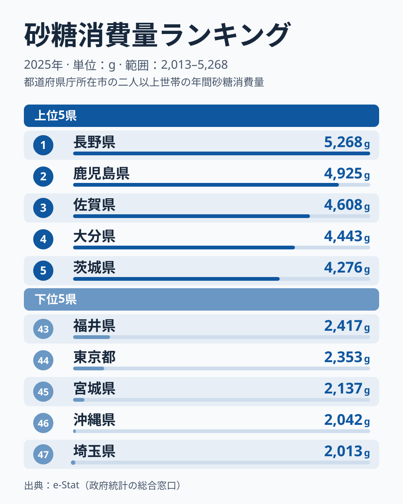
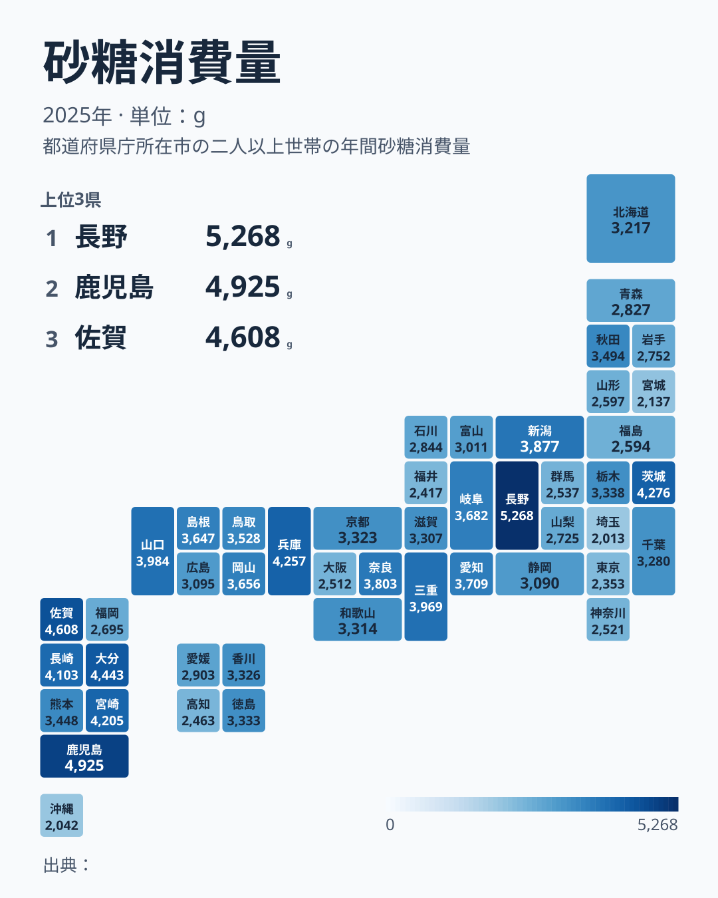

[長野県](/areas/20000)の家庭は、2025年に砂糖を5,268g購入しました。最も少なかった[埼玉県](/areas/11000)の2,013gと比べると**2.6倍**です。同じ日本に暮らしながら、家庭で買う砂糖の量はこれほど違います。

ただし、長野が1位になった要因は、このデータからは特定できません。前年の首位は三重県で、2025年は2位の鹿児島県が4,925gで、その差が343gしかないためです。そこでこの記事では、理由探しを急がず、差がどう分布しているのかと、地方ごとにどれだけばらついているのかを、47県の値から整理します。

> [!NOTE]
> 総務省「家計調査」のデータは**都道府県庁所在市の二人以上世帯**が家庭で購入した砂糖量を集計したもので、県全体の値ではありません。購入量であり、実際に消費した量そのものではないため、買い置きや贈答の影響もあり得ます。また、外食・加工食品に含まれる砂糖は捕捉されないため、「購入量が少ない = 糖分摂取量が少ない」とは言えず、このデータから健康面の優劣を読み取ることもできません。

## 砂糖消費量ランキング(2025年)

<source-link href="/ranking/sugar-consumption-quantity">砂糖消費量ランキングをもっと見る</source-link>

図の値を並べて読むだけでは見えにくいのが、差の形です。1位の長野から2位の鹿児島までは343g、約7%の差ですが、2位から10位の三重の3,969gまでは956gかけて、ほぼ一定の傾きで下がっていきます。突出しているのは長野だけではなく、上位全体がなだらかな坂になっています。上位5県(5,268gから4,276g)の幅は992gです。

一方、真ん中の水準は上位とかなり離れています。47県の中央値にあたる24位の和歌山県は3,314gで、1位の長野の約63%です。つまり長野の家庭は、全国の中位の県より約1.6倍の砂糖を買っている計算になります。

下位は逆に、値が密集しています。43位の福井県の2,417gから47位の埼玉県の2,013gまでの5県は、わずか404gの幅に収まっています。上位5県の幅(992g)の半分以下で、最下位グループは差がつきにくい一方、上位は少しずつ階段状に違っているのが分かります。

下位5県の顔ぶれは、福井、東京都が2,353g、宮城県が2,137g、[沖縄県](/areas/47000)が2,042g、埼玉が2,013gです。東京と埼玉は大都市圏ですが、宮城・福井・沖縄は地方の県で、都市かどうかだけでは分けられません。逆に上位にも、首都圏に近い茨城県が4,276g、大都市圏の兵庫県が4,257gで入っています。都市部か地方かという二分では、この順位は説明しきれません。

## 地図で見る砂糖消費量 ── 九州・沖縄の中でも差がある

地図を見ると、九州の南側に濃い県が並んでいます。上位10県のうち、[鹿児島](/areas/46000)、佐賀、大分、宮崎、長崎の5県が九州です。ところが、同じ九州の[福岡県](/areas/40000)は36位の2,695gで、鹿児島との差は2,230g、倍率にして約1.8倍です。沖縄は46位の2,042gで、九州の中でも最下位圏に入っています。「九州は甘党」と一括りにするのは、実態に合いません。

この「地方の中での差」を、7つの地方に分けて数字にしてみます。各地方の県を、最大値と最小値の差(開き)の大きい順に並べると、次のようになります。

- **九州・沖縄の8県**: 鹿児島の4,925gから沖縄の2,042gまで、開きは2,883g。中央値は4,154gで、全国の中央値の3,314gを約840g上回ります
- **中部の9県**: 長野の5,268gから福井の2,417gまで、開きは2,851g。全国1位と43位が同じ地方に同居しています
- **関東の7県**: 茨城の4,276gから埼玉の2,013gまで、開きは2,263g。隣り合う茨城と埼玉で約2.1倍の差があります
- **近畿の7県**: 兵庫の4,257gから大阪府の2,512gまで、開きは1,745g
- **北海道・東北の7県**: 秋田県の3,494gから宮城の2,137gまで、開きは1,357g。全国の中央値を上回るのは秋田県だけです
- **中国の5県**: 山口県の3,984gから広島県の3,095gまで、開きは889g
- **四国の4県**: 徳島県の3,333gから高知県の2,463gまで、開きは870g

つまり、地方ごとに「全体が高い」「全体が低い」と言えるのは中国や四国のように県数が少なく開きが小さい地方に限られ、九州・沖縄、中部、関東では、同じ地方の中に上位10位以内と下位10位以内が同居しています。地方名だけで砂糖の購入量を語ることはできません。

[仮説]として、同じ地方でこれだけ差が出るのは、気候や食文化よりも、県庁所在市の世帯構成や調理の頻度の違いが効いているからかもしれません。確かめるには、世帯類型別や年齢別の集計、複数年の推移が必要で、今回のデータだけでは検証できません。

## まとめ ── 差は大きいが、地方名では説明しきれない

- **1位の長野は5,268g、最下位の埼玉は2,013gで2.6倍差**
- 1位と2位の差は約7%、中央値の24位は1位の約63%で、上位はなだらかな坂、下位は404gの幅に密集している
- 地方別の県間の開きは、九州・沖縄が2,883g、中部が2,851gと大きく、中国は889g、四国は870gと小さい
- 同じ九州でも福岡は36位・沖縄は46位で、地方名や都市化だけでは順位を説明できない

長野が1位になった理由は、このデータからは分かりません。単年の順位はぶれやすく、前年は三重が首位でした。食の地域差をさらに掘り下げたい場合は、[経済・家計のカテゴリ](/category/economy)から他の品目別ランキングも合わせて確認してみてください。

## データについて

- 対象は総務省「家計調査」2025年の、都道府県庁所在市の二人以上世帯が購入した砂糖の量(単位はg)です。
- 県全体の値ではなく、県庁所在市の値である点に注意してください。
- 倍率は、データ上の最大値(長野)と最小値(埼玉)の比です。
- 地方の区分は、北海道・東北、関東、中部、近畿、中国、四国、九州・沖縄の7区分です。開きは各地方内の最大値と最小値の差で、中央値は各地方の県の値の中央値です。
