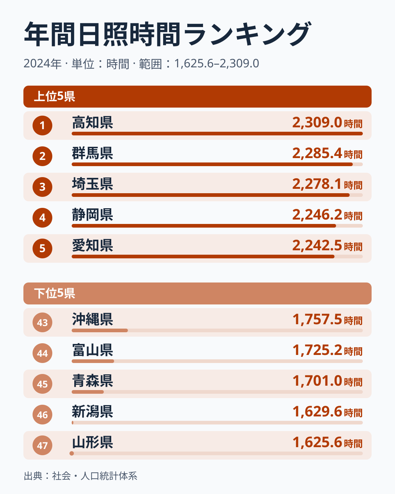
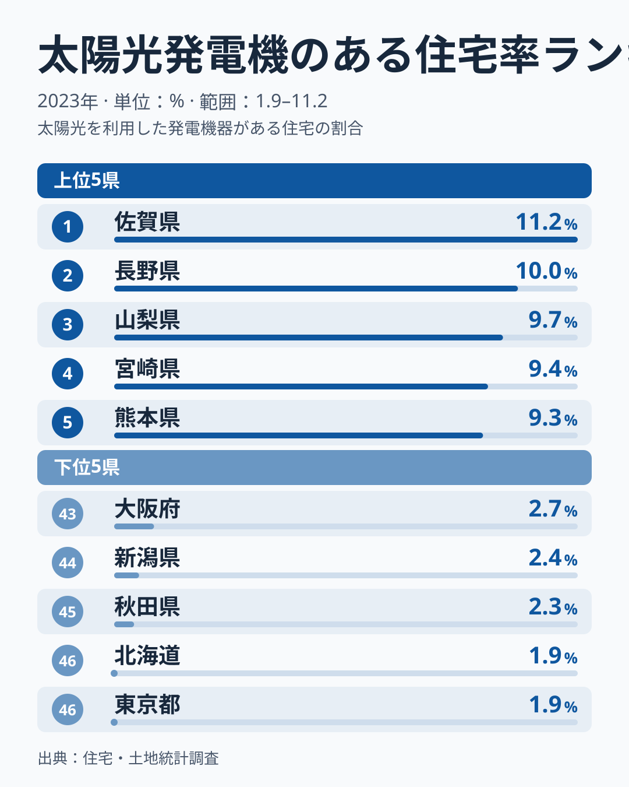
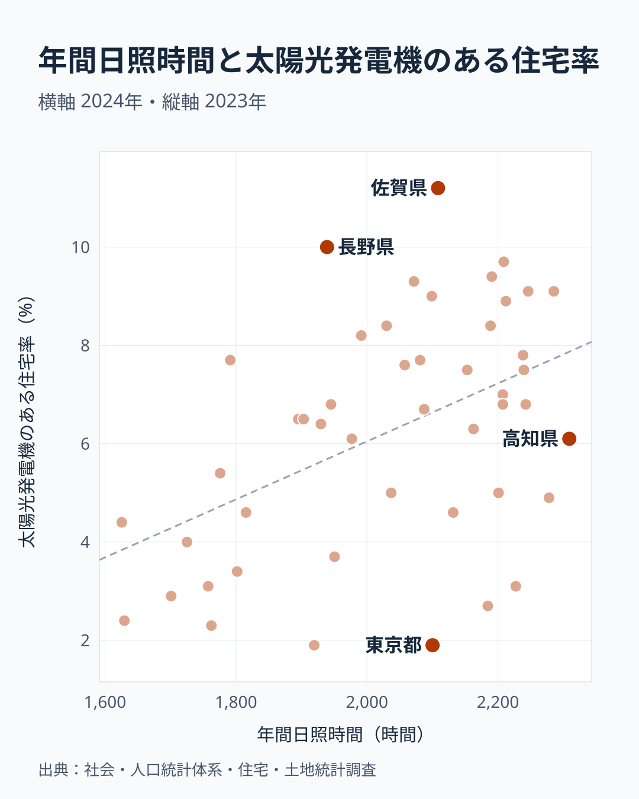

「日が照る県ほど、屋根に太陽光パネルが載っているはずだ」。太陽の光で発電する以上、これは自然な予想に思えます。

ところが、年間日照時間が全国1位の高知県の住宅太陽光普及率は6.1%で、47都道府県中28位です。普及率1位は日照20位の佐賀県で11.2%、2位は日照33位の長野県で10.0%です。2つのランキングは一致しません。

理由は2段階に分かれます。全国で比べると、まず都市の集合住宅の多さが普及率を押し下げ、日照との関係を見えにくくしています。一方で、戸建てが多い県だけに絞ると、日照が特に短い東北や日本海側の県で普及率が低いことが見えてきます。日照は無関係ではありませんが、差が大きく表れるのはこの日照の短い県です。

> [!NOTE]
> 本記事で扱う2つの指標は次のとおりです。**年間日照時間**は社会・人口統計体系の2024年の値です（単位：時間）。**住宅太陽光普及率**は総務省「住宅・土地統計調査」（2023年）の「太陽光発電機のある住宅の割合」で、全住宅に対する割合です。発電容量やパネルの枚数ではありません。

## 日照ランキングと普及率ランキングは一致しない

まず年間日照時間の上下を確認します。

年間日照時間の上位は、高知県が2,309時間、群馬県が2,285時間、埼玉県が2,278時間、静岡県が2,246時間、愛知県が2,243時間です。太平洋側の県と内陸の県が並びます。下位は山形県が1,626時間、新潟県が1,630時間、青森県が1,701時間と、東北や日本海側の県です。

<source-link href="/ranking/annual-sunshine-duration">年間日照時間ランキングをもっと見る</source-link>

次に普及率の上下です。

普及率の上位は、佐賀県が11.2%、長野県が10.0%、山梨県が9.7%、宮崎県が9.4%、熊本県が9.3%です。日照の上位5県のうち、普及率でも5位以内に入る県はありません。

象徴的なのが[高知県](/areas/39000)です。日照は1位なのに普及率は28位です。逆に[長野県](/areas/20000)は日照33位で普及率2位です。日照8位の神奈川県は3.1%で40位、日照16位の大阪府は2.7%で43位と、日照に恵まれた都市部の府県が下位に並びます。

<source-link href="/ranking/solar-panel-housing-rate">太陽光発電機のある住宅率ランキングをもっと見る</source-link>

## 都市部が低いのは集合住宅が多いから

普及率の下位は、東京都と北海道が1.9%で同率46位、秋田県が2.3%で45位、新潟県が2.4%で44位、大阪府が2.7%で43位、青森県が2.9%で42位です。沖縄県と神奈川県は3.1%で同率40位です。

このうち東京都、大阪府、神奈川県は、日照では21位、16位、8位で、下位ではありません。それでも普及率が低いのは、この指標が全住宅に対する割合だからです。集合住宅が多い都市では、分母にパネルを載せにくい住宅が多く含まれます。

[姉妹記事](/blog/solar-panel-housing-prefecture-gap)で見たとおり、[一戸建住宅比率](/ranking/detached-house-ratio)が55%未満の11都道府県の普及率の平均は3.9%で、55%以上の36県の平均は7.0%です。神奈川県の一戸建住宅比率は40.7%で、日照があっても受け止める屋根が足りない状態です。

> [!WARNING]
> 下位の都市部の数値を「環境意識が低い」と読むのは適切ではありません。集合住宅の多い都市は、住民の意欲とは関係なく分母が大きくなり、割合が低く出ます。

## 全国の相関は弱い、戸建てが多い県に絞ると

47都道府県を、横軸に年間日照時間、縦軸に普及率をとって重ねます。

相関係数は0.47、順位どうしの相関は0.43です。日照が長い県ほど普及率がやや高い傾向はありますが、点のばらつきは大きく、日照だけで普及率を当てることはできません。

右端の[高知県](/areas/39000)は日照が1位でも普及率は線より下にあります。左上の長野県は日照が中位より下なのに、普及率は線より上です。そして[東京都](/areas/13000)や神奈川県のように、日照は十分なのに普及率が低い県が線の下に並び、全体の相関を弱めています。

そこで一戸建住宅比率が55%以上の36県に絞って計算すると、日照時間と普及率の相関係数は0.71まで上がります。同じ36県で、一戸建の多さと普及率の相関係数はマイナス0.29です。戸建てが多い県どうしを比べると、普及率の差は戸建ての多さより日照の長さと連動して見えます。この0.71は、東北や日本海側の日照が短い県が相関を押し上げているためで、山形県、新潟県、青森県、秋田県、富山県の5県を除くと0.48まで下がります。

つまり、日照は普及率に関係がないのではありません。ただし連動の多くは、日照が特に短い山形県、新潟県、青森県、秋田県が、戸建てが多いのに普及率で伸びないことから生まれています。それ以外の県では、日照の差と普及率の差の関係は全国の数字と同じ程度です。

それでも説明しきれない県が残ります。高知県は一戸建住宅比率が68.2%で55%以上の側に入り、日照は1位ですが、普及率は6.1%です。長野県は日照が33位なのに10.0%です。この2県の差は、日照でも戸建ての多さでも説明できません。自治体の補助制度、住宅の新しさ、気温、電気料金といった別の要因が関わる可能性がありますが、本記事のデータでは確かめていません。

> [!TIP]
> 相関係数は全体の傾向を示す数字で、因果を示すものではありません。読み解くときは、どの県を比べた数字かを確かめ、都市と地方をまとめた数字と、条件をそろえた数字を分けて見るのが近道です。

## この指標を読むときの注意点

**「住宅の割合」であって発電量ではありません。** 今回の普及率は太陽光発電機のある住宅の割合で、1軒あたりの容量や、メガソーラーなど住宅以外の発電設備は含みません。発電容量で比べれば別の順位になります。

**日照時間は1年分の値です。** 2024年の値なので、年によって順位は動きます。県全体の平均ではなく、特定の地点の観測値である可能性もあります。

**制度の影響は見ていません。** 住宅太陽光の普及には、補助金や住宅メーカーの営業エリア、電力の買い取り条件なども関わると考えられますが、本記事の指標には含まれていません。

## まとめ

- 日照1位の高知県の普及率は6.1%で28位です。普及率1位は日照20位の佐賀県で11.2%です
- 47都道府県の相関係数は0.47で、日照だけでは普及率を説明できません
- 都市部は集合住宅の多さで低く出ます。一戸建住宅比率が55%未満の11都道府県の平均は3.9%です
- 一戸建住宅比率が55%以上の36県に絞ると、日照との相関係数は0.71です。日照の短い5県を除くと0.48まで下がります
- 高知県と長野県の差は日照でも戸建てでも説明できず、別の要因が残ります

パネルが載るかどうかは、まず屋根の形で絞られ、日照が特に短い県ではさらに伸びにくい、と読むことができます。エネルギー全般の地域差は[エネルギーカテゴリ](/category/energy)からも確認できます。
