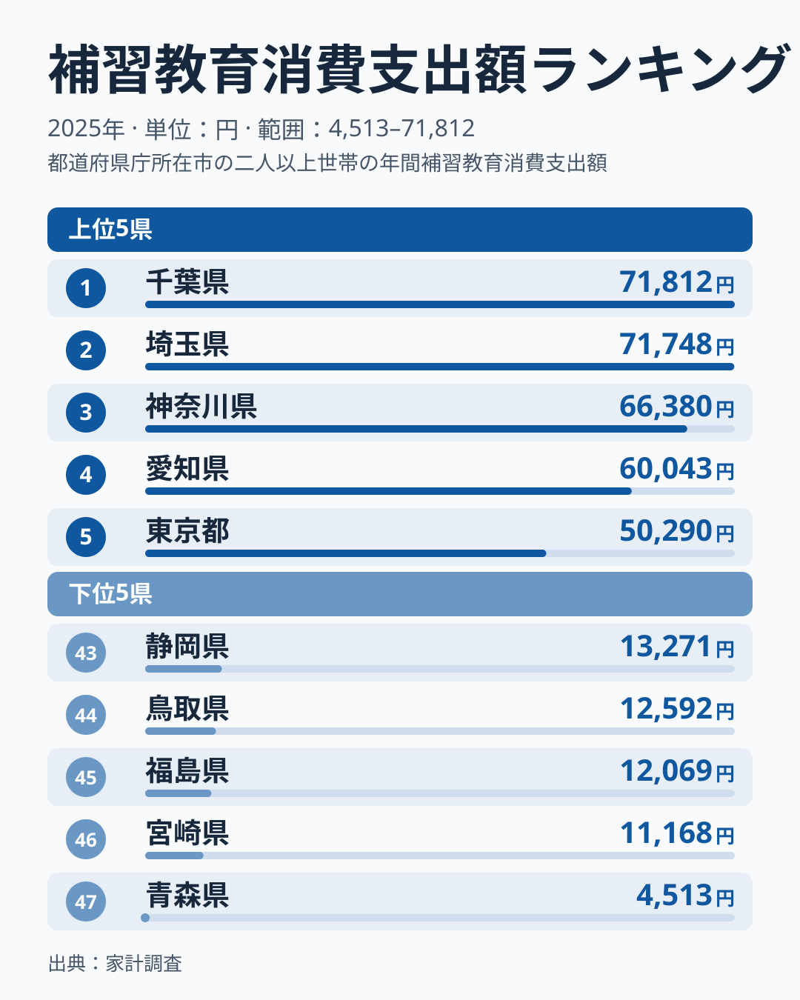
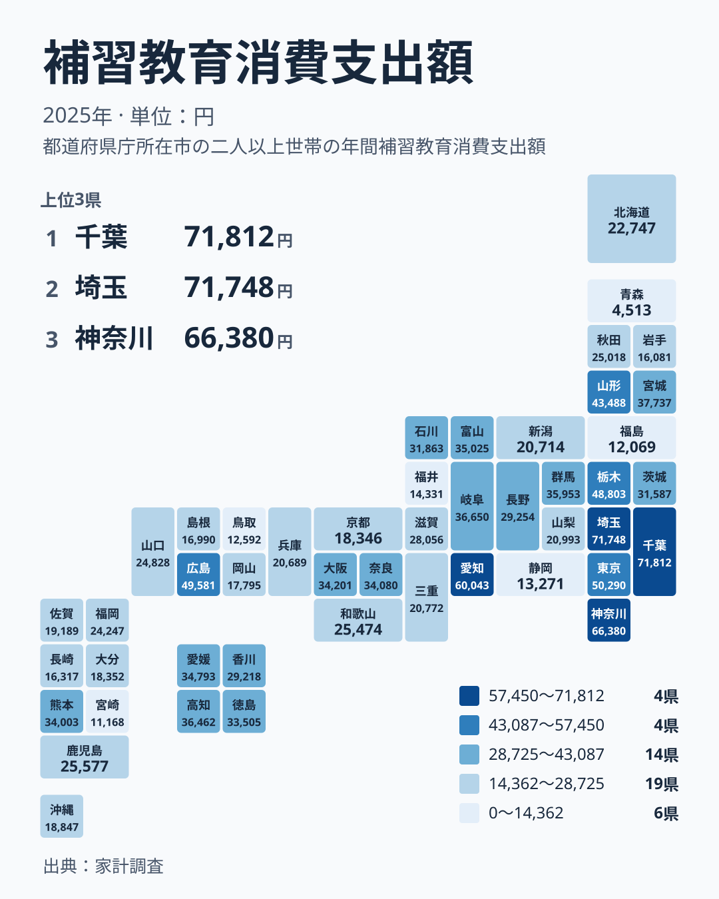

子どもの塾や習い事にかける費用は、どの県に住んでいても同じような水準なのでしょうか。2025年の家計調査を見ると、補習教育への支出は千葉県で71,812円、青森県で4,513円と、大きく開いています。この記事では、その差が何を意味するのかを、暮らしの条件に引き寄せて考えます。

## 補習教育への支出は1位と47位でどれほど違うか

補習教育への支出が最も多いのは千葉県で、71,812円です。2位は埼玉県の71,748円で、両県はほとんど並んでいます。3位は神奈川県の66,380円、4位は愛知県の60,043円、5位は東京都の50,290円です。

一方、最も少ないのは青森県で4,513円です。46位は宮崎県の11,168円、45位は福島県の12,069円、44位は鳥取県の12,592円、43位は静岡県の13,271円と続きます。最大の千葉県と最小の青森県を比べると、約15.9倍の開きがあります。

> [!NOTE]
> ここでの補習教育消費支出額は、家計調査で把握される、学習塾や予備校、家庭教師などにかかる家計の支出を指します。県庁所在地など調査対象の世帯が使った金額であり、県内の全世帯の平均とは限りません。また、塾に通っていない世帯も含めた平均のため、通う家庭の実際の月謝そのものではありません。

<source-link href="/ranking/supplementary-education-group-consumption-expenditure">補習教育への支出ランキングをもっと見る</source-link>

上の図は、上位5県と下位5県を並べたものです。上位は千葉県、埼玉県、神奈川県、愛知県、東京都で、いずれも大都市圏の県が占めています。下位には青森県、宮崎県、福島県、鳥取県、静岡県が並びます。

注目したいのは、上位2県の近さです。千葉県は71,812円、埼玉県は71,748円で、順位は違っても生活感覚としては同水準です。首都圏の郊外で子育てをする家庭では、塾や補習が教育費の中で大きな比重を占めている様子がうかがえます。

下位の県を見ると、中位との間にも段差があります。順位が下がるほど金額の差は縮まり、最下位の青森県だけが4,513円と突出して低くなっています。これは単なる地域差というより、青森県の調査結果に特有の事情が重なっている可能性を示します。

## 首都圏と中京圏に支出が集まる理由

関東の7県のうち、千葉県、埼玉県、神奈川県、東京都、栃木県の5県が7位以内に入っています。栃木県は48,803円で7位です。群馬県は35,953円で12位、茨城県は31,587円で20位と、関東の中でも差があります。

中部では愛知県が60,043円で4位、岐阜県が36,650円で10位、富山県が35,025円で13位です。一方、同じ中部でも静岡県は13,271円で43位、福井県は14,331円で42位と低い位置にあります。中部という地方でひとくくりにはできないことがわかります。

近畿は、大阪府が34,201円で15位、奈良県が34,080円で16位、滋賀県が28,056円で23位です。兵庫県は20,689円で33位、京都府は18,346円で37位でした。受験競争が激しいというイメージのある近畿でも、意外なほど順位は上下に散らばっています。

> [!WARNING]
> 家計調査は標本調査で、都道府県別に見ると調査世帯の数が限られます。補習教育のように、支出する世帯としない世帯が分かれやすい項目は、少数の世帯の影響で平均が大きく動きます。1年分の数字だけで県の教育熱心さを断定するのは避けるべきです。

## 地理分布で見ると何が見えるか

地図に落とすと、関東から東海にかけて濃い色が連なる一方、東北や九州には淡い色が目立ちます。ただし東北でも山形県は43,488円で8位、宮城県は37,737円で9位と上位に入っています。北海道・東北の中では、山形県と宮城県が突出しているわけです。

同じ東北でも、福島県は12,069円で45位、岩手県は16,081円で41位、青森県は4,513円で47位です。秋田県は25,018円で26位でした。東北の中だけでも、1位級の県に近い水準から最下位まで大きな幅があります。

九州・沖縄では、熊本県が34,003円で17位、鹿児島県が25,577円で24位、福岡県が24,247円で28位です。佐賀県は19,189円で34位、沖縄県は18,847円で35位、大分県は18,352円で36位、長崎県は16,317円で40位、宮崎県は11,168円で46位でした。九州・沖縄では、上位に入る県が熊本県だけという点が目を引きます。

中国と四国も見ておきます。中国では広島県が49,581円で6位と高い一方、鳥取県は12,592円で44位、島根県は16,990円で39位です。四国では高知県が36,462円で11位、愛媛県が34,793円で14位、徳島県が33,505円で18位、香川県が29,218円で22位と、四県とも中位以上にそろっています。

> [!TIP]
> 順位だけでなく金額も確認してください。8位の山形県は43,488円、9位の宮城県は37,737円で、上位の中にも段差があります。順位が近くても金額の差が大きいことがあり、反対に15位から18位のように金額がほぼ並ぶ区間もあります。

## 暮らしへの含意：教育費の差は家計の何を映すのか

この数字から読み取れるのは、補習教育が「全国どこでも同じ形で存在する支出」ではないということです。千葉県や埼玉県のように7万円前後に達する地域がある一方で、青森県は4,513円にとどまっています。同じ子育て世帯でも、教育費の組み立て方が地域によって異なると考えられます。

背景として考えられるのは、通える範囲に塾や予備校がどれだけあるか、中学や高校の受験を選ぶ家庭がどれだけ多いか、といった条件です。大都市圏では選択肢が多く、受験を前提とした学習が家計に組み込まれやすいのでしょう。一方で、通塾の選択肢が少ない地域では、支出そのものが小さくなります。

ただし、金額が小さい県で学びの機会が乏しいとは限りません。学校や家庭での学習、通信教育など、塾以外の手段が使われている可能性もあります。補習教育への支出が少ないことは、そのまま学力や教育意識の低さを意味しません。

家計を考える立場からは、住む地域の水準を知っておくことに意味があります。たとえば首都圏から地方に移る場合は、教育費の見込みが変わるかもしれません。反対に、地方から大都市圏に移る家庭は、補習教育の支出が想定より大きくなる可能性を見ておく必要があります。

愛知県の60,043円や広島県の49,581円のように、東京都や大阪府以外にも高い水準の地域があります。教育費の地域差は、人口の多さだけでは説明できないということです。千葉県や埼玉県の詳しいデータは、[千葉県のデータ](/areas/12000)や[埼玉県のデータ](/areas/11000)で確認できます。ほかの家計関連の指標とあわせて見るなら、[同じカテゴリの統計一覧](/category/economy)も役に立ちます。

## 数字を読むときに押さえておきたいこと

最後に、数字を使うときの注意点を整理します。

- 金額は塾に通っていない世帯も含めた平均であり、通う家庭の月謝とは異なります
- 標本調査のため、県ごとの1年分の結果は変動しやすい性質があります
- 青森県の4,513円のように極端に低い値は、調査世帯の構成の影響を受けている可能性があります
- 順位が近い県同士の差は、実質的な違いとは限りません

千葉県と埼玉県の差はわずか64円で、こうした差は誤差の範囲と考えるのが自然です。順位の上下よりも、上位グループと下位グループのまとまりを見るのが適切です。

また、補習教育の費用は家計全体の教育費の一部にすぎません。授業料や教材費、通学費など、ほかの項目と合わせて見ることで、子育て家庭の負担の全体像がつかめます。

## データについて

この記事で使った指標は、家計調査の補習教育消費支出額で、2025年の値を円で示しています。47都道府県すべての値が揃っており、順位は金額の多い順です。記事中の倍率は、最大の千葉県71,812円と最小の青森県4,513円の比を示したものです。県ごとの数字は調査世帯の標本に基づく推計値で、地域の傾向をつかむための目安として読んでください。

## まとめ

補習教育への支出は、千葉県の71,812円から青森県の4,513円まで、約15.9倍の幅があります。上位は千葉県、埼玉県、神奈川県、愛知県、東京都で、大都市圏の県が並びました。

ただし、山形県が8位、宮城県が9位、広島県が6位など、大都市圏以外にも高い県があり、地理だけでは説明しきれません。数字は標本調査に基づく平均であり、1年の値で地域を断定せず、傾向をつかむ材料として活用してください。
