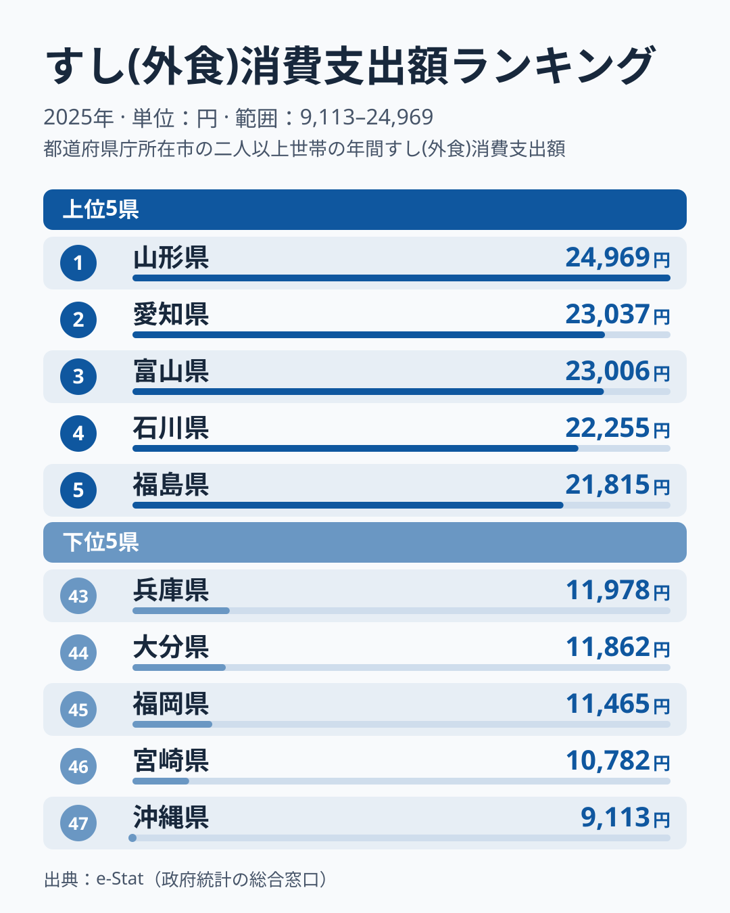
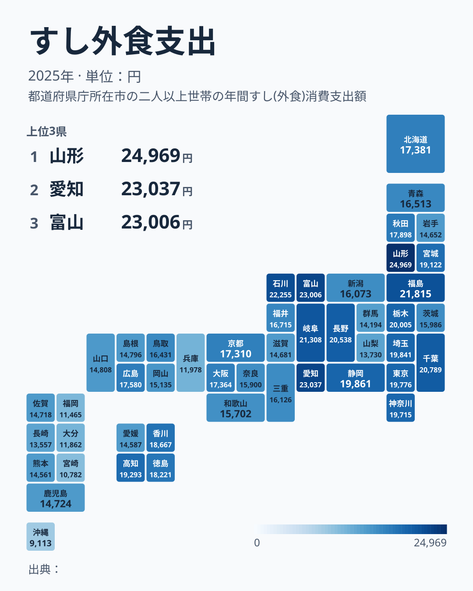

「寿司といえば東京、築地、高級店」——そんなイメージで首位を予想すると、データは意外な答えを返してきます。総務省「家計調査」2025年の**すし外食支出**で全国トップに立ったのは山形県で、1世帯あたり年間24,969円でした。2位は愛知県23,037円、3位は富山県23,006円です。寿司の本場というイメージの東京都は19,776円で12位にとどまり、最下位は沖縄県の9,113円でした。首位の山形県との差は2.7倍にのぼります。

前年の2024年に首位だったのは富山県で、山形県は2024年には6位でした。1年で首位が入れ替わり、2位だった高知県は14位まで下がっています。この記事では、2025年の上位と下位を確認したうえで、「毎年入れ替わる県」と「ほとんど動かない県」を分けて読み、東京や海のない県の位置づけも整理します。

## 上位と下位の分布——上位は東北から東海、下位は九州に集中

<source-link href="/ranking/sushi-dining-consumption-expenditure">すし外食支出ランキングの全件データを見る</source-link>

上位5県は山形・愛知・富山・石川・福島です。山形県24,969円、愛知県23,037円、富山県23,006円、石川県22,255円、福島県21,815円という並びで、東北が2県、北陸が2県、東海が1県と、地方をまたいで並んでいます。6位以下も岐阜県21,308円、千葉県20,789円、長野県20,538円、栃木県20,005円、静岡県19,861円と続き、上位10県は海岸線の長さで並んでいるわけではありません。

下位5県は兵庫・大分・福岡・宮崎・沖縄です。兵庫県11,978円、大分県11,862円、福岡県11,465円、宮崎県10,782円、沖縄県9,113円で、5県のうち4県が九州・沖縄です。首位の山形県の月換算は約2,081円、最下位の沖縄県は約759円で、同じ「すし外食」でも家計への入り込み方がこれだけ違います。

地図にすると、九州・沖縄の低さが目立ちます。九州・沖縄の8県は、佐賀県35位、鹿児島県34位、熊本県39位、長崎県42位、大分県44位、福岡県45位、宮崎県46位、沖縄県47位と、すべて34位以下に収まりました。大分県は2024年に16位、佐賀県は2024年に22位、熊本県は2024年に29位と中位に入っていたので、2025年は九州の低さがいっそうはっきり出た年です。

> [!NOTE]
> 「すし外食支出」は家計調査の外食の品目で、店で食べたすし代の年間支出額です。持ち帰りの[すし(弁当)](/ranking/sushi-takeout-consumption-expenditure)は別の品目で、この値には含まれません。また値は県庁所在市に住む二人以上の世帯の平均で、県全体や個人1人あたりの金額ではありません。山形県の値は山形市の世帯の値で、東京都は東京都区部の世帯の値です。

## 前年から入れ替わった県——山形の首位交代と大分の急落

前年の2024年と比べると、47県のうち12県が10位以上順位を動かしました。大きく上がった県は、福島県が2024年の23位から2025年の5位へ、愛媛県が2024年の46位から2025年の38位へ、広島県が2024年の43位から2025年の19位へ上がっています。山形県は2024年の6位から2025年に首位へ上がり、19,623円から24,969円へ5,346円、約27%増えました。愛媛県の支出は9,731円から14,587円へ約50%増えています。

下がった県で目立つのは大分県で、17,813円から11,862円へ約33%減り、2024年の16位から2025年の44位へ落ちました。高知県は2024年の2位から2025年の14位へ、北海道は2024年の8位から2025年の20位へ下がっています。ただし首位が入れ替わった富山県は、23,185円から23,006円とほぼ横ばいでした。富山県が下がったのではなく、山形県が大きく伸びたことで、富山県の順位が3位になった形です。

前年と今年の順位の相関を順位相関係数で見ると0.78で、1に近いほど前年と同じ並びを意味します。前年の並びがかなり残る一方で、上位の顔ぶれは毎年少しずつ入れ替わっています。

> [!WARNING]
> 家計調査は県庁所在市の限られた世帯の標本調査なので、1年分の順位は標本の偏りの影響を受けます。山形県が首位になったからといって、山形県の人が全国でいちばんすしを外食で食べると断定はできません。同じ表の数値でも、複数年の位置とあわせて読むのが安全です。

## 動かない県——石川・愛知・岐阜・静岡と、12年連続最下位の沖縄

順位が毎年入れ替わる一方で、ほとんど動かない県もあります。2021年から2025年の5年間、すべての年で上位10県に入ったのは石川県、愛知県、岐阜県、静岡県の4県です。石川県は2021年から順に2位、1位、1位、4位、4位、岐阜県は2021年から順に1位、5位、4位、9位、6位、愛知県は2021年から順に7位、9位、3位、7位、2位、静岡県は2021年から順に10位、2位、2位、3位、10位と推移しました。これに対して山形県は2021年から順に3位、25位、7位、6位、1位と動き、2022年に大きく落ち込んでいます。今年の首位は定着した姿とは言い切れません。

石川県は2014年から2025年の12年間で6回首位に立っていて、首位の顔ぶれの中でも飛び抜けて安定しています。[仮説] 北陸から東海にかけては、外食でのすしの利用が日常のものとして根づいているため、標本の偏りがあっても上位に残りやすいのかもしれません。ただし、このデータだけでは食文化の差が原因だとは確かめられません。複数年の上位常連が続くかどうかを、今後の年の値で見ていく必要があります。

最下位側では、沖縄県が2014年から2025年の12年間、毎年47位でした。沖縄県の値は2021年の4,974円から2025年の9,113円へ約1.8倍になっていますが、それでも他の46県の下にとどまっています。愛媛県は2021年から2024年に45位から46位、長崎県は2021年から2025年の5年間とも42位から46位と低い位置が続いていて、愛媛県の2025年の38位が例外的な上昇だったことがわかります。

## 東京はなぜ12位なのか

東京都は19,776円で12位でした。首位の山形県とは5,193円の差があり、大阪府は21位で17,364円、兵庫県は43位で11,978円です。東京都は2021年から2025年の5年間のうち3年で上位10県に入っていて、今年はそこから少し外れた位置にあります。

東京都が首位圏に入らない理由については、いくつかの仮説が考えられます。12位は47都道府県の上位4分の1に入る位置なので低いわけではありませんが、寿司の本場というイメージとは差があります。[仮説] 東京は外食の選択肢が多く、外食費がすしに集中しにくいのかもしれません。また、高単価の店が多ければ、気軽に通う回数が減って年間の支出が伸びにくい可能性もあります。家計調査の対象が二人以上世帯に限られるため、単身者の外食が数字に映らないことも、都市部が上位に入りにくい一因になりえます。ただしこれらはいずれも本記事のデータからは検証できておらず、外食全体の支出や世帯構成の指標と並べて確かめる必要があります。

## 海なし県は割れる——岐阜・長野は上位、群馬・山梨は下位

「海が近いからすしの外食が多い」という単純な説明は、2025年のデータでは成り立ちません。海のない8県の順位を並べると、岐阜県が6位、長野県が8位、栃木県が9位、埼玉県が11位、奈良県が29位、滋賀県が36位、群馬県が40位、山梨県が41位と、上位10県に3県、40位台に2県と大きく割れています。

海のある県でも、北海道、高知県、大分県のように前年から大きく動いた県があり、海の有無は単独では順位の説明になりません。上位に入る海なし県が、外食としてのすしを選びやすい環境にあるのか、それとも標本の偏りなのかは、複数年の値を見なければ決められません。岐阜県は5年間すべて上位10県に入っているので、少なくとも岐阜県は偶然だけでは説明しにくい水準です。

## まとめ——すし外食支出が映す地域差

- **首位は山形県24,969円**です。前年は6位で、1年で5,346円増えて富山県から首位を引き継ぎました
- **2位は愛知県23,037円、3位は富山県23,006円、4位は石川県22,255円、5位は福島県21,815円**と続き、上位は東北から東海にまたがります
- **最下位は沖縄県9,113円**で、首位との差は2.7倍です。12年連続の最下位で、九州の7県と沖縄県はすべて、47県中の下位14県に入りました
- **東京は19,776円で12位**です。5年間のうち3年は上位10県に入っていました
- 毎年入れ替わる県がある一方、石川・愛知・岐阜・静岡の4県は5年間すべて上位10県に入っています。1年分の順位だけで地域の食習慣を断定せず、複数年で読むのが安全です

あわせて見る: [食・商業カテゴリのランキング一覧](/category/commercial) / [山形県のデータ](/areas/06000) / [沖縄県のデータ](/areas/47000)
