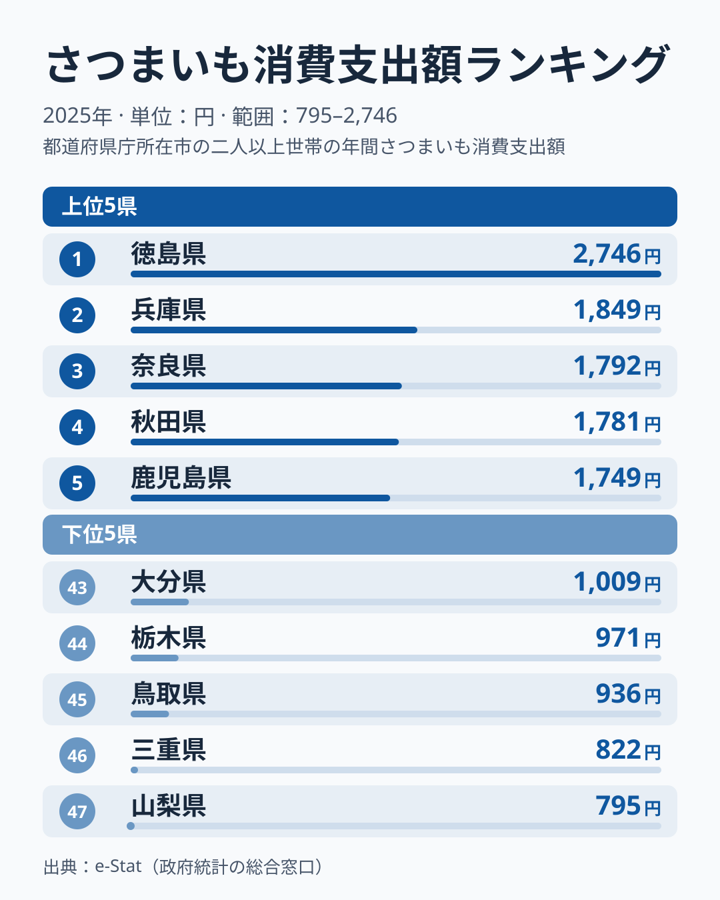
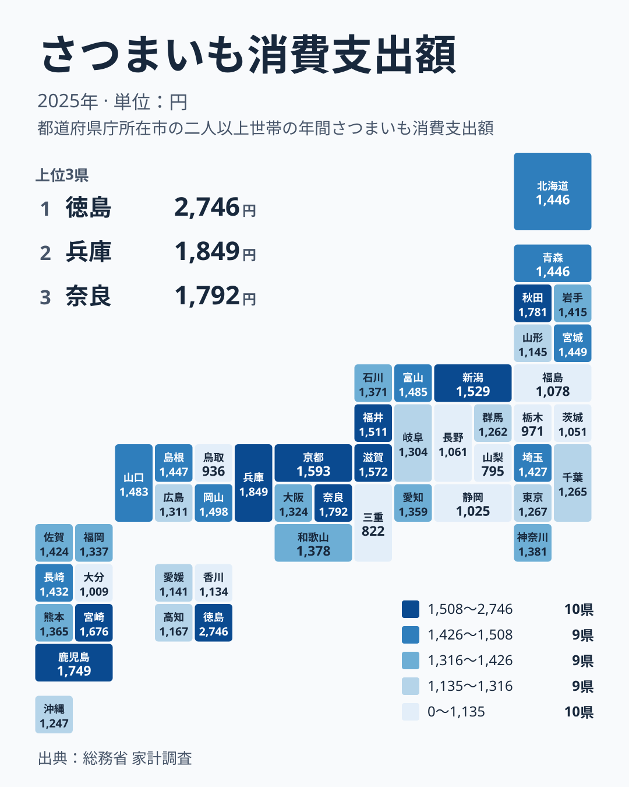

さつまいもの消費支出額は、1世帯あたりが1年間にさつまいもの購入に使った金額を示す指標です。総務省の家計調査によると、2025年の全国データでは1位の徳島県が2,746円、最下位の山梨県が795円で、その差は約3.5倍にのぼります。

産地として知られる鹿児島県や徳島県が上位に来るのは想像しやすいところですが、実際のランキングを見ると、兵庫県や奈良県、京都府、滋賀県といった関西の県が上位10県に4つ並んでいます。さつまいもの一大産地ではないこれらの地域で、なぜ支出額が伸びているのでしょうか。

この記事では、上位・下位それぞれの顔ぶれを地図で確認しながら、焼き芋文化や気候条件がどのように消費量へ結びついているのかを探ります。

> [!NOTE]
> 家計調査の「消費支出額」は世帯が実際に購入した金額の平均で、消費量そのものではありません。対象は都道府県庁所在市の二人以上世帯で、記事中の県名は県庁所在市（例: 茨城県なら水戸市）の世帯の値を指し、県全体の産地統計とは対象が異なります。単価が高い高級さつまいも（紅はるか等のブランド品種）を買う地域は、消費量が同じでも支出額が押し上げられる点に注意が必要です。

## 上位と下位

<source-link href="/ranking/sweet-potato-consumption-expenditure">さつまいも消費支出額ランキングをもっと見る</source-link>

1位は[徳島県](/areas/36000)の2,746円で、2位の兵庫県の1,849円に約900円の差をつけています。徳島県は「なると金時」というブランドさつまいもの産地で、鳴門市周辺の砂地栽培で知られています。地元での消費が多いのは、産地ならではの入手のしやすさと、なると金時を使った焼き芋などの食習慣が背景にあると考えられます。徳島県は2023年から2025年まで3年連続で1位です。

5位の[鹿児島県](/areas/46000)1,749円も、さつまいもの作付面積・収穫量で全国トップクラスを誇る産地です。鹿児島では「安納いも」をはじめとする多品種が栽培され、焼酎の原料としても利用されるほど生活に根づいた作物です。家庭での消費頻度が高く、金額に反映されていると見られます。

一方で2位の兵庫県1,849円、3位の奈良県1,792円、4位の秋田県1,781円は、さつまいもの主要産地ではありません。これらの地域が上位に入る理由として、冬場の気温が低く「焼き芋」を温かい食べ物として求める需要が強いことが挙げられます。特に関西圏（近畿2府4県）は、7位の京都府1,593円、8位の滋賀県1,572円まで含めて上位10県に4県が入っており、関西の冬の食文化として焼き芋やふかし芋が定着している可能性を示しています。ただし関西が一様に高いわけではなく、和歌山県は23位（1,378円）、大阪府は28位（1,324円）と中位にとどまります。[滋賀県](/areas/25000)や[京都府](/areas/26000)は盆地特有の底冷えする気候を持ちますが、2位の兵庫県は海沿いの神戸市を県庁所在市とするため、気候だけでは説明できません。

## 最下位グループの傾向

最下位は山梨県の795円で、1位の徳島県の3割弱にとどまります。46位の三重県822円、45位の鳥取県936円、44位の栃木県971円、43位の大分県1,009円と続き、下位5県は甲信・東海・山陰・関東北部・九州に散らばっていて、単一の地域では括れません。

一方、茨城県は41位（1,051円）です。茨城県は実は「べにはるか」などさつまいもの主要産地の一つで、鹿児島県に次ぐ収穫量を誇ります。ただし家計調査の値は水戸市の世帯のもので、県全体の産地とは対象が異なります。茨城県は2023年に46位、2024年に47位と、3年続けて下位にあります。産地であるにもかかわらず家計での購入額が低い理由としては、自家消費・親戚や知人からのやり取り・直売所での購入など、家計調査の「購入」に計上されにくい形での入手経路が多い可能性があります。統計上の「支出額」は、贈答や自家栽培分を捉えられない点に注意が必要です。

下位には47位の山梨県、44位の栃木県、40位の長野県など関東・中部の内陸県が目立ち、上位に関西の県が並ぶ構図との対比が際立ちます。これらの地域でさつまいもへの支出配分が相対的に小さくなっている背景は、家計調査の支出額だけからは特定できません。

> [!WARNING]
> 家計調査は抽出調査のため、年ごとのサンプル世帯構成によって数値が変動します。単年の順位だけで「この県はさつまいもをあまり食べない」と断定するのではなく、複数年の傾向と合わせて見ることをおすすめします。

## 発見：産地でも順位は分かれる

今回のデータで最も興味深いのは、産地でも順位が分かれる点です。徳島県は1位、鹿児島県は5位に入る一方、同じ産地の茨城県は41位です。産地としての出荷は加工用・他県への出荷が中心となり、地元の家計消費とは別の経路をたどる可能性があります。一方で、消費支出額の上位には冬の冷え込む盆地・日本海側の地域（滋賀・京都・奈良・秋田）が目立ち、これは焼き芋という「温かいおやつ」を求める気候的な需要と結びついている可能性があります。ただし北海道は16位、青森県は17位、山形県は36位と、寒い地域でも順位はばらつくため、気候だけでは説明できません。

[仮説] 焼き芋文化の強さは、冬季の寒さと石焼き芋の移動販売・スーパーの焼き芋コーナーの普及度に左右されている可能性があります。検証には都道府県別の焼き芋専門店舗数や移動販売台数のデータが必要で、現時点では家計調査の支出額から推測できる範囲にとどまります。

> [!TIP]
> 同じ家計調査の[さつまいも消費量ランキング](/ranking/sweet-potato-consumption-quantity)では、徳島県が1位、山梨県が47位と支出額と同じ両端です。一方で茨城県は消費量が26位と支出額（41位）より上がり、支出額の低さには購入単価の差が含まれている可能性があります。支出額と消費量を並べて見ると、順位の理由を絞り込みやすくなります。

## まとめ

- 1位は徳島県2,746円で3年連続の1位。産地「なると金時」の地元消費が支出を押し上げていると考えられる
- 最下位は山梨県795円で、1位と最下位の差は約3.5倍
- 兵庫・奈良・京都・滋賀など関西の非産地県が上位10県に4県入り、焼き芋文化の存在を示唆する
- 産地でも順位は分かれ、徳島は1位、鹿児島は5位、茨城は41位

他の食品の家計消費支出も、[家計・経済カテゴリ](/category/economy)で都道府県別に比較できます。
