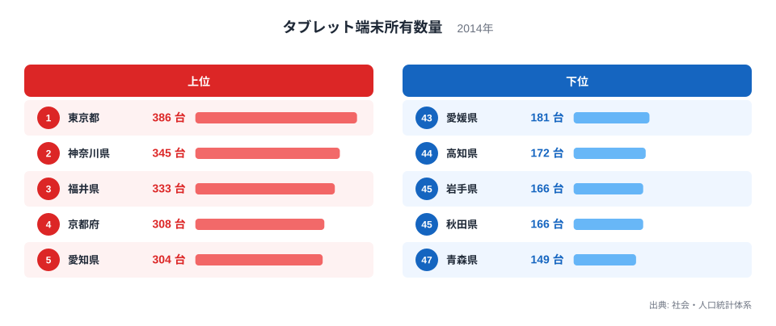
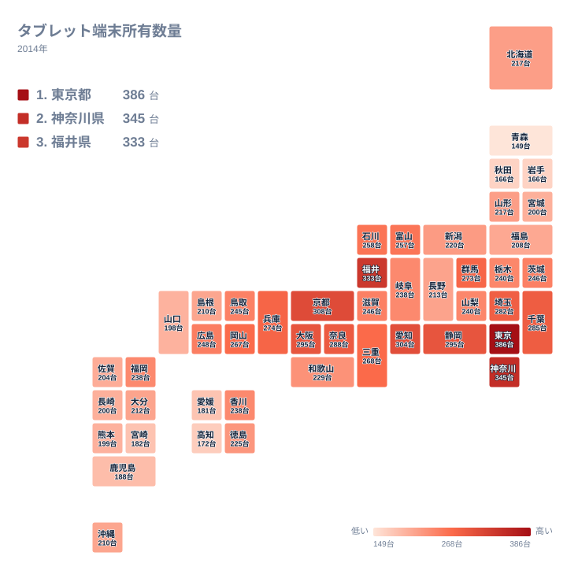

## 大都市だけでは説明できない上位の顔ぶれ

2014年のタブレット端末所有数量で1位になったのは東京都で、386台でした。2位は神奈川県の345台です。ここまでは多くの人が予想する並びでしょう。ところが3位には福井県が入り、333台を記録しました。京都府の308台や愛知県の304台よりも高い値です。

一方、最も低かったのは青森県の149台です。1位との間には大きな開きがあります。この記事では、上位と下位がなぜこの順になるのかを、地理・産業構造・歴史の面から考えます。ただし、統計が直接示しているのは台数と順位だけです。背景の説明は、あくまで仮説として扱います。

> [!NOTE]
> この指標の単位は「台」で、2014年の値です。ただし、台数が都道府県ごとの総数なのか、世帯などの母数をそろえた値なのかは、この記事で使うデータだけでは確認できません。指標の識別名には世帯あたりの値を思わせる語が含まれていますが、分母は示されていません。そのため、この記事では「台数の多い少ない」という範囲で読み、人口規模と結びつけた断定はしません。

## 上位5県と下位5県を並べて見る

まず、上位5県と下位5県を図で確認します。

<source-link href="/ranking/tablet-ownership-multi-person-households-per-1000">タブレット端末所有数量ランキングをもっと見る</source-link>

上位5県は、東京都、神奈川県、福井県、京都府、愛知県です。地方で分けると、関東が東京都と神奈川県の2県、中部が福井県と愛知県の2県、近畿が京都府の1県です。上位は特定の一地方に偏らず、三つの地方にまたがっています。

下位5県は、青森県、秋田県、岩手県、高知県、愛媛県です。青森県、秋田県、岩手県の3県は北海道・東北に属し、高知県と愛媛県の2県は四国に属します。上位が複数の地方に散らばるのに対し、下位は北海道・東北と四国に集まっている点が対照的です。

数値の幅にも違いがあります。上位5県は386台から304台まで値が大きく動きますが、下位5県は149台から181台の範囲に低い値が固まっています。上位には、東京都のように突出した県と、愛知県のようにその後ろに続く県が混在しています。下位は、似た水準の県が横並びになりやすいと言えます。つまり、上位に入る要因は一つとは限らない可能性があります。ただし、この図だけで要因を特定することはできません。

## 地理分布で見ると何が見えるか

次に、都道府県の位置関係をタイルマップで見ます。

マップを見ると、関東から近畿にかけての都市圏に、値の高い県が連なっています。関東では、東京都が386台、神奈川県が345台、千葉県が285台、埼玉県が282台、群馬県が273台です。中部では静岡県が295台で、愛知県の304台と合わせると、東京から名古屋へと続く帯が浮かびます。

近畿は、京都府が308台、大阪府が295台、奈良県が288台、兵庫県が274台、三重県が268台です。ここで注目したいのは大阪府です。国内有数の大都市ですが、京都府や神奈川県より低い値でした。しかも静岡県とは同じ295台で並んでいます。人口の多い都市が必ず最上位に来るわけではない点が、この指標の興味深いところです。

これに対して、北海道・東北は全体に低めです。北海道と山形県はどちらも217台で、宮城県は200台、福島県は208台です。北海道・東北の中で最も高い値でも、全国では中位より下に位置します。この地域には、冬の積雪や広い面積といった共通の条件がありますが、それが所有数量に結びついているかどうかは、この統計だけでは判断できません。

> [!WARNING]
> この統計は2014年の1時点の値です。タブレットが普及の途上にあった時期の数字で、現在の所有状況とは大きく異なる可能性があります。また、調査の方法による誤差も考えられるため、台数が近い県どうしの差は、実態の差とは言い切れません。

## 福井県の3位は何で説明できるのか

福井県の333台は、この指標でいちばん目を引く結果です。ここで、データで言えることと言えないことを分けておきます。

言えるのは、福井県が東京都と神奈川県に次ぐ高い値を示し、京都府や愛知県を上回ったという事実です。大都市圏の県ではなくても、高い水準に届く例があることを示しています。

言えないのは、その理由です。福井県は眼鏡や繊維といった地場産業で知られ、世帯の人数が比較的多い県として語られることもあります。これらが関係している可能性は、仮説として考えられます。しかし、この統計には産業別の就業者数も世帯人数も含まれていません。仮説を裏づける数字は、このデータの中にはありません。分母が不明であることも合わせると、高い値が台数の多さそのものなのか、世帯規模の違いなのかも判別できません。

福井県の結果は、地理や歴史だけでは説明しきれない部分がこの指標に残っていることを示しています。他の統計と組み合わせて確かめる余地がある、と受け止めるのが妥当です。

## 下位に並ぶ北海道・東北と四国

下位の県を見ると、青森県が149台で最も低く、秋田県と岩手県がともに166台で続きます。四国では、高知県が172台、愛媛県が181台でした。

同じ四国でも、香川県は238台、徳島県は225台と、高知県や愛媛県よりかなり高い水準です。四国の中でも値には差があります。九州・沖縄では、福岡県が238台と最も高く、宮崎県が182台、鹿児島県が188台でした。九州・沖縄の中でも、大都市を抱える県とそうでない県で開きがあります。

こうした差の背景として、農林水産業の比率が高い県では仕事で端末を使う機会が都市部より少ないのではないか、自動車での移動が中心の地域では端末を使う習慣が育ちにくいのではないか、といった見方があります。ただし、これらは仮説です。この統計に産業構成や移動手段のデータは含まれていないため、確認はできません。

中位の例も見ておきます。群馬県は273台、岡山県は267台、石川県は258台、富山県は257台でした。大都市圏ではなくても、200台台後半の水準に達する県があることがわかります。上位だけを見ると都市圏の話に見えますが、中位まで視野に入れると、地方の県にも幅広い水準があることが読み取れます。

> [!TIP]
> 順位表の並びだけで県の優劣を決めないことが、読み違いを防ぐコツです。たとえば静岡県と大阪府は、どちらも295台で同じ値です。中位は台数が接近している県が多いので、順位よりも台数そのものを見て比べてください。

## 東京都と神奈川県が示す都市圏の姿

首都圏の2都県は、この指標を読むうえで欠かせません。[東京都のデータ](/areas/13000)を見ると、多くの統計で全国の先頭に立っています。企業の本社や情報関連の産業が集まり、新しい機器に触れる機会が多い土地であることが、高い値の背景にあるという見方は自然です。

[神奈川県のデータ](/areas/14000)も見てみましょう。神奈川県は345台で2位に入り、大阪府や愛知県を上回りました。東京への通勤者が多い県であり、住宅地に暮らす世帯が多いことが関係しているかもしれません。

歴史的には、関東に政治・経済・教育の機能が早くから集まってきました。新しい技術が先に届きやすい地域だったという説明は成り立ちます。ただし、これも仮説であり、2014年の台数だけから歴史の影響を測ることはできません。

他の経済関連の統計も合わせて読みたい方は、[同じカテゴリの統計一覧](/category/economy)も参考にしてください。複数の指標を並べると、タブレットの所有数量だけでは見えない地域の特徴が浮かび上がります。

## データについて

この記事で扱うのは、社会・人口統計体系に収録された「タブレット端末所有数量」の2014年の値です。単位は台で、全47都道府県の値を使っています。記事中の数値と順位は、すべてこの統計から取り出したものです。同じ値の県が複数あるため、同値の県については順位を示さず、値だけを並べました。

産業構造・歴史・世帯の様子に関する説明は、統計の外にある一般的な知識に基づく仮説です。統計そのものが原因を示しているわけではありません。指標の分母も、このデータだけでは確認できません。因果関係は断定せず、読み解きの手がかりとして受け取ってください。
