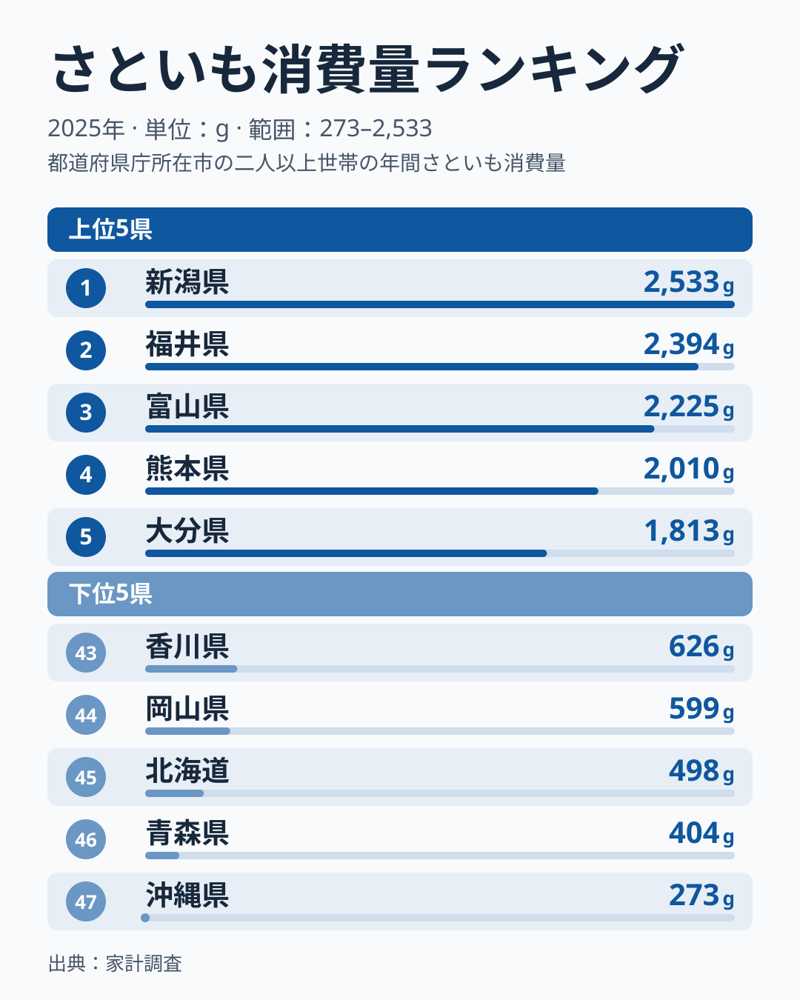
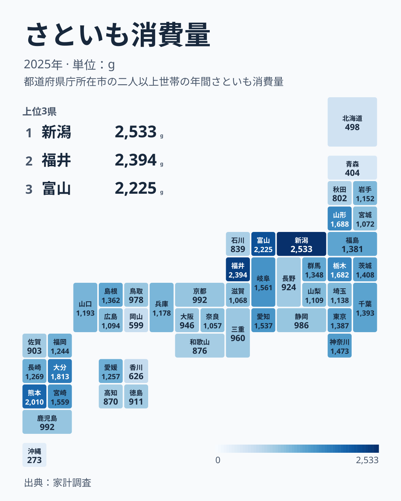

さといもは、秋から冬にかけて全国の食卓に並ぶ身近な根菜です。汁物や煮物に使われ、郷土料理とも結びつきの深い食材ですが、実際にどれだけ買われているかは都道府県ごとに大きく違います。

総務省の家計調査による2025年のデータでは、さといもの消費量は1位の新潟県が2,533グラム、最下位の沖縄県が273グラムで、その差は9.3倍に達します。同じ家計調査で見ると、じゃがいもは最大と最小の開きが1.6倍、さつまいもは2.9倍にとどまります。さといもは、芋類の中でも県による開きがとりわけ大きい品目です。

この記事では、47都道府県のさといも消費量を上位と下位で確認し、地図で分布を見たうえで、じゃがいも・さつまいもと並べて開きの大きさを確かめます。最後に、理由として語られがちな説明のうちデータで確かめられるものと、確かめられないものを分けて整理します。

## 上位と下位、どの県が並んでいるか

<source-link href="/ranking/taro-consumption-quantity">さといも消費量ランキングをもっと見る</source-link>

上位5県は、新潟県が2,533グラムで1位、福井県が2,394グラムで2位、富山県が2,225グラムで3位と中部の3県が続き、4位は熊本県で2,010グラム、5位は大分県で1,813グラムと九州の2県が入ります。続いて山形県が1,688グラムで6位、栃木県が1,682グラムで7位でした。1位と3位の差は308グラムで、上位3県は近い水準に固まっています。

下位は、43位が香川県で626グラム、44位が岡山県で599グラム、45位が北海道で498グラム、46位が青森県で404グラム、そして47位が沖縄県で273グラムです。上位との差は大きく、1位の新潟県は43位の香川県の4.0倍にあたります。注目したいのは青森県で、東北地方に属しながら6位の山形県とは対照的に下位に沈んでいる点です。東北だから一律に多いわけではなく、北海道と沖縄という南北の端が下位に並ぶことと合わせて、地方区分だけでは順位を説明できないことが分かります。

## 地図で見る分布と、同じ地方内のばらつき

地図で色の濃さを追うと、中部の新潟県・福井県・富山県と、九州の熊本県・大分県・宮崎県に濃い色のまとまりが浮かびます。一方、北海道と沖縄県の両端、そして中国の岡山県と四国の香川県は薄い色です。

ただし、濃い地域の中にも例外があります。九州では熊本県が4位、大分県が5位、宮崎県が9位ですが、福岡県は20位、佐賀県は38位です。鹿児島県は30位の京都府と同じ992グラムで、順位は31位です。関東でも栃木県は7位なのに埼玉県は24位、東北でも山形県は6位なのに青森県は46位と、同じ地方の中で順位が大きく割れます。地図から言えるのは、中部の日本海側と九州中部にまとまりがあるという程度で、県ごとの差は地方単位の説明に収まりません。

## じゃがいも・さつまいもと比べると何が分かるか

さといもの開きの大きさは、他の芋類と並べると際立ちます。同じ2025年の家計調査で、じゃがいもは最も多い長崎県が10,016グラム、最も少ない群馬県が6,081グラムで1.6倍、さつまいもは最も多い徳島県が4,937グラム、最も少ない山梨県が1,674グラムで2.9倍です。さといもの9.3倍は、この2品目の開きを大きく上回っています。

県の順位も芋類で一致しません。新潟県はさといもが最多で、さつまいもは3番目、じゃがいもは4番目に多く、3品目すべてで上位5県に入ります。しかし福井県は、さといもが2番目に多くじゃがいもも7番目に多い一方、さつまいもは47県中40番目と少ない側です。熊本県もさといもは4番目に多いのに、じゃがいもは31番目で中位より下です。「芋が好きな県」が一様に多く買っているわけではなく、さといもの多さは品目ごとの事情を反映していると読めます。

下位の2道県を見ると、沖縄県はじゃがいもが47県中45番目、さつまいもが44番目と、どちらも少ない側で、さといもの少なさを他の芋が補っている様子は購入量では見えません。北海道もじゃがいもは14番目、さつまいもは10番目に多く、他の芋が突出して多いとは言えません。里芋の少なさを他の芋類で説明する見方は、このデータでは裏づけられませんでした。

あわせて見る: [じゃがいも消費量ランキング](/ranking/potato-consumption-quantity) / [さつまいも消費量ランキング](/ranking/sweet-potato-consumption-quantity)

## 理由はどこまで言えるか

新潟県・福井県・富山県が上位に並ぶ理由は、このデータだけでは特定できません。ここで言えるのは、里芋が秋冬の汁物や煮物と結びつく食材であることと、その使われ方に地域差がありうることまでです。山形県の芋煮会のような行事食は有名ですが、山形県は6位であり、新潟県・福井県・富山県の多さを説明するものではありません。

[仮説] 里芋の産地とその周辺では、購入量が高く出る地域と、自家栽培や贈答でまかなわれて購入量が低く出る地域が混在している可能性があります。新潟県は購入量でも1位なので、自給が多い県ほど購入量が少なくなるという単純な形にはなっていません。検証には、農林水産省の野菜の作付面積・収穫量の統計など県別の産地データと購入量を並べ、収穫量の多い県が購入量でも上位に来るかを見る必要があります。この記事のデータには県別の生産量が含まれないため、ここでは確かめていません。

**補足:** 家計調査でいう「消費量」は、県庁所在市などに住む二人以上の世帯が購入した量を集計したものです。県全体の実態調査ではなく、都市部の世帯の購入量を都道府県の代表値として扱っている点に注意してください。

> [!WARNING]
> ここで扱う数値は2025年単年の家計調査データです。市別の値は単年のぶれが大きく、里芋は天候で収穫量が変わりやすい作物でもあるため、年によって順位が入れ替わる可能性があります。下位の県を「食べていない」と読むことも、順位から食習慣の強さを断定することもできません。複数年の推移はこの記事のデータからは分かりません。

上位に入った[新潟県のデータ](/areas/15000)や[熊本県のデータ](/areas/43000)を見ると、他の食品の購入傾向とあわせて地域の食文化を調べる手がかりになります。[同じカテゴリの統計一覧](/category/economy)では、家計消費に関する他の指標も確認できます。

## まとめ

- 1位は新潟県で2,533グラム、最下位は沖縄県で273グラムで、開きは9.3倍です
- じゃがいもの1.6倍、さつまいもの2.9倍と比べて、さといもは県による開きがとりわけ大きい品目です
- 上位5県は新潟県・福井県・富山県の中部3県と、熊本県・大分県の九州2県で、下位5県は香川県・岡山県・北海道・青森県・沖縄県です
- 同じ地方の中でも順位は大きく割れ、芋類の間でも県の順位は一致しないため、地方区分や「芋好き」では説明できません
- 理由は [仮説] の域を出ません。県別の収穫量などと突き合わせることが次の検証になります
