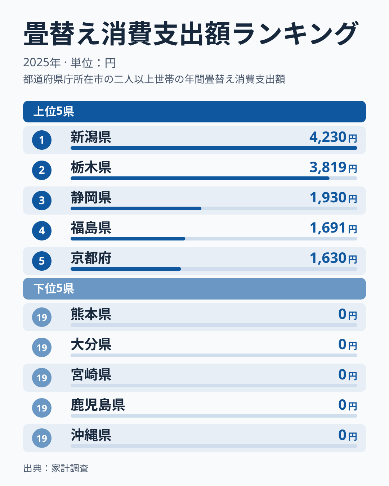
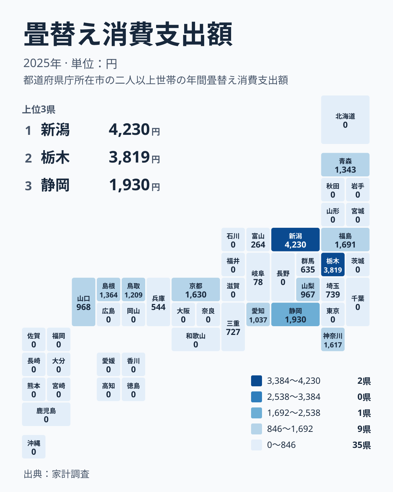

畳替えは、毎年のように行う支出ではありません。数年に一度、まとまった費用がかかる種類の出費です。その畳替えへの支出を2025年の家計調査で見ると、都道府県によって驚くほど差があります。1位の新潟県は4,230円、一方で47件のうち29件は0円です。この記事では、数字の並びから暮らしの何が見えてくるのかを考えます。

## 畳替えへの支出、上位と下位の顔ぶれ

まずは上位5県と下位5県を図で確認します。

<source-link href="/ranking/tatami-replacement-consumption-expenditure">畳替えへの支出ランキングをもっと見る</source-link>

1位は新潟県で4,230円、2位は栃木県で3,819円です。続く静岡県は3位で1,930円ですから、上位2県とその下の間には大きな断層があります。4位の福島県は1,691円、5位の京都府は1,630円で、ここから先は緩やかに下がっていきます。

注目したいのは、新潟県と栃木県の2県だけが、他の県を大きく引き離している点です。この2県だけが別格の支出を示しており、全国の平均的な姿とは言いにくい状況です。

下位側は、19位の北海道から47位の沖縄県まで0円が並びます。最下位が一つに決まらず、29県が同じ0円で並んでいるのが、この指標の最大の特徴です。順位の差というより、「支出があったかどうか」の差と読むほうが実態に近いでしょう。

> [!NOTE]
> この指標は家計調査の「畳替え」への消費支出額で、単位は円、2025年の値です。畳替えは頻度の低い支出なので、調査対象の世帯で1年間に畳替えをした世帯が少なければ、その県の値は0円になります。0円は「畳文化がない」という意味ではなく、「調査の対象世帯に支出が記録されなかった」という意味です。

## 地理分布で見ると、どこに偏っているか

続いて、47都道府県の分布を地図状のタイルで確認します。

地方ごとに、支出が記録された県の数を数えると傾向が見えてきます。中部は9県のうち6県、関東は7都県のうち4県、近畿は7府県のうち3府県に支出があります。中国は5県のうち3県に支出があり、岡山県と広島県は0円です。北海道・東北は7道県のうち、福島県と青森県の2県だけです。

一方で、四国の4県と九州・沖縄の8県は、すべて0円でした。支出が記録された県は、中部・関東・近畿・中国といった本州の中央から西寄りの地域に多く、西南日本の四国と九州・沖縄には1県もありません。

ただし、同じ地方の中でも支出のある県とない県が混在しています。たとえば関東では、栃木県が全国2位の一方で、茨城県、千葉県、東京都は0円です。地方という大きなくくりでは、傾向を断定しにくい指標だと言えます。

## 内訳を分けて考える:「ある県」と「ない県」

この指標を、金額の大小ではなく「支出が記録された県」と「記録されなかった県」に分けて読むと、真因に近づけます。支出が記録されたのは1位の新潟県から18位の岐阜県までの18県です。岐阜県の78円は、記録された県の中で最も少ない額でした。

17位の富山県は264円、18位の岐阜県は78円と、記録された県の末端は極めて小さな額です。これは、年間で畳替えをした世帯がごく一部で、その費用を調査世帯全体で平均した結果だと考えられます。つまり、新潟県の4,230円は「どの世帯も毎年4千円を払っている」のではなく、「畳替えをした世帯が一定数いた」ことの反映と読めます。

この点を踏まえると、順位の高さは「畳を大事にする度合い」を直接測るものではありません。畳替えのタイミングがその年に重なった世帯がいたかどうかで、数字が大きく動く構造だからです。上位の値も、その年の事情に左右されている可能性があります。

> [!WARNING]
> 家計調査は標本調査で、調べられる世帯数が限られます。畳替えのように発生頻度の低い支出は、1世帯の出費が県の値を大きく押し上げることがあります。0円の県も、実際には畳替えをした家庭がある可能性があります。1年分の値だけで県の傾向を断定しないでください。

## 暮らしへの含意:畳替えは「周期の出費」

生活者の視点では、畳替えは家計の中で「周期の出費」として捉えるのが現実的です。表替えや裏返しの費用は、毎月の食費や光熱費のようには平準化されません。ある年に集中し、別の年にはまったく出ない性質を持ちます。

そのため、2025年に4,230円を示した新潟県の家庭が、毎年それだけ使うとは限りません。逆に、0円だった東京都や大阪府の家庭が、畳替えと無縁だとも言えません。数年単位でならして考えるほうが自然です。

読者として役立つのは、自宅の畳の状態を基準に、数年先の費用を見込んでおく姿勢です。ランキングの順位に一喜一憂するより、自分の家の畳替えの時期を把握し、積み立てておくほうが家計管理に直結します。同じカテゴリの数字を横断して見たい場合は、[同じカテゴリの統計一覧](/category/economy)も参考になります。

## 新潟県と栃木県、突出の読み方

上位2県をもう少し詳しく見ます。[新潟県のデータ](/areas/15000)では、畳替えへの支出が4,230円で全国1位でした。[栃木県のデータ](/areas/09000)では3,819円で2位です。

新潟県は中部、栃木県は関東に属し、地理的には離れています。両県に共通する地域特性を、今回のデータだけから挙げることはできません。静岡県の1,930円を大きく上回っていることから、調査世帯に畳替えをした家庭が含まれた影響があった可能性もありますが、データ内に確かめる材料はありません。

複数年のデータを追って同じ県が上位に並ぶかどうかを確かめれば、継続的な傾向かどうかが判断できます。今回示された値は2025年の1年分だけです。上位2県を「畳替え熱心な県」と決めつけず、来年以降の推移を見守るのが堅実な読み方です。

> [!TIP]
> 頻度の低い支出は、順位よりも「0円かどうか」と「何年も続けて上位に出るか」を見ると読み違いを減らせます。まず自分の県が18位以内か、19位以下の0円の群かを確かめ、その後で複数年の推移を比べるのがコツです。

## データについて

ここで使った指標は、家計調査の「畳替え消費支出額」です。2025年の値を、円単位で都道府県別に示しています。全47件のうち、支出が記録されたのは18県、0円は29県でした。

最大は新潟県の4,230円で、最小は0円です。最小が0円であるため、最大と最小の倍率は計算できません。比較するときは、実データの値と順位を並べて読むのが適切です。

家計調査は、世帯の支出を継続的に調べる統計です。畳替えのような単発の支出は、調査期間中に発生した世帯の有無が値を左右します。数値の大小は、県全体の畳替え需要を厳密に表すものではない点を、改めて確認しておきます。なお、地方のくくりは北海道・東北、関東、中部、近畿、中国、四国、九州・沖縄の7区分で統一しています。

## まとめ

畳替えへの支出は、1位の新潟県が4,230円、2位の栃木県が3,819円と上位2県が突出し、19位の北海道以下29県が0円という、極端な分布でした。この姿は、県ごとの畳文化の差というより、頻度の低い支出が調査世帯に記録されたかどうかの差を映している可能性があります。

家計にとっては、順位よりも自宅の畳の状態と、数年単位の費用の見込みが大切です。今回の数字は、周期的な出費をどう扱うかを考えるきっかけとして活用してください。
