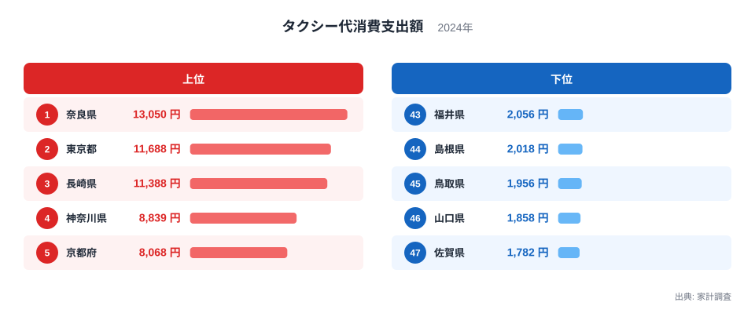
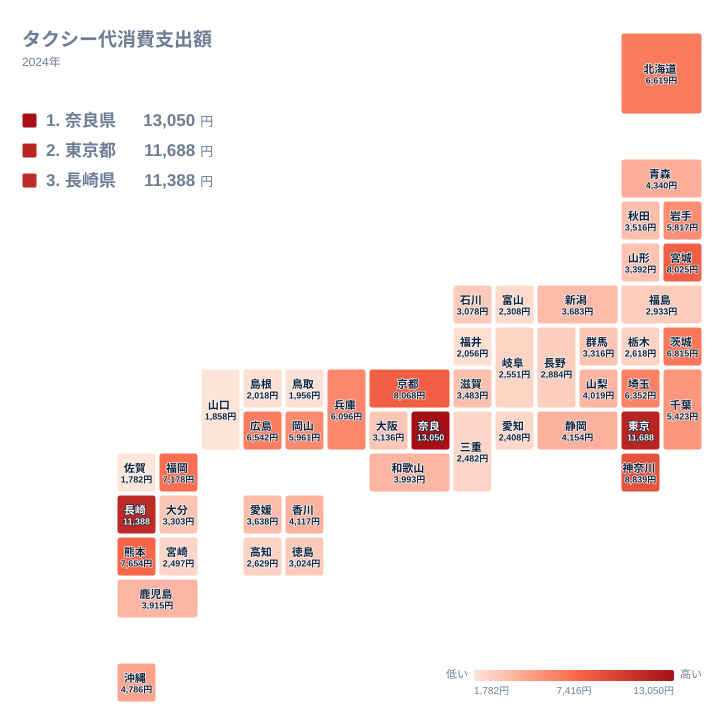

## タクシー代への支出が最も多い県はどこか

タクシー代への支出が最も多い県はどこでしょうか。2024年の家計調査で1位になったのは奈良県で、13,050円でした。2位は東京都で11,688円、3位は長崎県で11,388円です。大都市の東京都が2位に入るのは想像しやすい一方、奈良県と長崎県が並ぶ結果には意外な印象を持つ方も多いはずです。

最も少なかったのは佐賀県の1,782円です。1位の奈良県と47位の佐賀県を比べると、13,050円と1,782円で7倍を超える開きがあります。

この記事では、都道府県の差を金額の層に分けて整理します。そのうえで、地形、公共交通、観光、暮らし方といった背景を、あくまで仮説として考えます。使えるデータは支出額と順位だけなので、理由を確定させることはできません。その前提で読み進めてください。

> [!NOTE]
> この指標は、家計調査で把握した世帯がタクシー代として支出した金額の、2024年の都道府県別の値です。運賃の高さを直接示すものではありません。支出額は、利用の頻度と1回あたりの金額が合わさった結果なので、運賃が高い地域だから多いとは限りません。

## 上位3県と4位以下の段差

まず、上位5県と下位5県を図で確認します。

<source-link href="/ranking/taxi-fare-consumption-expenditure">タクシー代への支出ランキングをもっと見る</source-link>

図でまず目に入るのは、上位3県と4位以下の段差です。3位の長崎県は11,388円、4位の神奈川県は8,839円で、差は2,549円あります。一方、1位から3位の中では、1位の奈良県と3位の長崎県の差は1,662円にとどまります。上位3県は1万円を超える水準で固まっており、4位の神奈川県以下は8,000円台以下に落ちます。

4位から5位は、神奈川県が8,839円、京都府が8,068円で、差は771円です。6位の宮城県は8,025円なので、京都府とほとんど差がありません。5位までの図だけを見ると、上位の特徴が際立って見えますが、実際には5位前後から連続的に値が下がっていきます。

下位5県は、佐賀県が1,782円、山口県が1,858円、鳥取県が1,956円、島根県が2,018円、福井県が2,056円です。5県の差は274円しかなく、47位と43位がほぼ横並びです。下位は中国地方の山口県、鳥取県、島根県と、北陸の福井県、そして佐賀県という構成です。

## 地理分布から見える傾向

次に、全国の分布をタイルマップで見てみます。

地図を眺めると、東京都や神奈川県を含む首都圏、京都府や奈良県の近畿、そして宮城県、北海道、広島県、福岡県といった地方の中核都市を抱える道県が、高めの層に入っています。大都市圏や中核都市を持つ地域でタクシー支出が大きくなる傾向がうかがえます。ただし、長崎県や熊本県のように、そうした都市圏とは言い切れない県も上位に入っています。

一方、中国地方の山口県、鳥取県、島根県と、北陸の福井県、富山県は、いずれも下位に位置しています。これらの県の順位は、福井県が43位、島根県が44位、鳥取県が45位、山口県が46位で、富山県も42位です。ここに佐賀県が47位で加わります。四国の愛媛県が25位、香川県が20位、徳島県が33位と、中位に分布しています。西日本全体が低いわけではなく、地域の中でもばらつきがあります。

大都市圏でも例外があります。愛知県は41位で2,408円、大阪府は31位で3,136円です。大阪府は、隣の奈良県の13,050円と比べて4倍を超える差があります。大都市圏であることがそのまま高い支出につながるわけではないことが、この数字からわかります。

> [!TIP]
> 順位だけでなく、金額の層を意識すると読みやすくなります。上位3県は1万円を超え、4位から8位は7,000円台から8,000円台です。9位から18位は4,000円台後半から6,000円台、中位は3,000円台から4,000円台、下位は2,000円前後と、層ごとに水準が異なります。層をまたぐと、順位の差以上に金額の差は大きくなります。

## 奈良県・東京都・長崎県が高い理由を考える

[奈良県のデータ](/areas/29000)を見ても、13,050円という値は突出しています。理由として、観光地を多く抱えること、駅から目的地までの移動に使われること、大阪府や京都府への通勤の途中で使われることなどが仮説として考えられます。ただし、この指標だけでは、どれが当てはまるかを確認できません。

2位の[東京都のデータ](/areas/13000)は11,688円です。電車やバスが発達した都市で、終電後の移動や短距離の移動に使われているのではないか、という仮説が考えられます。自家用車を持たない世帯が多いことが関係している可能性もありますが、保有状況のデータは今回ありません。首都圏では、神奈川県が4位で8,839円、埼玉県が12位で6,352円、千葉県が16位で5,423円と、いずれも比較的高い層に入っています。

3位の長崎県は11,388円です。坂が多い地形のため、タクシーが日常の足として使われやすいのではないか、という見方があります。観光客の利用が影響している可能性も考えられます。ただし、これらは仮説であり、今回のデータから裏づけることはできません。

京都府は5位で8,068円、熊本県は7位で7,654円、福岡県は8位で7,178円です。観光や都市機能が集まる地域という共通点はありますが、これも推測の域を出ません。

## 関連品目との対比：自家用車と公共交通

タクシー代は、自家用車や公共交通との対比で考えると理解しやすくなります。ただし、この記事で使えるのはタクシー代の数字だけです。自家用車の保有率や鉄道の利用状況は確認できないため、以下はあくまで仮説です。

下位の佐賀県、山口県、鳥取県、島根県、福井県では、自家用車での移動が生活の中心で、タクシーを使う機会が少ないのではないか、という仮説が考えられます。愛知県が41位で2,408円と低い点も、同じ見方で説明できるかもしれません。ただし、自家用車の保有状況がわからないため、確かめることはできません。

反対に、地形や鉄道網の都合でタクシーが補完的な役割を担う地域では、支出が増える可能性があります。ただし、公共交通が弱いから多い、強いから少ない、と単純には言えません。東京都のように公共交通が発達していても支出が多い県があります。大阪府は鉄道網が密だと言われますが、31位で3,136円です。

中位では、新潟県が24位で3,683円、愛媛県が25位で3,638円、秋田県が26位で3,516円と、金額が近い県が連なっています。岩手県は15位で5,817円、青森県は18位で4,340円です。積雪の多い地域でタクシーが選ばれる面があるのではないか、という見方もありますが、これも確認はできません。

> [!WARNING]
> 家計調査は標本調査で、都道府県単位では調査された世帯数が多くありません。そのため、一部の世帯の長距離利用などが、県の平均を大きく動かす可能性があります。年ごとに順位が入れ替わることもあるため、1年分の順位だけで地域の特徴を断定するのは避けてください。

## 中位の県と全体像

全国の真ん中あたりを見ると、静岡県は19位で4,154円、香川県は20位で4,117円、山梨県は21位で4,019円です。このあたりは4,000円前後に集まっています。その上には、岡山県の5,961円、岩手県の5,817円、千葉県の5,423円といった5,000円台後半から6,000円近い層があり、上位と中位の間をつないでいます。

さらに下がると、石川県が32位で3,078円、徳島県が33位で3,024円、福島県が34位で2,933円、長野県が35位で2,884円と続きます。3,000円前後を境に、値は2,000円台に入っていきます。

数字が小さいことを「移動が便利で使わない」と読むか、「利用できる選択肢が少ない」と読むかで、地域の見え方は変わります。この指標だけでは、どちらが当てはまるかは判断できません。同じカテゴリの数字とあわせて見たい場合は、[同じカテゴリの統計一覧](/category/economy)も参考になります。

## データについて

この記事で使ったのは、2024年の家計調査にもとづくタクシー代消費支出額です。単位は円で、47都道府県すべての値がそろっています。

タクシー代は、日常的に頻繁に使う費目ではないため、世帯による差が大きく出やすい項目だと考えられます。数字を読むときは、順位そのものよりも、上位・中位・下位という大きな層を見ることをおすすめします。

奈良県の13,050円と佐賀県の1,782円という差の背景には、地形、鉄道、車社会、観光、世代構成といった地域の条件が関わっている可能性があります。ただし、この指標だけでは要因を特定できません。自分の住む県がどの層にあるかを確かめ、その背景を考えるきっかけにしてください。
