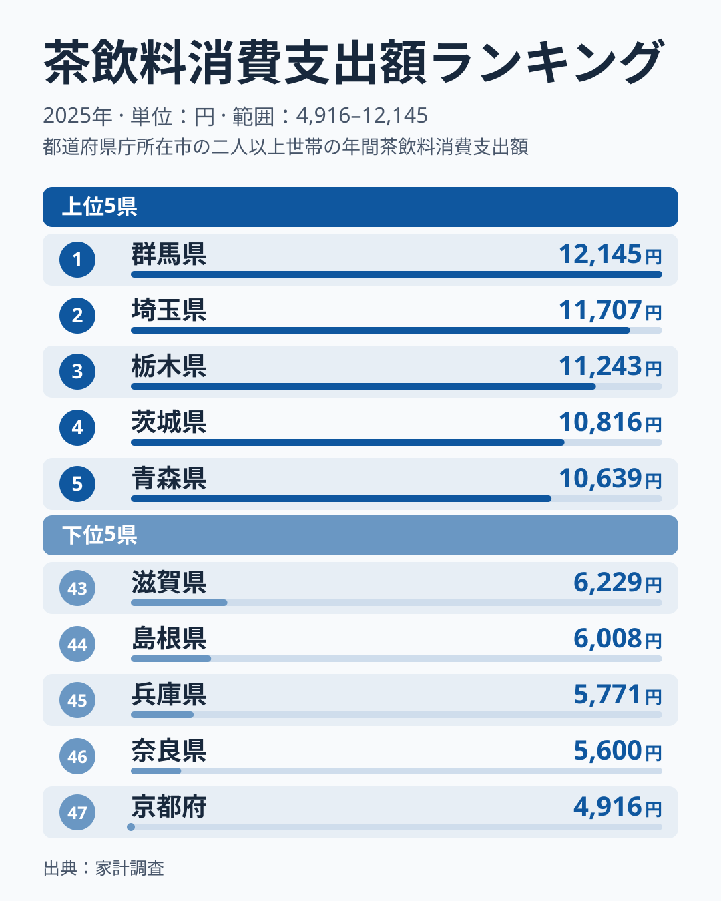
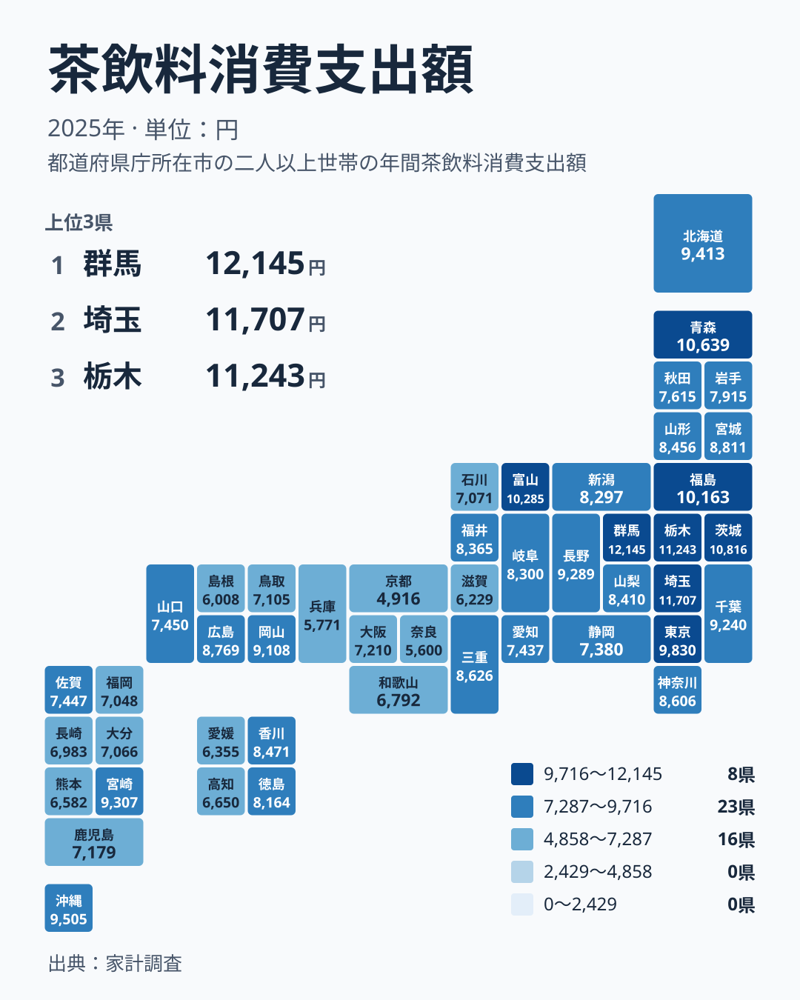

## 茶どころの県が上位とは限らない

お茶といえば、静岡や京都を思い浮かべる方が多いのではないでしょうか。ところが家計調査の2025年の結果で、茶飲料への支出が最も多かったのは群馬県でした。金額は12,145円です。2位は埼玉県の11,707円、3位は栃木県の11,243円と続き、1位から4位までを関東の4県が占めています。

一方、最も少なかったのは京都府の4,916円で、47位でした。群馬県と京都府を比べると、12,145円と4,916円という開きがあります。この記事では、この差がどう読めるのかを考えます。ただし、差の要因はこのデータだけでは分かりません。食文化や暮らし方に触れる部分は、あくまで仮説として書きます。

この記事でいう茶飲料は、ペットボトルや缶、紙パックなどで売られている、すぐ飲める状態のお茶を中心とした飲み物への支出です。急須で淹れる茶葉の購入とは別の項目と考えられるため、「お茶をよく飲む県」の順位とは限りません。

> [!NOTE]
> ここでの指標は、家計調査の「茶飲料消費支出額」です。単位は円で、年間の支出額を表します。茶葉の購入費とは別の項目であり、茶葉の産地や茶の消費量そのものを示す数字ではありません。

## 上位5県と下位5県を並べてみる

まず、上位と下位をひと目で比べられる図を見てください。

<source-link href="/ranking/tea-drink-consumption-expenditure">茶飲料への支出ランキングをもっと見る</source-link>

上位5県は、群馬県の12,145円、埼玉県の11,707円、栃木県の11,243円、茨城県の10,816円、青森県の10,639円です。5県のうち4県が関東で、1位から4位までを茨城・栃木・群馬の3県と埼玉県が占めています。そこに東北の青森県が5位で入っている点は目を引きます。

下位5県は、47位の京都府が4,916円、46位の奈良県が5,600円、45位の兵庫県が5,771円、44位の島根県が6,008円、43位の滋賀県が6,229円です。京都府、奈良県、兵庫県、滋賀県の4府県は近畿に属し、島根県だけが中国地方です。

上位に関東、下位に近畿が多いという対照は、図からはっきり読み取れます。最大の群馬県と最小の京都府の比は、約2.5倍にあたります。ただし、なぜこうなるのかは、このデータだけでは断定できません。

> [!TIP]
> 順位を読むときは、「お茶をよく飲む県」と「お茶を飲料として買う県」を分けて考えるのがコツです。茶飲料の支出が少ないことは、お茶が身近でないことを意味しません。

## 関東の上位をどう読むか

関東では、群馬県が1位、埼玉県が2位、栃木県が3位、茨城県が4位でした。一方で、東京都は9,830円で8位、千葉県は9,240円で13位、神奈川県は8,606円で18位です。茨城・栃木・群馬と埼玉が上位に並び、東京・千葉・神奈川は8位から18位に位置しています。同じ関東でも、位置はかなり分かれています。

この背景について、車での移動が多い地域では飲料を買う機会が増える、まとめ買いされやすい品目だ、といった説明は考えられます。しかし、これは仮説にすぎません。移動手段や買い方のデータは今回の実データに含まれておらず、このデータからは要因は分かりません。

群馬県の詳しい数字は[群馬県のデータ](/areas/10000)、埼玉県については[埼玉県のデータ](/areas/11000)で、ほかの指標も確認できます。ほかの統計と並べて見ると、仮説を検討する手がかりが増えるかもしれません。

## 地理分布で見える傾向

次に、47都道府県の分布を地図で確かめます。

地図から読み取れる傾向は、大きく三つあります。一つ目は、関東から東北にかけて支出の多い県が集まっていることです。福島県が10,163円で7位、青森県が5位、北海道が9,413円で10位に入っています。ただし、同じ北海道・東北でも秋田県は7,615円で27位、岩手県は7,915円で26位と、県ごとに幅があります。

二つ目は、近畿に低い順位の府県が多いことです。京都府、奈良県、兵庫県、滋賀県が43位から47位に並びます。一方で、近畿でも三重県は8,626円で17位と高めです。

三つ目は、九州と四国で県ごとのばらつきが大きいことです。九州・沖縄では、沖縄県が9,505円で9位、宮崎県が9,307円で11位と上位ですが、熊本県は6,582円で41位です。四国でも、香川県が8,471円で19位なのに対し、愛媛県は6,355円で42位でした。同じ地方でも順位が大きく離れており、地方単位でひとくくりにはできません。

中部では、茶の産地として知られる静岡県が7,380円で31位でした。産地の知名度と、飲料への支出の多さは必ずしも重ならないことが分かります。

> [!WARNING]
> 家計調査は、限られた世帯を対象にした標本調査です。県全体の実態をそのまま表すとは限りません。また、調査世帯の入れ替わりなどでも金額は動くため、わずかな順位の差を過大に読まないでください。

## 京都府の最下位をどう読むか（仮説）

最下位の京都府は、宇治茶で知られる茶の名産地です。その京都府が47位という結果は、一見すると意外です。ここで一つの仮説として、急須で茶葉を淹れる習慣が根づいている地域では、市販の茶飲料への支出が小さくなる、という見方があります。

近畿の府県が下位に並ぶことは、この仮説と矛盾しません。ただし、茶葉の購入額のデータは今回ありません。仮説を裏づけることも、否定することもできない点に注意してください。

沖縄県が9位に入ったことについては、さんぴん茶のようにお茶を日常的に飲む文化が関係しているのでは、という見方もあります。これも仮説の域を出ません。このデータは茶飲料への支出だけを示しており、文化的な背景は別の資料で確かめる必要があります。

## 関連する飲み物との対比で考える

お茶の周辺には、コーヒーや紅茶、清涼飲料などがあります。これらは「ちょっと飲み物を買う」場面で茶飲料と競合する品目かもしれません。ただ、この記事で使えるのは茶飲料の数字だけで、他品目の金額は示せません。茶飲料の支出が高い県で、飲み物を買って持ち歩く習慣が強いのかどうかも、このデータからは分かりません。

隣り合う県でも差は出ます。中部の富山県は10,285円で6位ですが、福井県は8,365円で22位、石川県は7,071円で35位です。隣接していても水準が違う理由は、このデータからは分かりません。気候や暮らし方、買い物環境など、さまざまな要素を別のデータで一つずつ確かめる必要があります。

品目どうしの対比を進めるには、別の統計との照合が欠かせません。[同じカテゴリの統計一覧](/category/economy)から、気になる品目を探してみてください。

## データについて

このデータは家計調査の2025年の結果で、指標名は茶飲料消費支出額、単位は円です。47都道府県の値が揃っており、1位の群馬県は12,145円、47位の京都府は4,916円でした。

数字の見方で注意したいのは、これが支出額であって、飲んだ量ではない点です。価格の高低や購入場所の違いも支出額に影響します。同じ量を買っても、価格が高い地域では金額が大きくなる可能性があります。支出額の多さは、必ずしも飲んだ量の多さを意味しません。

## まとめ

茶飲料への支出は、1位の群馬県が12,145円、2位の埼玉県が11,707円、3位の栃木県が11,243円と、関東の県が上位を占めました。最下位は京都府の4,916円で、茶どころのイメージとは逆の結果です。

この差は、飲料として買うか、急須で淹れるかといった習慣の違いを映している可能性があります。ただし、これは仮説であり、このデータだけでは確かめられません。順位だけで「お茶好きの県」を決めつけず、どんな形でお茶と付き合っているのかを他のデータも使って考えると、数字がより面白く見えてきます。
