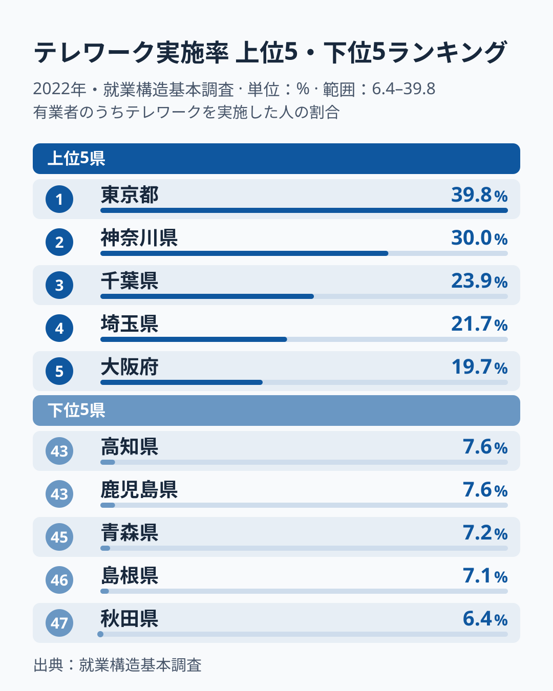
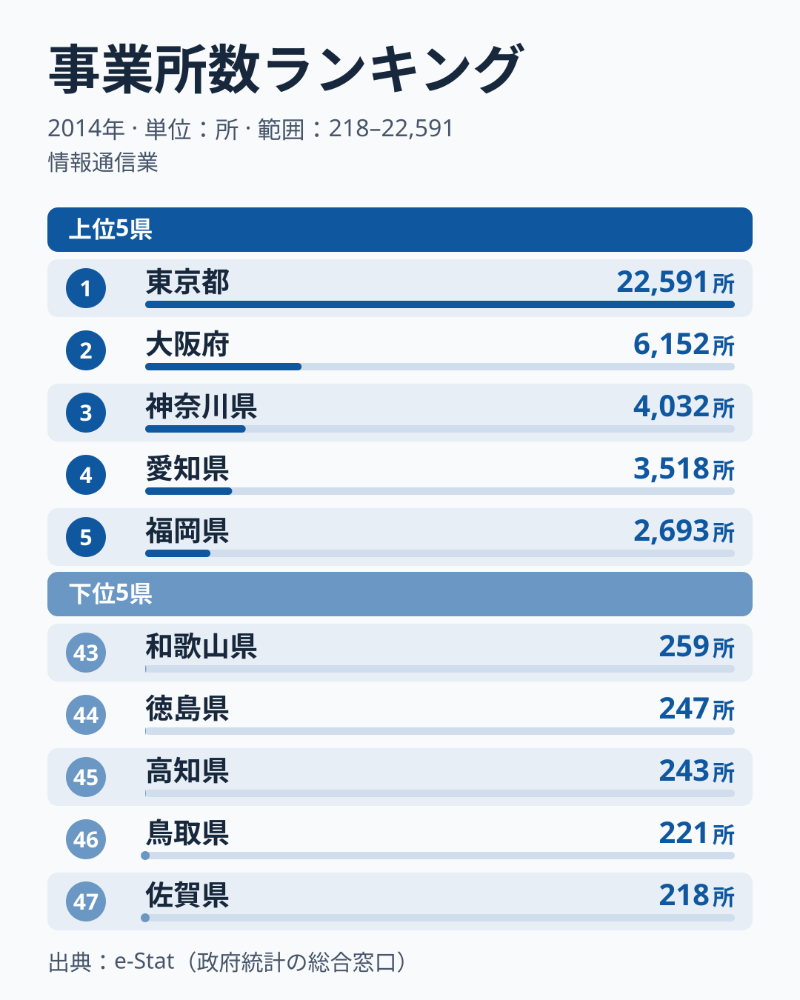
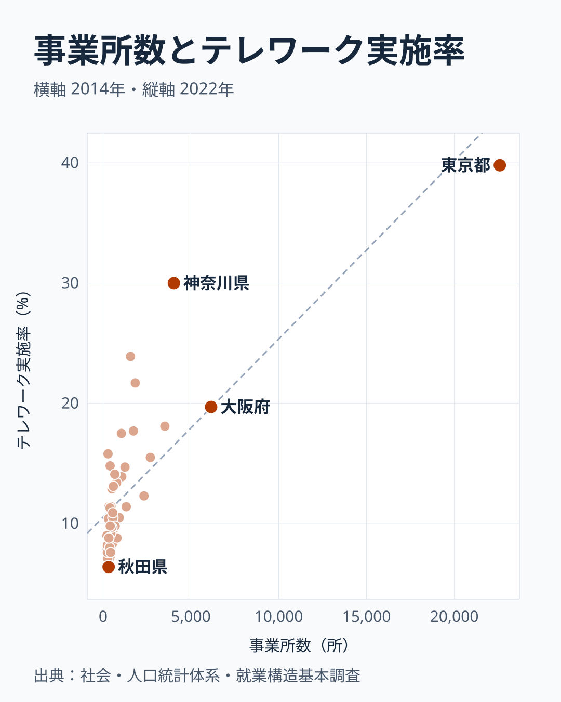
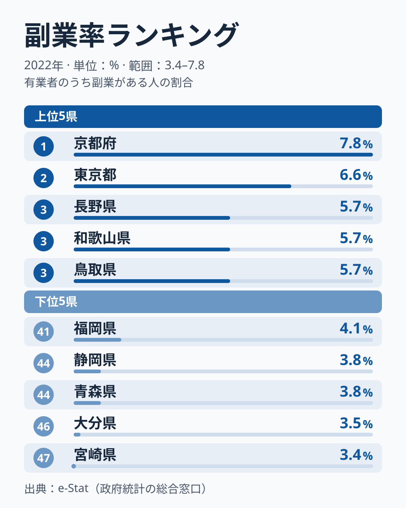

「在宅で働くのが当たり前になった」と感じている人と、「うちの地域にそんな働き方はない」と感じている人がいます。この感覚の差は、気のせいではなく、データにはっきり出ています。

2022年の就業構造基本調査によると、テレワークを実施した人の割合は、**東京都で39.8%**でした。働く人のおよそ4割がテレワークを経験しています。一方、最も低い**秋田県は6.4%**にとどまります。その差は**約6.2倍**で、同じ国の同じ時期の調査とは思えないほど開いています。

この記事では、6倍の差がどんな地図と重なるのかを、情報通信業の事業所数と並べて確かめます。重なりは強い一方で例外もあり、重なりを「原因」と言い切れない理由もあわせて示します。最後に、同じ調査の副業率・転職率と地域差の大きさを比べます。

> [!NOTE]
> ここでいうテレワーク実施率は、有業者のうち2022年にテレワーク (在宅勤務・モバイルワーク等) を実施した人の割合です。総務省「就業構造基本調査」(2022年) に基づきます。コロナ禍を経た直後の調査で、その後の出社回帰の動きは反映していません。

## テレワーク率ランキング：上位は首都圏、下位は7%前後の県が並ぶ

上位の顔ぶれは予想どおりで、**東京39.8%・神奈川30.0%・千葉23.9%・埼玉21.7%**と、首都圏4都県が一気に並びます。5位は**大阪19.7%**、6位**愛知18.1%**と三大都市圏が続きます。

注目したいのは上位のなかの落差です。1位の東京都と2位の神奈川県だけで約10ポイント離れ、3位の千葉県は23.9%、5位の大阪府は19.7%まで下がります。**大都市圏のなかでも東京都だけが突出している**形です。

一方、下位は東北・山陰・四国・九州南部に散らばっています。最下位の**秋田6.4%**を筆頭に、**島根7.1%・青森7.2%・鹿児島7.6%・高知7.6%**と、7%前後の県が固まっています。最下位の秋田県は、東京都の6分の1に届きません。

10%を下回る県は20県あり、47都道府県の4割を超えます。これらの県では、テレワークをした人は働く人の10人に1人にも届いていません。

<source-link href="/ranking/telework-rate">テレワーク実施率の47都道府県ランキングをもっと見る</source-link>

## 情報通信業の事業所数と重ねる：相関は0.84、ただし例外もある

テレワークしやすい業種の代表は情報通信業です。この業種がどこにあるかを、経済センサスの情報通信業の事業所数 (2014年) で見ます。**東京都は22,591所で全国1位**、2位の**大阪府6,152所**、3位の**神奈川県4,032所**を大きく引き離しています。

下位県では事業所そのものが少なくなります。テレワーク最下位の秋田県は情報通信業の事業所が316所で39位、テレワーク46位の島根県は264所で42位です。事業所数の最下位は**[佐賀県](/areas/41000)の218所**で、東京都とは100倍を超える開きがあります。

<source-link href="/ranking/number-of-establishments-information-communication">情報通信業の事業所数ランキングを見る</source-link>

47都道府県を1枚の散布図にすると、重なりの強さと例外の両方が見えます。横軸に情報通信業の事業所数 (対数目盛)、縦軸にテレワーク実施率をとると、事業所数が多い県ほどテレワーク率も高い、正の相関です。相関係数は対数にした事業所数で**約0.84**、生の事業所数でも約0.79です。

右上に1点だけ離れているのが東京都です。外れ値の東京都を除いても相関係数は約0.77で、東京都1点だけが作った重なりではありません。

ただし、重ならない県もあります。奈良県は情報通信業の事業所が281所で41位なのに、テレワーク率は15.8%で9位です。滋賀県も事業所は401所で32位、テレワーク率は14.8%で11位です。千葉県はテレワーク3位ですが、事業所数は9位です。奈良県・千葉県・滋賀県は、他県で働く・通学する人の割合 (流出人口比率、2020年) が奈良県12.98%、千葉県12.7%、滋賀県6.15%で、全国で2番目・3番目・6番目に高い県です。[仮説] 住んでいる県ではなく、他県にある勤め先がテレワークをしている可能性があります。就業構造基本調査は住んでいる県で数えるため、事業所の所在地とずれが出ます。

> [!WARNING]
> 情報通信業の事業所数とテレワーク率の重なりは相関で、因果の証明ではありません。事業所数は2014年、テレワーク率は2022年と8年離れています。事業所数は人口で割っていない件数で、人口の多い県ほど大きくなります。さらに奈良県・滋賀県のように、県境を越えた通勤で数え方がずれる県があります。「情報通信業が多いからテレワークが多い」とまでは、このデータでは言えません。

[仮説] それでも、事業所の地図とテレワーク率の地図がこれだけ重なることは、「テレワークをする人がどれだけいるか」が個人の希望より、地域にある仕事の種類と結びついている可能性を示します。確かめるには、職種別・産業別の就業者の構成と突き合わせる必要があります。

## 「テレワーク先進県は副業も盛ん」は本当か

「在宅で柔軟に働ける県では、副業に取り組む人も多いのではないか」という見方もあります。同じ調査の副業実施率と並べると、両者の結びつきは弱いものでした。

副業実施率の1位は、テレワーク率では8位の**京都府で7.8%**です。テレワーク1位の**東京都は副業では2位の6.6%**です。一方で、テレワーク46位の**島根県は副業率では5.6%で6位**と上位に入っています。

副業率の上位5県には、京都・東京と並んで**長野・和歌山・鳥取**が入ります。いずれもテレワーク率では中位以下の県です。下位5県は**宮崎・大分・青森・静岡・福岡**で、このうち青森県はテレワーク率でも7.2%で45位と下位にあり、大分県もテレワーク39位と下位寄りです。上位は顔ぶれが大きくずれ、下位は一部が重なる、という関係です。

47都道府県でテレワーク率と副業率の相関係数を計算すると約0.37で、テレワーク率が高い県ほど副業率もやや高い、弱い正の相関です。東京都を除くと約0.18まで下がります。テレワーク率と副業率は、まったく無関係ではないものの、同じ地図とは言えません。

> [!WARNING]
> テレワーク最下位の秋田県は副業率でも4.2%で39位と低い一方、テレワーク下位の島根県は副業率が上位です。両者を「柔軟な働き方」として束ねると、県ごとの実態を見誤ります。[仮説] 副業率の高さは、農業・自営業など兼業しやすい働き方の多さを映している可能性があります。検証には産業別の就業者構成との突き合わせが必要で、この記事のデータだけでは断定できません。

副業率の最下位は**宮崎県の3.4%**で、テレワーク率は8.8%で34位と、こちらも下位寄りです。

<source-link href="/ranking/side-job-rate">副業実施率の都道府県ランキングを見る</source-link>

## 地域差の大きさを比べる：テレワーク6.2倍、副業2.3倍、転職1.6倍

同じ2022年の就業構造基本調査から、テレワーク・副業・転職の3つの指標を、1位と最下位の比で並べます。

- テレワーク実施率は、1位の東京都が39.8%、最下位の秋田県が6.4%で、約6.2倍
- 副業率は、1位の京都府が7.8%、最下位の宮崎県が3.4%で、約2.3倍
- 転職率は、1位の東京都と福岡県が5.4%、最下位の和歌山県と愛媛県が3.3%で、約1.6倍

3つのうち、県による違いが最も大きいのはテレワークです。ただし1位と最下位の比は両端の2県で決まり、テレワークは東京都が突出しているぶん大きく出ます。東京都を除いて1位の神奈川県の30.0%で比べても約4.7倍あり、副業や転職より地域差が大きいことは変わりません。

転職率の1位に東京都と並んで福岡県が入っている点も目を引きます。福岡県のテレワーク実施率は15.5%で10位、副業率は4.1%で43位と、3つの指標で順位がそろいません。3つを「柔軟な働き方」としてひとくくりにせず、指標ごとに地域差の大きさと顔ぶれを確かめる必要があります。

あわせて見る: [転職率ランキング](/ranking/job-change-rate) / [流出人口比率ランキング](/ranking/outflow-population-ratio) / [労働・賃金カテゴリのランキング](/category/laborwage)

## まとめ

- **テレワーク実施率は東京都が39.8%で最も高く、秋田県が6.4%で最も低い**結果でした。その差は約6.2倍です (2022年・就業構造基本調査)。
- 上位は東京・神奈川・千葉・埼玉の**首都圏4都県が独占**し、なかでも東京都だけが突出しています。10%未満の県は20県あります。
- テレワーク率は情報通信業の事業所数 (2014年) と強く重なり、相関係数は対数で約0.84、東京都を除いても約0.77でした。ただし奈良県・滋賀県のように事業所が少なくてもテレワーク率が高い県があり、重なりは相関で因果ではありません。
- 副業率との相関は約0.37と弱く、副業率1位は京都府、テレワーク下位の島根県が副業率6位に入ります。
- 1位と最下位の比はテレワークが約6.2倍、副業が約2.3倍、転職が約1.6倍で、県による違いが最も大きいのはテレワークです。
