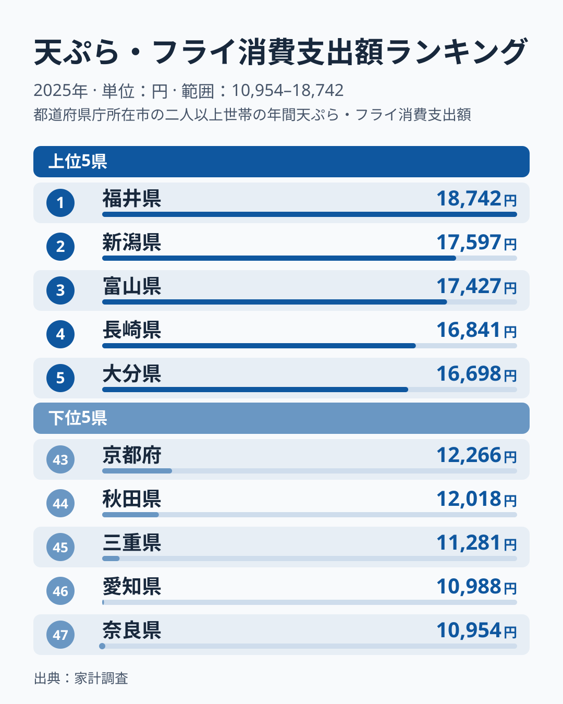
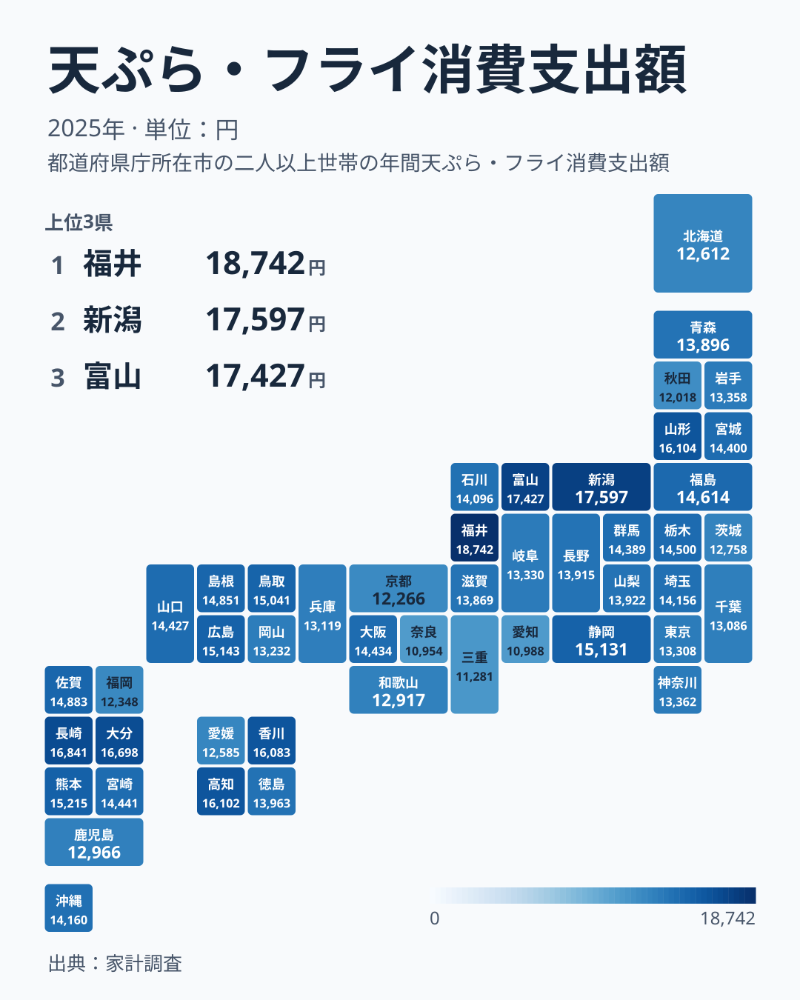

スーパーの惣菜コーナーに並ぶ天ぷらやフライは、忙しい日の食卓を助けてくれる定番の中食です。総務省の家計調査では、都道府県庁所在市に住む世帯がこの「天ぷら・フライ」にいくら支出しているかを毎年調べています。2025年のデータを見ると、同じ商品分類でありながら、支出額には想像以上の開きがあることが分かります。

もっとも支出額が多いのは福井県で、18,742円です。もっとも少ないのは奈良県で、10,954円にとどまります。18,742円を10,954円で割ると、およそ1.71になります。つまり福井県は奈良県のおよそ1.71倍を天ぷら・フライに使っている計算です。この記事では、上位と下位にどのような県が並ぶのか、地理的にどのような分布を描くのか、そして地域差の背景に何があるのかを、実際のランキング図と地図から確認していきます。

> [!NOTE]
> この支出額は、総務省の家計調査に基づく都道府県庁所在市に住む二人以上の世帯の平均額です。県内全域の平均ではなく、都道府県庁所在市という一部の地域の家計だけを反映した数値です。調査対象の世帯数も限られるため、年によって順位が入れ替わることがあります。この点にご注意ください。

## 天ぷら・フライ支出額が高い県、低い県

<source-link href="/ranking/tempura-fry-consumption-expenditure">天ぷら・フライ消費支出額ランキングをもっと見る</source-link>

上位を見ると、1位の福井県18,742円に続き、2位は新潟県で17,597円、3位は富山県で17,427円です。4位は長崎県で16,841円、5位は大分県で16,698円と続きます。上位3県は日本海側の福井県・新潟県・富山県が占め、4位と5位には九州の2県が入っています。6位の山形県は16,104円、8位の香川県は16,083円で、その間は21円の差に収まり、東北・四国の県が接戦で続きます。

下位を見ると、47位の奈良県10,954円のひとつ上、46位は愛知県で10,988円です。奈良県と愛知県の差はわずか34円で、ほぼ並んでいます。45位は三重県で11,281円、44位は秋田県で12,018円、43位は京都府で12,266円という順になっています。下位5県のうち、奈良県だけが海に面していない内陸県で、残りの4県はいずれも海に面した県です。海の近さだけでは支出額の高低を単純に説明できないことが、この時点ですでに見えてきます。

[新潟県のデータ](/areas/15000)を見ると、この統計以外にも地域の特徴を確認できます。同じように[福井県のデータ](/areas/18000)も、他の指標とあわせて調べることができます。

## 地図で見る地域差

地図に色を塗って見ると、支出額が多い県は福井県、新潟県、富山県と日本海側に並ぶ一方で、長崎県や大分県といった九州の県、山形県、高知県、香川県も上位8位以内に入っており、特定の一地域だけに偏った分布ではありません。9位は熊本県で15,215円、10位は広島県で15,143円です。同じ北陸でも石川県は24位で14,096円と中位にとどまります。

一方で支出額が少ない県は、47位の奈良県、46位の愛知県、45位の三重県、44位の秋田県、43位の京都府の5県です。近畿のなかでも大阪府は18位で14,434円と中位にあり、同じ地方の中で順位が大きく割れています。東北でも山形県が6位、秋田県が44位と両極に分かれています。とくに秋田県は日本海に面した県でありながら44位、福岡県も42位で12,348円と下位に位置しており、「日本海側だから支出額が多い」という単純な図式だけでは、この分布の全体を説明しきれないことが分かります。

> [!WARNING]
> 「天ぷら・フライ」という分類には、魚介類を使ったものから、鶏肉や野菜を使ったものまで幅広い種類の揚げ物が含まれています。同じ支出額であっても、中身の内訳は都道府県ごとに異なっている可能性があり、この統計だけでは「魚の天ぷらが多いか」「肉のフライが多いか」までは判別できません。

## なぜ地域差が生まれるのか

[仮説] 新潟県、福井県、富山県はいずれも日本海に面しており、甘えびやホタルイカ、白えびなど新鮮な魚介類が手に入りやすい地域として知られています。新鮮な魚介類が入手しやすい環境が、天ぷらなど揚げ物を家庭やスーパーの惣菜として買う習慣を支えている可能性があります。ただし、同じ日本海側にある秋田県は44位、福岡県は42位と下位にあるため、海に近いことだけが理由ではなさそうです。

[仮説] 5位の大分県には、鶏肉を天ぷらのように揚げる「とり天」という郷土料理があり、地元で親しまれてきた食文化として知られています。天ぷら・フライという分類には魚介類だけでなく鶏肉を使った揚げ物も含まれるため、こうした郷土の食文化が支出額を押し上げている可能性があります。この点は、とり天そのものの購入額を切り分けたデータがないため、あくまで仮説にとどまります。

47位の奈良県は、滋賀県と並んで近畿地方で海に面していない内陸県です。ただし内陸県の滋賀県は29位で13,869円と中位にあり、内陸であることだけでは順位を説明できません。新鮮な魚介類を使った天ぷらを日常的に買う習慣が、海に面した県と比べて根付きにくかった可能性があります。ただし、鶏肉や野菜を使った天ぷら・フライという選択肢もあるため、内陸であることだけが理由と断定することはできません。

## 惣菜・中食としての「天ぷら・フライ」

家計調査における「天ぷら・フライ」は、家庭で材料から手作りする揚げ物ではなく、スーパーや惣菜店で調理済みの状態で購入する中食に分類される品目です。共働き世帯の増加や、単身世帯・高齢世帯の増加によって、家庭で揚げ物を一から作るよりも、調理済みの天ぷらやフライを買って済ませる家庭が増えている地域ほど、この支出額が高くなっている可能性があります。

[仮説] この金額は世帯当たりの支出額のため、世帯の人数や構成も影響します。同じ金額を1人世帯が使う場合と、4人世帯が使う場合とでは、1人当たりの消費量はまったく異なります。世帯構成の違いを考慮せずに都道府県間の金額だけを比べると、実際の1人当たりの消費傾向とはずれた印象を持ってしまう可能性があります。

大分県のとり天のように、天ぷら・フライという広い分類のなかに、地域ごとの郷土料理や食文化が隠れていることも見逃せません。同じランキングの中でも、上位に来る理由は県によってまったく異なる可能性があり、1つの原因にまとめて説明することは難しいテーマだと言えます。

> [!TIP]
> この支出額は世帯単位の金額です。世帯の人数や年齢構成が異なる県同士を比べるときは、金額の大小だけでなく、[同じカテゴリの統計一覧](/category/economy)にある他の指標もあわせて確認すると、より立体的に地域差を読み解くことができます。

## まとめ

- 天ぷら・フライ消費支出額の1位は福井県で18,742円、47位は奈良県で10,954円です
- 1位の福井県は47位の奈良県のおよそ1.71倍の支出額です
- 上位5県は福井県、新潟県、富山県、長崎県、大分県で、日本海側の3県と九州の2県が並びます
- 下位5県のうち奈良県だけが内陸県で、愛知県、三重県、秋田県、京都府はいずれも海に面した県です
- 日本海側であることだけでは支出額の高低を説明できず、地元の食文化や世帯構成など複数の要因が関わっている可能性があります
