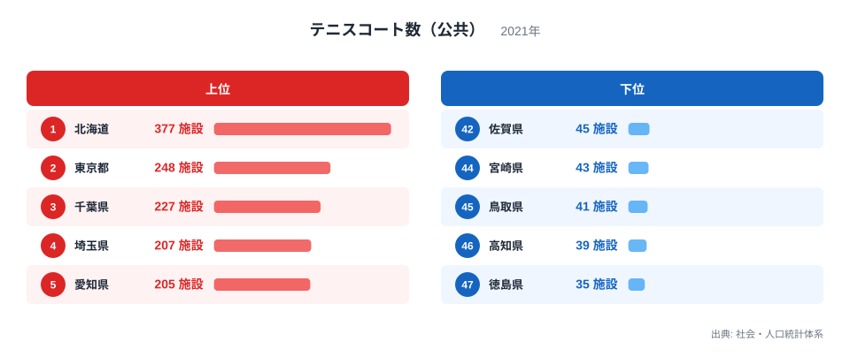
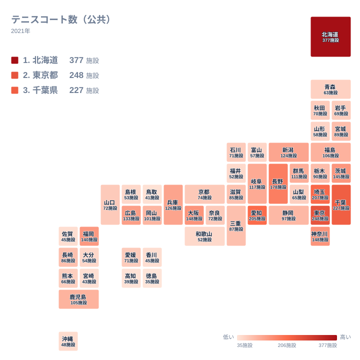

## 公共テニスコートの数は県でこれほど違います

公園や運動公園に併設された公共のテニスコートは、身近なスポーツ施設の一つです。ところが都道府県ごとに数を並べると、予想以上に大きな開きがあります。2021年のデータで最も多いのは北海道の377施設で、1位です。最も少ないのは徳島県の35施設で、47位です。同じ「公共のテニスコート」とは思えないほどの差です。

この記事では、上位と下位がなぜその順になるのかを、地理や産業、都市の成り立ちといった視点から考えます。ただし、手元にあるのは県別の施設数と順位だけです。面積や人口、気候の数値は含まれていません。そのため、原因は仮説として示し、データから確かめられることとは分けて書きます。

> [!NOTE]
> この指標は「公共」のテニスコートを、コートの面数ではなく「施設」の単位で数えた値です。運動公園の中に何面並んでいても、1か所なら1施設です。そのため、施設数の多い県が、実際に使える面数も多いとは限りません。小さな公園コートを数多く持つ県と、大規模なテニス公園を少数持つ県では、同じ施設数でも中身が違います。

<source-link href="/ranking/tennis-court-public">テニスコート数（公共）ランキングをもっと見る</source-link>

図の上位は、北海道の377施設、東京都の248施設、千葉県の227施設、埼玉県の207施設、愛知県の205施設です。下位は、佐賀県が45施設、宮崎県が44位で43施設、鳥取県が45位で41施設、高知県が46位で39施設、徳島県が47位で35施設です。

上位には、広い北海道と、大都市圏にあたる東京都・千葉県・埼玉県・愛知県が並びます。1位の北海道と2位の東京都の間には、377施設と248施設という大きな差があります。北海道だけが突出している点は、この指標の最大の特徴です。

下位に並ぶのは、九州・沖縄の佐賀県と宮崎県、中国の鳥取県、四国の高知県と徳島県です。地方はばらばらですが、いずれも上位の都市圏とは性格が違う県です。もっとも、この図だけでは、少ない理由が人口なのか、土地の条件なのか、整備の方針なのかは判別できません。

## 北海道と大都市圏が上位に入る背景

1位の北海道は377施設で、2位の東京都の248施設を大きく上回ります。理由の一つとして考えられるのは、広い道内に市町村が散らばり、それぞれが運動施設を持つ構造です。人口の少ない地域にも施設を分けて置くと、道全体の合計は大きくなります。ただし、道内の市町村ごとの内訳はこのデータにないので、あくまで仮説です。[北海道のデータ](/areas/01000)のページで、ほかの指標と合わせて確認できます。

2位の東京都は248施設です。土地に余裕のない都市部でも、これだけの数があります。人口の多さが背景にある可能性はありますが、利用者数のデータはないため、このデータだけでは確かめられません。[東京都のデータ](/areas/13000)と見比べると、都市の規模と施設数の関係を探るヒントになります。

3位の千葉県は227施設、4位の埼玉県は207施設、5位の愛知県は205施設です。関東の二県は東京都に隣接し、愛知県は中部の中心です。大都市圏の県が上位に多い傾向は読み取れます。しかし、それが施設数の理由だと言い切るには、人口の数値を重ねて調べる必要があります。ここでは、傾向があるという範囲にとどめます。

この傾向には例外もあります。神奈川県と大阪府は、どちらも148施設で7位です。大都市を抱える府県が、必ずしも上位の中心にいるわけではありません。人口の多さだけで順位を説明することはできないのです。

## 人口では説明しきれない中位の県

6位の長野県は178施設で、神奈川県や大阪府より上位です。9位の茨城県は145施設、10位の福岡県は140施設で、続く11位の広島県は133施設、12位の兵庫県は126施設です。13位の新潟県は124施設で、14位の岐阜県は117施設です。

長野県が大都市圏でないのに6位に入る理由は、このデータからは分かりません。気候や観光、合宿の利用などを理由に挙げる説明は思いつきますが、裏付ける数値がないので断定はできません。分かるのは、長野県の順位が、大都市圏の県が上位に並ぶという傾向に当てはまらない例だということだけです。

新潟県や岐阜県のように、中部の広い県が10位台前半に入っていることも目を引きます。県土の広さや市町村の数が影響している可能性はありますが、これも仮説です。人口以外の要因が働いていると考えるのが自然です。

下位寄りでは、沖縄県が41位で48施設です。島しょ県という条件が関わるかもしれませんが、この数字だけで原因を決めることはできません。

> [!WARNING]
> このデータは公共のテニスコートだけが対象です。民間のテニスクラブ、大学や企業の私有コート、リゾート施設のコートは含まれません。民間施設が多い県では、公共の数が少なくても実際のプレー環境が乏しいとは限りません。順位を県のテニス環境の優劣と読むのは避けてください。

## 地方内の開きが大きい地方と小さい地方

タイルマップで全国を眺めると、濃い色の県は北海道と関東に目立ち、四国や中国、九州南部には施設数の少ない県が見えます。ここで注目したいのは、地方ごとの水準よりも、同じ地方の中での開きです。

開きが最も大きいのは、北海道・東北です。北海道が377施設で1位なのに対し、山形県は58施設で35位です。北海道を除いても、福島県が106施設で16位、青森県が63施設で34位と、東北の県は中位から下位寄りに散らばります。北海道という突出した県が、地方全体の印象を引き上げていることが分かります。

対照的に、関東は開きが小さい地方です。東京都が248施設で2位、最小の栃木県でも90施設で20位です。7県すべてが20位以内に収まっており、都市圏が連なる地域では、施設数が一定の水準に集まっていると読めます。ただし、その理由が人口なのか土地利用なのかは、このデータでは区別できません。

中部は、愛知県が205施設で5位、長野県が178施設で6位に入る一方、福井県は52施設で39位です。同じ地方に上位と下位の県が同居しており、関東とは対照的です。四国は愛媛県でも71施設にとどまり、徳島県の35施設が47位です。上位に入る県がなく、地方全体が低い水準に寄っています。

こうして見ると、地方という単位で語れる地方と、県ごとの事情を見なければならない地方があります。順位を読むときは、地方の名前だけで判断しない方が実態に近づけます。

> [!TIP]
> 順位表では、値が同じ県は同じ順位になります。この指標でも、神奈川県と大阪府は148施設で7位、福井県と和歌山県は52施設で39位です。中位は数施設の違いで順位が変わるため、順位の上下より施設数の値そのものを見る方が、差の大きさを正しくつかめます。

## 数字から言えることと言えないこと

ここまでの内容を整理します。データから確かめられるのは、次のことです。

- 北海道の377施設が全国で突出して多く、徳島県の35施設が最も少ないことです。最大と最小の間には、377施設と35施設という開きがあります。
- 上位には東京都、千葉県、埼玉県、愛知県といった大都市圏の県が多いことです。
- 長野県が6位に入り、神奈川県と大阪府が7位にとどまるように、人口の多さだけでは説明できない県があることです。

これに対して、地理や歴史、気候が数を左右したという具体的な説明は、このデータだけでは裏付けられません。「なぜ北海道は多いのか」「なぜ四国は少ないのか」を確かめるには、面積、人口、市町村の数、施設の整備時期といった別の統計が要ります。

公共のスポーツ施設は、体育館やプール、運動場など、種類ごとに県の傾向が違います。[同じカテゴリの統計一覧](/category/educationsports)から他の施設の指標を探し、テニスコートの順位と重ねてみると、県ごとのスポーツ環境の特徴がより立体的に見えてきます。

## データについて

この記事で使ったのは、社会・人口統計体系の「テニスコート数（公共）」で、2021年の値です。単位は施設で、全47都道府県の値が公開されています。記事内の数値と順位は、すべてこの実データに基づいています。

値が同じ県は同じ順位として扱っています。値が近い県どうしは、順位が一つ違うだけでも実際の差は小さいことがあるため、僅差の順位は目安として扱うのが適切です。

この指標は施設の「数」であり、利用のしやすさ、コートの面数、予約の取りやすさ、設備の質は反映していません。県ごとのスポーツ環境を評価するときは、ここで見た数字を出発点として、ほかの統計や現地の情報もあわせて確認することをおすすめします。
