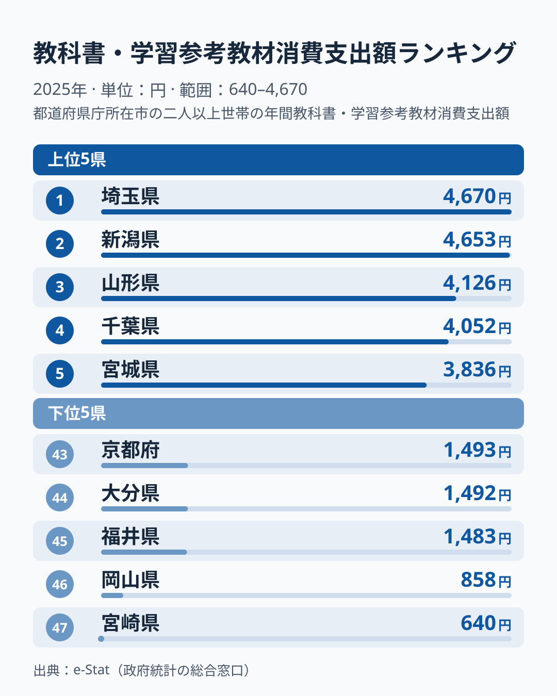
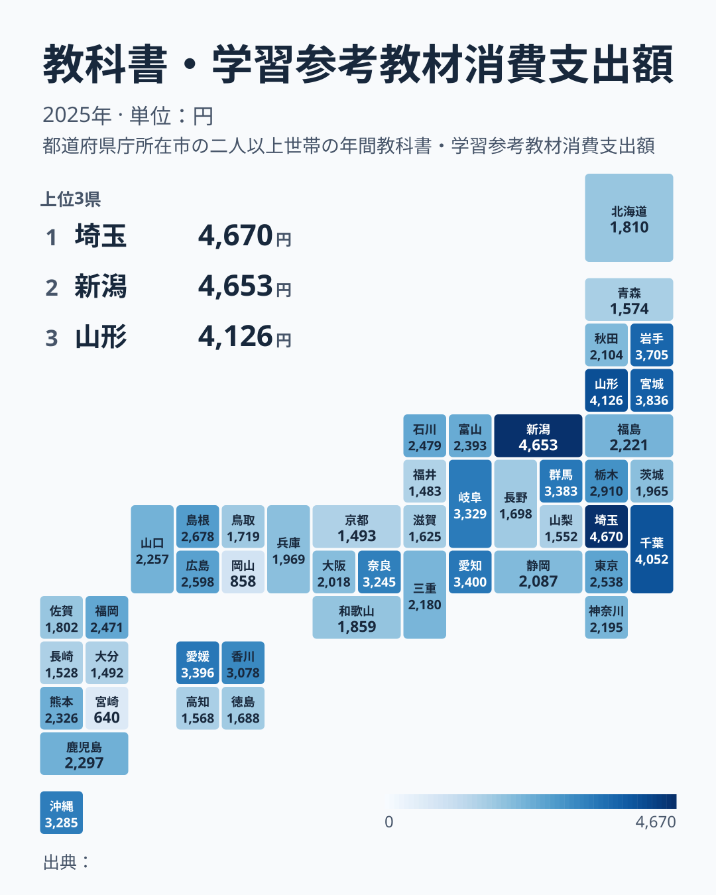

「教科書代が高い県といえば、私立中学受験が盛んな東京や大阪だろう」——そう思って統計を開くと、意外な結果が待っています。総務省の家計調査によると、2025年に教科書・学習参考教材費の1世帯あたり年間支出額が最も高かったのは埼玉県の4,670円で、新潟県4,653円、山形県4,126円が続きました。最下位は宮崎県の640円で、首位との差は7.3倍です。東京都は17位の2,538円にとどまり、大都市が上位を占めるわけではありません。

さらに注目したいのは、順位の動きです。2024年に1位だった鳥取県は2025年に35位の1,719円へ下がり、2位だった高知県も40位の1,568円になりました。この記事では、2025年のランキングを見ながら、鳥取・高知・岡山・宮崎など確認できた数県の動きを手がかりに、順位の入れ替わりを確かめます。ただし、入れ替わる理由はこの記事のデータだけでは検証できず、標本のぶれなどを [仮説] として挙げるにとどまります。

> [!NOTE]
> 家計調査の「教科書・学習参考教材費」は、学校で使用する教科書代に加えて、家庭で購入する参考書・問題集・ドリルなどの学習教材費を合算した費目です。学習塾の月謝や家庭教師費用（「補習教育費」という別費目）は含まれません。

## 上位と下位

<source-link href="/ranking/textbook-consumption-expenditure">教科書・学習参考教材費ランキングをもっと見る</source-link>

上位5県の顔ぶれは、関東の[埼玉県](/areas/11000)・千葉県、東北の山形県・宮城県、中部の新潟県が混在しており、「都市部が高い」「地方が高い」のどちらか一方では説明がつきません。1位の埼玉県と2位の新潟県の差は17円しかなく、首位争いは僅差です。わずかな差で順位が決まるため、1位という肩書きに大きな意味を持たせるべきではありません。

前年の順位との関係は、確認できた範囲では弱いようです。2024年の1位だった鳥取県と2位の高知県は、2025年にはそれぞれ35位、40位と中位から下位寄りの順位になりました。この記事では2025年の埼玉県・新潟県について前年の順位を確認していないため、上位の入れ替わりが全体でどの程度かは判断できません。少なくともこの2県については、前年の順位が翌年の順位を予告していません。

家計調査は、国全体の家計を推計するための標本調査です。都道府県別の値は、県庁所在市に住む二人以上の世帯の平均で、1市あたりの調査世帯数には限りがあります。教科書や参考書は購入頻度が低く、進級・進学の時期に支出が集中しやすい費目です。[仮説] 調査世帯の中に買い替えの年を迎えた世帯が何世帯含まれるかで、市の平均が大きく動くと考えられます。この仮説は、市別の調査世帯数と年ごとの購入世帯数を突き合わせて検証する必要があります。

## 最下位グループ

最下位の宮崎県は640円で、1位埼玉県の4,670円と7.3倍の差があります。下位の境目に注目すると、43位の京都府1,493円、44位の大分県1,492円、45位の福井県1,483円は10円の範囲に集中しています。一方、45位の福井県1,483円と46位の岡山県858円の間は600円を超えて開いています。岡山県と宮崎県は、このまとまりから大きく離れた値です。

> [!WARNING]
> この表の値は県全体ではなく、県庁所在市の二人以上の世帯の標本平均です。また、教科書や教材は購入が特定の年や時期に集中する費目のため、調査対象の世帯がたまたま購入の年に当たったかどうかで値が変わります。単年の順位だけで、その県の教育への姿勢や教育の質を判断することはできません。

最下位の顔ぶれも、年によって動いています。岡山県は2021年に1位でしたが、2022年に45位まで下がり、2025年は46位の858円です。宮崎県も2023年に47位、2024年に39位、2025年に47位の640円と、下位と中位の間を行き来しています。上位と下位が同じ県の間で何度も入れ替わっている点から、[仮説] として、これが地域の恒常的な特徴ではなく、年ごとのぶれを大きく含む値である可能性があります。ただし、標本誤差なのか実際の年ごとの変化なのかは、この記事のデータでは区別できません。

## 発見: 東京・神奈川・大阪は中位以下、大都市圏の県が一様に上位とはいえない

地図で見ると、濃い色は埼玉県・千葉県・新潟県・山形県・宮城県に分かれて現れ、まとまった地域のかたまりをつくっていません。東京都は17位の2,538円、神奈川県は25位、大阪府は29位で、いずれも1位埼玉県の4,670円を大きく下回ります。一方で、愛知県は7位の3,400円と上位に入ります。大都市圏に近い県の中でも位置はまちまちで、大都市圏の県が一様に上位に集まる傾向は読み取れません。

私立中学受験率が高い東京都・神奈川県が上位に来ないのは、受験対策として支出が大きい「学習塾費」「家庭教師費」が別費目に計上されることが一因かもしれません。ただし、ほかの要因を排除できているわけではありません。教科書・学習参考教材費は学校の授業に紐づく購入が中心で、受験競争の激しさがそのまま表れる費目ではありません。[仮説] 公立学校での副教材の指定慣行や、自治体による教材補助の有無が、この費目の水準に影響している可能性があります。ただし、2025年の1年分の順位だけでは、この仮説を支持も否定もできません。複数年の平均を取った上で、自治体別の制度と突き合わせる必要があります。

> [!TIP]
> 教育費全体の地域差を知りたい場合は、この教科書・教材費だけでなく「補習教育費」（学習塾・家庭教師）や「教育費」全体のランキングと合わせて見ると、都市部の教育支出の実態がより立体的に見えてきます。関連する指標は[教育・スポーツカテゴリ](/category/educationsports)からまとめて確認できます。

## まとめ

- 2025年の1位は埼玉県4,670円、2位は新潟県4,653円で、差は17円の僅差
- 最下位は宮崎県640円で、1位との差は7.3倍
- 2024年に1位だった鳥取県は35位、2位だった高知県は40位と、確認できたこの2県では順位が大きく動いた
- 43〜45位は10円の範囲に集中し、45位と46位の間は600円超開いている
- 東京都17位・神奈川県25位・大阪府29位と中位以下で、愛知県は7位に入る
- 単年の順位は標本のぶれを含む可能性があるため、県の恒常的な特徴と読まず、複数年で確かめる必要がある

## データについて

総務省統計局「家計調査」（e-Stat経由で集計）。2025年の都道府県庁所在市の二人以上世帯における、1世帯あたり年間支出額（教科書・学習参考教材費）を集計しています。過去年の順位は同じ指標の2021〜2024年の値を参照しました。
