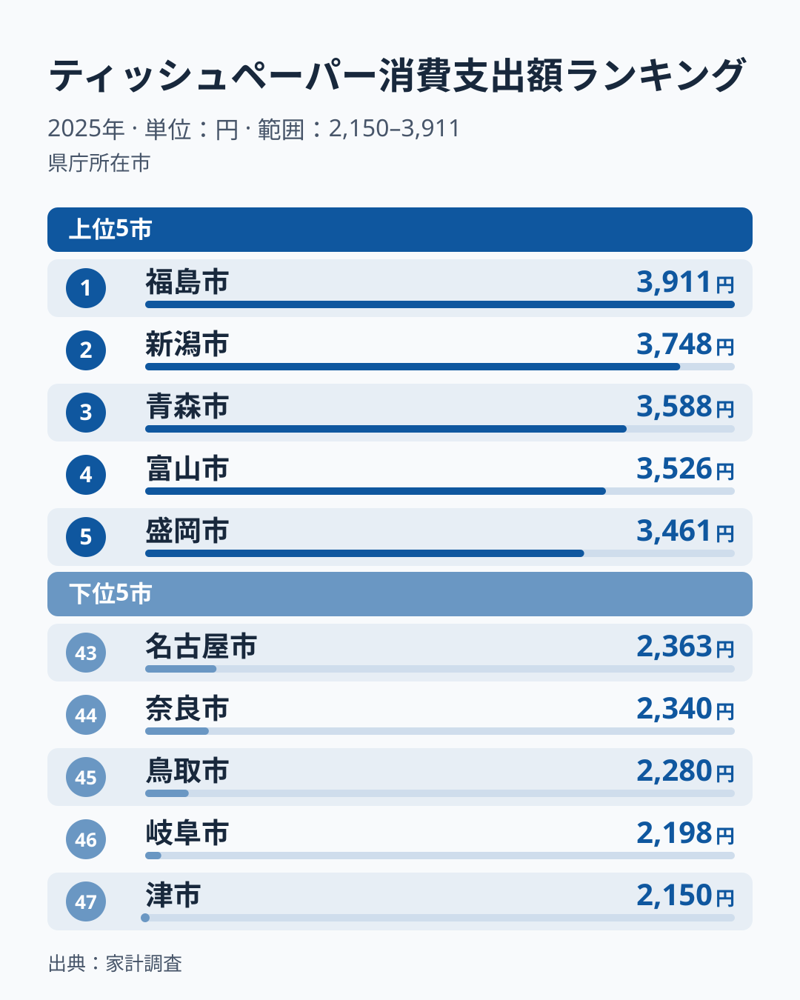
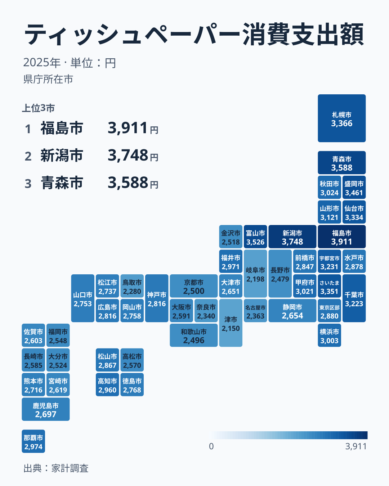

ティッシュペーパーは、どの家庭でも当たり前のように使う日用品です。それだけに地域差など無いように思えますが、総務省の家計調査から都道府県庁所在市の年間消費支出額を見ると、2025年は最も多い県と少ない県で1.8倍の開きがありました。しかも上位に並ぶ顔ぶれには、毎年のように同じ地域の偏りが見られます。

この記事では、2025年の家計調査をもとにした都道府県別のティッシュペーパー消費支出額から、上位と下位の顔ぶれと地理的な広がりを確かめ、2007年からの19年分で偏りが続いているかを見ていきます。ティッシュペーパー消費支出額を子どもの平均体重との関係から読み解く記事は別に用意しているため、本記事ではその関係には立ち入りません。

> [!NOTE]
> このデータは総務省の家計調査による都道府県庁所在市の二人以上の世帯を対象にした年間消費支出額です。本文の県名は、その県の県庁所在市の値を指します。都道府県全体の平均ではなく、単身世帯の消費は含まれていません。

## 上位5県と下位5県、1.8倍の開き

<source-link href="/ranking/tissue-paper-consumption-expenditure">ティッシュペーパー消費支出額ランキングをもっと見る</source-link>

2025年のティッシュペーパー消費支出額は、福島県が年間3,911円で1位でした。2位は新潟県の3,748円、3位は青森県の3,588円、4位は富山県の3,526円、5位は岩手県の3,461円と続きます。上位5県のうち3県が東北の県で、残る2県も新潟県と富山県という日本海側の県です。

下位は、三重県が2,150円で47位、岐阜県が2,198円で46位、鳥取県が2,280円で45位、奈良県が2,340円で44位、愛知県が2,363円で43位でした。1位の福島県と47位の三重県の差は1.82倍で、2024年の2.10倍からは縮まっています。2024年に1位だった青森県は3位、47位だった兵庫県は22位で、1年で順位が大きく動いた県もあります。

それでも上位の顔ぶれには偏りがあります。2025年は東北6県がすべて12位以内に入りました。福島県が1位、青森県が3位、岩手県が5位、宮城県が8位、山形県が11位、秋田県が12位です。

## 地理的な広がりを見る

地図で全体を見渡すと、東北の各県と、隣り合う新潟県・富山県で支出額が高く、東海から近畿にかけての一帯で低いという、面としての傾向が見えてきます。北海道も3,366円で6位に入っています。ただし北陸でも石川県は2,518円で39位と47市の平均を下回り、上位10位には埼玉県・栃木県・千葉県といった関東の県も入っています。

この偏りは2025年だけのものではありません。東北6県の値を単純平均して47市の単純平均と比べると、2007年から2025年までの19年間、毎年1.17倍から1.36倍の間で平均を上回っていました。最も大きかったのは2009年の1.36倍、最も小さかったのは2013年の1.17倍で、2025年は1.19倍です。反対に近畿の2府4県（滋賀・京都・大阪・兵庫・奈良・和歌山）の平均は、19年間毎年0.83倍から0.96倍の間で、平均を下回り続けています。青森県は19年のうち9回、最も多い県になりました。

ただし例外もあります。15位の沖縄県は2,974円で、温暖な地域でありながら47市の平均の2,851円を上回っています。17位の高知県も2,960円です。寒い地域ほど支出が多い、という単純な形だけでは説明しきれません。

> [!WARNING]
> ティッシュペーパーの支出額は年ごとに順位が動きます。2024年に47位だった兵庫県が2025年に22位になったように、単年の順位を県の恒常的な特徴と読むのは避け、東北6県の平均のように複数年で同じ傾向が続くかを確かめてください。

## 東北の高さをどう読むか

東北の高さの理由は、この記事のデータでは確かめられません。そのうえで考えられる読み筋を挙げます。[仮説] 寒い季節に暖房で室内が乾燥すると鼻や喉の粘膜が刺激を受けやすく、ティッシュペーパーを使う機会が増えるのかもしれません。風邪をひきやすい季節が長いことも、使う量を押し上げている可能性があります。

ただし、この仮説だけでは説明できない県があります。冬の寒さが厳しい長野県は、2025年は42位でした。2024年も45位です。寒さだけでは支出額が決まらず、気候以外の要因も働いている可能性があります。

[仮説] もう一つ考えられるのは世帯の人数です。家計調査は二人以上の世帯の平均なので、1世帯あたりの人数が多い地域ほど、家族で使うティッシュペーパーの量も多くなるかもしれません。ただし、この記事のデータからは世帯人数との関係は確かめられません。家計調査の金額には、どの価格帯の製品を買っているかも混ざっています。

> [!TIP]
> 同じ紙製品でも、トイレットペーパーやキッチンペーパーの支出と並べると、ティッシュ特有の差なのか、紙製品全体をまとめ買いする習慣の差なのかを切り分ける手がかりになります。

## 他の紙製品の支出額とあわせて読む

ティッシュペーパーは単価が安く購入頻度が高い日用品で、地域差が出にくいと考えられがちです。それでも東北6県が19年続けて平均を上回っているように、地域の偏りは統計にはっきり表れます。家計調査には他にも数多くの日用品の支出額データが収録されており、[同じカテゴリの統計一覧](/category/economy)から関連する品目のランキングをたどると、地域ごとの生活パターンの違いがより見えやすくなります。ティッシュペーパー消費支出額と子どもの体重の地域分布を並べた[ティッシュペーパー消費支出額と平均体重の関係を探る記事](/blog/tissue-paper-consumption-expenditure-vs-average-weight)もあわせてご覧ください。

2025年に1位だった[福島県のデータ](/areas/07000)や、19年で9回1位になった[青森県のデータ](/areas/02000)を個別に見ると、人口構成や気候など他の指標との関係も確かめられます。

## まとめ

- 2025年の1位は福島県で、年間3,911円をティッシュペーパーに支出しています
- 47位は三重県で2,150円、46位の岐阜県、45位の鳥取県と続きました
- 1位と47位の差は1.82倍で、2024年の2.10倍から縮まりました
- 東北6県の平均は、2007年から2025年まで19年続けて47市の平均を1.17〜1.36倍の幅で上回っています
- 近畿の2府4県の平均は、19年続けて47市の平均を下回っています
- 理由は確かめられておらず、寒さや乾燥との関係は仮説の段階です。長野県のように寒冷地でも少ない県があります
