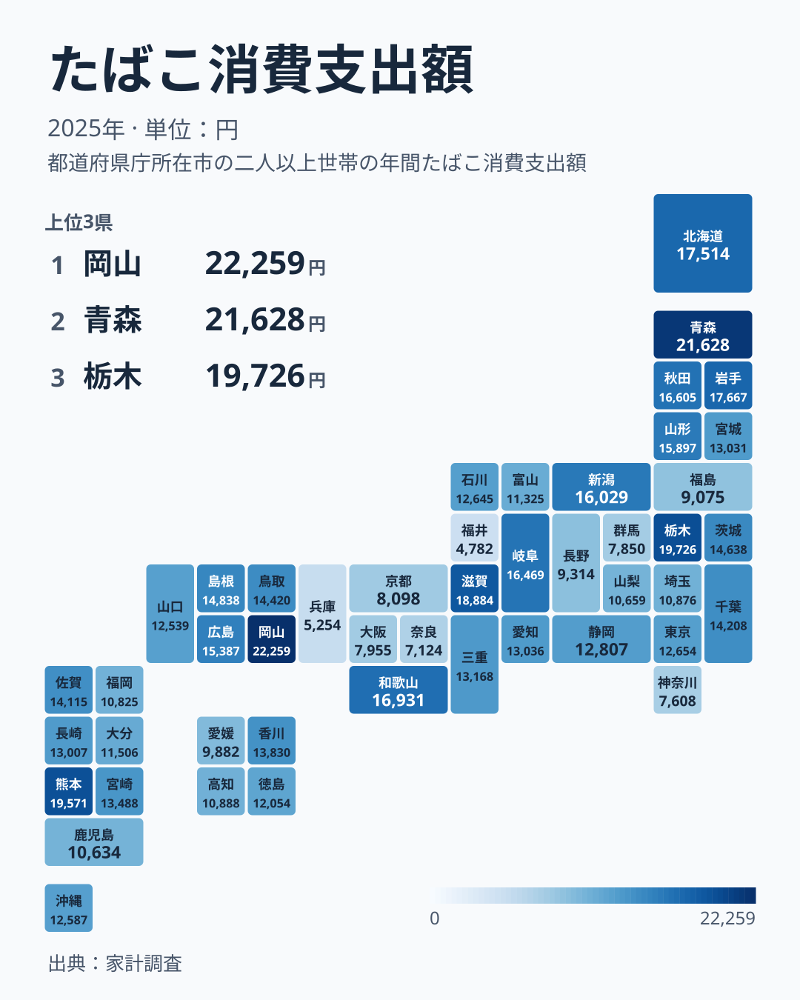
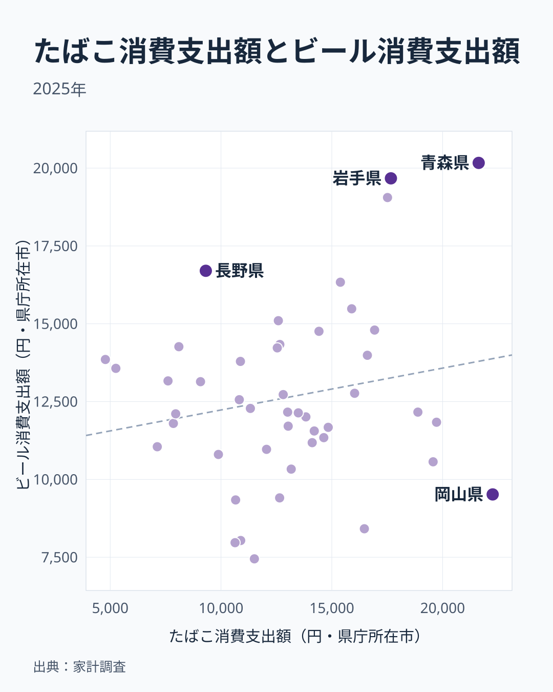
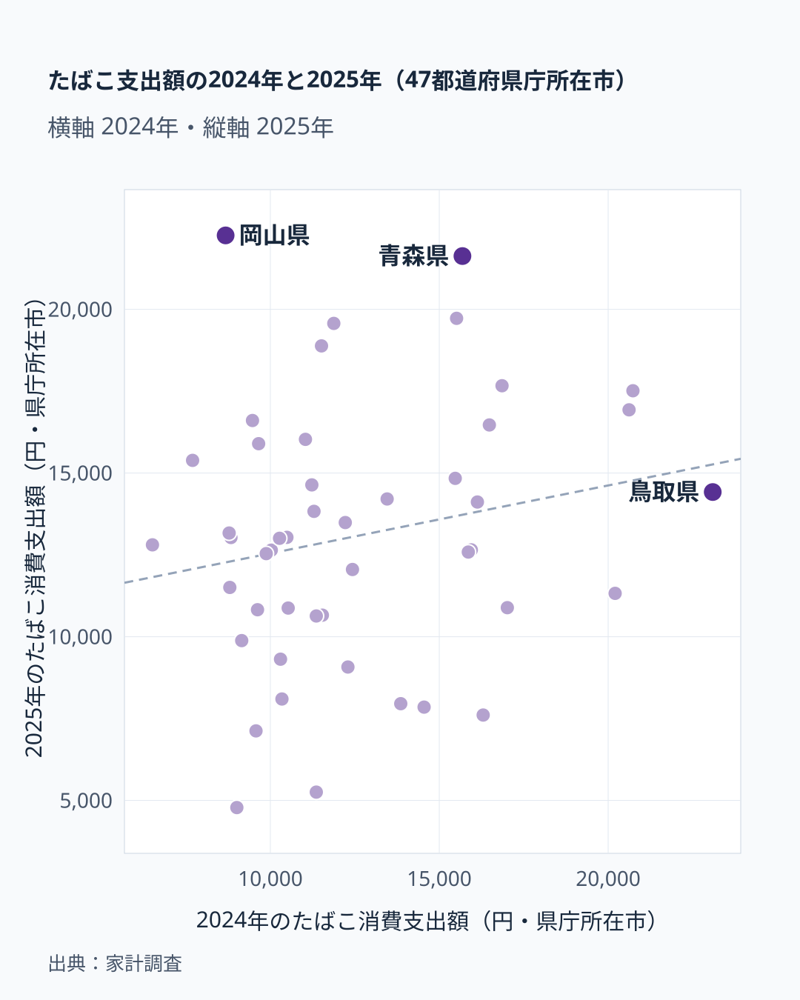

「たばこは全国どこでも同じように吸われている」——そう思っている方は多いかもしれません。しかし総務省の家計調査(都道府県庁所在市・二人以上世帯)を見ると、2025年のたばこ消費支出額は1位岡山県22,259円、最下位福井県4,782円と、4.7倍ほどの開きがあります。

たばこの価格は全国どこでもほぼ同じです。それでも支出額にここまで差が出るのはなぜでしょうか。先に結論を書くと、この差の大部分は「その県の喫煙文化」では説明できません。2024年と2025年の47都市の値を並べて相関係数を取ると0.20にしかならず、1年で順位が大きく入れ替わるからです。ビールの支出額との相関も0.19で、「嗜好品にお金を使う県」という共通の傾向も見えません。以下、図で順に確かめます。

> [!NOTE]
> 本データは総務省「家計調査」(都道府県庁所在市・政令指定都市、二人以上世帯)の1世帯あたり年間支出額で、県全体の値ではありません。調査の対象世帯は限られるため、単年の順位は標本の影響でぶれやすい点に注意してください。

## 上位と下位の顔ぶれ

<source-link href="/ranking/tobacco-consumption-expenditure">たばこ消費支出額ランキングをもっと見る</source-link>

上位は1位[岡山県](/areas/33000)22,259円、2位青森県21,628円、3位栃木県19,726円、4位熊本県19,571円、5位滋賀県18,884円です。1位と2位の差は631円しかなく、ほぼ並んでいます。図にない比較として、47都市の中央値(24位の長崎県)は13,007円です。1位岡山はその約1.7倍、上位5県の平均20,414円は約1.6倍にあたります。

一方、下位は47位[福井県](/areas/18000)4,782円、46位兵庫県5,254円、45位奈良県7,124円、44位神奈川県7,608円、43位群馬県7,850円です。下位5県の平均は6,524円で、中央値のちょうど半分ほどです。福井は中央値の約37%にとどまります。上位5県の平均と下位5県の平均を比べると約3.1倍で、1位と最下位の4.7倍より差は小さくなります。端の1県だけが極端なのではなく、中央値から見て上にも下にも広がっている分布です。

下位のなかでも、45位の奈良と46位の兵庫の間には1,870円の断絶があります。福井と45位の差は2,342円ですから、福井と兵庫の2県は下位5県のなかでも特に低い位置にいます。

> [!WARNING]
> 支出額は「購入本数×単価」の結果です。価格が全国でほぼ同じでも、1日の本数や銘柄の構成が違えば、喫煙者の数が同じでも支出額は変わります。支出額の高さをそのまま「喫煙者が多い」と読まないでください。

## 地図で見る:北日本が濃く、西日本は点在する

地図にすると、上位5県だけを見ていたときには見えなかった偏りが出てきます。上位10県には、岡山・青森・栃木・熊本・滋賀に加えて、6位岩手県17,667円、7位北海道17,514円、8位和歌山県16,931円、9位秋田県16,605円、10位岐阜県16,469円が入ります。このうち青森・岩手・秋田・北海道の4つは北海道・東北で、上位10県の4割を占めます。上位5県だけを見て「地方に偏らない」と言い切るのは早計で、上位10県まで広げると北日本に厚みがあります。

下位は福井・兵庫・奈良・神奈川・群馬に続き、41位京都府8,098円、42位大阪府7,955円と、近畿から関東にかけての大都市圏が目立ちます。ただし都市部であれば低いとは限りません。26位の東京都は12,654円で中央値に近く、22位の愛知県は13,036円、35位の福岡県は10,825円と、大都市のあいだでも位置がばらつきます。[仮説] 外食や娯楽の選択肢が多い都市部ではたばこに回る割合が小さくなる可能性はありますが、東京や愛知が中位にあり、都市とは言いにくい福井が最下位であることから、都市部かどうかだけでは説明がつきません。検証には喫煙率など別の統計との照合が必要です。

## ビールと比べても「嗜好品の多い県」は見えない

たばこが多い県は酒にもお金を使うのか。同じ年のビール消費支出額と並べて確かめました。相関係数は0.19で、点はほぼ全体に散らばっています。

重なる県もあります。ビールが1位の青森県は20,168円でたばこも2位、ビール2位の岩手県19,672円はたばこ6位、ビール3位の北海道19,055円はたばこ7位です。北日本ではどちらも多いという共通点があります。ところが、たばこ1位の岡山県はビール9,518円で41位、たばこ4位の熊本県はビール10,566円で39位、たばこ10位の岐阜県はビール8,415円で44位と、たばこだけが突出する県があります。逆に、ビール4位の長野県16,702円はたばこが39位です。

下位側にも見落としたくない点があります。たばこが最下位の福井県のビールは13,853円で14位、46位の兵庫県は13,568円で16位、44位の神奈川県は13,165円で17位と、ビールは中位より上です。たばこが少ない県は、嗜好品全般に支出を控えているわけではありません。たばこの支出額は酒とは別の理由で決まっていると読むほうが、データに沿っています。

あわせて見る: たばこと同じく家計調査の嗜好品である[ビール消費支出額ランキング](/ranking/beer-consumption-expenditure)

## 発見: 順位は年によって入れ替わる

今回のランキングは2025年単年です。前年の2024年と並べたのが上の図で、相関係数は0.20でした。もし各県に安定した「たばこを多く買う体質」があるなら、点は右上がりの直線に近く並ぶはずですが、実際には大きく散らばっています。

具体的に見ると、2024年の首位は鳥取県23,095円でしたが、2025年は14,420円で16位に下がりました。逆に、2025年に首位となった岡山県は、2024年には8,676円で45位でした。1年で22,259円まで伸びた計算で、約2.6倍です。最下位の静岡県6,510円(2024年)は2025年に12,807円の25位へ上がり、青森県は12位から2位へ、福井県は41位から47位へ動いています。

> [!TIP]
> 都道府県庁所在市の家計調査は1つの市で調べる世帯が限られるため、1年の順位は少数の世帯の買い方に左右されます。「この県は多い」と読むときは、2年、3年と並べて安定して上位にいるかを確かめると、偶然の上振れを避けられます。この記事の2年分の比較では、そう言える県は多くありません。

中位の混み具合にも目を向けてみます。20位宮崎13,488円から25位静岡12,807円までの6県は、1,000円足らずの幅に収まっています。この帯では数百円の違いで順位が数位入れ替わるため、中位の順位差にはほとんど意味がないと考えたほうがよいでしょう。こうした中位の密集に比べて両端が離れているのは、極端な値が標本の偏りの影響を受けやすいことも一因と考えられます。ただし、これは[仮説]です。検証するには、標本の世帯数や過去数年分の推移を並べて、極端な県の値が翌年も続くかを確かめる必要があります。

## まとめ

- 1位は岡山県22,259円、最下位は福井県4,782円で4.7倍ほどの差(2025年)。中央値13,007円に対し、1位は約1.7倍、福井は約37%
- 上位5県は岡山・青森・栃木・熊本・滋賀で5つの地方に分かれるが、上位10県では北海道・東北が4県を占める
- ビールとの相関は0.19で、たばこだけが突出する岡山・熊本・岐阜がある一方、たばこが少ない福井・兵庫・神奈川のビールは中位以上
- 前年首位の鳥取は16位、前年45位の岡山が首位、前年最下位の静岡は25位で、2024年と2025年の相関は0.20
- 地域差の理由は [仮説] の域を出ず、単年の順位は県庁所在市の標本の影響を受ける

家計の消費支出をめぐる地域差は、たばこ以外の品目でも広く見られます。他の消費支出データは[経済カテゴリ一覧](/category/economy)からたどれます。
