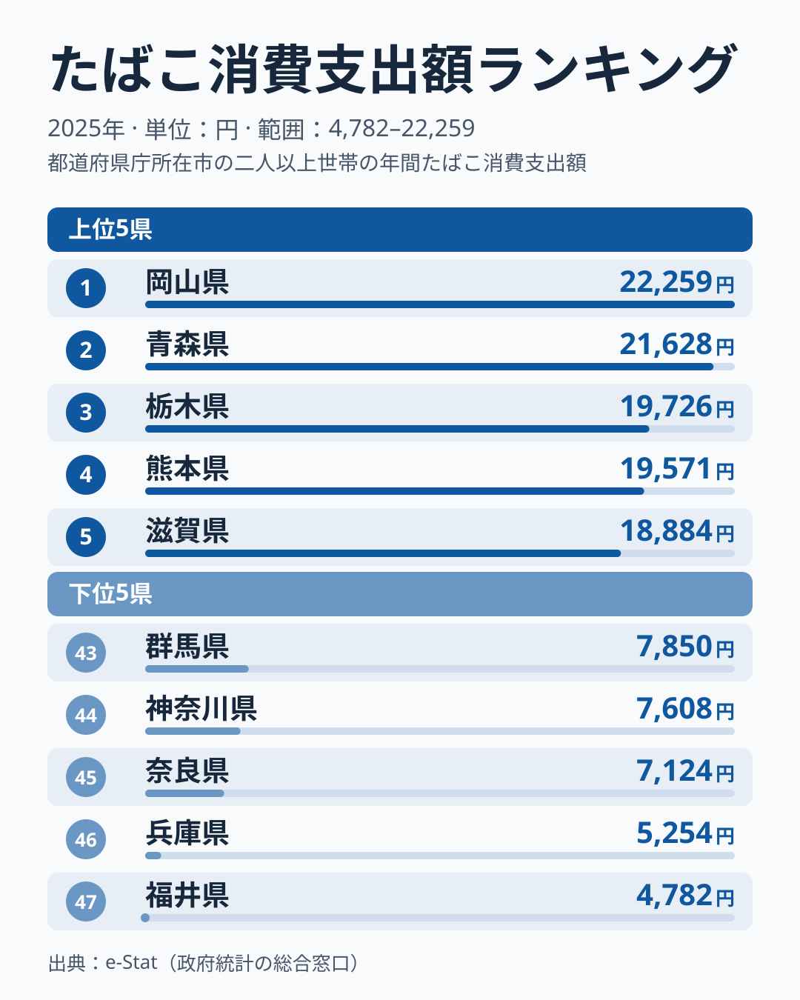

「たばこは全国どこでも同じように吸われている」——そう思っている方は多いかもしれません。しかし総務省の家計調査(都道府県庁所在市・二人以上世帯)を見ると、2025年のたばこ消費支出額は1位岡山県22,259円、最下位福井県4,782円と、4.7倍ほどの開きがあります。

たばこの価格は全国どこでもほぼ同じです。それでも支出額にここまで差が出るのはなぜでしょうか。この記事では、図から読み取れる上位・下位の分布と、順位の入れ替わりに注目して、地域差をどう読むべきかを整理します。

> [!NOTE]
> 本データは総務省「家計調査」(都道府県庁所在市・政令指定都市、二人以上世帯)の1世帯あたり年間支出額で、県全体の値ではありません。単年の順位は標本の影響でぶれやすく、構造を断定できるものではない点に注意してください。

## 上位と下位の顔ぶれ

<source-link href="/ranking/tobacco-consumption-expenditure">たばこ消費支出額ランキングをもっと見る</source-link>

上位は1位[岡山県](/areas/33000)22,259円、2位青森県21,628円、3位栃木県19,726円、4位熊本県19,571円、5位滋賀県18,884円です。注目したいのは、1位と2位の差が631円しかなく、ほぼ並んでいることです。1位から5位までの幅は3,375円で、上位5県はかなり接戦だといえます。

所属する地方を見ると、岡山は中国、青森は北海道・東北、栃木は関東、熊本は九州・沖縄、滋賀は近畿で、5県が5つの異なる地方に分かれています。特定の地方に偏っていないため、「西日本だから」「東日本だから」といった単純な区分では説明しにくいデータです。

下位は47位[福井県](/areas/18000)4,782円、46位兵庫県5,254円、45位奈良県7,124円、44位神奈川県7,608円、43位群馬県7,850円です。43位から47位までの幅は3,068円で、上位5県の幅とほぼ同じ規模です。ただし最下位2県と45位の間には1,870円の差があり、福井と兵庫は下位の中でも特に低い位置にあります。

最下位の福井は中部、兵庫・奈良は近畿、神奈川・群馬は関東と、こちらもまとまった地方には収まりません。[仮説] 外食や娯楽の選択肢が多い都市部では、家計のなかでたばこに回る割合が相対的に小さくなる可能性があります。ただし福井のように都市部とは言いにくい県も最下位にあるため、はっきりした理由は断定できません。

> [!WARNING]
> 支出額は「購入本数×単価」の結果です。価格が全国でほぼ同じでも、銘柄の構成や購入のしかたが違えば、喫煙者の数が同じでも支出額は変わります。支出額の高さをそのまま「喫煙者が多い」と読まないでください。

## 発見: 順位は年によって入れ替わる

今回のランキングは2025年単年です。前年は鳥取県が首位でしたが、2025年は14,420円で16位となり、首位は岡山県に替わりました。また静岡県は前年に最下位でしたが、2025年は12,807円で25位でした。同じ県でも1年で順位が大きく動いており、順位だけで地域の特徴を決めつけるのは危険です。

中位の混み具合にも目を向けてみます。20位宮崎13,488円から25位静岡12,807円までの6県は、1,000円足らずの幅に収まっています。この帯では数百円の違いで順位が数位入れ替わるため、中位の順位差にはほとんど意味がないと考えたほうがよいでしょう。

上位と下位で目立つのは、こうした中位の密集に比べて両端が大きく離れている点です。1位岡山と47位福井の差は17,477円あり、極端な県の値は標本の偏りの影響も受けやすいため、翌年以降も同じ位置にとどまるかを見守る必要があります。

あわせて見る: [ビール消費支出額ランキング](/ranking/beer-consumption-expenditure)

## まとめ

- 1位は岡山県22,259円、最下位は福井県4,782円で4.7倍ほどの差(2025年)
- 上位5県は岡山・青森・栃木・熊本・滋賀で、5つの異なる地方に分かれる。1位と2位の差は631円
- 下位は福井・兵庫・奈良・神奈川・群馬の順で、最下位2県は45位との間に1,870円の差がある
- 前年首位の鳥取は16位、前年最下位の静岡は25位と、順位は年によって大きく動く
- 地域差の理由は [仮説] の域を出ず、県庁所在市の値として読む必要がある

家計の消費支出をめぐる地域差は、たばこ以外の品目でも広く見られます。他の消費支出データは[経済カテゴリ一覧](/category/economy)からたどれます。
