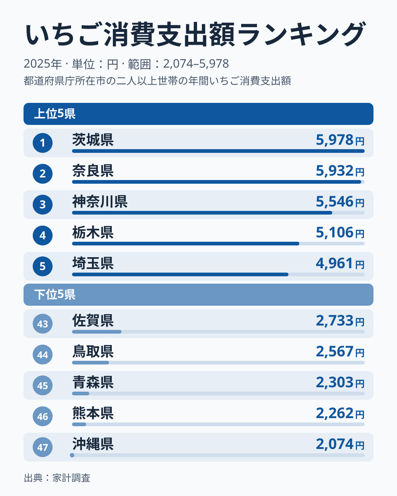
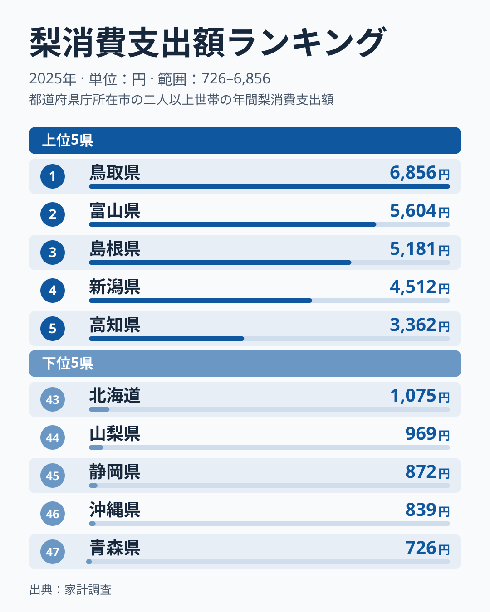
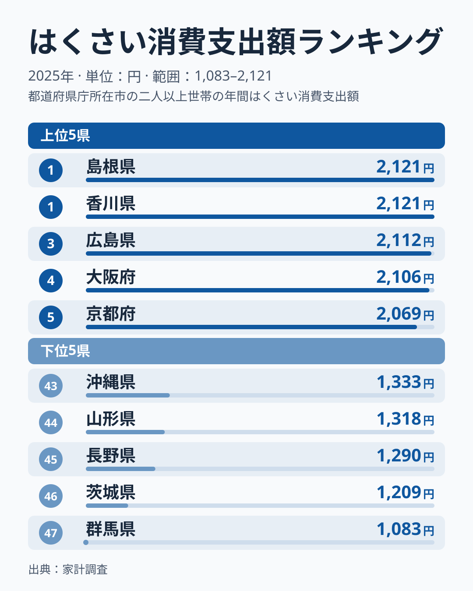
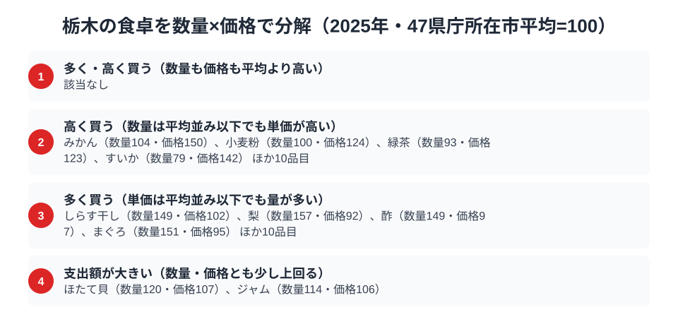

栃木県は「いちご王国」を掲げるだけあって、家計調査でもいちご消費支出額は全国4位に入ります。1位は茨城県、2位は奈良県、3位は神奈川県で、栃木はそれに続く位置です。同じ野菜・果物のカテゴリーでも、はくさい消費支出額は38位と下位に沈みます。同じ栃木の食卓で、なぜここまで差が開くのでしょうか。

家計調査の品目別データから栃木県庁所在市（宇都宮市）の家計を見ると、いちご4位・梨9位と果物2品目で全国上位10位以内に入る一方、葉物野菜のはくさいでは下位に回る、という非対称な姿が浮かび上がります。この記事では、いちご・梨・はくさいの3品目を通じて、栃木の食卓の特徴を探ります。理由まで言い切れるわけではなく、答えられるのは仮説の範囲までです。はくさいについては数量・価格の分解が手元になく、下位の理由はデータでは示せません。

> [!NOTE]
> 本記事の数値は総務省統計局「家計調査（品目別）」に基づく、都道府県庁所在市（栃木県は宇都宮市）の二人以上世帯における2025年の年間消費支出額です。実際の消費量ではなく金額ベースであるため、価格差や購入頻度の違いも反映されます。市別の値は単年のぶれが大きいため、順位は1年分の結果として読んでください。

## いちご — 全国4位5,106円、首位は茨城の5,978円

<source-link href="/ranking/strawberry-consumption-expenditure">いちご消費支出額ランキングをもっと見る</source-link>

栃木県は年間5,106円と、いちご消費支出額で全国4位です。1位は茨城県の5,978円、2位は奈良県の5,932円、3位は神奈川県の5,546円で、栃木県はこの3つに次ぐ位置にあります。最下位の沖縄県は2,074円で、首位の茨城県とは約2.9倍の開きがあります。

栃木は「とちおとめ」「とちあいか」などの主力品種を生み出してきた、いちご生産量日本一の県です。[仮説] 産地であることや、直売所・道の駅でいちごが手頃な価格で並ぶ環境が、地元での消費額を押し上げている可能性があります。ただし2025年は茨城・奈良・神奈川が栃木を上回っており、これが単年のぶれの範囲なのか、構造的な違いなのかは、複数年の推移で確かめる必要があります。

## 梨 — 全国9位3,057円、上位10位以内の果樹王国

<source-link href="/ranking/pear-consumption-expenditure">梨消費支出額ランキングをもっと見る</source-link>

梨は年間3,057円で全国9位です。首位の鳥取県は6,856円、2位の富山県は5,604円、3位の島根県は5,181円、4位は新潟県の4,512円で、栃木県は首位の半分に満たない水準です。最下位の青森県は726円で、首位の鳥取県とは約9.4倍の差があります。

栃木県は「にっこり」という大玉品種で知られる梨の産地です。いちごほどの存在感はありませんが、上位10位以内に入っています。ただし、この順位が高い単価によるものか、買う量の多さによるものかは金額だけでは分かりません。後の節で見るとおり、梨は数量指数157・価格指数92で、単価は平均以下なのに買う量が多く、梨の金額順位は量の多さを反映しているとみられます。

## はくさい — 全国38位1,445円、果物に比べて弱い野菜

<source-link href="/ranking/chinese-cabbage-consumption-expenditure">はくさい消費支出額ランキングをもっと見る</source-link>

はくさいは栃木が全国38位で、年間1,445円です。首位は島根県と香川県で、ともに2,121円と並んでいます。続いて3位は広島県の2,112円、4位は大阪府の2,106円、5位は京都府の2,069円です。最下位は群馬県の1,083円で47位、46位は茨城県の1,209円です。栃木は38位で、隣接する茨城・群馬はそれよりさらに下位にあります。

[仮説] 鍋料理や漬物の文化の地域差が、支出額の違いに影響している可能性があります。栃木ではそうした機会が相対的に少なく、はくさいの支出額を押し下げている可能性もありますが、家計調査の金額だけでは、こうした食文化の違いを直接確かめることはできません。

> [!WARNING]
> この記事の梨は、価格指数92と単価が平均以下なのに、支出額は9位と上位に入っています。つまり金額の順位は、高いものを買っていることではなく、買う量の多さを映している場合があります。逆にみかんのように、数量が平均並みでも単価の高さで支出額が上がる品目もあります。金額の順位だけで「たくさん食べている」と読むのは避けてください。また、この記事で扱う3品目だけで栃木の食文化全体を語ることはできません。

## 栃木の食卓は産地だけで説明できるか

いちご4位・梨9位という果物の強さと、はくさい38位という野菜の弱さ。一見バラバラに見えるこの結果を貫く軸として、[仮説] 「産地であるかどうか」が考えられます。いちご・梨はどちらも栃木が全国有数の生産地で、地元で穫れる作物を地元で消費する構造が支出額に表れている可能性があります。一方のはくさいは栃木が主要な産地として知られる品目ではなく、地元消費を押し上げる要因が働きにくいという読みです。ただし、はくさいの数量・価格の分解は今回の材料にないため、この読みを数字で裏付けることはできません。

この軸だけでは説明しきれない品目もあります。次の節で見るとおり、みかんは数量指数104に対して価格指数が150と、栃木の単価の高さが際立つ品目です。栃木がみかんの主産地として語られることは少なく、産地だけでは食卓の強みを説明できません。

## 数量×価格で分解する宇都宮市の食卓

<source-link href="/ranking/mandarin-consumption-expenditure">みかん消費支出額ランキングをもっと見る</source-link>

栃木県の食べ方の癖を、家計調査の「数量」と「価格」に分けて確かめます。47都道府県庁所在市の平均を100とした指数で見ると、梨は数量指数157・価格指数92で、単価は平均以下なのに買う量が平均を大きく上回る「安く仕入れて量を食べる」型です。まぐろ（数量151・価格95）、酢（数量149・価格97）、しらす干し（数量149・価格102）も同じ傾向で、量の多さが支出額を支えています。

一方、みかん（数量104・価格150）は買う量は平均並みなのに単価が5割ほど高い品目です。小麦粉（数量100・価格124）、緑茶（数量93・価格123）、すいか（数量79・価格142）も、量は平均並み以下なのに単価が2〜4割高い「質で稼ぐ」品目です。[仮説] 贈答や来客用に選ばれやすい品目が並ぶことが単価を押し上げている可能性がありますが、購入目的は家計調査から分からないため、他の年や品種別のデータでの確認が必要です。

数量も価格も平均を大きく上回る品目は、今回の分解では見つかりませんでした。そのなかで、ほたて貝（数量120・価格107）とジャム（数量114・価格106）は、数量・単価ともに平均を少しだけ上回る型で、両方が効いて支出額が大きくなっています。

支出額の順位だけを見ると、「たくさん食べている」のか「高いものを買っている」のかは区別できません。栃木の梨のように数量指数が高く価格指数が低い品目は「量で稼ぐ」強み、みかんや緑茶のように価格指数だけが高い品目は「質で稼ぐ」強みです。ランキング上位の品目を見るときは、この2つを分けて読むと食卓の実力がより正確に分かります。

> [!NOTE]
> ここでの基準は「47都道府県庁所在市の単純平均=100」であり、家計調査で公表される全国平均値とは異なります。価格指数は支出額を数量で割った単価の相対値なので、実際に買っている品種やブランドの違いも含まれており、純粋な物価水準を示すものではありません。対象はいずれも二人以上世帯・宇都宮市の2025年の年間データです。

## まとめ

- いちご消費支出額は栃木県が年間5,106円で全国4位、首位の茨城県は5,978円、最下位の沖縄県は2,074円で首位とは約2.9倍差
- 梨消費支出額は栃木県が年間3,057円で全国9位、首位の鳥取県は6,856円
- はくさい消費支出額は栃木県が年間1,445円で全国38位、首位の島根県と香川県はともに2,121円
- 栃木の食卓は「果物は上位、はくさいは下位」という対照だが、[仮説] 産地であることが効いている可能性がある、という域を出ない。はくさいは数量・価格の分解が示せず、下位の理由はデータでは確かめられない
- 支出額を数量×価格に分解すると、梨は「安く買って量を食べる」型、みかんや緑茶は「質で稼ぐ」型と、稼ぎ方の違いが見える
- 詳しい地域データは[栃木県の地域プロフィール](/areas/09000)、他の家計品目は[経済カテゴリ一覧](/category/economy)で確認できる

> [!TIP]
> 栃木の食卓を読むときは、支出額の順位だけでなく数量×価格の分解が手がかりになります。みかんは数量104・価格150で、買う量は平均並みなのに単価が高く、梨は数量157・価格92で、単価は低いのに量が多いという、正反対の稼ぎ方をしています。ただし、これは2025年の宇都宮市の値であり、理由は他の年や品種別のデータで確かめる必要があります。
