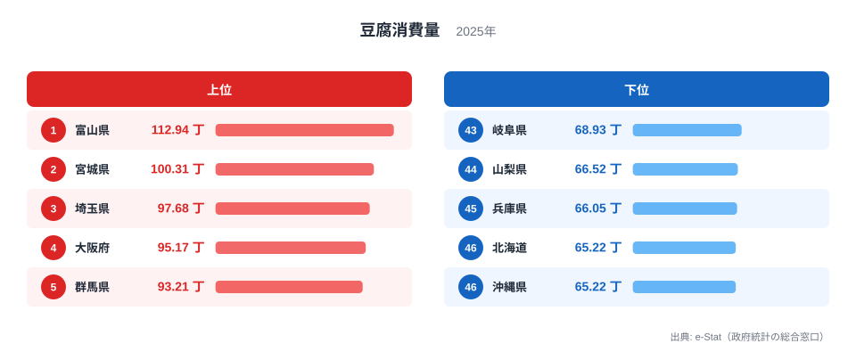

「豆腐といえば京都」「大豆食文化は西日本」——そんなイメージを持つ方は多いでしょう。しかし2025年の家計調査が示す豆腐消費量の地図は、その先入観とは少し違う姿をしています。

豆腐消費量とは、都道府県庁所在市の二人以上世帯が1年間に買う豆腐の数量（丁換算）のことです。2025年にトップに立ったのは**富山県の112.94丁**でした。最下位は沖縄県の65.22丁（北海道も同じ値）で、その差は1.73倍にのぼります。

2024年の首位は宮城県の116.57丁でした（公開ランキングの2024年値）。2025年の宮城県は100.31丁で2位となり、首位が入れ替わっています。上位10県には富山・宮城・埼玉・大阪・群馬・福島・岩手・徳島・石川・栃木が並び、東北と北陸だけでなく関東や関西の県も混じる、1県が突出しない顔ぶれです。この記事では、その分布を順位とともに読み解きます。

> [!NOTE]
> ここでの「豆腐消費量」は家計調査（総務省）の都道府県庁所在市・二人以上世帯における年間購入数量（丁）です。支出額ではなく数量であり、県全体の平均でもなく「県庁所在市の世帯」が対象です。外食や、厚揚げ・がんもなど別品目は含みません。

## 豆腐消費量ランキング TOP10 と最下位

まず2025年の上位と下位の顔ぶれをチャートで確認してみましょう。

<source-link href="/ranking/tofu-consumption-quantity">豆腐消費量ランキングをもっと見る</source-link>

トップは[富山県](https://stats47.jp/areas/16000)で112.94丁、2位が[宮城県](https://stats47.jp/areas/04000)の100.31丁、3位が埼玉県の97.68丁です。4位は大阪府で95.17丁、5位は群馬県で93.21丁、6位は福島県で92.75丁、7位は岩手県で92.56丁と続きます。

1位の富山県は2位の宮城県を12.63丁上回っており、首位だけが少し抜けています。2位から10位まではおおむね91〜100丁の間に収まっています。具体的には8位が徳島県で92.52丁、9位が石川県で91.71丁、10位が栃木県で90.76丁で、7位から10位は1.8丁の範囲に4県がひしめいています。この密度では、単年の順位の細かな上下に大きな意味を読み込むのは危険です。

TOP10のうち東北は宮城・福島・岩手の3県、北陸は富山・石川の2県、北関東は群馬・栃木の2県です。一方で埼玉・大阪・徳島も入っており、特定の地域だけが豆腐を買っているわけではないことがわかります。

> [!TIP]
> 112.94丁は「県庁所在市の二人以上世帯が、年間で100丁を超える豆腐を買っている」ことを意味し、365日を112.94で割ると、おおよそ3日に1丁のペースです。

## 最下位グループ——北海道・沖縄が並び、東海・近畿の一部も下位

下位を見ると、最下位は[沖縄県](https://stats47.jp/areas/47000)の65.22丁で、北海道も同じ65.22丁で並んでいます。その上は、45位が兵庫県で66.05丁、44位が山梨県で66.52丁、43位が岐阜県で68.93丁です。

最下位の沖縄県は65.22丁、1位の富山県は112.94丁で、その差は1.73倍です。同じ日本の中で、県庁所在市の世帯が年間に購入する豆腐の数量が約1.7倍違うというのは、食文化や買い物習慣の地域差として小さくない開きです。

下位には北海道・沖縄という日本の南北両端が並び（同値の65.22丁のため、46位・47位の順位は便宜上のものです）、山梨・岐阜・兵庫のほか、愛媛が42位、茨城が41位と続きます。東北の青森県も40位で72.05丁にとどまり、東北でも県による差が大きいことがわかります。

北海道と沖縄が下位に並ぶ背景としては、豆腐以外の食材や料理（肉料理・魚介・沖縄ならではの食材など）に食卓の重心が置かれている可能性があります。ただし、これは本データだけでは確かめられない[仮説]です。検証には、品目別の購入数量や支出の構成を県別に比べる必要があります。

> [!WARNING]
> 家計調査は標本調査で、県庁所在市の限られた世帯の1年分の購入数量を集計したものです。単年の順位は誤差を含み、上位県は入れ替わりやすいです。2024年は宮城県が116.57丁、佐賀県が57.1丁（最下位）でしたが、2025年の佐賀県は81.04丁で21位です。この変動の大きさは、標本の揺れの影響を無視できないことを示しており、単年の1位を「日本一の豆腐県」と断定するのは避けるべきです。

## 発見1: 「西の豆腐」イメージは数量では裏付けられない

豆腐＝西日本という印象は、おそらく「京都の湯豆腐」「九州の濃い豆腐」といった食文化のブランドイメージに由来しています。しかし2025年の購入数量で見ると、京都府は19位で83.02丁にとどまり、上位10県に西日本から入ったのは大阪府が4位、徳島県が8位の2県だけです。

九州・沖縄を見ても、佐賀県が21位で81.04丁、福岡県が28位で77.42丁、熊本県が33位で74.98丁、沖縄県が最下位と、上位には1県もありません。「西日本＝豆腐をたくさん買う」という一括りの理解は、少なくとも購入数量のデータでは支持されません。

一方で、「東北・日本海側が圧倒的に多い」という見方も2025年のデータでは単純には成り立ちません。東北6県のうち、TOP10に入ったのは宮城が2位、福島が6位、岩手が7位で、山形は14位で85.66丁、秋田は22位で80.06丁、青森は40位で72.05丁でした。新潟県も12位で89.71丁と、2024年の112.35丁（2位）からは大きく下がっています。

[経済・家計カテゴリの統計一覧](https://stats47.jp/category/economy)では、豆腐以外にも食品消費に関する多くの指標が確認できます。納豆・味噌など大豆加工食品全体の地域差と合わせて見ると、豆腐の分布がより立体的に把握できるでしょう。

> [!NOTE]
> 「ブランドとしての豆腐」と「数量としての豆腐」は別物です。湯豆腐や郷土料理として有名でも、世帯が日常的に買う丁数が多いとは限りません。逆に豆腐文化が語られない県でも、味噌汁の具や煮物など日常使いで購入数量が積み上がることがあります。

## 発見2: 首位交代と、上位が一極に偏らない理由

2024年の宮城県116.57丁から、2025年は富山県112.94丁へと首位が入れ替わりました。宮城県自体も116.57丁から100.31丁へ、約16丁減っています。ここから「宮城で豆腐離れが進んだ」「富山で急に増えた」と読むのは早計です。

**[仮説] 標本の揺れが大きい**：県庁所在市の限られた世帯を対象とする調査なので、単年の数量は世帯の入れ替わりの影響を受けます。2024年と2025年で佐賀県が57.1丁から81.04丁へ動いていることは、この仮説でも説明できますが、世帯構成の変化など別の要因でも起こりうるため、裏付けとまでは言えません。検証には、複数年の平均で順位が安定するかを確認する必要があります。検証期日は2026年の家計調査の公表後とし、2024〜2026年の3年平均で首位と最下位が変わるかを見ます。

**[仮説] 豆腐が地域を問わず日常食である**：上位10県が東北・北陸・北関東・近畿・四国にまたがり、2位から10位までが91〜100丁の範囲に集まっていることは、豆腐が特定地域の名物というより全国で広く買われる品目であることを示唆します。検証には、豆腐の購入頻度や世帯人員別の集計など、別の切り口のデータが要ります。

構造面で本データから確かめられるのは次の点です。上位側では、2024年に2位だった新潟県が2025年は12位へ下がり、2024年に4位で99.83丁だった富山県が首位に上がっています。上位の顔ぶれが年ごとに入れ替わる以上、「富山は豆腐の産地や食習慣が根付いているから多い」「北海道・沖縄は別の食材が中心だから少ない」といった地理や産業構造の説明は、この1指標だけでは裏付けられません。世帯人員の構成や豆腐の流通、外食の比率は本データに含まれないため、追うには家計調査の世帯人員別集計や他の食品の購入数量との比較が別に必要です。

いずれも現時点では仮説であり、本データ単独で因果は断定できません。確かに言えるのは、2025年の単年の数量では富山県が首位で、1.73倍の開きが北海道・沖縄という南北の両端と北陸の富山の間に現れている、という点までです。

## まとめ

- 2025年の豆腐消費量（年間購入数量）1位は**富山県の112.94丁**。2024年に首位だった宮城県は100.31丁で2位でした。
- 最下位は**沖縄県の65.22丁**（北海道も同値）で、1位との差は**1.73倍**です。
- 上位10県は富山・宮城・埼玉・大阪・群馬・福島・岩手・徳島・石川・栃木で、東北・北陸・北関東・近畿・四国にまたがります。
- 「豆腐は西日本」という通説は購入数量では裏付けられず、京都府は19位、九州・沖縄は上位に入りませんでした。
- 標本調査のため単年の順位は動きやすく、1位の入れ替わりを食文化の変化と断定せず、複数年で見直すのが安全です。
