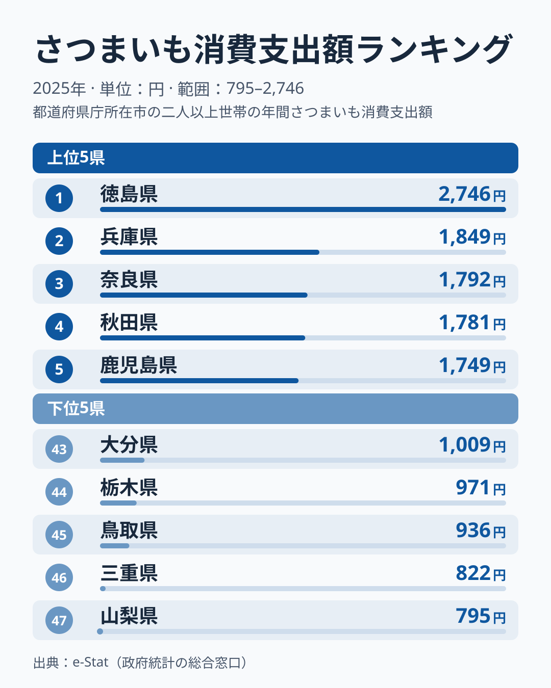
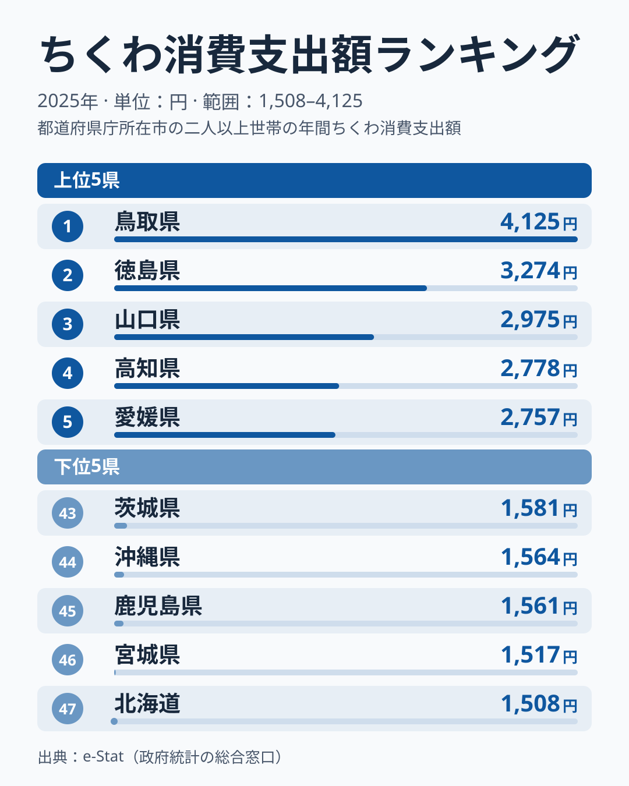
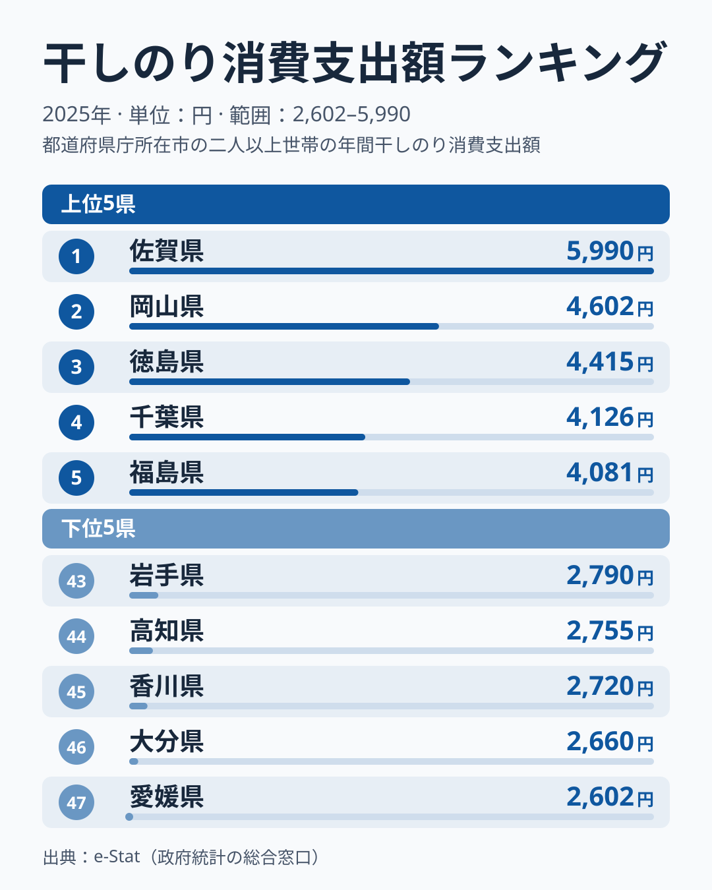
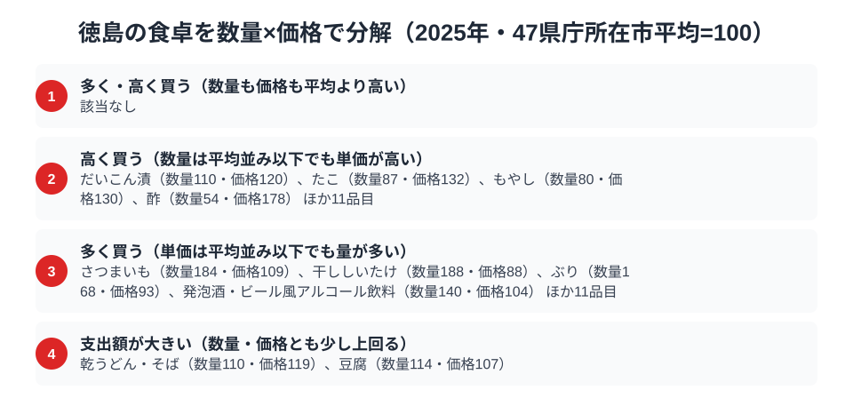

四国の東に位置する徳島県は、鳴門海峡の渦潮で知られますが、食卓にも特色があります。総務省の家計調査（品目別）の2025年で徳島市の二人以上世帯を見ると、さつまいもは支出額で全国1位です。一方、ちくわは2位、のりは3位でした。ちくわの首位は鳥取、のりの首位は佐賀です。

この記事で取り上げる3品目のうち、徳島が全国1位なのはさつまいもです。ちくわとのりは首位を他県に譲りましたが、3品目とも全国の上位3位以内に入っています。題の「日本一はさつまいもだけ?」には、この3品目の範囲では「はい」と答えられます。ただし、家計調査にはほかにも多くの品目があり、他の品目の順位までは本記事のデータで確認していません。そこで後半では、数量×価格で徳島市の食卓を分解し、徳島がどんな買い方をしているのかを読み解きます。

> [!NOTE]
> 家計調査の都道府県データは、県庁所在市（徳島県は徳島市）の二人以上世帯を対象にした年間支出額です。県全体ではなく徳島市在住世帯の家計簿から見た傾向であり、支出「金額」であって消費「量」そのものではない点にご注意ください。市別の値は単年のぶれが大きいため、1年の順位だけで食文化の優劣は判断できません。

## さつまいも — 全国1位2,746円、2位は兵庫県1,849円

<source-link href="/ranking/sweet-potato-consumption-expenditure">さつまいも消費支出額ランキングをもっと見る</source-link>

徳島県のさつまいも消費支出額は2,746円で全国1位です。2位の兵庫県は1,849円、3位は奈良県1,792円、4位は秋田県1,781円、5位は鹿児島県1,749円と、2位以下は僅差で並んでいます。上位5県を見ると近畿の兵庫県・奈良県、東北の秋田県、九州・沖縄の鹿児島県、そして四国の徳島県と、地域は散らばっています。2位以下が僅差で並ぶなかで徳島だけが抜け出しており、この記事の3品目のうち日本一となったのはさつまいもだけです。

徳島といえば「鳴門金時」。鳴門海峡沿いの砂地で育つ鳴門金時は、ほくほくとした食感と上品な甘さで知られる、徳島を代表する特産品です。焼き芋や天ぷら、大学芋など多彩な食べ方で親しまれており、産地であることが消費の多さにつながっている可能性があります。[仮説] 産地と消費地が重なる県で家計の支出額が大きくなる、という見立てです。ただし産地の別の県である鹿児島県が5位にとどまることを踏まえると、地元の産物を日常的に食べる食習慣の強さのほうが効いているのかもしれず、検証には産地別の購入量などの別データが必要です。[さつまいも消費支出の記事](/blog/sweet-potato-expenditure-ranking)も合わせて読むと、さつまいも消費の地域差の全体像が分かります。

## ちくわ — 2位3,274円、首位は鳥取県4,125円

<source-link href="/ranking/chikuwa-consumption-expenditure">ちくわ消費支出額ランキングをもっと見る</source-link>

ちくわの消費支出額で徳島県は3,274円の2位でした。1位は鳥取県の4,125円です。3位は山口県2,975円、4位は高知県2,778円、5位は愛媛県2,757円で、上位5県は鳥取県と山口県の中国地方、徳島県・高知県・愛媛県の四国で占められています。上位が中国・四国に偏っている点が、このランキングの大きな特徴です。

首位は譲りましたが、徳島は魚のすり身を使った練り物文化が盛んな土地で、「徳島ちくわ」「竹ちくわ」といった郷土色豊かなちくわが受け継がれています。竹に巻いて焼く「竹ちくわ」は、徳島の海岸部で生まれた素朴な郷土食で、そのまま食べたり煮物に入れたりと日常的に食卓に登場します。

上位を中国地方と四国の県が占めている点は、1県の事情というより地域に広がる練り物文化の存在を示しているようにも読めます。[仮説] 新鮮な魚が手に入る立地と、それを練り物として保存・加工する食文化がこの地域に共通している、という見立てです。検証するには、練り物の産地・消費地を市町村別に比べる別のデータが要ります。

## のり — 3位4,415円、首位は佐賀県5,990円

<source-link href="/ranking/dried-nori-consumption-expenditure">のり消費支出額ランキングをもっと見る</source-link>

海の幸をもう一つ。のり（干しのり）の消費支出額で徳島県は4,415円の3位でした。1位は佐賀県の5,990円、2位は岡山県の4,602円です。4位は千葉県4,126円、5位は福島県4,081円で、3位の徳島と4位の千葉の差は289円しかなく、3位と4位は僅差です。上位5県は九州・沖縄の佐賀県、中国の岡山県、四国の徳島県、関東の千葉県、東北の福島県と、ちくわとは対照的に地域がばらけています。

同じ四国でも、最下位の愛媛県は2,602円、香川県は45位の2,720円、高知県は44位の2,755円と、のりの支出額は四国のなかでも大きく割れています。そのため、「四国だから海苔を多く食べる」とは言えません。徳島では、おにぎりや手巻き、佃煮など、海苔を使った食習慣が根づいているのかもしれません。[仮説] 海に面した立地と、海産物を日常的に取り入れる食習慣が、消費を後押ししている、という見立てです。ただし単年の市別データなので、来年以降も上位にとどまるかを見てから判断するのが安全です。

> [!WARNING]
> のりは1枚あたりの単価や品質の差が支出額に出やすい品目です。金額の順位だけでは「多く食べている」のか「高いものを選んでいる」のか区別できないため、次節の数量指数・価格指数で確認します。

## 徳島の食卓を貫くもの

3品目の順位を並べると、さつまいもは1位、ちくわは2位、のりは3位と、そろって全国の上位3位以内です。上位に共通するのは、地元の産物を保存・加工した形で日常的に食べる点かもしれません。[仮説] 砂地の鳴門金時、海の魚から作るちくわ、海の幸であるのりと、鳴門という地理的条件が、大地の作物と海の幸の両方に影響している可能性がある、という見立てです。ただし産地の鹿児島県はさつまいもで5位にとどまっており、産地であることだけでは説明しきれません。1年分の順位は入れ替わりやすいことから、文化の違いというより年ごとのぶれも含んでいる点は割り引いて読む必要があります。

ちくわの首位は鳥取県で4,125円と、徳島の3,274円を上回っており、練り物消費の厚みは徳島だけのものではありません。同じ「上位に並ぶ」でも、徳島は「さつまいもという大地の作物で突き抜ける型」、鳥取は「練り物で突き抜ける型」と、食卓の骨格が異なります。鳥取県はのりでは26位の3,177円、さつまいもでは45位の936円でした。県ごとの地理と食文化が、家計の数字にくっきり表れるのが県民の食卓比較の面白さです。

> [!TIP]
> 徳島の数量指数・価格指数を見ると、さつまいもは数量184・価格109、干ししいたけは数量188・価格88、酢は数量54・価格178と、品目によって「量」と「単価」の効き方が大きく異なります。支出額の順位だけでなく、この2つの指数をセットで見ることが、徳島市の食卓を読むコツです。

## 数量×価格で分解する徳島市の食卓

<source-link href="/ranking/dried-shiitake-consumption-expenditure">干ししいたけ消費支出額ランキングをもっと見る</source-link>

ここまでさつまいも・ちくわ・のりという3つの品目を、それぞれ個別に読み解いてきました。ですがこれらはいずれも「支出額」という金額のランキングです。支出額は「数量×単価」の掛け算で決まるため、同じ上位でも実際には「たくさん買っているから金額が大きいのか」「単価の高いものを選んでいるから金額が大きいのか」という背景の違いがありえます。そこで家計調査で数量と支出額の両方が公表されている品目について、47都道府県庁所在市の平均をそれぞれ100とした数量指数・価格指数を作り、徳島市の家計を品目単位で分解してみます。

図では、徳島市の品目を4つの型に整理しています。数量も価格も平均より高い「多く・高く買う」型は、2025年は該当なしでした。冒頭で見たさつまいもは、数量指数184・価格指数109です。価格も100を上回りますが、数量の突出が際立っており、図では「多く買う（単価は平均並み以下でも量が多い）」の型に分類されています。つまり徳島市はさつまいもを、単価の高さよりも買う量の多さで支えているといえます。題の「日本一はさつまいもだけ?」に重ねると、3品目の範囲では日本一はさつまいもだけですが、数量の面では他の品目にも「量で食べる」傾向が広がっています。

「多く買う」型には、干ししいたけ（数量指数188・価格指数88）、ぶり（数量指数168・価格指数93）、発泡酒・ビール風アルコール飲料（数量指数140・価格指数104）が並びます。図では、さつまいもなどを含めてこの区分に合計15品目が挙げられています。[仮説] 保存のきく乾物や加工品を日常的に買い置きする習慣が、量の多さに結びついている可能性があります。ちくわ・のりが加工品として上位に入っていたことと、方向が重なる見立てです。

「高く買う」型は、数量が平均並み以下でも単価が高い品目です。酢は数量指数54・価格指数178、たこは数量指数87・価格指数132、もやしは数量指数80・価格指数130で、量は少なめでも単価が高い品目でした。だいこん漬は数量指数110・価格指数120です。図ではこの区分に、挙げた品目を含めて合計15品目が示されています。

もう一つ、「支出額が大きい（数量・価格とも少し上回る）」型として、乾うどん・そば（数量指数110・価格指数119）と豆腐（数量指数114・価格指数107）が挙がっています。量も単価も少しずつ平均を上回ることで、支出額が大きくなる品目です。徳島市の食卓は「量を確保する」品目と「単価の高いものを選ぶ」品目を使い分けており、この使い分けが、支出額という一つの数字だけでは見えない徳島市の食卓の奥行きだといえます。

> [!NOTE]
> ここでの数量指数・価格指数は、家計調査（品目別、都道府県庁所在市、二人以上世帯）の2025年の年間値をもとに47都道府県庁所在市の平均をそれぞれ100とした相対値です。家計調査の全国計とは別の基準であり、価格指数は「支出額÷数量」から逆算した単価の比較なので、品種やブランドの違いによる価格差も含んでいます。

読み方のコツとして、だいこん漬や乾うどん・そばのように、数量は平均を1割ほど上回る程度でも、価格指数が120前後になる品目があることを覚えておくと便利です。数量指数と価格指数をセットで見ると、その県が「量で食べる」のか「単価の高いものを選んでいる」のかという、金額だけでは分からない消費の癖が見えてきます。

## まとめ

- さつまいも消費支出額は徳島県が全国1位（2,746円）、2位は兵庫県の1,849円
- ちくわは徳島県が2位（3,274円）、首位は鳥取県の4,125円
- のりは徳島県が3位（4,415円）、首位は佐賀県の5,990円
- 数量×価格で見ると、さつまいも・干ししいたけ・ぶりなど「量で食べる」品目が目立つ

徳島県の他の統計は[徳島県の地域プロフィール](/areas/36000)、食品・家計消費の地域差は[経済カテゴリ一覧](/category/economy)からご覧いただけます。
